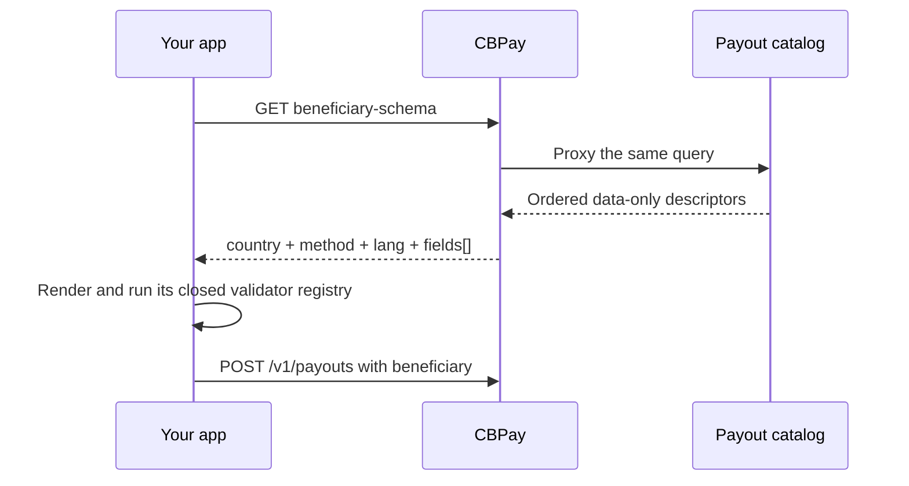

> **Environments:** Test `https://cryptobank.qbank.cl/platform` (`pk_test_...`) - Live `https://api.qbank.cl/platform` (`pk_...`).

## What this endpoint does

`GET /v1/payouts/beneficiary-schema` returns the data-only descriptors needed
to render the `beneficiary` object for one payout corridor. Use it before
`POST /v1/payouts` instead of hardcoding country-specific form tables.
The response is ordered for rendering and contains localized labels,
placeholders, hints, errors, conditional rules and the names of the closed
client-side validators.

The endpoint is a read-only catalog. It does not validate or create a payout,
does not execute validator code, and does not expose the identity of any
processing provider.

## Request

```bash
curl "https://api.qbank.cl/platform/v1/payouts/beneficiary-schema?country=CL&method=fintoc&lang=en" \
  -H "Authorization: Bearer <token>"
```

`country` is an ISO alpha-2 destination country and `method` is the payout
rail method. `lang` accepts `en`, `es` or `zh` and defaults to `en`.
For the global `swift` and `sepa` methods, any requested country resolves
through the `*:swift` or `*:sepa` wildcard; the response echoes the requested
country.



## Response

```json
{
  "country": "CL",
  "method": "fintoc",
  "lang": "en",
  "fields": [
    {
      "key": "name",
      "label": "Beneficiary name",
      "placeholder": "Pedro Soto Fuentes",
      "kind": "text"
    },
    {
      "key": "tax_id",
      "label": "RUT",
      "placeholder": "12.345.678-5",
      "hint": "The check digit is validated",
      "kind": "text",
      "validator": "chilean_rut",
      "error": "Invalid RUT: check the verification digit"
    },
    {
      "key": "bank_code",
      "label": "Bank",
      "kind": "bank"
    },
    {
      "key": "account_type",
      "label": "Account type",
      "kind": "select",
      "options": [
        { "value": "checking", "label": "Checking account" },
        { "value": "vista", "label": "Sight account" }
      ]
    },
    {
      "key": "account_number",
      "label": "Account number",
      "kind": "text",
      "hint": "Digits only",
      "validator": "cl_account_number",
      "error": "Invalid account number: digits only (max 20)"
    }
  ]
}
```

### Field descriptor contract

Every field includes `key`, `label` and `kind`. `kind` is one of `text`,
`phone`, `bank`, `select`, `geoCountry`, `geoState` or `geoCity`.
`fields` order is significant.

| Property | Meaning |
|---|---|
| `placeholder`, `hint`, `error` | Localized display strings. |
| `options` | Closed values for a `select`; use `value` in the payout and display `label`. |
| `show_if`, `required_if` | Show or require the field when `{key, equals}` matches the current form. |
| `required_when_country_has_subdivisions` | Require a state when the selected country has catalogued subdivisions. |
| `default_value`, `fixed_value` | Initial value or immutable value supplied by the schema. |
| `validator` | A simple closed validator name run on a non-empty value. |
| `validator_with_values` | A closed cross-field validator receiving the field and current form values. |
| `validate_fn_when` | Condition under which the format validator runs. |
| `optional` | The field is not required; a supplied value is still validated. |
| `wide`, `collapsible`, `collapsible_group` | Rendering hints only. |
| `default_from_corridor_country` | Pre-fill a country field from `country`, but keep it editable. |
| `country_key`, `state_key` | Source fields for `geoState` and `geoCity` cascades. |

The backend sends validator names only. Each frontend must implement the
closed registry, and must treat an unknown name as a safe validation error.
Do not evaluate code received from the API.

## Supported corridors

The catalog contains 20 exact country/method corridors plus global
`*:swift` and `*:sepa` fallbacks. Availability is still controlled by the
methods catalog, so call `GET /v1/payouts/methods` when building the selector.
The schema endpoint returns `404 payout_corridor_unsupported` when no schema
exists for the requested pair.

The existing [payout corridors guide](https://docs.cbpayapp.com/en/guides/payout-corridors) explains
the business fields and complete payout examples. This page explains how to
render those fields dynamically.

## Errors and safe retry behavior

| HTTP | Code | What to do |
|---:|---|---|
| 400 | `invalid_payload` | Supply both `country` and `method`; do not guess a method. |
| 400 | `invalid_language` | Use exactly `en`, `es` or `zh`, or omit `lang` for English. |
| 404 | `payout_corridor_unsupported` | Refresh the methods catalog and stop rendering that corridor. |
| 401/403 | Authentication or scope error | Use the account-scoped token required by the platform. |

This is a read-only request and has no idempotency key. If a network failure
leaves the result unknown, retry the read. Never retry `POST /v1/payouts`
with a new key to recover from an uncertain money operation; use the original
idempotency key and reconcile its status.

## FAQ

#### Does the response contain executable validation code?
No. `validator` and `validator_with_values` are names from a closed set. The
frontend owns the implementation and must not execute strings as code.
#### Should I use the schema instead of the methods catalog?
No. The methods catalog says which corridors are enabled. This endpoint says
which beneficiary fields to render after the user chooses one.
#### Are fields without optional or conditional flags required?
Yes. A field without `optional`, `required_if` or another conditional
exception is required by the curated corridor schema. The payout endpoint
remains the final authority and can reject an invalid submission.
#### Can I cache the response?
You may cache it briefly by `country`, `method` and `lang`, but refresh it
when the methods catalog changes and handle `404` or validation errors
without creating a payout.
#### Why does the platform response match the core response?
CBPay platform proxies this static catalog unchanged. Integrators should use
the platform URL and do not need to know which internal service supplied it.
