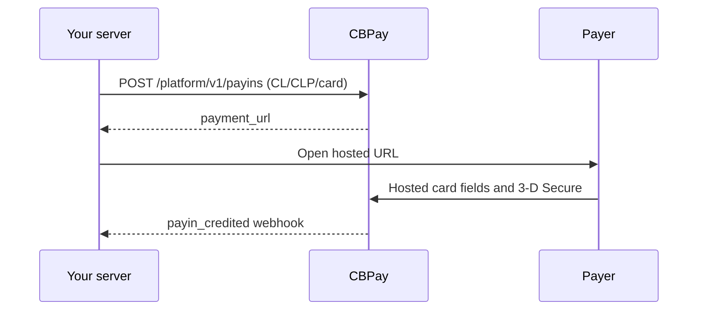

> **Environments:** Test `https://cryptobank.qbank.cl/platform` (`pk_test_...`) - Live `https://api.qbank.cl/platform` (`pk_...`).

Use this corridor when a payer in Chile needs to pay by card in CLP. Your
server creates the payin; CBPay returns a hosted `payment_url`. Open it in a
popup or redirect. Card data stays in the hosted fields and 3-D Secure runs
inside the checkout modal when the issuer requests it.



## Create the payin

```bash
curl -X POST https://api.qbank.cl/platform/v1/payins \
  -H "Authorization: Bearer <token>" \
  -H "Idempotency-Key: cl-card-order-8841" \
  -H "Content-Type: application/json" \
  -d '{"country":"CL","currency":"CLP","method":"card","amount":"150000","description":"Order 8841","idempotency_key":"cl-card-order-8841"}'
```

```json
{
  "payin_id": "7a2b…",
  "status": "pending",
  "country": "CL",
  "currency": "CLP",
  "method": "card",
  "amount": "150000",
  "payment_url": "https://api.qbank.cl/pay/cards/9f3XkT…"
}
```

`idempotency_key` is mandatory in the body or `Idempotency-Key` header.
CLP is an integer currency: `"150000.50"` returns 422 `core_rejected`.
Replaying the same key returns the original payin with
`idempotency_hit: true`; never create a second key after an ambiguous result.

## Hosted checkout and stored cards

Open `payment_url` in a popup. The checkout shows the waiting modal only for
`CL/CLP/card`, validates the integer CLP amount before submit, and reports
availability with a status indicator. Saving a card requires both the
integrator's offer and the payer's consent. Later one-click and merchant-
initiated charges use the server-side stored-card endpoint; the PAN is never
sent to your server.

The universal checkout quotes `CL/CLP/card` when the catalog reports it as
available. Always read `GET /platform/v1/payins/methods` before showing the
option.

### Payer document (optional)

For card payins, `customer` is sent to the core as `bill_to`. You may provide
`document_type` and `document_number` for fraud scoring. The document is
optional: omitting both fields is valid. For `CL`, `document_type` defaults to
`RUT` when a number is present and `document_number` must be a valid Chilean
RUT (modulo 11, with or without punctuation). An invalid RUT is rejected
before the charge claim with `400 invalid_payload`. Other countries accept
plain text up to 50 characters; markup and longer values are rejected.

```json
{
  "customer": {
    "first_name": "Ana",
    "last_name": "Rojas",
    "email": "payer@example.com",
    "country": "CL",
    "document_type": "RUT",
    "document_number": "11.111.111-1"
  },
  "save_card": true
}
```

### Knowing whether the card was saved

When `save_card: true` was offered and the payer consented, an approved
`complete` response includes `card_saved`. `true` means the credential was
stored and can be used through the stored-card flow. `false` means the sale
was approved but the card was not stored; show a clear message and do not
charge the payer again. The field is omitted when saving was not offered or
requested.

## Issuer installments

For Chilean CLP card payins, the hosted checkout can offer issuer-financed
installments. The payer first tokenizes the new card; only when the token
reports deferred payment options does the page display the curated choices
`3`, `6`, `12`, `24`, `36`, and `48`, limited to the issuer's reported maximum.
The payer then confirms the selected term and the checkout sends it in the
public session completion request:

```json
{
  "payment_token": "tok_…",
  "months": 6
}
```

`months` is an integer. Omit it, or send `0` or `1`, for a single payment.
Values from `2` through `48` request issuer installments. The value is
validated before the payment claim, so `-2` or `99` returns
`400 invalid_payload` without consuming an attempt.

Installments are supported only for a new front-tokenized card in the Chile
issuer-installment flow. They are not supported for stored-card
merchant-initiated charges (MIT), and the Commerce Installments beta is not
part of this contract. Real verification rails reject an installment request;
the front-token Kushki rail and the simulator are the supported paths.
Never submit a second charge after an ambiguous result.

An approved response includes the approved term as a receipt field, and the
same value is retained in the charge audit payload:

```json
{
  "status": "paid",
  "transaction_id": "710000000000123",
  "months": 6
}
```

| HTTP | Code | Solution |
|---:|---|---|
| 400 | `invalid_payload` | Send an integer from `0` to `48`; use `0`, `1`, or omit it for a single payment. |
| 200 | `failed_attempt` | If a stored card was selected with installments, use a new card; the failure is reattemptable. |
| 200 | `review` | If a real verification rail has money in flight, read the session and reconcile; never blind-retry. |

> **Important**
UF card payins are temporarily disabled in production while the corridor approval is pending. The UF contract and examples below are retained for reference and will return when the corridor is approved. Current requests are rejected with `409 corridor_disabled` or `422 core_rejected`; use `CLP` for production card payins.
## UF card payins

The Chile card corridor is designed to accept `currency: "UF"`. Send the amount as a
decimal string with up to two decimal places:

```bash
curl -X POST https://api.qbank.cl/platform/v1/payins \
  -H "Authorization: Bearer <token>" \
  -H "Idempotency-Key: cl-uf-card-order-8842" \
  -H "Content-Type: application/json" \
  -d '{"country":"CL","currency":"UF","method":"card","amount":"1.50","description":"Order 8842","idempotency_key":"cl-uf-card-order-8842"}'
```

When enabled, the response keeps `currency: "UF"` and `amount: "1.50"` in the payin and
receipt. The card rail charges the UF amount natively and converts it to CLP
internally; `1 UF` is approximately `41,274 CLP` and the exact value depends
on the applicable UF rate. UF amounts can be combined with issuer
installments: include the same `months` field described above in the
front-token `complete` request. The approved term is returned in the receipt.

UF accepts at most two fractional digits. `"1.50"` is valid, while `"1.501"`
returns 422 `core_rejected` ("amount has too many decimals for this currency")
before the payment claim. CLP remains an integer
currency, so `"150000.50"` returns the same honest
pre-claim rejection. As with every payin, read the resource after an
ambiguous result and do not submit a second charge.

For the current conversion context, read:

```bash
curl https://api.qbank.cl/v1/rates/usd/local \
  -H "Authorization: Bearer <token>"
```

The response includes the `uf` key from the OXR `CLF` ISO source. Settlement
converts UF to USDT at the applicable spot rate; the displayed UF rate is
not a promise of a fixed settlement price.

When the corridor returns, an approved UF webhook will preserve `currency: "UF"` and the UF amount:

```json
{
  "event": "payin_credited",
  "payin_id": "7a2b…",
  "country": "CL",
  "currency": "UF",
  "amount": "1.50",
  "status": "credited"
}
```

## Pre-authorized payins (holds)

With `capture_method: "manual"` the hosted checkout authorizes (holds) instead
of charging. You capture (charge in full) or void (release, no money moves)
later from your integration or the admin panel:

```bash
curl -X POST https://api.qbank.cl/platform/v1/payins \
  -H "Authorization: Bearer <token>" \
  -H "Content-Type: application/json" \
  -d '{"country":"CL","currency":"CLP","method":"card","amount":"10000","capture_method":"manual","description":"Order 8843","idempotency_key":"cl-manual-order-8843"}'
```

The payin stays `pending` with `capture_method: "manual"` while the hold is
open. The issuer releases un-captured holds automatically (7 days debit, 28
days credit); the payin then closes as expired and you are notified.

```bash
# Capture the full authorized amount.
curl -X POST https://api.qbank.cl/platform/v1/payins/7a2b…/captures \
  -H "Authorization: Bearer <token>" \
  -H "Content-Type: application/json" \
  -d '{"idempotency_key":"cap-order-8843"}'
# Or release the hold without moving money.
curl -X POST https://api.qbank.cl/platform/v1/payins/7a2b…/voids \
  -H "Authorization: Bearer <token>" \
  -H "Content-Type: application/json" \
  -d '{"idempotency_key":"void-order-8843"}'
# History (paginated).
curl "https://api.qbank.cl/platform/v1/payins/7a2b…/captures?page_size=50" \
  -H "Authorization: Bearer <token>"
```

Rules: v1 captures the total only (`partial_capture_unsupported` otherwise);
manual requires an interactive payment (stored cards charge immediately) and
cannot combine with installments. A `201` means done (`verdict: completed`,
capture credits through the normal flow); a `202` means ambiguous — retry
with the SAME key, never a new one. No OTP is required (a capture credits
your account, a void moves nothing). Concurrent capture+void is
single-flighted: one wins, the other gets a `409`.

## Read, void, and refund
```bash
curl https://api.qbank.cl/platform/v1/payins/7a2b… \
  -H "Authorization: Bearer <token>"
curl "https://api.qbank.cl/platform/v1/payins?from=2026-11-01&to=2026-11-30&country=CL&currency=CLP&method=card&page=1&page_size=50" \
  -H "Authorization: Bearer <token>"
```

An authorized card payment can be voided before settlement. A refund is
semi-automatic: creation may return `pending`, and a signed notification
closes it. Both operations require idempotency and never retry an ambiguous
dispatch automatically.

| Status | Meaning |
|---|---|
| `pending` | Hosted payment is waiting for the payer |
| `credited` | Payment was confirmed and credited |
| `failed` | The payment was clearly rejected |
| `refunded` | The refund was confirmed |
| `review` | Reconciliation is required; do not submit another charge |

## Errors

| HTTP | Code | Solution |
|---:|---|---|
| 400 | `invalid_amount` | Send a positive decimal amount (non-numeric or negative values are rejected before dispatch) |
| 400 | `idempotency_key_required` | Send the body field or header |
| 409 | `idempotency_conflict` | Use the original payload with the original key |
| 409 | `already_captured` / `hold_released` / `hold_expired` | The hold already closed: read its captures/voids instead of retrying with a new key |
| 422 | `core_rejected` | Show the hosted failure and do not blind-retry — this includes decimal violations (CLP must be integer, UF at most two decimals) |
| 422 | `payin_not_capturable` / `preauth_not_supported` | Only pending manual card payins can be captured or voided |
| 422 | `partial_capture_unsupported` | v1 captures the full authorized amount only |
| 202 | `action_pending` | The capture/void is reconciling; retry with the same key |
| 503 | `core_unavailable` | Read the payin and retry only with the same key |

## Webhooks

Verify the signature before processing. Relevant events are
`payin_credited`, `payin_refunded`, `dispute`, and `card_stored`.

```json
{
  "event": "payin_credited",
  "payin_id": "7a2b…",
  "country": "CL",
  "currency": "CLP",
  "amount": "150000",
  "status": "credited"
}
```

## FAQ

#### Can I send decimal CLP or UF?
CLP must be an integer. UF accepts up to two decimal places, for example
`"1.50"`; three or more decimal places return 422 `core_rejected`.
#### What if the create request times out?
Read the resource or repeat the request with the same idempotency key. Do
not submit a new charge.
#### When is a refund final?
A refund can remain `pending` until the signed notification confirms it.
#### How long does a hold last?
7 days on debit cards, 28 on credit (issuer policy). Capture or void before
then; expired holds close automatically with a notification.
#### Can I capture half now and half later?
Not in v1: capture takes the full authorized amount. Partial capture is a
documented future phase.
#### Can I combine a hold with installments or a stored card?
No: pre-authorization requires a new card paid in full on the hosted page.
Stored cards charge immediately and installments settle at once.
