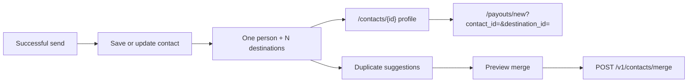

> **Environments:** Test `https://cryptobank.qbank.cl/platform` (`pk_test_...`) - Live `https://api.qbank.cl/platform` (`pk_...`).

A contact represents one person, not one destination. Each person can have many reusable destinations: a linked CBPay account, payout beneficiaries by corridor, and crypto addresses by chain. Contacts are created automatically by successful sends and can also be created or imported explicitly.



## Unified agenda

The platform groups automatic saves by normalized display name when a send has no phone, email or linked account to identify the person. Normalization folds case, accents and repeated spaces. If more than one possible contact remains, the platform does not guess: the send continues with its existing destination behavior and the user can choose from the agenda later.

A contact can contain:

- a linked CBPay destination;
- one or more payout destinations, each with country, currency and method;
- one or more crypto destinations, each with chain and address.

The contact book is private to the account. Destination data is scoped to the owner and is never exposed across accounts.

## Manage contacts in the portal

The portal's `/contacts` screen has a toolbar with search, source, CBPay-only, favorites, destination type, country and sort filters. It shows the server-side total and lets the user page through results. Search also matches destination data when the list is expanded, including labels, payout corridor fields and crypto chain/address text.

Each row opens `/contacts/{id}`. The profile has a toolbar with back navigation, edit and delete actions, favorite state, a destination count and grouped destination cards. From a card the user can rename its label, delete it, or use the contextual **Send** action. A destination send opens `/payouts/new?contact_id=<contact_id>&destination_id=<destination_id>` so the wizard can use that exact saved destination.

The profile's merge action opens a preview UI. It shows the contacts, destinations and the selected survivor before submitting; it never merges merely because a suggestion exists.

## List and filter contacts

Use `expand=destinations` when the client needs destinations in the same list response. This is a bulk expansion, not one request per contact. `dest_type` and `dest_country` require that expansion. The supported filters are `q`, `source`, `has_destinations`, `sort`, `has_cbpay`, `favorite`, `page` and `page_size`; `total` is returned with the page.

```bash
curl "https://api.qbank.cl/platform/v1/contacts?q=carlos&source=import&has_destinations=true&sort=recent&expand=destinations&dest_type=payout&dest_country=CL&page=1&page_size=50" \\
  -H "Authorization: Bearer <token>"
```

```json
{
  "page": 1,
  "page_size": 50,
  "total": 1,
  "contacts": [{
    "contact_id": "3f8a1b2c-4d5e-6f70-8a9b-0c1d2e3f4a5b",
    "display_name": "Carlos Soto",
    "has_cbpay": true,
    "destinations": [{
      "destination_id": "bb22c3d4-5e6f-7a80-9b0c-1d2e3f4a5b6c",
      "type": "payout",
      "country": "CL",
      "currency": "CLP",
      "method": "bank_transfer",
      "label": "Cuenta principal"
    }]
  }]
}
```

Invalid boolean, sort, source or destination filters fail closed with `400 invalid_filter`. Unknown expansion values return `400 invalid_expand`.

## Create, read and update a contact

Automatic saving is preferred for send flows, but an integrator can create a contact directly:

```bash
curl -X POST https://api.qbank.cl/platform/v1/contacts \\
  -H "Authorization: Bearer <token>" \\
  -H "Content-Type: application/json" \\
  -d '{"display_name":"Carlos Soto","phone":"+56987654321","favorite":true}'
```

```json
{
  "contact_id": "3f8a1b2c-4d5e-6f70-8a9b-0c1d2e3f4a5b",
  "display_name": "Carlos Soto",
  "phone": "+56987654321",
  "has_cbpay": true,
  "source": "manual",
  "favorite": true,
  "destinations": [],
  "created_at": "2026-11-13T12:00:00Z",
  "updated_at": "2026-11-13T12:00:00Z"
}
```

Read the complete profile, including destinations, with `GET /v1/contacts/{contact_id}`. Update only the fields that changed with `PATCH /v1/contacts/{contact_id}`:

```bash
curl -X PATCH https://api.qbank.cl/platform/v1/contacts/3f8a1b2c-4d5e-6f70-8a9b-0c1d2e3f4a5b \\
  -H "Authorization: Bearer <token>" -H "Content-Type: application/json" \\
  -d '{"display_name":"Carlos Soto","alias":"Carlitos","favorite":true}'
```

The response is the updated complete contact. A changed phone re-runs the CBPay match. `DELETE /v1/contacts/{contact_id}` deletes the contact and its saved destinations.

## Add and label destinations

Add a payout, crypto or linked CBPay destination with `POST /v1/contacts/{contact_id}/destinations`. Destinations are deduplicated by their fingerprint.

```bash
curl -X PATCH https://api.qbank.cl/platform/v1/contacts/3f8a1b2c-4d5e-6f70-8a9b-0c1d2e3f4a5b/destinations/bb22c3d4-5e6f-7a80-9b0c-1d2e3f4a5b6c \\
  -H "Authorization: Bearer <token>" -H "Content-Type: application/json" \\
  -d '{"label":"Cuenta principal"}'
```

```json
{
  "destination_id": "bb22c3d4-5e6f-7a80-9b0c-1d2e3f4a5b6c",
  "type": "payout",
  "country": "CL",
  "currency": "CLP",
  "method": "bank_transfer",
  "label": "Cuenta principal",
  "last_used_at": "2026-11-13T12:05:00Z"
}
```

Use `DELETE /v1/contacts/{contact_id}/destinations/{destination_id}` to remove one destination without removing the person.

## Find duplicates and preview a merge

Suggestions are read-only and grouped by folded name. They are candidates, not an automatic merge:

```bash
curl https://api.qbank.cl/platform/v1/contacts/duplicates \\
  -H "Authorization: Bearer <token>"
```

```json
{
  "groups": [{
    "name": "juan perez",
    "contact_ids": ["3f8a1b2c-4d5e-6f70-8a9b-0c1d2e3f4a5b", "9c1d2e3f-4a5b-6c7d-8e9f-0a1b2c3d4e5f"],
    "display_names": ["Juan Pérez", "JUAN PEREZ"],
    "contacts_count": 2,
    "destinations_count": 3
  }]
}
```

The portal loads the full contact profiles and shows a preview. To confirm, send two to twenty distinct IDs and choose the survivor when needed:

```bash
curl -X POST https://api.qbank.cl/platform/v1/contacts/merge \\
  -H "Authorization: Bearer <token>" -H "Content-Type: application/json" \\
  -d '{"contact_ids":["3f8a1b2c-4d5e-6f70-8a9b-0c1d2e3f4a5b","9c1d2e3f-4a5b-6c7d-8e9f-0a1b2c3d4e5f"],"surviving_contact_id":"3f8a1b2c-4d5e-6f70-8a9b-0c1d2e3f4a5b"}'
```

The `200` response is the surviving complete contact and includes `merged_contact_ids`. Destinations move to the survivor in one transaction; a foreign or missing ID returns `404` and performs no partial merge.

> **Important**
`POST /v1/contacts/merge` is not idempotent. After a successful merge, source contacts are deleted, so blindly retrying the same request returns `404`. Do not resend it after an ambiguous timeout; query the contact and duplicate suggestions, then let the client decide whether a new operation is needed.
## Errors and states

| HTTP | Error | What it means | What to do |
|---|---|---|---|
| 400 | `invalid_filter` / `invalid_expand` | A filter or expansion is unsupported | Use the documented values and require `expand=destinations` for destination filters |
| 400 | `batch_too_large` | More than 20 contacts were sent to merge | Split the user-reviewed operation |
| 404 | `not_found` | The contact or destination is absent or belongs to another account | Re-fetch the profile; never guess another ID |
| 409 | `duplicate` | A phone or email would collide with another contact | Edit the existing contact or review duplicates |

Contact mutations are synchronous: a successful `200` or `201` is final, while `4xx` is rejected and made no partial change. There are no contact webhooks; money movement created from a contact keeps the normal payout, transfer or withdrawal status and idempotency rules of that operation.

## FAQ

#### Does one person need one contact even with several bank accounts?Yes. Keep one contact and attach one payout destination per country, currency and method as needed.#### Why did two people with the same name not merge automatically?Duplicate suggestions are deliberately conservative. If more than one candidate is possible, the platform does not infer identity; use the preview and select the survivor yourself.#### Can I retry a merge after a timeout?No blind retry. The merge is not idempotent. Read the contact and duplicate suggestions first; after success the source IDs no longer exist.#### How do I send from the profile?Select a destination's Send action. The portal opens `/payouts/new?contact_id=...&destination_id=...` and the wizard uses that destination context.#### Can another account read my destinations?No. Contact and destination reads and writes are scoped to the authenticated account.#### What happens if a destination is removed?Only that destination is deleted. The contact and its other destinations remain available.
