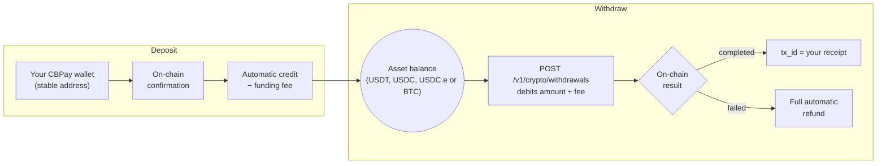

> **Environments:** Test `https://cryptobank.qbank.cl/platform` (`pk_test_...`) - Live `https://api.qbank.cl/platform` (`pk_...`).

Your crypto balances are connected to the blockchain. Supported
combinations:

| Network | Asset | Balance credited |
|---|---|---|
| `tron` | `usdt` | USDT |
| `eth` | `usdt` | USDT |
| `eth` | `usdc` | USDC |
| `polygon` | `usdt` | USDT |
| `polygon` | `usdc` | USDC |
| `polygon` | `usdce` | **USDC.e** (bridged USDC) |
| `btc` | `btc` | BTC |

Every deposit credits the **balance of its own asset** (a USDC wallet
credits your USDC balance; a Polygon USDT or USDC wallet credits the
corresponding balance; a Polygon USDC.e wallet credits your **USDC.e**
balance; the Bitcoin wallet credits your BTC balance).
`GOLD` is the only balance with no on-chain rail: it moves only via
internal transfers and operator credits.



## Your account is born with its wallets

Every account — person and company — is created with **one deposit wallet
per supported combination** (`tron`/`usdt`, `eth`/`usdt`, `eth`/`usdc`,
`polygon`/`usdt`, `polygon`/`usdc`, `polygon`/`usdce` and `btc`/`btc`),
**free of charge** and automatically: as soon as you register, your seven
addresses are ready to receive funds.

```bash
# Right after creating the account, your addresses already exist:
curl https://api.qbank.cl/platform/v1/crypto/wallets \
  -H "Authorization: Bearer <token>"
```

```json
{
  "page": 1,
  "page_size": 50,
  "wallets": [
    { "wallet_id": "9d68…", "chain": "tron", "asset": "USDT", "address": "TXMD…", "label": "", "type": "deposit", "receive_only": true, "created_at": "2026-07-11T23:33:20Z" },
    { "wallet_id": "a83d…", "chain": "eth", "asset": "USDT", "address": "0xefe0…", "label": "", "type": "deposit", "receive_only": true, "created_at": "2026-07-11T23:33:20Z" },
    { "wallet_id": "fb88…", "chain": "eth", "asset": "USDC", "address": "0xa072…", "label": "", "type": "deposit", "receive_only": true, "created_at": "2026-07-11T23:33:20Z" },
    { "wallet_id": "c1d4…", "chain": "btc", "asset": "BTC", "address": "bc1qf66…", "label": "", "type": "deposit", "receive_only": true, "created_at": "2026-07-11T23:33:20Z" }
  ]
}
```

> **Note**
Provisioning runs in the background when the account is created: if you
query at the very second of registration an address may still be missing —
retry a few seconds later.
Deposit wallets are **entry doors**, not operating wallets: they only
**receive** crypto that credits your virtual balance. They cannot send
funds, and cannot be exported or imported (that is what
[segregated wallets](https://docs.cbpayapp.com/en/guides/segregated-wallets) are for).

> **Note**
Two products, two routes: deposit wallets live under `/v1/crypto/wallets`
and segregated wallets under `/v1/segregated-wallets`. Every wallet
response carries a `type` discriminator (`deposit` / `segregated`) so you
can always tell them apart.
| Account type | Deposit wallets per network+asset pair |
|---|---|
| Person | **1** (the birth wallets already take the slot) |
| Company | **1** (the birth wallets already take the slot) |

## Can I create more deposit wallets?

No. Every account — person and company — holds exactly **one deposit
wallet per network+asset pair**, and all of them are born with the account.
`POST /v1/crypto/wallets` exists only to restore a missing pair (an
exceptional case): with the seven wallets already provisioned it responds
`422 wallet_limit_reached`.

### Polygon USDT, USDC and USDC.e

Polygon supports three separate six-decimal balances. `polygon:usdt` uses
the USDT PoS contract
`0xc2132D05D31c914a87C6611C10748AEb04B58e8F`; `polygon:usdc` uses native
USDC at `0x3c499c542cEF5E3811e1192ce70d8cC03d5c3359`; and `polygon:usdce`
uses the bridged USDC contract documented below. Never send one token to
another token's address flow.

Deposits are detected quickly but credited after **128 Polygon
confirmations** (approximately 4–5 minutes) to account for Bor reorgs.
Withdrawals use the normal asynchronous status lifecycle and reconcile by
`tx_id` (the reconciliation query is exact); Polygon gas is paid in POL and is not a customer
ledger balance.

```bash
curl https://api.qbank.cl/platform/v1/crypto/wallets \
  -H "Authorization: Bearer <token>"
```

The response includes one receive-only wallet for each Polygon pair. Use
`chain: "polygon"` with `asset: "usdt"`, `"usdc"` or `"usdce"` when creating
or restoring a missing wallet. Polygon USDT/USDC/USDC.e balances remain
separate in balances, movements, history and withdrawals.

### Polygon USDC.e

USDC.e is the bridged USDC token on Polygon and is a separate asset from
Polygon USDC. Use `chain: "polygon"` and `asset: "usdce"` for its wallet,
deposit and withdrawal operations. The bridged contract is
`0x2791Bca1f2de4661ED88A30C99A7a9449Aa84174`; amounts use six decimals and
are credited to the **USDC.e** balance, never to USDC.

Polygon USDC.e is available for wallets, deposits, withdrawals, transfers,
segregated balances, history and balance views. It is not available in swaps,
cards, checkout/QR PoS or OTC in v1. Automatic conversions into USDC.e that
cannot complete remain `pending_retry`; read the existing operation instead
of creating a replacement.

```bash
curl -X POST https://api.qbank.cl/platform/v1/crypto/wallets \
  -H "Authorization: Bearer <token>" \
  -H "Content-Type: application/json" \
  -d '{ "chain": "eth", "asset": "usdc" }'
```

With the pair already provisioned — `422`:

```json
{
  "error": "wallet_limit_reached",
  "message": "accounts hold one deposit wallet per network/asset pair (created automatically with the account); use segregated wallets for additional wallets"
}
```

- Birth wallets are **always free**; the `wallet_creation` fee would only
  apply to a manual restoration (with a fee of 0, the default, it is free;
  if creation fails, the charge is refunded automatically).
- Need **several wallets** with their own balance (per client, per
  project, per business unit)? That is the
  [segregated wallets](https://docs.cbpayapp.com/en/guides/segregated-wallets) product: companies
  have no limit, persons hold 1 per network+asset pair.

## View my wallets

```bash
curl https://api.qbank.cl/platform/v1/crypto/wallets \
  -H "Authorization: Bearer <token>"
```

```json
{
  "wallets": [
    {
      "wallet_id": "b7e3…",
      "chain": "tron",
      "asset": "USDT",
      "address": "TQmZ…",
      "label": "",
      "type": "deposit",
      "receive_only": true,
      "created_at": "2026-07-07T12:00:00Z"
    },
    {
      "wallet_id": "a1c9…",
      "chain": "eth",
      "asset": "USDT",
      "address": "0x8f3B…",
      "label": "",
      "type": "deposit",
      "receive_only": true,
      "created_at": "2026-07-07T12:00:00Z"
    },
    {
      "wallet_id": "fb88…",
      "chain": "eth",
      "asset": "USDC",
      "address": "0xa072…",
      "label": "",
      "type": "deposit",
      "receive_only": true,
      "created_at": "2026-07-07T12:00:00Z"
    },
    {
      "wallet_id": "c1d4…",
      "chain": "btc",
      "asset": "BTC",
      "address": "bc1qf66…",
      "label": "",
      "type": "deposit",
      "receive_only": true,
      "created_at": "2026-07-07T12:00:00Z"
    }
  ]
}
```

> **Note**
Bitcoin addresses are **native bech32** (`bc1q…`): any modern wallet or
exchange can send funds to them. BTC amounts use 8 decimals
(`"0.00050000"`).
## Deposit

Send the wallet's asset to its address, **over the correct network**. When
the deposit confirms on-chain, that asset's balance is credited
automatically (net of the `funding` fee if CBPay configured one) and the
`crypto_deposit_credited` webhook fires:

```json
{
  "account_id": "…",
  "chain": "tron",
  "asset": "USDT",
  "tx_id": "b1946ac9…",
  "amount": "499.000000",
  "fee": "1.000000"
}
```

> **Important**
Send **only the wallet's asset over its network** (USDT to a USDT wallet,
USDC to a USDC wallet, USDC.e to a USDC.e wallet, BTC to the Bitcoin wallet).
Polygon USDT and USDC are separate token contracts. Addresses are yours and
stable: you can reuse them for every deposit.
### Confirmation times

| Network | Detection | Credit (network confirmation) |
|---|---|---|
| TRON | Near-instant | **~1 minute** (19 confirmations) |
| Ethereum | Near-instant | **A few minutes** depending on congestion |
| Polygon | Near-instant | **~4–5 minutes** (128 confirmations for Bor reorg safety) |
| Bitcoin | At the first block (~10 min) | **~30 minutes** (3 confirmations) |

The credit always arrives with the webhook and the `tx_id` so you can
verify it on the network explorer.

## Transfer (on-chain withdrawals)

Send USDT, USDC, USDC.e or BTC from its balance to any external address
(`asset` is optional only where the pair has a default; for Polygon always
send the explicit `asset`):

```bash USDT over TRON
curl -X POST https://api.qbank.cl/platform/v1/crypto/withdrawals \
  -H "Authorization: Bearer <token>" \
  -H "Content-Type: application/json" \
  -d '{
    "chain": "tron",
    "to_address": "TVJ6…",
    "amount": "100.000000",
    "idempotency_key": "withdrawal-2026-07-07-b"
  }'
```

```bash USDC over Ethereum
curl -X POST https://api.qbank.cl/platform/v1/crypto/withdrawals \
  -H "Authorization: Bearer <token>" \
  -H "Content-Type: application/json" \
  -d '{
    "chain": "eth",
    "asset": "USDC",
    "to_address": "0x8f3B…",
    "amount": "50.000000",
    "idempotency_key": "withdrawal-usdc-2026-07-09-a"
  }'
```

```bash USDC over Polygon
curl -X POST https://api.qbank.cl/platform/v1/crypto/withdrawals \
  -H "Authorization: Bearer <token>" \
  -H "Content-Type: application/json" \
  -d '{
    "chain": "polygon",
    "asset": "usdc",
    "to_address": "0x8f3B…",
    "amount": "50.000000",
    "idempotency_key": "withdrawal-polygon-usdc-2026-11-06-a"
  }'
```

```bash BTC over Bitcoin
curl -X POST https://api.qbank.cl/platform/v1/crypto/withdrawals \
  -H "Authorization: Bearer <token>" \
  -H "Content-Type: application/json" \
  -d '{
    "chain": "btc",
    "to_address": "bc1qw508d6qejxtdg4y5r3zarvary0c5xw7kv8f3t4",
    "amount": "0.00050000",
    "idempotency_key": "withdrawal-btc-2026-07-15-a"
  }'
```

> **Note**
On Bitcoin the destination can be a bech32 (`bc1q…`), taproot (`bc1p…`) or
legacy (`1…` / `3…`) address. The Bitcoin **network fee** is covered by
the operation itself — you receive the final status via webhook like any
other withdrawal.
Response `202` — `amount + fee` is debited and the transaction broadcasts:

```json
{
  "withdrawal_id": "5e8c…",
  "chain": "tron",
  "asset": "USDT",
  "to_address": "TVJ6…",
  "amount": "100.000000",
  "fee": "1.000000",
  "total_debit": "101.000000",
  "status": "processing",
  "tx_id": "…"
}
```

> **Note**
Every withdrawal saves the address as a [contact](https://docs.cbpayapp.com/en/guides/contacts)
automatically — name it with `"contact_name"` in the body, or disable it
with `"save_contact": false`. To repeat a send, use `"to_contact_id"`
instead of `to_address` (the contact's saved address for that `chain` is
used).
The final state arrives via the `crypto_withdrawal_status_changed` webhook:
**`completed`** (the `tx_id` is your receipt) or **`failed`** (the full
debit is refunded).

You can also query the withdrawal at any time:

```bash
curl https://api.qbank.cl/platform/v1/crypto/withdrawals/5e8c… \
  -H "Authorization: Bearer <token>"
```

```json
{
  "withdrawal_id": "5e8c…",
  "chain": "tron",
  "asset": "USDT",
  "to_address": "TVJ6…",
  "amount": "100.000000",
  "fee": "1.000000",
  "total_debit": "101.000000",
  "status": "completed",
  "status_code": "confirmed",
  "status_message": "confirmed on-chain",
  "tx_id": "7d1f…"
}
```

> **Note**
To move balance to **another CBPay account**, skip the blockchain:
[internal transfers](https://docs.cbpayapp.com/en/guides/transfers) are instant and free.
### Withdrawal detail and final summary

After creating a withdrawal, the portal opens
`/crypto/withdrawals/{withdrawal_id}` and loads
`GET /v1/crypto/withdrawals/{withdrawal_id}`. The detail page is the final
summary for that operation. It shows the current status, asset and amount,
fee and total debit, destination address, network, transaction ID when one
exists, and the receipt/tracking actions when `receipt_url` is available.
The network label is rendered from the chain (`TRON`, `Ethereum`, `Polygon`
or `Bitcoin`), and the transaction ID opens the corresponding explorer link.

The page refreshes while the status is `pending` or `processing` and stops
refreshing in a final state. A completed withdrawal includes its `tx_id`;
failed withdrawals show the final status and the automatic refund described
above. A 400, 403 or 404 is treated as a definitive lookup error rather than
being retried indefinitely.

```json
{
  "withdrawal_id": "5e8c…",
  "chain": "tron",
  "asset": "USDT",
  "to_address": "TVJ6…",
  "amount": "100.000000",
  "fee": "1.000000",
  "total_debit": "101.000000",
  "status": "completed",
  "tx_id": "7d1f…",
  "receipt_url": "https://business.cbpayapp.com/t/example"
}
```

The receipt download and tracking link are available from the detail header
when the response provides `receipt_url`. Use the back link to return to the
wallet for the matching chain and asset.

### Travel Rule (withdrawals above the threshold)

International regulation (FATF R.16, the "Travel Rule") requires on-chain
withdrawals **from 1,000 USD** to declare who receives the funds before
moving the money. Below the threshold nothing changes. There are two
paths:

#### Own wallet (self-hosted)

If the destination is a wallet owned by the account holder (not an
exchange), declare `wallet_type` and the beneficiary name:

```bash
curl -X POST https://api.qbank.cl/platform/v1/crypto/withdrawals \
  -H "Authorization: Bearer <token>" \
  -H "Content-Type: application/json" \
  -d '{
    "chain": "tron",
    "to_address": "TVJ6…",
    "amount": "1500.000000",
    "wallet_type": "self_hosted",
    "beneficiary_name": "Maria Perez",
    "idempotency_key": "withdrawal-2026-07-12-a"
  }'
```

The response includes `"travel_rule_status": "self_hosted_attested"`.

#### Another institution (travel address)

If the destination is an account at another compatible institution, ask
the beneficiary for their **travel address** (a code starting with `ta…`)
and send it along with their name — the payment address is provided by
the receiving institution, so `to_address` can be omitted:

```bash
curl -X POST https://api.qbank.cl/platform/v1/crypto/withdrawals \
  -H "Authorization: Bearer <token>" \
  -H "Content-Type: application/json" \
  -d '{
    "chain": "tron",
    "amount": "1500.000000",
    "travel_address": "ta2AQSjBotWQf38c8sxYYK2Kfis…",
    "beneficiary_name": "Maria Perez",
    "idempotency_key": "withdrawal-2026-07-12-b"
  }'
```

The exchange with the receiving institution happens inline. If it
approves, the withdrawal goes to the address it provided and the response
includes `"travel_rule_status": "approved"`. If the institution rejects
(`travel_rule_rejected`) or has not resolved yet (`travel_rule_pending`),
the withdrawal is not executed and nothing is debited — retry later with
the **same** `idempotency_key`.

| Error | What it means | What to do |
|---|---|---|
| `travel_rule_required` | Withdrawal above the threshold without beneficiary data | Add `travel_address` or `wallet_type: "self_hosted"` + `beneficiary_name` |
| `travel_rule_beneficiary_required` | `beneficiary_name` is missing | Send the destination holder's name |
| `travel_rule_address_mismatch` | Your `to_address` does not match the address approved by the receiving institution | Omit `to_address` or use the address from the approved exchange |
| `travel_rule_rejected` | The receiving institution rejected the transfer | Verify the beneficiary data with the recipient |
| `travel_rule_pending` | The receiving institution has not resolved yet | Retry later with the same `idempotency_key` |
| `travel_rule_unavailable` | Exchange temporarily unavailable | Retry with the same `idempotency_key` |

## Movements

```bash
# On-chain activity: deposits + withdrawals, with tx_id and date filters
curl "https://api.qbank.cl/platform/v1/crypto/transactions?from=2026-07-01&to=2026-07-08" \
  -H "Authorization: Bearer <token>"
```

```json
{
  "page": 1,
  "page_size": 50,
  "deposits": [
    {
      "chain": "tron",
      "asset": "USDT",
      "tx_id": "b1946ac9…",
      "from_address": "TX9a…",
      "amount": "499.000000",
      "reference": "dep_8813…",
      "created_at": "2026-07-07T12:10:00Z"
    }
  ],
  "withdrawals": [
    {
      "withdrawal_id": "5e8c…",
      "chain": "tron",
      "asset": "USDT",
      "to_address": "TVJ6…",
      "amount": "100.000000",
      "fee": "1.000000",
      "total_debit": "101.000000",
      "status": "completed",
      "tx_id": "7d1f…",
      "created_at": "2026-07-07T15:00:00Z"
    }
  ]
}
```

```bash
# Current balance (available + held)
curl https://api.qbank.cl/platform/v1/balances \
  -H "Authorization: Bearer <token>"

# Full accounting history (funding, withdrawals, wallet fees…)
curl "https://api.qbank.cl/platform/v1/movements?type=funding&from=2026-07-01&to=2026-07-08" \
  -H "Authorization: Bearer <token>"
```

Every deposit credits the **balance of its wallet's asset** (USDT, USDC,
USDC.e or BTC); wallets are entry points, each asset has a single balance.

## Errors

| HTTP | `error` | Cause |
|---|---|---|
| 400 | `invalid_chain` | Unsupported network (use `tron`, `eth`, `polygon` or `btc`) |
| 400 | `invalid_asset` | Network/asset pair without an on-chain rail (supported: `tron`/`usdt`, `eth`/`usdt`, `eth`/`usdc`, `polygon`/`usdt`, `polygon`/`usdc`, `polygon`/`usdce`, `btc`/`btc` — `GOLD` does not operate on-chain) |
| 400 | `to_address_required` | Missing withdrawal destination address |
| 402 | `insufficient_funds` | Not enough balance in that asset (for the withdrawal or the creation fee) |
| 422 | `wallet_limit_reached` | The account already holds its deposit wallet for that network+asset pair (applies to persons and companies) |
| 422 | (withdrawal with `status: failed`) | Rejected at broadcast; debit refunded |
| 503 | `withdrawals_unavailable` | Withdrawals not enabled for this corridor yet |
## FAQ

#### Do I need to create deposit wallets?
No. Every account is born with its deposit wallets for all supported pairs
(`tron:usdt`, `eth:usdt`, `eth:usdc`, `polygon:usdt`, `polygon:usdc`,
`polygon:usdce`, `btc:btc`), free of charge. The
create endpoint only self-heals a missing pair — a second wallet for the
same pair answers `wallet_limit_reached` (422).
#### When is a deposit credited to my balance?
Detection is near real-time (`pending`); the credit happens once the
network reaches the required confirmations for that chain. Track it with
`GET /v1/crypto/transactions` or the `crypto_deposit` webhooks.
#### What happens if my withdrawal fails?
The debited amount (including the fee) is refunded to your balance
automatically. Retry with the **same** `idempotency_key` — the platform
never re-broadcasts on its own.
#### Why is my withdrawal asking for beneficiary data?
Withdrawals above your organization's Travel Rule USD threshold require
`wallet_type: self_hosted` plus `beneficiary_name`, or a `travel_address`
(the `travel_rule_*` 422 errors guide you field by field).
#### Can I withdraw GOLD on-chain?
No — GOLD is a ledger-only balance without an on-chain rail. Convert it
with [Swaps](https://docs.cbpayapp.com/en/guides/swaps) to a withdrawable asset first.
#### Why was my withdrawal blocked with compliance_hold?
The withdrawal was held for review and was **not** processed: no funds moved
and your `idempotency_key` was not consumed. The portal shows a copyable
reference line with UTC time, error code and short request ID. Include it when
you contact support; the exact compliance reason is not disclosed.
Money-out limit errors are listed in the public error reference.
