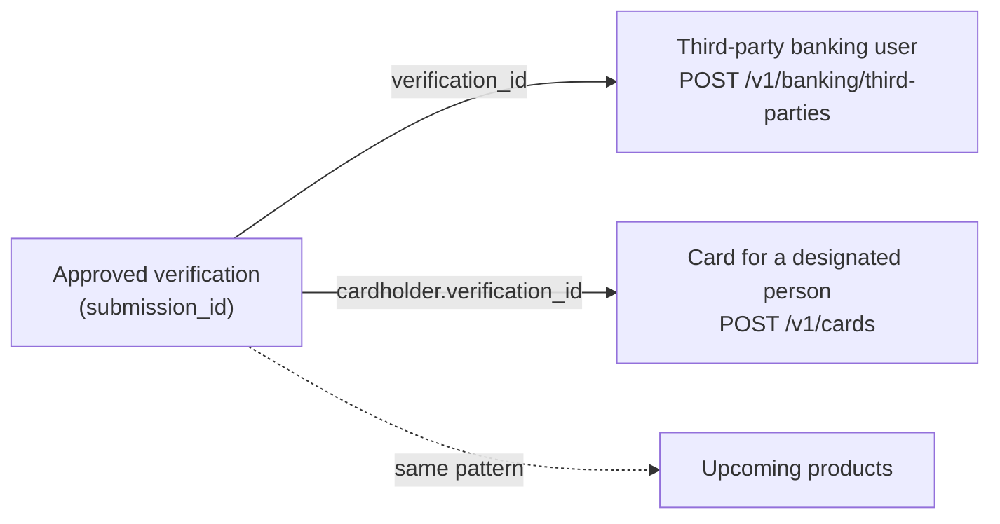

> **Environments:** Test `https://cryptobank.qbank.cl/platform` (`pk_test_...`) - Live `https://api.qbank.cl/platform` (`pk_...`).

## One verification for everything (reusable identity)

A customer's approved verification is their **single identity** inside
CBPay: you never re-type their data or re-upload their documents in any
other product.



- **Third-party banking**: `POST /v1/banking/third-parties` requires the
  `verification_id` of an **approved** verification of the third party.
  The type (`INDIVIDUAL`/`COMPANY`) comes from the kind (KYC ⇒ person,
  KYB ⇒ company), the data (name, email, address) auto-fills from the
  verified profile, and the already-validated documents are re-delivered
  automatically to the banking provider (`documents_synced` in the
  response). Details in
  [Banking](https://docs.cbpayapp.com/en/guides/banking#third-party-banking-users-companies-only).
- **Cards for designated persons**: `POST /v1/cards` with a person
  `cardholder` requires `cardholder.verification_id` of that person's
  **approved KYC**. The cardholder's identity and documents come from the
  verification; you only add the issuer-specific fields (`occupation`,
  `salary_usd`). Details in [Cards](https://docs.cbpayapp.com/en/guides/cards).
- **Your own account**: your approved onboarding is reused too — when
  creating your banking customer or your first card, missing data and
  documents auto-fill from your verification.

Explicit fields in your request **always win** over the autofill.

> **Important**
Without an approved verification of the third party, the banking
registration and designated card issuance answer
`422 verification_required`. Verify first (hosted links or API data) and
use the approved `submission_id` as `verification_id`.
## Compliance report (KYB only)

For every KYB verification you can download the **signed compliance
report** (PDF, evidence for your own auditors):

```bash
curl -o report.pdf https://api.qbank.cl/platform/v1/kyb/submissions/{submission_id}/report \
  -H "Authorization: Bearer <token>"
```

It is free (the service was billed when the verification was created).

## Verification report (PDF + JSON)

Besides the processor's report, every decided KYC or KYB submission has its
**verification report** generated by the platform. It is the full file, not a
summary: verified identity (person or company), declared economic profile,
risk attestations, masked bank account, decision lifecycle, documents with
their document validation, liveness check, **related parties with their own
screening** (KYB) and the AML/CFT screening with the detail of every match — all
with an integrity hash and a public verification code. Two formats
(`?format=pdf|json`, default `pdf`) and three languages (`?lang=en|es|zh`,
default `en`). It is free: it is a read of a verification you already paid
for.

Report sections:

| Section | Contents |
|---|---|
| Subject | Verified identity: person (document, nationality, tax residence, occupation) or company (registration, incorporation, jurisdiction, ISIC industry, website) |
| Economic profile | Source of funds, purpose of the relationship, expected volumes and revenue, expected chains |
| Attestations | Declared risk answers (money services, third-party funds, high-risk activities, prohibited countries) |
| Bank account | Bank, holder and account number **masked at the source** (never in full) |
| Documents | Category, file, status, validation outcome, score, validation timestamp and rejection reason. The PDF adds **identity document photos** when the provider supplies them (if none, the section is omitted) |
| Liveness | Per role (holder, UBO N): outcome, gate, liveness / antispoofing / face similarity scores. **One entry per session** — a subject can have the onboarding `gate` check plus one or more later evidence `media_recapture`s, each with its own `session_id` and `purpose`. The PDF embeds selfie/frames when live media exists; JSON only declares metadata (`has_selfie`, `has_video`, `frame_gestures`, hashes) without URLs |
| Related parties | KYB only: UBOs, control persons and signers, each with identity, ownership, their documents, **all their liveness sessions** (`liveness_sessions[]`) and **their own AML/CFT screening** |
| AML/CFT screening | Risk level, indicators, matches with aliases, sanctions lists with source and validity, PEP positions, RCA links and adverse media. The PDF closing includes the full AML/CFT annex (attribution and sources) when a screening exists |

> **Note**
**Liveness has one entry per session, not one per subject.** A `gate`
session is the check that unlocked onboarding — it usually only carries the
selfie. A `media_recapture` session is a later evidence capture and is the
one that carries the full package (selfie + one frame per requested gesture
+ video). A `media_recapture` that ended `outcome: "FAIL"` still matters —
it can be the only session with usable video — so **iterate the whole
`liveness[]` array** instead of reading `liveness[0]`; the subject's current
verdict is always the `gate` session's `outcome`. In a KYB, `parties[].liveness`
(singular) stays for compatibility and always points to that party's `gate`
session, while `parties[].liveness_sessions[]` carries every session for
that party.
> **Note**
**How to read the PDF.** The report opens with a **navigable cover**: an index
of cards with icon, title and page number that are **clickable** and jump to
their section. Every section carries its own icon and accent bar (the same
visual language as the AML/CFT report), identity document and liveness photos keep
their real aspect ratio, and no heading is ever left alone at the bottom of a
page. Adverse media entries in the AML/CFT annex carry a **“view source”** chip and
the public verification URL in the closing block is clickable — for safety
**only `http` and `https` links are embedded**; any other scheme is dropped and
the text stays unlinked.
### For your third parties (company accounts)

```bash
# PDF in Spanish
curl -o report.pdf "https://api.qbank.cl/platform/v1/kyb/submissions/{submission_id}/verification-report?lang=es" \
  -H "Authorization: Bearer <token>"

# JSON (same content as the PDF)
curl "https://api.qbank.cl/platform/v1/kyc/submissions/{submission_id}/verification-report?format=json" \
  -H "Authorization: Bearer <token>"
```

A third party's report is **complete**: the AML/CFT section includes the risk
level, indicators and matches (names, sanctions lists, PEP, adverse media).
You perform the due diligence on your customer and this report is your
evidence.

`format=json` response (shape summary — the PDF renders from the same model):

```json
{
  "report_id": "IDR-C3D4E5F6A7B8",
  "kind": "kyb",
  "scope": "third_party",
  "generated_at": "2026-07-27T19:04:11Z",
  "generated_by": "CBPay",
  "language": "es",
  "aml_detail": true,
  "submission_id": "c3d4e5f6-a7b8-4c9d-0e1f-2a3b4c5d6e7f",
  "external_customer_id": "cust_789",
  "status": "approved",
  "risk_band": "low",
  "aml_decision": "no_match",
  "subject": {
    "type": "company",
    "name": "Importadora Andina SpA",
    "company": {
      "legal_name": "Importadora Andina SpA",
      "registration_number": "77.123.456-7",
      "incorporation_date": "2019-04-12",
      "incorporation_country": "CHL",
      "website": "https://andina.example",
      "countries_of_operation": ["CL", "PE"]
    },
    "address": { "city": "Santiago", "country": "CL" },
    "registered_address": { "line1": "Av. Apoquindo 1234", "city": "Santiago", "country": "CL" },
    "industry": { "code": "G4690", "label": "Wholesale trade" },
    "economic_profile": {
      "source_of_funds": "business_revenue",
      "primary_purpose": "supplier_payments",
      "annual_revenue_usd": "250000",
      "monthly_payments_usd": "40000",
      "expected_chains": ["tron", "ethereum"]
    },
    "attestations": [
      { "key": "att_money_services", "value": false },
      { "key": "att_high_risk_activities", "items": [] }
    ],
    "bank_account": {
      "bank_name": "Banco de Chile",
      "account_holder": "Importadora Andina SpA",
      "account_masked": "****4321",
      "country": "CL",
      "currency": "CLP"
    }
  },
  "parties": [
    {
      "source": "ubo",
      "index": 0,
      "kind": "ubo",
      "name": "Javier Villablanca",
      "person": {
        "first_name": "Javier",
        "last_name": "Villablanca",
        "date_of_birth": "1985-03-04",
        "nationality": "CL",
        "id_type": "national_id",
        "id_number": "12345678-9"
      },
      "address": { "city": "Santiago", "country": "CL" },
      "ownership_percent": "60",
      "has_ownership": true,
      "has_control": true,
      "documents": [
        { "category": "uboIdentity:0", "status": "validated", "outcome": "MATCH", "party_index": 0 }
      ],
      "liveness": {
        "role": "ubo:0",
        "session_id": "lv_e763e3465bf34f1dab826a263c1eaaaa",
        "purpose": "gate",
        "status": "completed",
        "outcome": "PASS",
        "passed_gate": true,
        "liveness_score": "0.86",
        "media": { "has_selfie": true, "has_video": false, "expires_in_sec": 900 }
      },
      "liveness_sessions": [
        {
          "role": "ubo:0",
          "session_id": "lv_e763e3465bf34f1dab826a263c1eaaaa",
          "purpose": "gate",
          "status": "completed",
          "outcome": "PASS",
          "passed_gate": true,
          "liveness_score": "0.86",
          "media": { "has_selfie": true, "has_video": false, "expires_in_sec": 900 }
        },
        {
          "role": "ubo:0",
          "session_id": "lv_4cdd3a82903940cebd8cc95a77cdacb3",
          "purpose": "media_recapture",
          "status": "completed",
          "outcome": "FAIL",
          "passed_gate": false,
          "liveness_score": "0.98",
          "reasons": ["challenge_review"],
          "media": {
            "has_selfie": true,
            "has_video": true,
            "frame_gestures": ["center", "turn_right", "smile"],
            "video_mime_type": "video/mp4",
            "expires_in_sec": 900
          }
        }
      ],
      "aml": {
        "screening_id": "d5f6a7b8-9c0d-4e1f-2a3b-4c5d6e7f8a9b",
        "risk_level": "no_risk",
        "sanctions": "clear",
        "pep": "clear",
        "adverse_media": "clear",
        "monitor": true,
        "matches_total": 0
      }
    }
  ],
  "documents": [
    {
      "category": "registration",
      "filename": "deed.pdf",
      "status": "validated",
      "outcome": "MATCH",
      "score": "0.97",
      "validated_at": "2026-07-26T14:02:00Z"
    }
  ],
  "liveness": [
    {
      "role": "ubo:0",
      "session_id": "lv_e763e3465bf34f1dab826a263c1eaaaa",
      "purpose": "gate",
      "status": "completed",
      "outcome": "PASS",
      "passed_gate": true,
      "liveness_score": "0.99",
      "media": { "has_selfie": true, "has_video": false, "expires_in_sec": 900 }
    },
    {
      "role": "ubo:0",
      "session_id": "lv_4cdd3a82903940cebd8cc95a77cdacb3",
      "purpose": "media_recapture",
      "status": "completed",
      "outcome": "FAIL",
      "passed_gate": false,
      "liveness_score": "0.98",
      "reasons": ["challenge_review"],
      "media": {
        "has_selfie": true,
        "has_video": true,
        "frame_gestures": ["center", "turn_right", "smile"],
        "video_mime_type": "video/mp4",
        "expires_in_sec": 900
      }
    }
  ],
  "aml": {
    "screening_id": "b7e1c2d3-4f5a-6b7c-8d9e-0f1a2b3c4d5e",
    "risk_level": "no_risk",
    "status": "no_hits",
    "monitor": true,
    "screened_at": "2026-07-26T14:05:12Z",
    "sanctions": "clear",
    "pep": "clear",
    "adverse_media": "clear",
    "screening_result": "no_hits",
    "indicators": [
      { "key": "ind_sanctions", "hit": false },
      { "key": "ind_pep", "hit": false },
      { "key": "ind_adverse_media", "hit": false }
    ],
    "subject_rows": [
      { "key": "legal_name", "value": "Importadora Andina SpA" }
    ],
    "matches_total": 0
  },
  "content_sha256": "9f2b4c…",
  "verification_code": "Bc3d4e5f6a7b84c9d0e1f2a3b4c5d6e7f9f2b4c6d8e0a1b3c5d7",
  "verification_url": "https://api.qbank.cl/platform/verify/reports/Bc3d4e5f6a7b84c9d0e1f2a3b4c5d6e7f9f2b4c6d8e0a1b3c5d7"
}
```

> **Note**
If the verification does not yet have a linked AML/CFT screening (older
verifications), the first download runs it automatically **at no cost**. If
the screening is unavailable at that moment, the report is generated anyway
with `"partial": ["aml_unavailable"]` — the section is never fabricated.
### Related parties and their screening (KYB)

In a company verification, every UBO, control person and signer in the file
comes out as a `parties[]` entry with their full identity, their ownership,
the documents and liveness check that belong to them, and **their own AML/CFT
screening with continuous monitoring enabled**. The `(source, index)` pair is
the party's stable identity inside the file: it is what links their documents
(`uboIdentity:0`) and what makes their screening always the same, no matter
how many times you download the report.

Screening the parties is **free** (it is a due-diligence duty, not a billable
product) and stays monitored: if a UBO lands on a sanctions list after
onboarding, the alert shows up on its own.

> **Note**
If a party does not have its screening yet at download time, the report is
generated with `"partial": ["party_aml_unavailable"]` and the missing
screening runs in the background: the next download already carries it.
### For your own onboarding

```bash
curl -o report.pdf "https://api.qbank.cl/platform/v1/me/verification/report?lang=en" \
  -H "Authorization: Bearer <token>"
```

In the report of your own verification the AML/CFT section is **aggregated**
(`aml_detail: false`): you see the status per category — `sanctions`, `pep`
and `adverse_media` as `clear` or `under_review` — without the match details.
The same applies to the screening of your related parties: their AML/CFT sections
are aggregated too. The rest of the file (identity, economic profile,
documents, liveness, parties) is complete.

### Public report verification

Every report carries a `verification_code` (printed on the PDF next to a QR).
Anyone can confirm its authenticity without credentials:

```bash
curl "https://api.qbank.cl/platform/verify/reports/Bc3d4e5f6a7b84c9d0e1f2a3b4c5d6e7f9f2b4c6d8e0a1b3c5d7"
```

```json
{
  "valid": true,
  "type": "verification_report",
  "kind": "kyb",
  "status": "approved",
  "decision": "approved",
  "date": "2026-07-27",
  "issued_by": "CBPay"
}
```

The public page confirms only the type, the current decision status, the date
and the issuing brand — never data about the subject. In a browser it responds
with an HTML page carrying your brand.

## Classic OCR evidence and categories

Document validation remains conservative and fail-closed. A completed item may
include an `ocr` object with field-level values and confidence, detected dates,
quality and fraud signals, plus:

- `mrz.line1`, `mrz.line2`, `mrz.line3` and `mrz.valid_checksum` when MRZ
  evidence exists. TD1 lines are normalized for OCR padding/truncation before
  the ICAO checks run.
- `failed_checks`, a non-PII list of failed MRZ checks, omitted when empty.
- `engine_summary` and the extracted `fields` map.

The engine canonicalizes identity front/back, residence-proof and indexed UBO
categories such as `uboIdentity:0`. The v0 wealth/KYB document schemas are
`sourceOfWealth`, `legalPresence`, `certificateOfGoodStanding`,
`registerShareholder`, `ownershipStructure`, `controlStructure`,
`dividendEvidence`, `financialStatements`, `compliance_report`, `amlPolicy`
and `mlroCV`. Unknown categories remain `REVIEW`; they are never converted to
`MATCH`. The remediation family treats `proofOfAddress`, `proofOfResidence`,
`residenceProof` and `uboProofOfAddress` as the same proof-of-address
requirement.

For KYC/KYB, `MATCH`, `REVIEW` and `NO_MATCH` remain the only outcomes.
Sidecar unavailability, unreadable evidence, failed MRZ checks and any failed
anti-spoof frame stay in `REVIEW` or request changes according to the existing
workflow. OCR completion emits the existing document-validation webhook; no
new public endpoint or provider identity is introduced.

## Webhooks

| Event | When |
|---|---|
| `kyc_verification_status_changed` / `kyb_verification_status_changed` | The submission changed state (whole lifecycle: received, in review, changes requested, approved, rejected…) |
| `kyc_link_completed` / `kyb_link_completed` | Your customer completed a hosted link |
| `kyc_document_validated` / `kyb_document_validated` | OCR finished for a document uploaded through the API |
| `kyc_liveness_completed` | The liveness check was completed from a liveness link |

Example payload (`kyc_verification_status_changed`):

```json
{
  "account_id": "9b1deb4d-3b7d-4bad-9bdd-2b0d7b3dcb6d",
  "kind": "kyc",
  "event": "approved",
  "submission_id": "c3d4e5f6-a7b8-4c9d-0e1f-2a3b4c5d6e7f",
  "external_customer_id": "cust_789",
  "status": "approved",
  "risk_band": "low",
  "decision": "approved"
}
```

Your own onboarding arrives with `"self_onboarding": true` instead of
`external_customer_id`. Subscribe like every other event (see
[Webhooks](https://docs.cbpayapp.com/en/webhooks)).

## Costs (configured by your operator, can be 0)

| Service | When it is billed |
|---|---|
| `kyc_verification` | When creating a third-party KYC link or submission |
| `kyb_verification` | When creating a third-party KYB link or submission |

The charge comes out of your default settlement balance, is refunded if
creation fails, and **your own onboarding never bills**. Re-sends of an
open submission and liveness links do not charge again.

## Errors

| HTTP | `error` | Cause | Solution |
|---|---|---|---|
| 400 | `idempotency_key_required` | Creation POST without a key | Send `idempotency_key` (body or header) |
| 400 | `invalid_payload` | Missing `external_customer_id` or another required field | Check the body |
| 400 | `liveness_already_completed` | The liveness check already passed | Nothing to do |
| 400 | `invalid_format` | Invalid `format` when requesting a verification report | Use `pdf` or `json` |
| 400 | `invalid_language` | Invalid `lang` when requesting a verification report | Use `en`, `es` or `zh` |
| 402 | `insufficient_funds` | Balance cannot cover the fee | Fund the account and retry |
| 403 | `verification_requires_2fa` | A new self-service request needs a confirmed TOTP or a registered passkey | Enroll one factor, then retry `POST /v1/me/verification/link` |
| 403 | `verification_rejected_requires_admin` | An administrator rejected the account's KYC/KYB for compliance | Contact your administrator to reopen verification; self-service resubmission is not available |
| 403 | `verification_required` | Your account has not approved its own verification | Complete your [onboarding](#your-own-verification-onboarding) |
| 403 | `company_account_required` | A person account tried to verify third parties | Company accounts only |
| 403 | `service_disabled` | The `kyc` service is disabled for your account | Contact your operator |
| 404 | `not_found` | The link/submission does not exist or is not yours | Check the id |
| 410 | `invite_expired` | The hosted invite expired | Request a new link; do not retry the expired bearer URL |
| 409 | `remediation_link_missing` | The same submission has no usable remediation link | Request a remediation link for the same submission with a fresh idempotency key |
| 409 | `already_decided` | The submission already has a final decision | Read the submission; never reopen it with a new link |
| 409 | `idempotency_key_reused` | The key belongs to another submission | Use a key dedicated to this submission |
| 422 | `company_docs_pending` | A KYB parent has no company documents while related-party checks are complete | Upload the company evidence; the case is sent to human review after the documented wait |
| 409 | `source_of_wealth_required` | A new KYC submission has no source-of-wealth evidence | Upload the evidence and approve again |
| 404 | `verification_not_found` | You requested your self report without a registered verification | Complete your onboarding first |
| 409 | `already_verified` / `self_verification_in_progress` | Onboarding link requested with an already-approved account, or while a verification is already in progress | Nothing to do, or complete that verification |
| 503 | `verifications_unavailable` | Identity verification temporarily unavailable | Retry later |

## FAQ

#### Why can't I create payouts right after registering?
Every account must approve identity verification before moving money out.
Meanwhile you can fund and explore the API. Request your link with
`POST /v1/me/verification/link` and complete it — approval unlocks everything.
#### Why does verification ask me to contact an administrator?An administrator may have deactivated or closed the account, or rejected its KYC/KYB. In those states, `POST /v1/me/verification/link` does not re-serve or create a self-service link. The administrator must restore the account or reopen verification first.#### Hosted links vs data through the API — which one?
With links, your customer completes everything in the wizard (form +
documents + liveness) and you never handle sensitive data. With API data
you send the fields and upload documents via presign — useful if you have
your own form — but the liveness check still needs a liveness link (it is
a camera flow, impossible server-to-server).
#### When is the fee billed and when not?
It bills when CREATING a third-party link or submission (live mode). Your
onboarding, open-submission re-sends, liveness links, queries and documents
are free; a failed creation is refunded automatically.
#### Why can't my person account create links?
Third-party verification is a B2B tool for company accounts; a person
account only needs its free `/v1/me/verification` onboarding.
#### Compliance asked for more documents — how do I send them?
You will receive `more_info_required` with `pending_documents`. Use this
page's presign → upload → confirm flow; the submission then returns to review.
#### Does this replace AML/CFT screening?
No: they complement each other. Verification proves identity with evidence;
[AML/CFT screening](https://docs.cbpayapp.com/en/guides/aml) checks sanctions/PEP/adverse-media lists and
can watch the identity continuously.
#### Can I reuse a customer's verification in other products?
Yes — an approved verification is the reusable identity. Pass its
`submission_id` as `verification_id` when registering a banking user or
issuing a card for a designated person; data and documents auto-fill. See
[reusable identity](#one-verification-for-everything-reusable-identity).
#### Do I get an email when my verification is approved or rejected?
If this is your own account (not a company verifying a third party), you get
an automatic branded email when the decision is approved, rejected or
changes-requested. It never includes detailed rejection reasons. Third
parties do not receive this email; they receive the
`kyc_status_changed`/`kyb_status_changed` webhook you integrated.
