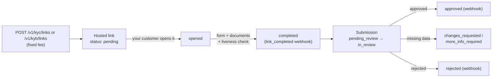

> **Environments:** Test `https://cryptobank.qbank.cl/platform` (`pk_test_...`) - Live `https://api.qbank.cl/platform` (`pk_...`).

## Account verification before creating payins
Authenticated collection requires `kyc_status: approved` for person accounts and approved KYB for companies; until then, `POST /v1/payins` (QR/card/checkout/bank_transfer/fintoc), collect OTP/collect, dedicated deposit accounts, stored-card charges and subscriptions return `403 verification_required`. Existing public links, passive deposits, org-admin assignment and system-created instruments remain available; request `POST /v1/me/verification/link`, then retry after approval.
**Identity verification** proves a person (KYC) or company (KYB) is who
they claim to be, with real evidence: a complete form, document uploads
validated by OCR and a **video liveness check**. It has two sides:
1. **Your own verification (onboarding)** — mandatory: until approved, your
   account can only **fund** (payins, crypto deposits, incoming transfers)
   and read. Person ⇒ KYC; company ⇒ KYB.
2. **Verifying your customers (company accounts only)** — generate hosted
   links or send data through the API to verify your own end customers,
   with a fixed fee per verification.

## Your own verification (onboarding)
When you register, your account starts unverified (`kyc_status: none`) and **can only fund and read**. Any outgoing-money action (payouts, transfers,
withdrawals, banking, cards) answers `403 verification_required` until you
are approved.
> **Note**New self-service requests require a confirmed TOTP or registered passkey; see [Profile & security](https://docs.cbpayapp.com/en/guides/profile) for enrollment steps and retry. Open links are re-served before this gate; API-key automation remains exempt.### Request your verification link

```bash
curl -X POST https://api.qbank.cl/platform/v1/me/verification/link \
  -H "Authorization: Bearer <token>"
```

`201` response (if you already have an open link, the same one is returned
with `200`):

```json
{
  "link_id": "a1b2c3d4-e5f6-4a7b-8c9d-0e1f2a3b4c5d",
  "kind": "kyc",
  "url": "https://…/on/usd/individual/new?invite=abc123…",
  "status": "pending",
  "label": "Ana Pérez",
  "created_at": "2026-07-10T12:00:00Z",
  "updated_at": "2026-07-10T12:00:00Z"
}
```

The `kind` derives from your account type: person ⇒ `kyc`, company ⇒
`kyb`. Onboarding is **free** for you.
### Complete the wizard

Open the `url`: the hosted wizard guides you through the form, document
uploads (identity, proof of residence; corporate documents for companies)
and — for KYC — the camera liveness check.
### Wait for review

Check your state any time:

```bash
curl https://api.qbank.cl/platform/v1/me/verification \
  -H "Authorization: Bearer <token>"
```

```json
{
  "kyc_status": "pending_review",
  "required_kind": "kyc",
  "verified": false,
  "link": { "link_id": "a1b2c3d4-…", "kind": "kyc", "url": "https://…", "status": "completed" },
  "submission": {
    "submission_id": "f0e1d2c3-…",
    "kind": "kyc",
    "status": "changes_requested",
    "liveness_pending": false,
    "pending_documents": ["proofOfResidence"],
    "changes_requested_comments": "Please upload a legible proof of residence.",
    "documents_received": ["identity"],
    "documents_gate": {
      "ok": false,
      "matched": 2,
      "total": 10,
      "unresolved": [
        { "category": "bankStatement", "effective_outcome": "REVIEW" }
      ]
    },
    "created_at": "2026-07-10T12:05:00Z",
    "updated_at": "2026-07-11T16:00:00Z"
  }
}
```

The four optional `submission` fields are returned when available:
`pending_documents`, `changes_requested_comments`, `documents_received` and
`documents_gate`; `rejection_reason` is intentionally not exposed and a
temporary core refresh failure may omit them.

When compliance approves, your `kyc_status` becomes `approved`
**automatically**, every service unlocks, and you receive the
`kyc_verification_status_changed` webhook with `self_onboarding: true`.

> **Note**
**Automatic decision engine:** a fully clean application (documents read correctly, liveness passed, no sanctions or PEP matches, no risk signals) is approved **in seconds without human intervention**. Grey areas go to the operator's human review queue. Severe AML/CFT sanctions (including a KYB party), prohibited jurisdictions, explicit document fraud/expiry and explicit provider rejection signals also go to the human queue with their reasons preserved; the engine no longer auto-rejects. The `decision_source` field of the status webhook (`"auto"` / `"admin"`) tells you who decided.
The approval also **backfills your account profile with the verified
identity**: `display_name` (person = first + last name; company = legal
name), `tax_id` and `country` are taken from the verification and from then
on are **immutable** via `PATCH /v1/me` (`409 identity_locked`) — the
verified identity is the source of truth.
> **Note**
While waiting you can fund normally: payins, crypto deposits and incoming
transfers work from day one. If verification is rejected
(`kyc_status: rejected`), contact your operator about a new link.
## Verifying your customers (company accounts only)

A verified **company** account can verify its own end customers. Each
created verification bills the configured fixed fee (`kyc_verification` /
`kyb_verification`; 0 = free), **automatically refunded** if creation
fails. Person accounts receive `403 company_account_required`.

### Option A — Hosted links (recommended)

Your customer completes EVERYTHING in the white-label wizard: form,
documents and liveness. You only generate the link and wait for the
webhook.

```bash KYC link (person)
curl -X POST https://api.qbank.cl/platform/v1/kyc/links \
  -H "Authorization: Bearer <token>" \
  -H "Content-Type: application/json" \
  -d '{
    "external_customer_id": "cust_123",
    "label": "Ana Pérez",
    "expires_in_days": 90,
    "idempotency_key": "kyc-link-cust-123-1"
  }'
```

```bash KYB link (company, with country)
curl -X POST https://api.qbank.cl/platform/v1/kyb/links \
  -H "Authorization: Bearer <token>" \
  -H "Content-Type: application/json" \
  -d '{
    "external_customer_id": "cust_456",
    "country": "cl",
    "label": "Comercial Andina SpA",
    "expires_in_days": 90,
    "idempotency_key": "kyb-link-cust-456-1"
  }'
```

- `external_customer_id` (required): YOUR reference for the verified
  customer — echoed back on every webhook and query. Values equal to
  `self` or ending in `:self` are reserved for account onboarding and are
  rejected with `400 invalid_payload`.
- `idempotency_key` (required): a retry with the same key returns the
  original link and **never double-charges**.
- `country` (KYB only): `us`, `cl`, `ve`, `br`, `mx`, `co`, `pe`, `bo`,
  `py`, `ar`, `uk`, `es`, `vg` or `generic` (with `generic_country` ISO alpha-2, e.g.
  `"ES"`). Individual KYC takes no country.
- `expires_in_days` (optional, 1–90): omitted, a native link defaults to 90 days. The simulator is different: omitted means no expiration, and it has no explicit cap.

`201` response:

```json
{
  "link_id": "b2c3d4e5-f6a7-4b8c-9d0e-1f2a3b4c5d6e",
  "kind": "kyb",
  "external_customer_id": "cust_456",
  "url": "https://…/on/cl/business/new?invite=abc123…",
  "status": "pending",
  "country": "cl",
  "label": "Comercial Andina SpA",
  "expires_at": 1721209600,
  "verification_fee": "2.000000",
  "created_at": "2026-07-10T12:00:00Z",
  "updated_at": "2026-07-10T12:00:00Z"
}
```

Query and history (every POST has its GET):

```bash
# Filtered listing
curl "https://api.qbank.cl/platform/v1/kyb/links?from=2026-07-01&to=2026-07-10&status=completed&page=1&page_size=50" \
  -H "Authorization: Bearer <token>"

# Detail (live link state)
curl https://api.qbank.cl/platform/v1/kyb/links/{link_id} \
  -H "Authorization: Bearer <token>"
```

| Link status | Meaning |
|---|---|
| `pending` | Created, your customer has not opened it |
| `opened` | Your customer opened the wizard |
| `completed` | Form submitted — the submission is born (`kyb_link_completed` / `kyc_link_completed` webhook) |
| `expired` | Expired without completion |

### Brand your verification links

Company accounts can configure the appearance of their hosted KYC/KYB links
from **Settings → Branding** in the portal. The preview uses the same effective
brand that a new link will use. You can upload a PNG logo, review the preview,
and adjust the company name, website, footer address, support email and colors.

The API exposes the same settings for company accounts. Text fields are
limited to 120 characters for `brand_name`, 200 for `website` and
`footer_address`, and 254 for `support_email`. Colors accept six-digit hex
values with or without `#`. A logo is a base64-encoded PNG of at most 512 KB
and 2000×2000 pixels; omit a logo field to keep the current image or send an
empty string to delete it.

```bash
curl -X PUT https://api.qbank.cl/platform/v1/account/branding \
  -H "Authorization: Bearer <token>" \
  -H "Content-Type: application/json" \
  -d '{
    "brand_name": "ACME Corp",
    "website": "www.acme.example",
    "support_email": "support@acme.example",
    "color_primary": "1A2B3C",
    "color_header": "",
    "color_accent": ""
  }'
```

`200 OK` returns the effective brand after the update. The response shape is
the same for `PUT` and `GET`:

```json
{
  "brand_name": "ACME Corp",
  "website": "www.acme.example",
  "footer_address": "",
  "support_email": "support@acme.example",
  "colors": {
    "primary": "#1A2B3C",
    "header": "#2E2E2E",
    "accent": "#A16207"
  },
  "logo_url": "https://cdn.cbpayapp.com/public/branding/org123/accounts/acc456/logo.png",
  "symbol_url": "",
  "custom": true
}
```

Read the current effective values before showing your own settings screen:

```bash
curl https://api.qbank.cl/platform/v1/account/branding \
  -H "Authorization: Bearer <token>"
```

The effective fallback is **account → organization → CBPay**. An empty text
value inherits from the next level. A link stores a sanitized snapshot when
it is created, so changing the account brand later does not unexpectedly
change a link that was already served. The hosted wizard shows the selected
logo, name and colors, while the **“Powered by CBPay”** pill remains fixed and
the footer remains present.

### Invited UBOs and directors

In a hosted KYB flow, each invited UBO or director completes their own
`/on/ubo` wizard (directors use the same flow). Before submitting, the invited person must
review and sign the sworn funds declaration shown by the wizard. This is a
form step, not a new API route or an OTP challenge.

If the invited person submits without an active signature, the submission
returns `409 declaration_required`. Do not create another invite or retry with
a new route: return the same wizard to the person, complete the declaration,
and submit again. Once signed, the declaration is attached automatically to
the dossier as the `swornDeclaration` item. The parent KYB case can continue
only after every required UBO/director child has completed its own flow.

### List and resend invited children

For the complete tenant-scoped contract, including request/response examples, states and solutions, see [UBO and director child invites](./kyc-ubo-children). The list never returns bearer URLs; resend reuses the same invite and submission.

### Option B — Data through the API

If you already hold the customer's data, create the verification directly
(no wizard). The submission enters the same review queue:

```bash
curl -X POST https://api.qbank.cl/platform/v1/kyc/submissions \
  -H "Authorization: Bearer <token>" \
  -H "Content-Type: application/json" \
  -d '{
    "external_customer_id": "cust_789",
    "idempotency_key": "kyc-sub-cust-789-1",
    "person": {
      "first_name": "Ana",
      "last_name": "Pérez",
      "email": "ana@example.com",
      "phone": "+56912345678",
      "nationality": "CHL",
      "date_of_birth": "1990-04-12",
      "tax_id": "12.345.678-5",
      "id_type": "id_card",
      "id_number": "12345678",
      "address": {
        "line1": "Av. Siempre Viva 123",
        "city": "Santiago",
        "state": "RM",
        "postal_code": "8320000",
        "country": "CHL"
      },
      "primary_purpose": "personal_or_living_expenses",
      "most_recent_occupation": "Engineer",
      "source_of_funds": "salary"
    }
  }'
```

Data-mode notes:

- Countries in **ISO alpha-3** (`CHL`, `USA`, `VEN`…); dates `YYYY-MM-DD`;
  `id_type`: `passport | id_card | drivers_license`.
- Phone in **E.164** with country code (e.g. `+56912345678`). The API still accepts legacy digit strings (digits, `+`, `-`, spaces, parentheses, up to 32 chars), but E.164 is the contract.
- KYB: body `{ external_customer_id, country?, business: {…}, ubos?,
  directors?, signers?, bank_info?, metadata? }` on
  `POST /v1/kyb/submissions`. Also, KYB data mode requires a complete legal name and registration number; KYC requires names, date of birth, ISO alpha-3 nationality, document and ISO alpha-3 country. Unknown KYB countries use the generic profile with that ISO; `country: generic` requires `generic_country`.
- **No liveness is required at creation**: the KYC submission carries
  `liveness_pending: true`; close it with a [liveness
  link](#liveness-check-liveness-link).
- Re-sending with the same `external_customer_id` while the submission is
  open (`pending_review`, `changes_requested`, `more_info_required`)
  **updates** the same submission and does not charge again.

`201` response:

```json
{
  "submission_id": "c3d4e5f6-a7b8-4c9d-0e1f-2a3b4c5d6e7f",
  "kind": "kyc",
  "external_customer_id": "cust_789",
  "status": "pending_review",
  "liveness_pending": true,
  "verification_fee": "1.500000",
  "created_at": "2026-07-10T12:05:00Z",
  "updated_at": "2026-07-10T12:05:00Z"
}
```

Query and history:

```bash
curl "https://api.qbank.cl/platform/v1/kyc/submissions?from=2026-07-01&to=2026-07-10&status=approved&page=1&page_size=50" \
  -H "Authorization: Bearer <token>"

curl https://api.qbank.cl/platform/v1/kyc/submissions/{submission_id} \
  -H "Authorization: Bearer <token>"
```

The detail adds `pending_documents`, `rejection_reason`,
`changes_requested_comments`, `documents_received`, `documents_gate` and
`aml_decision` for KYB.

| Submission status | Meaning |
|---|---|
| `pending_review` | Received, in the compliance queue |
| `in_review` | Compliance took the case |
| `changes_requested` | Data must be fixed and re-sent |
| `more_info_required` | Documents missing ([upload them via API](#documents-through-the-api)) |
| `escalated` | Escalated to senior review |
| `approved` / `approved_partial` | Approved (final) |
| `rejected` | Rejected (final) |
A migrated legacy submission is a frozen **tombstone**: reads return live data with `status: "migrated"`, `migrated_from`, `migrated_to` and `migrated_from_core`; approve, reject, request-changes, override, reinvite, document presign/upload/confirm, liveness links and `PATCH` banking intent return `409 superseded` with `this case was migrated; decide on <id-vivo>`. Operate `migrated_to`; notes and assignments fall through to the live case.
Owners may remediate their own self-onboarding submission before approval in `pending_review`, `in_review`, `changes_requested`, `more_info_required` or `escalated`; detail, documents and liveness routes remain available. Third-party, product and money routes are unchanged, and terminal `rejected` returns `403`.

### Documents through the API

Documents are optional at creation (if missing, compliance will request
them via `more_info_required`). 3-step flow:

### Presign

```bash
curl -X POST https://api.qbank.cl/platform/v1/kyc/submissions/{submission_id}/documents \
  -H "Authorization: Bearer <token>" \
  -H "Content-Type: application/json" \
  -d '{
    "category": "identity",
    "filename": "cedula.jpg",
    "content_type": "image/jpeg",
    "file_size": 482133
  }'
```

```json
{ "upload_url": "https://storage…", "key": "public-api/…", "expires_in": 900 }
```

Categories — KYC: `identity`, `identity_front` (front), `identity_back` (back),
`proofOfResidence`; KYB: `legalPresence`, `ownershipStructure`, `controlStructure`,
`companyDetails`. Types: `application/pdf`, `image/png`, `image/jpeg`; 15 MB max;
the upload URL expires in 15 minutes. Invited UBOs use `uboIdentity` (front) or `uboIdentityBack` (back).
### Upload

`PUT` the binary straight to `upload_url` with the same `Content-Type`.
### Confirm

```bash
curl -X POST https://api.qbank.cl/platform/v1/kyc/submissions/{submission_id}/documents/confirm \
  -H "Authorization: Bearer <token>" \
  -H "Content-Type: application/json" \
  -d '{ "key": "public-api/…", "category": "identity", "filename": "cedula.jpg", "content_type": "image/jpeg" }'
```

```json
{ "status": "received", "ocr": "queued" }
```

Confirming queues the OCR validation; the result arrives via the
`kyc_document_validated` / `kyb_document_validated` webhook and is
queryable with GET:

```bash
curl https://api.qbank.cl/platform/v1/kyc/submissions/{submission_id}/documents \
  -H "Authorization: Bearer <token>"
```

```json
{
  "items": [
    {
      "id": "9c9b0f1e-4b3c-4f6a-9f6d-2f0a1b2c3d4e",
      "category": "identity",
      "status": "completed",
      "outcome": "MATCH",
      "effective_outcome": "MATCH",
      "score": 0.97,
      "summary": "Document matches the submitted identity",
      "filename": "cedula.jpg"
    }
  ],
  "meta": { "retrieved": 1 }
}
```

`status` is `pending` while the native OCR job is queued, `running` while it
is being processed, `completed` when the result is stored, or `failed` after
bounded retries. While `pending` or `running`, treat the document as
unresolved and wait for the `kyc_document_validated` /
`kyb_document_validated` webhook. `failed` is fail-closed: it remains
`REVIEW` and never becomes a match automatically.

`outcome`: `MATCH`, `REVIEW` (manual review), `NO_MATCH`. Each completed item
also exposes `score` (mean field confidence) and a human-readable `summary`,
plus:

- `id`: the validation identifier (used by the compliance team to review it).
- `effective_outcome`: the outcome that currently governs — the admin's manual resolution from the admin panel if one exists, otherwise the OCR engine outcome. In the submission detail (`GET /v1/kyc/submissions/{id}`) the `documents_gate` block summarizes whether ALL documents are already resolved (`ok: true`), with `matched`/`total` and the `unresolved` list of pending ones.
- `manual_review`: present only when an admin manually resolved the validation from the admin panel. The account view carries `outcome` and `reviewed_at` (without the internal note or the reviewer).

The account-facing response may include `ocr` with field-level values and
confidence, document type, MRZ checks, detected dates, quality and fraud
signals. It is evidence for the compliance workflow, not an approval by
itself. If the native sidecar is unavailable, the document remains in
`REVIEW`; there is no external fallback and no automatic `MATCH`.

> **Note**
Manually resolving a document validation is an admin-panel-only operation (CBPay Admin); it is not exposed through the public API. When the compliance team applies it, your account sees the updated result in `effective_outcome` and `manual_review`, plus the corresponding `kyc_document_validated` / `kyb_document_validated` webhook.
### Liveness check (liveness link)

KYC submissions created through the API are born with
`liveness_pending: true` (the liveness check is a browser camera flow).
Generate a minimal hosted link for your customer to complete it:

```bash
curl -X POST https://api.qbank.cl/platform/v1/kyc/submissions/{submission_id}/liveness_link \
  -H "Authorization: Bearer <token>" \
  -H "Content-Type: application/json" \
  -d '{ "expires_in_days": 90 }'
```

```json
{ "url": "https://…/on/liveness/<token>", "status": "pending", "expires_at": 1751234567 }
```

- Free (the service was billed when the submission was created). If an
  open link exists, the POST returns the same one; if the check already
  passed, `400 liveness_already_completed`.
- `GET .../liveness_link` returns the latest link and the current check
  state (`{ "liveness": { "status", "outcome", "passed" } }`).
- On pass (outcome `PASS` or `REVIEW`): the submission clears
  `liveness_pending` and the `kyc_liveness_completed` webhook fires.

## Common questions

Consulta la [referencia de errors](https://docs.cbpayapp.com/en/errors) para códigos HTTP y soluciones.

#### Which verification should I use?
Use KYC for a person account and KYB for a company account.
