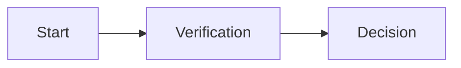

> **Environments:** Test `https://cryptobank.qbank.cl/platform` (`pk_test_...`) - Live `https://api.qbank.cl/platform` (`pk_...`).

- [Overview](https://docs.cbpayapp.com/en/guides/kyc-overview)
- [OCR and liveness](https://docs.cbpayapp.com/en/guides/kyc-ocr)
- [Errors](https://docs.cbpayapp.com/en/errors)

#### Where do I start?Start with the overview.
