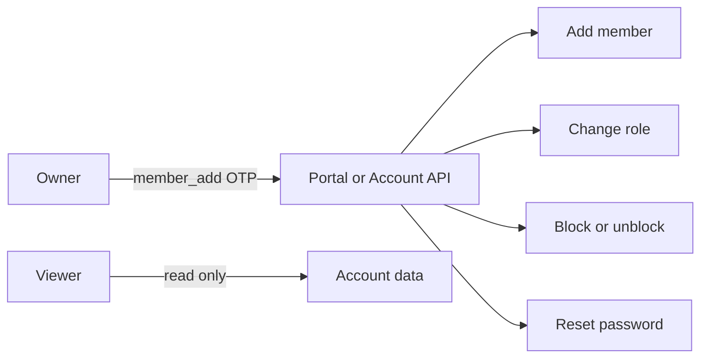
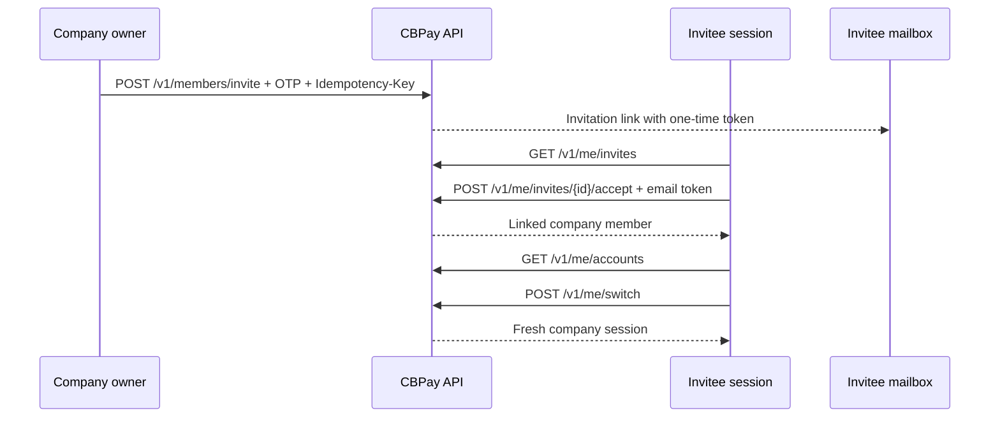

> **Environments:** Test `https://cryptobank.qbank.cl/platform` (`pk_test_...`) - Live `https://api.qbank.cl/platform` (`pk_...`).

Company accounts can invite an account that already exists in the same
organization. The invitee keeps one login and accepts the invitation from a
human session; CBPay then adds a company-scoped member with an `operator` or
`viewer` role.

> **Note**
Member invitations and the account switcher require a human session. API keys
cannot accept invitations, decline them, list the login's accounts or switch
account context.
## Roles and permissions

| Role | Read account data | Operate products | Manage members and credentials |
|---|---:|---:|---:|
| `owner` | Yes | Yes | Yes |
| `operator` | Yes | Yes | No |
| `viewer` | Yes | No | No |

`viewer` is read-only. It cannot create or change operations, credentials,
members or account settings. Keep at least one `owner` on every company
account.



## How the multi-account flow works



The invite is valid for seven days. Acceptance proves both the authenticated
session and possession of the email token. The session email must exactly
match the invited email; a token alone is not enough.

## Invite an existing account

An invitation is for an existing, active and verified account in the same
organization. It does not create a new login. The offered role must be
`operator` or `viewer`; an owner role can be granted later by an existing
owner through the role endpoint.

```bash
export CBPAY_API="https://api.qbank.cl/platform"
export OWNER_SESSION="<owner-session-token>"
export INVITEE_SESSION="<invitee-human-session-token>"
export INVITE_ID="7f3a9c1e-4b5d-4e6f-8a9b-0c1d2e3f4a5b"

curl -X POST "$CBPAY_API/v1/members/invite" \
  -H "Authorization: Bearer $OWNER_SESSION" \
  -H "Content-Type: application/json" \
  -H "Idempotency-Key: company-invite-ops-001" \
  -H "X-OTP-Token: <member-add-otp>" \
  -d '{"email":"ops@example.com","role":"operator"}'
```

```json
{
  "invite_id": "7f3a9c1e-4b5d-4e6f-8a9b-0c1d2e3f4a5b",
  "company_account_id": "1a2b3c4d-5e6f-4a7b-8c9d-0e1f2a3b4c5d",
  "company_name": "Acme SpA",
  "email": "ops@example.com",
  "role": "operator",
  "status": "pending",
  "invited_by": "owner@example.com",
  "delivery": "link",
  "expires_at": "2026-12-02T12:00:00Z",
  "created_at": "2026-11-25T12:00:00Z"
}
```

Send an `Idempotency-Key` on every invitation. Repeating the same payload
with the same key returns the existing invitation without sending another
email. Reusing that key for different data returns `idempotency_conflict`.

## Review, accept or decline

The invitee lists invitations from the human session. Supported filters are
`status=pending|accepted|declined|revoked|expired`, `page` and `page_size`;
the default page size is 50 and the maximum is 200.

```bash
curl "$CBPAY_API/v1/me/invites?status=pending&page=1&page_size=50" \
  -H "Authorization: Bearer $INVITEE_SESSION"
```

The email link supplies the opaque token. Do not log or expose it. Submit it
with the invitee session:

```bash
curl -X POST "$CBPAY_API/v1/me/invites/$INVITE_ID/accept" \
  -H "Authorization: Bearer $INVITEE_SESSION" \
  -H "Content-Type: application/json" \
  -d '{"token":"<token-from-the-invitation-email>"}'
```

```json
{
  "member_id": "9a8b7c6d-5e4f-4a3b-8c9d-0e1f2a3b4c5d",
  "account_id": "1a2b3c4d-5e6f-4a7b-8c9d-0e1f2a3b4c5d",
  "role": "operator",
  "linked": true
}
```

The session mailbox must exactly match the invited email. Declining is also
restricted to that mailbox, but does not need the email token:

```bash
curl -X POST "$CBPAY_API/v1/me/invites/$INVITE_ID/decline" \
  -H "Authorization: Bearer $INVITEE_SESSION"
```

Declining is safe to repeat: the API reports the real state
when a concurrent decision already won, without auditing a decision that did
not happen. Re-accepting a decided invitation returns `409 invalid_state`
instead — read the current state with `GET /v1/me/invites`. An expired
invitation cannot be resent (resend requires `pending`); the company owner
creates a new invitation, which supersedes the expired one.

## List, resend or revoke as the company

List company invitations with `status`, `page` and `page_size`:

```bash
curl "$CBPAY_API/v1/members/invites?status=pending&page=1&page_size=50" \
  -H "Authorization: Bearer $OWNER_SESSION"
```

Only a pending invitation can be resent or revoked. Both actions require the
owner's `member_add` OTP. Resend rotates the email token and renews its
seven-day validity; it does not create a second invitation.

```bash
curl -X POST "$CBPAY_API/v1/members/invites/$INVITE_ID/resend" \
  -H "Authorization: Bearer $OWNER_SESSION" \
  -H "X-OTP-Token: <member-add-otp>"

curl -X POST "$CBPAY_API/v1/members/invites/$INVITE_ID/revoke" \
  -H "Authorization: Bearer $OWNER_SESSION" \
  -H "X-OTP-Token: <member-add-otp>"
```

There is no public invitation webhook. Use the two GET endpoints for state;
the accepted member appears in `GET /v1/members`. Security notifications are
sent to the relevant mailbox for invitation decisions.

## Linked accounts and the account switcher

After acceptance, `linked: true` means the company member belongs to the same
login family as the invitee's primary account. It has its own company role
and status, but the credential is managed from the primary account only.
Password, email, 2FA, passkeys and social sign-in links are primary-account
credentials.

List the live accounts available to the current human login:

```bash
curl "$CBPAY_API/v1/me/accounts" \
  -H "Authorization: Bearer $INVITEE_SESSION"
```

```json
{
  "accounts": [
    {
      "account_id": "2b3c4d5e-6f7a-4b8c-9d0e-1f2a3b4c5d6e",
      "type": "person",
      "display_name": "Taylor Morgan",
      "member_id": "3c4d5e6f-7a8b-4c9d-0e1f-2a3b4c5d6e7f",
      "role": "owner",
      "primary": true
    },
    {
      "account_id": "1a2b3c4d-5e6f-4a7b-8c9d-0e1f2a3b4c5d",
      "type": "company",
      "display_name": "Acme SpA",
      "member_id": "9a8b7c6d-5e4f-4a3b-8c9d-0e1f2a3b4c5d",
      "role": "operator",
      "primary": false
    }
  ]
}
```

Switch with the target `account_id`:

```bash
curl -X POST "$CBPAY_API/v1/me/switch" \
  -H "Authorization: Bearer $INVITEE_SESSION" \
  -H "Content-Type: application/json" \
  -d '{"account_id":"1a2b3c4d-5e6f-4a7b-8c9d-0e1f2a3b4c5d"}'
```

The response contains a fresh `access_token`, `refresh_token`, expiry times,
`account_id`, `member_id` and `role`. The current session remains valid, so a
client can keep the primary account open in another tab. Store both tokens
like login tokens and never put them in URLs or logs.

Credentials are managed from the account marked `primary: true` in
`GET /v1/me/accounts`. A linked session receives
`primary_account_required` or `linked_login_managed_by_primary` if it tries
to change a primary-owned credential.

## Invitation states

| State | Meaning | Next action |
|---|---|---|
| `pending` | The invitee can accept or decline. | Accept, resend or revoke. |
| `accepted` | A linked company member was created. | Use member management or switch accounts. |
| `declined` | The invitee rejected it. | Create a new invitation if needed. |
| `revoked` | The owner cancelled it. | Create a new invitation if needed. |
| `expired` | Seven-day validity elapsed. | Create a new invitation (resend requires `pending`). |

## Manage members in the portal

### Open the company account settings

Sign in as an `owner`, open the company account settings and select the
members section.
### Add or select a member

When adding a member, provide an email, a password with at least eight
characters that is not a commonly used one, and one of the three roles. When editing a member, select the
member before changing the role or status.
### Confirm the member action

For adding a member, changing a role, blocking or unblocking a login, or
resetting a password, complete the `member_add` OTP challenge when the portal
asks for it. The action applies immediately after successful confirmation.
An owner cannot block their own login. To protect the account, ask another
owner to perform that action. The last owner also cannot be demoted.

## Manage members with the API

All examples use a human session token:

```bash
export CBPAY_API="https://api.qbank.cl/platform"
export SESSION_TOKEN="<human-session-token>"
export MEMBER_ID="5a4b3c2d-1e0f-9a8b-7c6d-5e4f3a2b1c0d"
```

### 1. Read your member profile

Use this endpoint to distinguish the signed-in member from the company
account:

```bash
curl "$CBPAY_API/v1/me/member" \
  -H "Authorization: Bearer $SESSION_TOKEN"
```

```json
{
  "id": "5a4b3c2d-1e0f-9a8b-7c6d-5e4f3a2b1c0d",
  "email": "ops@example.com",
  "role": "operator",
  "status": "active",
  "created_at": "2026-07-07T12:00:00Z"
}
```

API keys return `404 member_not_found` because they are not human members.

### 2. Add and list members

Adding a member is company-only. The default role is `operator` when the
field is omitted:

```bash
curl -X POST "$CBPAY_API/v1/members" \
  -H "Authorization: Bearer $SESSION_TOKEN" \
  -H "Content-Type: application/json" \
  -H "X-OTP-Token: <member-add-otp>" \
  -d '{
    "email": "ops@example.com",
    "password": "another-secure-pass",
    "role": "operator"
  }'
```

(With the default policy the OTP header is not required; accounts that
protect `member_add` answer `otp_required` until the token is sent.)

The response is the created member:

```json
{
  "id": "5a4b3c2d-1e0f-9a8b-7c6d-5e4f3a2b1c0d",
  "email": "ops@example.com",
  "role": "operator",
  "status": "active",
  "created_at": "2026-07-07T12:00:00Z"
}
```

List the current company members before presenting an edit form:

```bash
curl "$CBPAY_API/v1/members" \
  -H "Authorization: Bearer $SESSION_TOKEN"
```

```json
{
  "members": [
    {
      "id": "5a4b3c2d-1e0f-9a8b-7c6d-5e4f3a2b1c0d",
      "email": "ops@example.com",
      "role": "operator",
      "status": "active",
      "created_at": "2026-07-07T12:00:00Z"
    }
  ]
}
```

### 3. Change a member role

Only an owner of a company account can change roles. The allowed values are
`owner`, `operator` and `viewer`.

```bash
curl -X PUT "$CBPAY_API/v1/members/$MEMBER_ID/role" \
  -H "Authorization: Bearer $SESSION_TOKEN" \
  -H "Content-Type: application/json" \
  -H "X-OTP-Token: <member-add-otp>" \
  -d '{"role":"operator"}'
```

```json
{
  "member_id": "5a4b3c2d-1e0f-9a8b-7c6d-5e4f3a2b1c0d",
  "role": "operator",
  "changed": true
}
```

### 4. Block or unblock a member

Disabling a member revokes all of that member's sessions immediately. Use
`active` to unblock the login.

```bash
curl -X PUT "$CBPAY_API/v1/members/$MEMBER_ID/status" \
  -H "Authorization: Bearer $SESSION_TOKEN" \
  -H "Content-Type: application/json" \
  -H "X-OTP-Token: <member-add-otp>" \
  -d '{"status":"disabled"}'
```

```json
{
  "member_id": "5a4b3c2d-1e0f-9a8b-7c6d-5e4f3a2b1c0d",
  "status": "disabled",
  "changed": true,
  "sessions_revoked": 2
}
```

### 5. Reset a member password

Resetting a member password also revokes all of that member's sessions. To
change your own password, use `POST /v1/me/password` instead.

```bash
curl -X POST "$CBPAY_API/v1/members/$MEMBER_ID/reset-password" \
  -H "Authorization: Bearer $SESSION_TOKEN" \
  -H "Content-Type: application/json" \
  -H "X-OTP-Token: <member-add-otp>" \
  -d '{"password":"another-secure-pass"}'
```

```json
{
  "member_id": "5a4b3c2d-1e0f-9a8b-7c6d-5e4f3a2b1c0d",
  "status": "password_reset",
  "sessions_revoked": 1
}
```

## Errors and recovery

| HTTP | Error | What to do |
|---:|---|---|
| 400 | `invalid_role` | Send exactly `owner`, `operator` or `viewer`. |
| 403 | `owner_required` | Sign in with an owner session. |
| 403 | `company_only` | Use a company account; members are unavailable on person accounts. |
| 403 | `otp_required` | Request and verify the `member_add` OTP, then send its token. |
| 404 | `member_not_found` | Use a human member session, not an API key. |
| 409 | `last_owner_required` | Keep at least one owner before demoting this member. |
| 409 | `self_action_forbidden` | Ask another owner to change your status or reset your password. |
| 404 | `invitee_not_found` | No account in the organization uses that email; they must create their account first. |
| 409 | `invitee_not_ready` | The invited account has not verified its email yet. |
| 409 | `already_member` | That email already has access to this company. |
| 410 | `invite_expired` | The invitation expired; invite them again. |
| 409 | `company_not_active` | The company is no longer active; invitations are closed. |
| 403 | `primary_account_required` | Switch to the primary account to manage credentials. |
| 403 | `linked_login_managed_by_primary` | Reset the password or change the email from the primary account. |
| 403 | `switch_unavailable` | That account is not available for switching right now. |
| 400 | `invalid_email` | Send a plain valid email address for an existing account. |
| 400 | `idempotency_key_required` | Add `Idempotency-Key` to the invitation request. |
| 400 | `invalid_token` | The token has a bad format; copy it exactly from the email. |
| 401 | `invalid_token` | Wrong or already-used token; use the token from the latest invitation email. |
| 400 | `invalid_status` | In invitation filters use `pending`, `accepted`, `declined`, `revoked` or `expired`. |
| 404 | `not_found` | The invitation is not available in this mailbox or account context. |
| 409 | `idempotency_conflict` | Reuse the original payload or choose a new key. |
| 409 | `invalid_state` | The invitation is no longer pending; read its current state. |
| 429 | `too_many_attempts` | Wait and retry later; do not repeatedly resend invitations. |

See the [error reference](https://docs.cbpayapp.com/en/errors) for the complete API error catalogue.

> Email payees always resolve to the mailbox owner's own account: paying to the email of a multi-account user credits their personal account, never a company they operate.

#### Does the invite create a new account?
No. The email must already belong to an eligible account in the organization.
The invitation adds company access to that existing login.
#### Can I accept with only the email token?
No. Acceptance needs a human session whose email exactly matches the invited
mailbox, plus the token from the latest invitation email.
#### What does linked mean?
The company member shares the primary login's credential family. Its company
role and status remain separate, but password, email, 2FA, passkeys and social
links are managed from the primary account.
#### Where do I manage the linked credential?
Switch to the account marked `primary: true` in `GET /v1/me/accounts`.
#### Can an owner resend or revoke an accepted invitation?
No. Those actions apply only while the invitation is `pending`. Manage the
accepted member instead; disabling the member revokes its sessions.
#### Where does an email payee receive funds?
An email payee always resolves to the mailbox owner's personal account, not a
company account that person operates.
