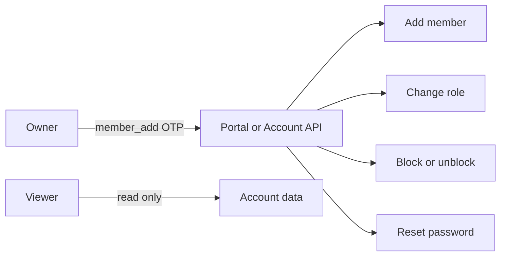

> **Environments:** Test `https://cryptobank.qbank.cl/platform` (`pk_test_...`) - Live `https://api.qbank.cl/platform` (`pk_...`).

Company accounts can give each human login only the access it needs. Use the
portal for routine administration, or the Account API when member management
is part of your controlled back-office workflow.

> **Note**
These endpoints require a human member session. API keys can access account
resources, but they do not have a member profile and cannot perform member
administration.
## Roles and permissions

| Role | Read account data | Operate products | Manage members and credentials |
|---|---:|---:|---:|
| `owner` | Yes | Yes | Yes |
| `operator` | Yes | Yes | No |
| `viewer` | Yes | No | No |

`viewer` is read-only. It cannot create or change operations, credentials,
members or account settings. Keep at least one `owner` on every company
account.



## Manage members in the portal

### Open the company account settings

Sign in as an `owner`, open the company account settings and select the
members section.
### Add or select a member

When adding a member, provide an email, a password with at least eight
characters and one of the three roles. When editing a member, select the
member before changing the role or status.
### Confirm the member action

For adding a member, changing a role, blocking or unblocking a login, or
resetting a password, complete the `member_add` OTP challenge when the portal
asks for it. The action applies immediately after successful confirmation.
An owner cannot block their own login. To protect the account, ask another
owner to perform that action. The last owner also cannot be demoted.

## Manage members with the API

All examples use a human session token:

```bash
export CBPAY_API="https://api.qbank.cl/platform"
export SESSION_TOKEN="<human-session-token>"
export MEMBER_ID="5a4b3c2d-1e0f-9a8b-7c6d-5e4f3a2b1c0d"
```

### 1. Read your member profile

Use this endpoint to distinguish the signed-in member from the company
account:

```bash
curl "$CBPAY_API/v1/me/member" \
  -H "Authorization: Bearer $SESSION_TOKEN"
```

```json
{
  "id": "5a4b3c2d-1e0f-9a8b-7c6d-5e4f3a2b1c0d",
  "email": "ops@example.com",
  "role": "operator",
  "status": "active",
  "created_at": "2026-07-07T12:00:00Z"
}
```

API keys return `404 member_not_found` because they are not human members.

### 2. Add and list members

Adding a member is company-only. The default role is `operator` when the
field is omitted:

```bash
curl -X POST "$CBPAY_API/v1/members" \
  -H "Authorization: Bearer $SESSION_TOKEN" \
  -H "Content-Type: application/json" \
  -d '{
    "email": "ops@example.com",
    "password": "another-secure-pass",
    "role": "operator"
  }'
```

The response is the created member:

```json
{
  "id": "5a4b3c2d-1e0f-9a8b-7c6d-5e4f3a2b1c0d",
  "email": "ops@example.com",
  "role": "operator",
  "status": "active",
  "created_at": "2026-07-07T12:00:00Z"
}
```

List the current company members before presenting an edit form:

```bash
curl "$CBPAY_API/v1/members" \
  -H "Authorization: Bearer $SESSION_TOKEN"
```

```json
{
  "members": [
    {
      "id": "5a4b3c2d-1e0f-9a8b-7c6d-5e4f3a2b1c0d",
      "email": "ops@example.com",
      "role": "operator",
      "status": "active",
      "created_at": "2026-07-07T12:00:00Z"
    }
  ]
}
```

### 3. Change a member role

Only an owner of a company account can change roles. The allowed values are
`owner`, `operator` and `viewer`.

```bash
curl -X PUT "$CBPAY_API/v1/members/$MEMBER_ID/role" \
  -H "Authorization: Bearer $SESSION_TOKEN" \
  -H "Content-Type: application/json" \
  -H "X-OTP-Token: <member-add-otp>" \
  -d '{"role":"operator"}'
```

```json
{
  "member_id": "5a4b3c2d-1e0f-9a8b-7c6d-5e4f3a2b1c0d",
  "role": "operator",
  "changed": true
}
```

### 4. Block or unblock a member

Disabling a member revokes all of that member's sessions immediately. Use
`active` to unblock the login.

```bash
curl -X PUT "$CBPAY_API/v1/members/$MEMBER_ID/status" \
  -H "Authorization: Bearer $SESSION_TOKEN" \
  -H "Content-Type: application/json" \
  -H "X-OTP-Token: <member-add-otp>" \
  -d '{"status":"disabled"}'
```

```json
{
  "member_id": "5a4b3c2d-1e0f-9a8b-7c6d-5e4f3a2b1c0d",
  "status": "disabled",
  "changed": true,
  "sessions_revoked": 2
}
```

### 5. Reset a member password

Resetting a member password also revokes all of that member's sessions. To
change your own password, use `POST /v1/me/password` instead.

```bash
curl -X POST "$CBPAY_API/v1/members/$MEMBER_ID/reset-password" \
  -H "Authorization: Bearer $SESSION_TOKEN" \
  -H "Content-Type: application/json" \
  -H "X-OTP-Token: <member-add-otp>" \
  -d '{"password":"another-secure-pass"}'
```

```json
{
  "member_id": "5a4b3c2d-1e0f-9a8b-7c6d-5e4f3a2b1c0d",
  "status": "password_reset",
  "sessions_revoked": 1
}
```

## Errors and recovery

| HTTP | Error | What to do |
|---:|---|---|
| 400 | `invalid_role` | Send exactly `owner`, `operator` or `viewer`. |
| 403 | `owner_required` | Sign in with an owner session. |
| 403 | `company_only` | Use a company account; members are unavailable on person accounts. |
| 403 | `otp_required` | Request and verify the `member_add` OTP, then send its token. |
| 404 | `member_not_found` | Use a human member session, not an API key. |
| 409 | `last_owner_required` | Keep at least one owner before demoting this member. |
| 409 | `self_action_forbidden` | Ask another owner to change your status or reset your password. |

See the [error reference](https://docs.cbpayapp.com/en/errors) for the complete API error catalogue.

#### Can an operator add or edit a member?
No. Operators can operate the account's products but cannot manage members or
credentials. An owner must perform the action.
#### Can I use an API key for member management?
No. Member administration is a human-session flow. API keys do not have a
member profile and `GET /v1/me/member` returns `member_not_found`.
#### What happens when I disable a member?
All sessions belonging to that member are revoked immediately. The member
must be re-enabled by an owner before signing in again.
#### How do I change my own password?
Use `POST /v1/me/password`. The administrator reset endpoint is for another
member and returns `self_action_forbidden` when used on yourself.
