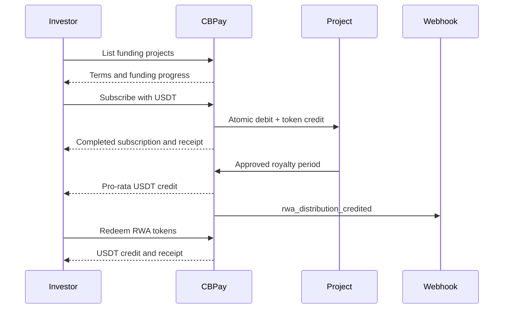

Royalty tokens represent a proportional entitlement in a published royalty project. The API uses exact decimal strings: never send floating-point numbers. A project publishes its price, supply, royalty terms, subscription window, and redemption switch before you buy.

> **Environments:** Test `https://cryptobank.qbank.cl/platform` (`pk_test_...`) - Live `https://api.qbank.cl/platform` (`pk_...`).

## The investor journey



## 1. Find a project

```bash
curl "https://api.qbank.cl/platform/v1/rwa/projects?status=funding&limit=50&page=1" \
  -H "Authorization: Bearer $CBPAY_TOKEN"
```

```json
{
  "page": 1,
  "page_size": 50,
  "projects": [{
    "project_id": "11111111-1111-4111-8111-111111111111",
    "code": "RWA-MIN01",
    "name": "Minera Norte Royalty I",
    "mineral": "copper",
    "status": "funding",
    "royalty_pct": "5",
    "royalty_base": "nsr",
    "cap_multiple": "2",
    "term_years": 7,
    "supply_total": "10000000.000000",
    "subscription_price_usdt": "1.000000",
    "min_per_account": "100.000000",
    "distribution_frequency": "quarterly",
    "chain": "polygon",
    "bridge_enabled": false,
    "transfers_enabled": true,
    "redeem_enabled": true,
    "sold_tokens": "1200000.000000",
    "raised_gross_usdt": "1200000.000000",
    "subscribers": 84,
    "redeemed_tokens": "0.000000"
  }]
}
```

Use `GET /platform/v1/rwa/projects/{code}` for the complete terms. Project status can be `draft`, `funding`, `active`, `distributing`, `defaulted`, `redeemed`, or `paused`.

## 2. Buy tokens

The request amount is the gross USDT amount. The configured `rwa_subscription` fee is charged on top and the token quantity is calculated from the net amount.

```bash
curl -X POST https://api.qbank.cl/platform/v1/rwa/subscriptions \
  -H "Authorization: Bearer $CBPAY_TOKEN" \
  -H "Content-Type: application/json" \
  -H "Idempotency-Key: sub-min01-0001" \
  -d '{
    "project_code": "RWA-MIN01",
    "usdt_amount": "1000.000000",
    "idempotency_key": "sub-min01-0001"
  }'
```

```json
{
  "subscription_id": "22222222-2222-4222-8222-222222222222",
  "account_id": "33333333-3333-4333-8333-333333333333",
  "project_id": "11111111-1111-4111-8111-111111111111",
  "project_code": "RWA-MIN01",
  "usdt_gross": "1000.000000",
  "fee_usdt": "10.000000",
  "usdt_net": "990.000000",
  "tokens_credited": "990.000000",
  "price_usdt": "1.000000",
  "status": "completed",
  "created_at": "2026-11-15T13:00:00Z",
  "receipt_url": "/platform/v1/rwa/subscriptions/22222222-2222-4222-8222-222222222222/receipt"
}
```

Buying requires verified identity, any required human-session OTP, available USDT, and an idempotency key. Reusing the same key returns the original operation; the server never creates a second subscription.

## 3. Monitor holdings and distributions

```bash
curl "https://api.qbank.cl/platform/v1/rwa/holdings" \
  -H "Authorization: Bearer $CBPAY_TOKEN"

curl "https://api.qbank.cl/platform/v1/rwa/distributions?from=2026-01-01T00:00:00Z&to=2026-12-31T23:59:59Z&page=1" \
  -H "Authorization: Bearer $CBPAY_TOKEN"
```

Distribution credits use the ex-date snapshot balance. A sample credit is:

```json
{
  "leg_id": "55555555-5555-4555-8555-555555555555",
  "distribution_id": "66666666-6666-4666-8666-666666666666",
  "project_code": "RWA-MIN01",
  "period": "2026-Q4",
  "tokens": "890.000000",
  "share_usdt": "12.500000",
  "fee_usdt": "0.125000",
  "created_at": "2026-11-15T15:00:00Z"
}
```

List subscriptions, redemptions, and distributions with `from`, `to`, and `page`; retrieve an individual resource with its ID. Every subscription, redemption, and distribution has a PDF receipt endpoint.

## 4. Redeem

Redemption returns USDT at the project subscription price (par) and atomically debits the RWA token balance.

```bash
curl -X POST https://api.qbank.cl/platform/v1/rwa/redemptions \
  -H "Authorization: Bearer $CBPAY_TOKEN" \
  -H "Content-Type: application/json" \
  -d '{
    "project_code": "RWA-MIN01",
    "tokens": "100.000000",
    "idempotency_key": "red-min01-0001"
  }'
```

```json
{
  "redemption_id": "44444444-4444-4444-8444-444444444444",
  "project_code": "RWA-MIN01",
  "tokens": "100.000000",
  "usdt_credited": "100.000000",
  "price_usdt": "1.000000",
  "status": "completed",
  "created_at": "2026-11-15T14:00:00Z",
  "receipt_url": "/platform/v1/rwa/redemptions/44444444-4444-4444-8444-444444444444/receipt"
}
```

## States and errors

| State | Meaning and action |
|---|---|
| `funding` | Subscriptions are open if the window and caps allow them. |
| `active` | The project operates and can produce distributions. |
| `distributing` | A distribution is being processed; follow the distribution resource. |
| `paused` | Do not retry blindly; wait for the project to reopen. |
| `defaulted` / `redeemed` | No new subscription; follow the project terms. |

Common RWA errors are documented in [Errors](https://docs.cbpayapp.com/en/errors). In particular, `rwa_window_closed`, `rwa_cap_exceeded`, `rwa_fee_exceeds_amount`, `rwa_redeem_disabled`, and `rwa_escrow_insufficient` are business outcomes, not retryable transport failures. For timeouts or 5xx responses, query the resource using the same idempotency key before taking action.

## Webhooks

Subscribe to `rwa_subscription_completed`, `rwa_distribution_credited`, and `rwa_redeem_completed`. Verify the webhook signature and return a 2xx only after durable processing. Payloads contain the operation ID, project code, exact decimal amounts, and status. See [Webhooks](https://docs.cbpayapp.com/en/webhooks).

## FAQ

#### Is the token price floating?
No. F1 redeems at the project's subscription price. The published project terms are the source of truth.
#### Can I retry a failed request?
For an ambiguous timeout or 5xx, first retrieve the original resource with the same idempotency key. Never send the financial operation again with a new key unless you intentionally want a new operation.
#### Why did my distribution differ from my current balance?
Entitlement uses the balance at the ex-date snapshot. Transfers after that snapshot do not change that period's share.
#### Is the blockchain bridge available?
No. The compiled contract exposes `bridge_enabled`, but the bridge flow is F2 and must not be treated as available in F1.
