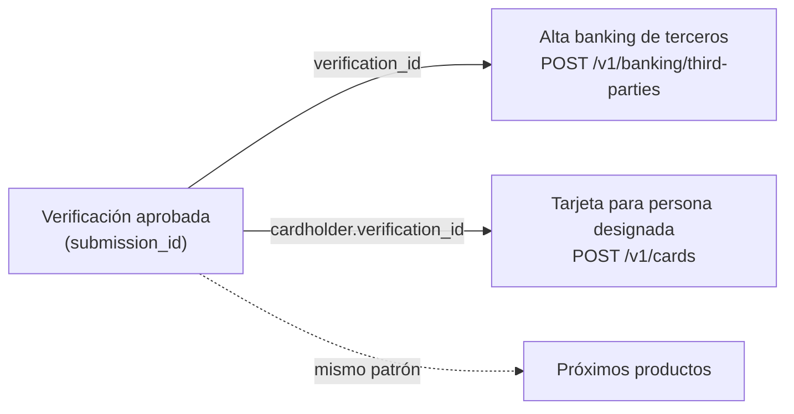

> **Ambientes:** Test `https://cryptobank.qbank.cl/platform` (`pk_test_...`) - Live `https://api.qbank.cl/platform` (`pk_...`).

## Una sola verificación para todo (identidad reutilizable)

La verificación aprobada de un cliente es su **identidad única** dentro de
CBPay: no vuelves a tipear sus datos ni a subir sus documentos en ningún
otro producto.



- **Banking para terceros**: `POST /v1/banking/third-parties` exige el
  `verification_id` de una verificación **aprobada** del tercero. El tipo
  (`INDIVIDUAL`/`COMPANY`) sale del kind (KYC ⇒ persona, KYB ⇒ empresa),
  los datos (nombre, email, dirección) se completan solos desde el perfil
  verificado, y los documentos ya validados se re-entregan automáticamente
  al proveedor bancario (`documents_synced` en la respuesta). Detalle en
  [Banking](https://docs.cbpayapp.com/es/guides/banking#usuarios-banking-de-terceros-solo-empresas).
- **Tarjetas para personas designadas**: `POST /v1/cards` con un
  `cardholder` de persona exige `cardholder.verification_id` de un **KYC
  aprobado** de esa persona. Identidad y documentos del titular salen de la
  verificación; solo agregas los campos propios del emisor (`occupation`,
  `salary_usd`). Detalle en [Tarjetas](https://docs.cbpayapp.com/es/guides/cards).
- **Tu propia cuenta**: tu onboarding aprobado también se reutiliza — al
  crear tu banking customer o tu primera tarjeta, los datos y documentos
  faltantes se completan desde tu verificación.

Los campos explícitos de tu request **siempre ganan** sobre el autofill.

> **Importante**
Sin una verificación aprobada del tercero, el alta banking y la emisión de
tarjetas designadas responden `422 verification_required`. Verifica primero
(links hosteados o datos por API) y usa el `submission_id` aprobado como
`verification_id`.
## Informe de compliance (solo KYB)

Para cada verificación KYB puedes descargar el **informe de compliance
firmado** (PDF, evidencia para tus propios auditores):

```bash
curl -o report.pdf https://api.qbank.cl/platform/v1/kyb/submissions/{submission_id}/report \
  -H "Authorization: Bearer <token>"
```

Es gratuito (el servicio se cobró al crear la verificación).

## Informe de verificación (PDF + JSON)

Además del informe del procesador, cada submission KYC o KYB decidida tiene
su **informe de verificación** generado por la plataforma. Es el expediente
completo, no un resumen: identidad verificada (persona o empresa), perfil
económico declarado, declaraciones de riesgo, cuenta bancaria enmascarada,
ciclo de vida de la decisión, documentos con su validación documental, prueba
de vida, **partes relacionadas con su propio screening** (KYB) y screening
AML/CFT con el detalle de cada coincidencia — todo con hash de integridad y
código de verificación pública. Dos formatos (`?format=pdf|json`, default
`pdf`) y tres idiomas (`?lang=en|es|zh`, default `en`). Es gratuito: es la
lectura de una verificación ya pagada.

Secciones del informe:

| Sección | Contenido |
|---|---|
| Sujeto | Identidad verificada: persona (documento, nacionalidad, residencia fiscal, ocupación) o empresa (registro, constitución, jurisdicción, industria ISIC, sitio) |
| Perfil económico | Origen de fondos, propósito de la relación, volúmenes e ingresos esperados, redes esperadas |
| Declaraciones | Respuestas de riesgo declaradas (servicios monetarios, fondos de terceros, actividades de alto riesgo, países prohibidos) |
| Cuenta bancaria | Banco, titular y número **enmascarado en origen** (nunca completo) |
| Documentos | Categoría, archivo, estado, resultado de validación, score, fecha de validación y motivo de rechazo. El PDF agrega **fotos del documento de identidad** cuando el proveedor las entrega (si no hay, la sección se omite) |
| Prueba de vida | Por rol (titular, UBO N): resultado, gate, scores de liveness / antispoofing / similitud facial. **Una fila por sesión** — un sujeto puede tener el check de onboarding `gate` más una o más recapturas de evidencia `media_recapture` posteriores, cada una con su propio `session_id` y `purpose`. El PDF embebe selfie/frames cuando hay media viva; el JSON solo declara metadata (`has_selfie`, `has_video`, `frame_gestures`, hashes) sin URLs |
| Partes relacionadas | Solo KYB: UBOs, personas de control y firmantes, cada una con identidad, participación, sus documentos, **todas sus sesiones de liveness** (`liveness_sessions[]`) y **su propio screening AML/CFT** |
| Screening AML/CFT | Nivel de riesgo, indicadores, coincidencias con alias, listas de sanciones con fuente y vigencia, posiciones PEP, vínculos RCA y medios adversos. El cierre del PDF incluye el anexo AML/CFT completo (atribución y fuentes) cuando hubo screening |

> **Nota**
**La prueba de vida trae una fila por sesión, no una por sujeto.** La sesión
`gate` es el check que habilitó el onboarding — normalmente trae solo la
selfie. La sesión `media_recapture` es una captura de evidencia posterior y
es la que trae el paquete completo (selfie + un frame por gesto solicitado +
video). Una `media_recapture` que terminó en `outcome: "FAIL"` sigue
importando — puede ser la única sesión con video utilizable — así que
**recorre todo el array `liveness[]`** en vez de leer `liveness[0]`; el
veredicto vigente del sujeto es siempre el `outcome` de la sesión `gate`. En
un KYB, `parties[].liveness` (singular) se conserva por compatibilidad y
siempre apunta a la sesión `gate` de esa parte, mientras
`parties[].liveness_sessions[]` trae todas las sesiones de esa parte.
> **Nota**
**Cómo se lee el PDF.** El informe abre con una **portada navegable**: un
índice de tarjetas con icono, título y número de página que son **clicables**
y saltan a su sección. Cada sección lleva su propio icono y barra de acento
(el mismo lenguaje visual del informe AML/CFT), las fotos del documento y de la
prueba de vida conservan su proporción real, y ningún encabezado queda solo
al pie de una página. Los medios adversos del anexo AML/CFT llevan un chip
**“ver fuente”** y la URL de verificación pública del cierre es clicable —
por seguridad **solo se embeben enlaces `http` y `https`**; cualquier otro
esquema se descarta y el texto queda sin enlace.
### De tus terceros (cuentas empresa)

```bash
# PDF en español
curl -o informe.pdf "https://api.qbank.cl/platform/v1/kyb/submissions/{submission_id}/verification-report?lang=es" \
  -H "Authorization: Bearer <token>"

# JSON (mismo contenido que el PDF)
curl "https://api.qbank.cl/platform/v1/kyc/submissions/{submission_id}/verification-report?format=json" \
  -H "Authorization: Bearer <token>"
```

El informe de un tercero es **completo**: la sección AML/CFT incluye nivel de
riesgo, indicadores y coincidencias (nombres, listas de sanciones, PEP,
medios adversos). Tú realizas la diligencia sobre tu cliente y este informe
es tu evidencia.

Respuesta `format=json` (resumen del shape — el PDF sale del mismo modelo):

```json
{
  "report_id": "IDR-C3D4E5F6A7B8",
  "kind": "kyb",
  "scope": "third_party",
  "generated_at": "2026-07-27T19:04:11Z",
  "generated_by": "CBPay",
  "language": "es",
  "aml_detail": true,
  "submission_id": "c3d4e5f6-a7b8-4c9d-0e1f-2a3b4c5d6e7f",
  "external_customer_id": "cust_789",
  "status": "approved",
  "risk_band": "low",
  "aml_decision": "no_match",
  "subject": {
    "type": "company",
    "name": "Importadora Andina SpA",
    "company": {
      "legal_name": "Importadora Andina SpA",
      "registration_number": "77.123.456-7",
      "incorporation_date": "2019-04-12",
      "incorporation_country": "CHL",
      "website": "https://andina.example",
      "countries_of_operation": ["CL", "PE"]
    },
    "address": { "city": "Santiago", "country": "CL" },
    "registered_address": { "line1": "Av. Apoquindo 1234", "city": "Santiago", "country": "CL" },
    "industry": { "code": "G4690", "label": "Comercio al por mayor" },
    "economic_profile": {
      "source_of_funds": "business_revenue",
      "primary_purpose": "supplier_payments",
      "annual_revenue_usd": "250000",
      "monthly_payments_usd": "40000",
      "expected_chains": ["tron", "ethereum"]
    },
    "attestations": [
      { "key": "att_money_services", "value": false },
      { "key": "att_high_risk_activities", "items": [] }
    ],
    "bank_account": {
      "bank_name": "Banco de Chile",
      "account_holder": "Importadora Andina SpA",
      "account_masked": "****4321",
      "country": "CL",
      "currency": "CLP"
    }
  },
  "parties": [
    {
      "source": "ubo",
      "index": 0,
      "kind": "ubo",
      "name": "Javier Villablanca",
      "person": {
        "first_name": "Javier",
        "last_name": "Villablanca",
        "date_of_birth": "1985-03-04",
        "nationality": "CL",
        "id_type": "national_id",
        "id_number": "12345678-9"
      },
      "address": { "city": "Santiago", "country": "CL" },
      "ownership_percent": "60",
      "has_ownership": true,
      "has_control": true,
      "documents": [
        { "category": "uboIdentity:0", "status": "validated", "outcome": "MATCH", "party_index": 0 }
      ],
      "liveness": {
        "role": "ubo:0",
        "session_id": "lv_e763e3465bf34f1dab826a263c1eaaaa",
        "purpose": "gate",
        "status": "completed",
        "outcome": "PASS",
        "passed_gate": true,
        "liveness_score": "0.86",
        "media": { "has_selfie": true, "has_video": false, "expires_in_sec": 900 }
      },
      "liveness_sessions": [
        {
          "role": "ubo:0",
          "session_id": "lv_e763e3465bf34f1dab826a263c1eaaaa",
          "purpose": "gate",
          "status": "completed",
          "outcome": "PASS",
          "passed_gate": true,
          "liveness_score": "0.86",
          "media": { "has_selfie": true, "has_video": false, "expires_in_sec": 900 }
        },
        {
          "role": "ubo:0",
          "session_id": "lv_4cdd3a82903940cebd8cc95a77cdacb3",
          "purpose": "media_recapture",
          "status": "completed",
          "outcome": "FAIL",
          "passed_gate": false,
          "liveness_score": "0.98",
          "reasons": ["challenge_review"],
          "media": {
            "has_selfie": true,
            "has_video": true,
            "frame_gestures": ["center", "turn_right", "smile"],
            "video_mime_type": "video/mp4",
            "expires_in_sec": 900
          }
        }
      ],
      "aml": {
        "screening_id": "d5f6a7b8-9c0d-4e1f-2a3b-4c5d6e7f8a9b",
        "risk_level": "no_risk",
        "sanctions": "clear",
        "pep": "clear",
        "adverse_media": "clear",
        "monitor": true,
        "matches_total": 0
      }
    }
  ],
  "documents": [
    {
      "category": "registration",
      "filename": "escritura.pdf",
      "status": "validated",
      "outcome": "MATCH",
      "score": "0.97",
      "validated_at": "2026-07-26T14:02:00Z"
    }
  ],
  "liveness": [
    {
      "role": "ubo:0",
      "session_id": "lv_e763e3465bf34f1dab826a263c1eaaaa",
      "purpose": "gate",
      "status": "completed",
      "outcome": "PASS",
      "passed_gate": true,
      "liveness_score": "0.86",
      "media": { "has_selfie": true, "has_video": false, "expires_in_sec": 900 }
    },
    {
      "role": "ubo:0",
      "session_id": "lv_4cdd3a82903940cebd8cc95a77cdacb3",
      "purpose": "media_recapture",
      "status": "completed",
      "outcome": "FAIL",
      "passed_gate": false,
      "liveness_score": "0.98",
      "reasons": ["challenge_review"],
      "media": {
        "has_selfie": true,
        "has_video": true,
        "frame_gestures": ["center", "turn_right", "smile"],
        "video_mime_type": "video/mp4",
        "expires_in_sec": 900
      }
    }
  ],
  "aml": {
    "screening_id": "b7e1c2d3-4f5a-6b7c-8d9e-0f1a2b3c4d5e",
    "risk_level": "no_risk",
    "status": "no_hits",
    "monitor": true,
    "screened_at": "2026-07-26T14:05:12Z",
    "sanctions": "clear",
    "pep": "clear",
    "adverse_media": "clear",
    "screening_result": "no_hits",
    "indicators": [
      { "key": "ind_sanctions", "hit": false },
      { "key": "ind_pep", "hit": false },
      { "key": "ind_adverse_media", "hit": false }
    ],
    "subject_rows": [
      { "key": "legal_name", "value": "Importadora Andina SpA" }
    ],
    "matches_total": 0
  },
  "content_sha256": "9f2b4c…",
  "verification_code": "Bc3d4e5f6a7b84c9d0e1f2a3b4c5d6e7f9f2b4c6d8e0a1b3c5d7",
  "verification_url": "https://api.qbank.cl/platform/verify/reports/Bc3d4e5f6a7b84c9d0e1f2a3b4c5d6e7f9f2b4c6d8e0a1b3c5d7"
}
```

> **Nota**
Si la verificación aún no tiene screening AML/CFT enlazado (verificaciones
antiguas), la primera descarga lo ejecuta automáticamente **sin costo**. Si
el screening no está disponible en ese momento, el informe sale igual con
`"partial": ["aml_unavailable"]` — la sección jamás se inventa.
### Partes relacionadas y su screening (KYB)

En una verificación de empresa, cada UBO, persona de control y firmante del
expediente sale como una entrada de `parties[]` con su identidad completa,
su participación, los documentos y la prueba de vida que le corresponden, y
**su propio screening AML/CFT con monitoreo continuo activado**. El par
`(source, index)` es la identidad estable de la parte dentro del expediente:
es lo que enlaza sus documentos (`uboIdentity:0`) y lo que hace que su
screening sea siempre el mismo, sin importar cuántas veces descargues el
informe.

El screening de las partes es **gratuito** (es una obligación de diligencia,
no un producto facturable) y queda bajo monitoreo: si un UBO entra a una
lista de sanciones después del alta, la alerta aparece sola.

> **Nota**
Si alguna parte todavía no tiene su screening al momento de la descarga, el
informe sale con `"partial": ["party_aml_unavailable"]` y el screening
faltante se ejecuta en segundo plano: la descarga siguiente ya lo trae.
### De tu propio onboarding

```bash
curl -o informe.pdf "https://api.qbank.cl/platform/v1/me/verification/report?lang=es" \
  -H "Authorization: Bearer <token>"
```

En el informe de tu propia verificación la sección AML/CFT va **agregada**
(`aml_detail: false`): verás el estado por categoría — `sanctions`, `pep` y
`adverse_media` como `clear` o `under_review` — sin el detalle de
coincidencias. Lo mismo aplica al screening de tus partes relacionadas: sus
secciones AML/CFT también van agregadas. El resto del expediente (identidad,
perfil económico, documentos, prueba de vida, partes) sale completo.

### Verificación pública del informe

Todo informe lleva un `verification_code` (impreso en el PDF junto a un QR).
Cualquiera puede confirmar su autenticidad sin credenciales:

```bash
curl "https://api.qbank.cl/platform/verify/reports/Bc3d4e5f6a7b84c9d0e1f2a3b4c5d6e7f9f2b4c6d8e0a1b3c5d7"
```

```json
{
  "valid": true,
  "type": "verification_report",
  "kind": "kyb",
  "status": "approved",
  "decision": "approved",
  "date": "2026-07-27",
  "issued_by": "CBPay"
}
```

La página pública confirma solo el tipo, el estado vigente de la decisión, la
fecha y la marca emisora — nunca datos del sujeto. En un navegador responde
una página HTML con tu marca.

## Evidencia y categorías del OCR clásico

La validación documental sigue siendo conservadora y fail-closed. Un ítem
completado puede incluir un objeto `ocr` con valores y confianza por campo,
fechas detectadas, calidad y señales de fraude, además de:

- `mrz.line1`, `mrz.line2`, `mrz.line3` y `mrz.valid_checksum` cuando existe
  evidencia MRZ. Las líneas TD1 se normalizan para corregir relleno o recorte
  del OCR antes de aplicar los checks ICAO.
- `failed_checks`, una lista sin PII de checks MRZ fallidos, omitida cuando
  está vacía.
- `engine_summary` y el mapa de `fields` extraídos.

El motor canoniza categorías de identidad frente/reverso, comprobante de
residencia y formularios UBO indexados como `uboIdentity:0`. Los esquemas
wealth/KYB v0 son `sourceOfWealth`, `legalPresence`,
`certificateOfGoodStanding`, `registerShareholder`, `ownershipStructure`,
`controlStructure`, `dividendEvidence`, `financialStatements`,
`compliance_report`, `amlPolicy` y `mlroCV`. Las categorías desconocidas quedan
en `REVIEW`; nunca se convierten en `MATCH`. Para subsanar, la familia
`proofOfAddress`, `proofOfResidence`, `residenceProof` y `uboProofOfAddress`
cuenta como el mismo requisito de domicilio.

En KYC/KYB, `MATCH`, `REVIEW` y `NO_MATCH` siguen siendo los únicos resultados.
Sidecar no disponible, evidencia ilegible, checks MRZ fallidos y cualquier frame
antispoof fallido permanecen en `REVIEW` o piden cambios según el flujo actual.
La finalización OCR emite el webhook de validación documental existente; no se
agrega un endpoint público ni se expone la identidad de un proveedor.

## Webhooks

| Evento | Cuándo |
|---|---|
| `kyc_verification_status_changed` / `kyb_verification_status_changed` | La submission cambió de estado (todo el ciclo: recibida, en revisión, cambios pedidos, aprobada, rechazada…) |
| `kyc_link_completed` / `kyb_link_completed` | Tu cliente completó un link hosteado |
| `kyc_document_validated` / `kyb_document_validated` | Terminó el OCR de un documento subido por API |
| `kyc_liveness_completed` | La prueba de vida fue completada desde un liveness link |

Payload de ejemplo (`kyc_verification_status_changed`):

```json
{
  "account_id": "9b1deb4d-3b7d-4bad-9bdd-2b0d7b3dcb6d",
  "kind": "kyc",
  "event": "approved",
  "submission_id": "c3d4e5f6-a7b8-4c9d-0e1f-2a3b4c5d6e7f",
  "external_customer_id": "cust_789",
  "status": "approved",
  "risk_band": "low",
  "decision": "approved"
}
```

Tu propio onboarding llega con `"self_onboarding": true` en vez de
`external_customer_id`. Suscríbete igual que al resto de eventos (ver
[Webhooks](https://docs.cbpayapp.com/es/webhooks)).

## Costos (configurados por tu operador, pueden ser 0)

| Servicio | Cuándo se cobra |
|---|---|
| `kyc_verification` | Al crear un link o submission KYC de un tercero |
| `kyb_verification` | Al crear un link o submission KYB de un tercero |

El cargo sale de tu saldo de settlement predeterminado, se reembolsa si la
creación falla, y **tu propio onboarding nunca cobra**. Re-envíos de una
submission abierta y liveness links no cobran de nuevo.

## Errores

| HTTP | `error` | Causa | Solución |
|---|---|---|---|
| 400 | `idempotency_key_required` | POST de creación sin clave | Envía `idempotency_key` (body o header) |
| 400 | `invalid_payload` | Falta `external_customer_id` u otro campo requerido | Revisa el body |
| 400 | `liveness_already_completed` | La prueba de vida ya fue superada | Nada que hacer |
| 400 | `invalid_format` | `format` inválido al pedir un informe de verificación | Usa `pdf` o `json` |
| 400 | `invalid_language` | `lang` inválido al pedir un informe de verificación | Usa `en`, `es` o `zh` |
| 402 | `insufficient_funds` | Saldo insuficiente para la comisión | Fondea la cuenta y reintenta |
| 403 | `verification_requires_2fa` | Una solicitud nueva exige un TOTP confirmado o un passkey registrado | Enrola un factor y reintenta `POST /v1/me/verification/link` |
| 403 | `verification_rejected_requires_admin` | Un administrador rechazó el KYC/KYB de la cuenta por compliance | Contacta al administrador para reabrir la verificación; el reenvío self-service no está disponible |
| 403 | `verification_required` | Tu cuenta aún no aprobó su propia verificación | Completa tu [onboarding](#tu-propia-verificacion-onboarding) |
| 403 | `company_account_required` | Una cuenta persona intentó verificar terceros | Solo cuentas empresa |
| 403 | `service_disabled` | El servicio `kyc` está deshabilitado para tu cuenta | Contacta a tu operador |
| 404 | `not_found` | El link/submission no existe o no es tuyo | Verifica el id |
| 410 | `invite_expired` | El invite hosteado expiró | Solicita un link nuevo; no reintentes la URL bearer expirada |
| 409 | `remediation_link_missing` | La misma submission no tiene un link de subsanación usable | Solicita un link para esa submission con una clave de idempotencia nueva |
| 409 | `already_decided` | La submission ya tiene una decisión final | Lee la submission; nunca la reabras con un link nuevo |
| 409 | `idempotency_key_reused` | La clave pertenece a otra submission | Usa una clave exclusiva para esta submission |
| 422 | `company_docs_pending` | El padre KYB no tiene documentos de empresa y las revisiones de relacionados están completas | Sube la evidencia de la empresa; el caso se deriva a revisión humana tras la espera documentada |
| 409 | `source_of_wealth_required` | Una submission KYC nueva no tiene evidencia de origen de fondos | Sube la evidencia y aprueba de nuevo |
| 404 | `verification_not_found` | Pediste tu informe self sin una verificación registrada | Completa tu onboarding primero |
| 409 | `already_verified` / `self_verification_in_progress` | Pediste link de onboarding con la cuenta ya aprobada, o con una verificación ya en curso | Nada que hacer, o completa esa verificación |
| 503 | `verifications_unavailable` | Verificación de identidad temporalmente no disponible | Reintenta más tarde |

## Preguntas frecuentes

#### ¿Por qué no puedo hacer payouts recién registrado?
Toda cuenta debe aprobar su verificación antes de mover dinero hacia afuera.
Mientras tanto puedes fondear y explorar la API. Pide el link con
`POST /v1/me/verification/link` y complétalo — la aprobación desbloquea todo.
#### ¿Por qué la verificación me pide contactar al administrador?Un administrador pudo haber desactivado o cerrado la cuenta, o rechazado su KYC/KYB. En esos estados, `POST /v1/me/verification/link` no vuelve a servir ni crea un link self-service. Primero el administrador debe restaurar la cuenta o reabrir la verificación.#### ¿Qué diferencia hay entre links hosteados y datos por API?
Con links, tu cliente completa todo en el wizard (formulario + documentos +
prueba de vida) y tú no manejas datos sensibles. Con datos por API tú envías
los campos y subes documentos vía presign — útil si ya tienes tu propio
formulario — pero la prueba de vida igual requiere un liveness link (es un
flujo de cámara, no se puede hacer server-to-server).
#### ¿Cuándo se cobra la comisión y cuándo no?
Se cobra al CREAR un link o una submission de terceros (modo live). Tu
onboarding, re-envíos abiertos, liveness links, consultas y documentos son
gratis; si falla la creación, la comisión se reembolsa sola.
#### ¿Por qué mi cuenta persona no puede crear links?
La verificación de terceros es una herramienta B2B para cuentas empresa; una
cuenta persona solo necesita su onboarding gratis en `/v1/me/verification`.
#### Compliance pidió más documentos, ¿cómo los mando?
Recibirás `more_info_required` con `pending_documents`. Usa el flujo presign
→ upload → confirm de esta página; luego la submission vuelve a revisión.
#### ¿Esto reemplaza al AML/CFT screening?
No: son complementarios. La verificación prueba la identidad con evidencia;
el [AML/CFT screening](https://docs.cbpayapp.com/es/guides/aml) consulta listas de sanciones/PEP/prensa
adversa y puede vigilar la identidad de forma continua.
#### ¿Puedo reusar la verificación de un cliente en otros productos?
Sí — una verificación aprobada es la identidad reutilizable. Pasa su
`submission_id` como `verification_id` al dar de alta un usuario banking o
emitir una tarjeta para una persona designada; los datos y documentos se
completan solos. Ver [identidad reutilizable](#una-sola-verificacion-para-todo-identidad-reutilizable).
#### ¿Recibo un email cuando aprueban o rechazan mi verificación?
Si es tu propia cuenta (no una empresa verificando a un tercero), recibirás
un email brandeado cuando la decisión sea aprobada, rechazada o pida cambios.
Nunca incluirá el motivo detallado del rechazo. Los terceros no reciben este
email; reciben el webhook `kyc_status_changed`/`kyb_status_changed` que ya
integraste.
