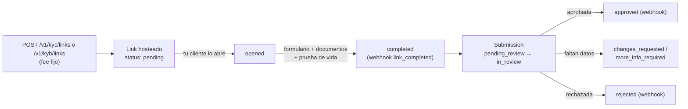

> **Ambientes:** Test `https://cryptobank.qbank.cl/platform` (`pk_test_...`) - Live `https://api.qbank.cl/platform` (`pk_...`).

## Verificación de la cuenta antes de crear payins
La cobranza autenticada requiere `kyc_status: approved` en personas y KYB aprobado en empresas; mientras tanto, `POST /v1/payins` (QR/card/checkout/bank_transfer/fintoc), OTP/collect, cuentas de depósito dedicadas, cobros con tarjeta guardada y suscripciones responden `403 verification_required`. Los links públicos, abonos pasivos, asignación de org-admin e instrumentos del sistema siguen disponibles; solicita `POST /v1/me/verification/link` y reintenta después de aprobar.
La **verificación de identidad** comprueba que una persona (KYC) o empresa
(KYB) es quien dice ser, con evidencia real: formulario completo, subida de
documentos validados por OCR y **prueba de vida en video**. Tiene dos caras:
1. **Tu propia verificación (onboarding)** — obligatoria: hasta aprobarla, tu cuenta solo puede **fondear** (payins, depósitos crypto, recibir
   transferencias) y consultar. Persona ⇒ KYC; empresa ⇒ KYB.
2. **Verificación de tus clientes (solo cuentas empresa)** — generas links
   hosteados o envías los datos por API para verificar a tus propios
   clientes finales, con una comisión fija por verificación.

## Tu propia verificación (onboarding)
Al registrarte, tu cuenta nace sin verificar (`kyc_status: none`) y **solo
puede fondear y leer**. Cualquier acción de dinero saliente (payouts,
transferencias, retiros, banking, tarjetas) responde
`403 verification_required` hasta que apruebes.
> **Nota**Las solicitudes nuevas exigen TOTP confirmado o passkey registrado; revisa [Perfil y seguridad](https://docs.cbpayapp.com/es/guides/profile) para enrolar uno y reintenta. Los links abiertos se re-sirven antes del gate; la automatización con API key sigue exenta.### Pide tu link de verificación

```bash
curl -X POST https://api.qbank.cl/platform/v1/me/verification/link \
  -H "Authorization: Bearer <token>"
```

Respuesta `201` (si ya tienes un link vigente, se devuelve el mismo con
`200`):

```json
{
  "link_id": "a1b2c3d4-e5f6-4a7b-8c9d-0e1f2a3b4c5d",
  "kind": "kyc",
  "url": "https://…/on/usd/individual/new?invite=abc123…",
  "status": "pending",
  "label": "Ana Pérez",
  "created_at": "2026-07-10T12:00:00Z",
  "updated_at": "2026-07-10T12:00:00Z"
}
```

El `kind` sale de tu tipo de cuenta: persona ⇒ `kyc`, empresa ⇒ `kyb`. El
onboarding **no tiene costo** para ti.
### Completa el wizard

Abre la `url`: el wizard hosteado te guía por el formulario, la subida de
documentos (identidad, comprobante de domicilio; societarios para
empresas) y — en KYC — la prueba de vida en video frente a la cámara.
### Espera la revisión

Consulta tu estado cuando quieras:

```bash
curl https://api.qbank.cl/platform/v1/me/verification \
  -H "Authorization: Bearer <token>"
```

```json
{
  "kyc_status": "pending_review",
  "required_kind": "kyc",
  "verified": false,
  "link": { "link_id": "a1b2c3d4-…", "kind": "kyc", "url": "https://…", "status": "completed" },
  "submission": {
    "submission_id": "f0e1d2c3-…",
    "kind": "kyc",
    "status": "changes_requested",
    "liveness_pending": false,
    "pending_documents": ["proofOfResidence"],
    "changes_requested_comments": "Sube un comprobante de residencia legible.",
    "documents_received": ["identity"],
    "documents_gate": {
      "ok": false,
      "matched": 2,
      "total": 10,
      "unresolved": [
        { "category": "bankStatement", "effective_outcome": "REVIEW" }
      ]
    },
    "created_at": "2026-07-10T12:05:00Z",
    "updated_at": "2026-07-11T16:00:00Z"
  }
}
```

Los cuatro campos opcionales de `submission` aparecen cuando están disponibles:
`pending_documents`, `changes_requested_comments`, `documents_received` y
`documents_gate`; `rejection_reason` no se expone y una falla temporal del
core puede omitirlos.

Cuando compliance aprueba, tu `kyc_status` pasa a `approved`
**automáticamente**, todos los servicios se desbloquean y recibes el
webhook `kyc_verification_status_changed` con `self_onboarding: true`.

> **Nota**
**Motor de decisión automática:** un expediente completamente limpio (documentos legibles, liveness aprobado, sin sanciones ni coincidencias PEP y sin señales de riesgo) se aprueba **en segundos y sin intervención humana**. Las zonas grises pasan a la cola humana del operador. Las sanciones AML/CFT severas (incluida una parte KYB), los países prohibidos, el fraude/expiración documental explícita y los rechazos explícitos del proveedor también pasan a la cola humana con sus razones preservadas; el motor ya no auto-rechaza. El campo `decision_source` del webhook (`"auto"` / `"admin"`) indica quién decidió.
La aprobación además **rellena el perfil de tu cuenta con la identidad
verificada**: `display_name` (persona = nombre + apellido; empresa = razón
social), `tax_id` y `country` se toman de la verificación y desde ese
momento quedan **inmutables** vía `PATCH /v1/me` (`409 identity_locked`) —
la identidad verificada es la fuente de verdad.
> **Nota**
Mientras esperas puedes fondear normalmente: payins, depósitos crypto y
transferencias entrantes funcionan desde el día uno. Si la verificación es
rechazada (`kyc_status: rejected`), contacta a tu operador por un link nuevo.
## Verificar a tus clientes (solo cuentas empresa)

Una cuenta **empresa** verificada puede verificar a sus propios clientes
finales. Cada verificación creada cobra la comisión fija configurada
(`kyc_verification` / `kyb_verification`; 0 = gratis), que se **reembolsa
automáticamente** si la creación falla. Las cuentas persona reciben
`403 company_account_required`.

### Opción A — Links hosteados (recomendada)

Tu cliente completa TODO en el wizard de marca blanca: formulario,
documentos y prueba de vida. Tú solo generas el link y esperas el webhook.

```bash Link KYC (persona)
curl -X POST https://api.qbank.cl/platform/v1/kyc/links \
  -H "Authorization: Bearer <token>" \
  -H "Content-Type: application/json" \
  -d '{
    "external_customer_id": "cust_123",
    "label": "Ana Pérez",
    "expires_in_days": 90,
    "idempotency_key": "kyc-link-cust-123-1"
  }'
```

```bash Link KYB (empresa, con país)
curl -X POST https://api.qbank.cl/platform/v1/kyb/links \
  -H "Authorization: Bearer <token>" \
  -H "Content-Type: application/json" \
  -d '{
    "external_customer_id": "cust_456",
    "country": "cl",
    "label": "Comercial Andina SpA",
    "expires_in_days": 90,
    "idempotency_key": "kyb-link-cust-456-1"
  }'
```

- `external_customer_id` (obligatorio): TU referencia del cliente
  verificado — la recibes de vuelta en cada webhook y consulta. Los valores
  `self` o terminados en `:self` están reservados para el onboarding de la
  cuenta y se rechazan con `400 invalid_payload`.
- `idempotency_key` (obligatoria): un retry con la misma clave devuelve el
  link original y **nunca cobra dos veces**.
- `country` (solo KYB): `us`, `cl`, `ve`, `br`, `mx`, `co`, `pe`, `bo`,
  `py`, `ar`, `uk`, `es`, `vg` o `generic` (con `generic_country` ISO alpha-2, ej. `"ES"`).
  El KYC individual no lleva país.
- `expires_in_days` (opcional, 1–90): si se omite, un link nativo vence en 90 días. El simulador es distinto: omitido significa sin expiración y no tiene tope explícito.

Respuesta `201`:

```json
{
  "link_id": "b2c3d4e5-f6a7-4b8c-9d0e-1f2a3b4c5d6e",
  "kind": "kyb",
  "external_customer_id": "cust_456",
  "url": "https://…/on/cl/business/new?invite=abc123…",
  "status": "pending",
  "country": "cl",
  "label": "Comercial Andina SpA",
  "expires_at": 1721209600,
  "verification_fee": "2.000000",
  "created_at": "2026-07-10T12:00:00Z",
  "updated_at": "2026-07-10T12:00:00Z"
}
```

Consulta e historial (todo POST tiene su GET):

```bash
# Listado con filtros
curl "https://api.qbank.cl/platform/v1/kyb/links?from=2026-07-01&to=2026-07-10&status=completed&page=1&page_size=50" \
  -H "Authorization: Bearer <token>"

# Detalle (estado vivo del link)
curl https://api.qbank.cl/platform/v1/kyb/links/{link_id} \
  -H "Authorization: Bearer <token>"
```

| Estado del link | Significado |
|---|---|
| `pending` | Creado, tu cliente aún no lo abre |
| `opened` | Tu cliente abrió el wizard |
| `completed` | Formulario enviado — nace la submission (webhook `kyb_link_completed` / `kyc_link_completed`) |
| `expired` | Venció sin completarse |

### Marca tus links de verificación

Las cuentas empresa pueden configurar la apariencia de sus links KYC/KYB
hosteados desde **Ajustes → Branding** en el portal. El preview usa la misma
marca efectiva que tendrá un link nuevo. Puedes subir un logo PNG, revisar el
preview y ajustar el nombre de la empresa, sitio web, dirección del footer,
correo de soporte y colores.

La API expone estos mismos ajustes para cuentas empresa. Los campos de texto
tienen un máximo de 120 caracteres para `brand_name`, 200 para `website` y
`footer_address`, y 254 para `support_email`. Los colores aceptan hex de seis
dígitos, con o sin `#`. El logo es un PNG en base64 de hasta 512 KB y
2000×2000 píxeles; omite el campo para conservar la imagen actual o envía una
cadena vacía para borrarla.

```bash
curl -X PUT https://api.qbank.cl/platform/v1/account/branding \
  -H "Authorization: Bearer <token>" \
  -H "Content-Type: application/json" \
  -d '{
    "brand_name": "ACME Corp",
    "website": "www.acme.example",
    "support_email": "support@acme.example",
    "color_primary": "1A2B3C",
    "color_header": "",
    "color_accent": ""
  }'
```

`200 OK` devuelve la marca efectiva después de actualizar. La respuesta tiene
la misma forma en `PUT` y `GET`:

```json
{
  "brand_name": "ACME Corp",
  "website": "www.acme.example",
  "footer_address": "",
  "support_email": "support@acme.example",
  "colors": {
    "primary": "#1A2B3C",
    "header": "#2E2E2E",
    "accent": "#A16207"
  },
  "logo_url": "https://cdn.cbpayapp.com/public/branding/org123/accounts/acc456/logo.png",
  "symbol_url": "",
  "custom": true
}
```

Lee los valores efectivos antes de mostrar tu propia pantalla de ajustes:

```bash
curl https://api.qbank.cl/platform/v1/account/branding \
  -H "Authorization: Bearer <token>"
```

El fallback efectivo es **cuenta → organización → CBPay**. Un texto vacío
hereda del nivel siguiente. Al crear un link, se congela un snapshot
sanitizado de la marca, por lo que cambiarla después no modifica
inesperadamente un link que ya fue servido. El wizard hosteado muestra el
logo, nombre y colores seleccionados, pero el pill **«Impulsado por CBPay»**
queda fijo y el footer siempre está presente.

### UBOs y directores invitados

En un flujo KYB alojado, cada UBO o director invitado completa su propio
wizard `/on/ubo` (flujo compartido con directores). Antes de enviar, la persona debe revisar y
firmar la declaración jurada de fondos que muestra el wizard. Es un paso del
formulario, no una ruta API nueva ni un desafío OTP.

Si la persona invitada envía sin una firma activa, la submission responde
`409 declaration_required`. No crees otra invitación ni reintentes con una ruta
nueva: vuelve a entregar el mismo wizard, completa la declaración y envía de
nuevo. Al firmar, la declaración se adjunta automáticamente al expediente
como ítem `swornDeclaration`. El caso KYB padre solo puede continuar cuando
cada UBO/director requerido completó su propio flujo.

### Lista y reenvío de hijos invitados

Para el contrato completo aislado por tenant, con ejemplos request/response, estados y soluciones, revisa [UBOs y directores invitados](./kyc-ubo-children). La lista nunca devuelve URLs bearer; el reenvío reutiliza la misma invitación y submission.

### Opción B — Datos por API

Si ya tienes los datos del cliente en tu sistema, créale la verificación
directo (sin wizard). La submission entra al mismo queue de revisión:

```bash
curl -X POST https://api.qbank.cl/platform/v1/kyc/submissions \
  -H "Authorization: Bearer <token>" \
  -H "Content-Type: application/json" \
  -d '{
    "external_customer_id": "cust_789",
    "idempotency_key": "kyc-sub-cust-789-1",
    "person": {
      "first_name": "Ana",
      "last_name": "Pérez",
      "email": "ana@ejemplo.com",
      "phone": "+56912345678",
      "nationality": "CHL",
      "date_of_birth": "1990-04-12",
      "tax_id": "12.345.678-5",
      "id_type": "id_card",
      "id_number": "12345678",
      "address": {
        "line1": "Av. Siempre Viva 123",
        "city": "Santiago",
        "state": "RM",
        "postal_code": "8320000",
        "country": "CHL"
      },
      "primary_purpose": "personal_or_living_expenses",
      "most_recent_occupation": "Engineer",
      "source_of_funds": "salary"
    }
  }'
```

Notas del modo datos:

- Países en **ISO alpha-3** (`CHL`, `USA`, `VEN`…); fechas `YYYY-MM-DD`;
  `id_type`: `passport | id_card | drivers_license`.
- Teléfono en **E.164** con código de país (ej. `+56912345678`). La API aún acepta cadenas de dígitos legacy (dígitos, `+`, `-`, espacios, paréntesis, hasta 32 caracteres), pero E.164 es el contrato.
- KYB: body `{ external_customer_id, country?, business: {…}, ubos?,
  directors?, signers?, bank_info?, metadata? }` en
  `POST /v1/kyb/submissions`. Además, el modo datos KYB exige nombre legal y número de registro completos; KYC exige nombres, fecha de nacimiento, nacionalidad ISO alpha-3, documento y país ISO alpha-3. Países KYB desconocidos usan el perfil genérico con ese ISO; `country: generic` exige `generic_country`.
- **No se exige prueba de vida al crear**: la submission KYC queda con
  `liveness_pending: true` y la cierras con un [liveness
  link](#prueba-de-vida-liveness-link).
- Re-enviar con el mismo `external_customer_id` mientras la submission
  siga abierta (`pending_review`, `changes_requested`,
  `more_info_required`) **actualiza** la misma submission y no cobra de
  nuevo.

Respuesta `201`:

```json
{
  "submission_id": "c3d4e5f6-a7b8-4c9d-0e1f-2a3b4c5d6e7f",
  "kind": "kyc",
  "external_customer_id": "cust_789",
  "status": "pending_review",
  "liveness_pending": true,
  "verification_fee": "1.500000",
  "created_at": "2026-07-10T12:05:00Z",
  "updated_at": "2026-07-10T12:05:00Z"
}
```

Consulta e historial:

```bash
curl "https://api.qbank.cl/platform/v1/kyc/submissions?from=2026-07-01&to=2026-07-10&status=approved&page=1&page_size=50" \
  -H "Authorization: Bearer <token>"

curl https://api.qbank.cl/platform/v1/kyc/submissions/{submission_id} \
  -H "Authorization: Bearer <token>"
```

El detalle agrega `pending_documents`, `rejection_reason`,
`changes_requested_comments`, `documents_received`, `documents_gate` y
`aml_decision` para KYB.

| Estado de la submission | Significado |
|---|---|
| `pending_review` | Recibida, en cola de compliance |
| `in_review` | Compliance tomó el caso |
| `changes_requested` | Hay que corregir datos y re-enviar |
| `more_info_required` | Faltan documentos ([súbelos por API](#documentos-por-api)) |
| `escalated` | Caso escalado a revisión senior |
| `approved` / `approved_partial` | Aprobada (final) |
| `rejected` | Rechazada (final) |
Una submission legacy migrada es una **tumba** congelada: leerla devuelve datos vivos con `status: "migrated"`, `migrated_from`, `migrated_to` y `migrated_from_core`; approve, reject, request-changes, override, reinvite, presign/upload/confirm, liveness link y `PATCH` de banking intent responden `409 superseded` con `this case was migrated; decide on <id-vivo>`. Opera `migrated_to`; notas y asignaciones caen en el caso vivo.
Los titulares pueden subsanar su submission propia antes de aprobarla en `pending_review`, `in_review`, `changes_requested`, `more_info_required` o `escalated`; detalle, documentos y liveness siguen disponibles. Terceros, productos y dinero no cambian, y `rejected` terminal responde `403`.

### Documentos por API

Los documentos son opcionales al crear (si faltan, compliance los pedirá
con `more_info_required`). Flujo de 3 pasos:

### Presign

```bash
curl -X POST https://api.qbank.cl/platform/v1/kyc/submissions/{submission_id}/documents \
  -H "Authorization: Bearer <token>" \
  -H "Content-Type: application/json" \
  -d '{
    "category": "identity",
    "filename": "cedula.jpg",
    "content_type": "image/jpeg",
    "file_size": 482133
  }'
```

```json
{ "upload_url": "https://storage…", "key": "public-api/…", "expires_in": 900 }
```

Categorías — KYC: `identity`, `identity_front` (frente), `identity_back` (reverso),
`proofOfResidence`; KYB: `legalPresence`, `ownershipStructure`, `controlStructure`,
`companyDetails`. Tipos: `application/pdf`, `image/png`, `image/jpeg`; máximo 15 MB;
la URL vence en 15 minutos. Para UBO invitados, usa `uboIdentity` (frente) o `uboIdentityBack` (reverso).
### Upload

`PUT` del binario directo a `upload_url` con el mismo `Content-Type`.
### Confirm

```bash
curl -X POST https://api.qbank.cl/platform/v1/kyc/submissions/{submission_id}/documents/confirm \
  -H "Authorization: Bearer <token>" \
  -H "Content-Type: application/json" \
  -d '{ "key": "public-api/…", "category": "identity", "filename": "cedula.jpg", "content_type": "image/jpeg" }'
```

```json
{ "status": "received", "ocr": "queued" }
```

Al confirmar se dispara la validación OCR; el resultado llega por el
webhook `kyc_document_validated` / `kyb_document_validated` y se consulta
con GET:

```bash
curl https://api.qbank.cl/platform/v1/kyc/submissions/{submission_id}/documents \
  -H "Authorization: Bearer <token>"
```

```json
{
  "items": [
    {
      "id": "9c9b0f1e-4b3c-4f6a-9f6d-2f0a1b2c3d4e",
      "category": "identity",
      "status": "completed",
      "outcome": "MATCH",
      "effective_outcome": "MATCH",
      "score": 0.97,
      "summary": "Document matches the submitted identity",
      "filename": "cedula.jpg"
    }
  ],
  "meta": { "retrieved": 1 }
}
```

`status` es `pending` mientras el trabajo OCR nativo espera, `running` mientras
se procesa, `completed` cuando se guarda el resultado o `failed` después de
reintentos acotados. Mientras esté en `pending` o `running`, trátalo como
pendiente y espera el webhook `kyc_document_validated` /
`kyb_document_validated`. `failed` falla cerrado: queda en `REVIEW` y nunca
se convierte automáticamente en match.

`outcome`: `MATCH` (coincide), `REVIEW` (revisión manual), `NO_MATCH`. Cada item
completado expone además `score` (confianza media de los campos) y un
`summary` legible:

- `id`: identificador de la validación (lo usa el equipo de cumplimiento para revisarla).
- `effective_outcome`: el resultado que rige hoy — si un administrador resolvió la validación manualmente desde el panel admin, ese resultado; si no, el del motor OCR. En el detalle de la submission (`GET /v1/kyc/submissions/{id}`) el bloque `documents_gate` resume si TODOS los documentos ya están resueltos (`ok: true`), con `matched`/`total` y la lista `unresolved` de los pendientes.
- `manual_review`: presente solo cuando un administrador resolvió manualmente la validación desde el panel admin. En la vista de cuenta trae `outcome` y `reviewed_at` (sin la nota interna ni el revisor).

La respuesta visible para la cuenta puede incluir `ocr` con valores y confianza
por campo, tipo de documento, comprobaciones MRZ, fechas detectadas, calidad y
señales de fraude. Es evidencia para compliance, no una aprobación por sí sola.
Si el sidecar nativo no está disponible, el documento queda en `REVIEW`; no
existe fallback externo ni `MATCH` automático.

> **Nota**
La revisión manual de una validación de documento es una operación exclusiva del panel de administración (CBPay Admin); no se expone por API pública. Cuando el equipo de cumplimiento la aplica, tu cuenta ve el resultado actualizado en `effective_outcome` y `manual_review`, y el webhook `kyc_document_validated` / `kyb_document_validated` correspondiente.
### Prueba de vida (liveness link)

Las submissions KYC creadas por datos nacen con `liveness_pending: true`
(la prueba de vida es un flujo de cámara en browser). Genera un link
mínimo hosteado para que tu cliente la complete:

```bash
curl -X POST https://api.qbank.cl/platform/v1/kyc/submissions/{submission_id}/liveness_link \
  -H "Authorization: Bearer <token>" \
  -H "Content-Type: application/json" \
  -d '{ "expires_in_days": 90 }'
```

```json
{ "url": "https://…/on/liveness/<token>", "status": "pending", "expires_at": 1751234567 }
```

- No cobra (el servicio se cobró al crear la submission). Si ya hay un
  link vigente, el POST devuelve el mismo; si la prueba ya fue superada,
  `400 liveness_already_completed`.
- `GET .../liveness_link` devuelve el último link y el estado del check
  (`{ "liveness": { "status", "outcome", "passed" } }`).
- Al pasar (outcome `PASS` o `REVIEW`): la submission limpia
  `liveness_pending` y llega el webhook `kyc_liveness_completed`.

## Preguntas frecuentes

Consulta la [referencia de errores](https://docs.cbpayapp.com/es/errors) para códigos HTTP y soluciones.

#### ¿Qué verificación debo usar?
Usa KYC para una cuenta persona y KYB para una cuenta empresa.
