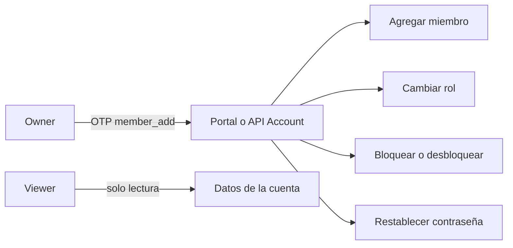

> **Ambientes:** Test `https://cryptobank.qbank.cl/platform` (`pk_test_...`) - Live `https://api.qbank.cl/platform` (`pk_...`).

Las cuentas de empresa pueden entregar a cada usuario humano solo el acceso
que necesita. Usa el portal para la administración habitual o la API de
Account cuando la gestión de miembros forme parte de un back-office
controlado.

> **Nota**
Estos endpoints requieren una sesión de miembro humano. Las API keys pueden
consultar recursos de la cuenta, pero no tienen perfil de miembro ni pueden
administrar miembros.
## Roles y permisos

| Rol | Lee datos de la cuenta | Opera productos | Administra miembros y credenciales |
|---|---:|---:|---:|
| `owner` | Sí | Sí | Sí |
| `operator` | Sí | Sí | No |
| `viewer` | Sí | No | No |

`viewer` es de solo lectura: no puede crear ni cambiar operaciones,
credenciales, miembros o ajustes de la cuenta. Mantén al menos un `owner` en
cada cuenta de empresa.



## Administrar miembros en el portal

### Abre los ajustes de la cuenta de empresa

Inicia sesión como `owner`, abre los ajustes de la cuenta de empresa y entra
en la sección de miembros.
### Agrega o selecciona un miembro

Al agregar un miembro, indica email, una contraseña de al menos ocho
caracteres y uno de los tres roles. Al editarlo, selecciónalo antes de
cambiar su rol o estado.
### Confirma la acción

Para agregar un miembro, cambiar un rol, bloquear o desbloquear un login, o
restablecer una contraseña, completa el desafío OTP `member_add` cuando el
portal lo solicite. La acción se aplica inmediatamente después de confirmar.
Un owner no puede bloquear su propio login. Pide a otro owner que lo haga. El
último owner tampoco puede ser degradado.

## Administrar miembros con la API

Todos los ejemplos usan un token de sesión humana:

```bash
export CBPAY_API="https://api.qbank.cl/platform"
export SESSION_TOKEN="<human-session-token>"
export MEMBER_ID="5a4b3c2d-1e0f-9a8b-7c6d-5e4f3a2b1c0d"
```

### 1. Consultar tu perfil de miembro

Este endpoint distingue al miembro que inició sesión de la cuenta de empresa:

```bash
curl "$CBPAY_API/v1/me/member" \
  -H "Authorization: Bearer $SESSION_TOKEN"
```

```json
{
  "id": "5a4b3c2d-1e0f-9a8b-7c6d-5e4f3a2b1c0d",
  "email": "ops@example.com",
  "role": "operator",
  "status": "active",
  "created_at": "2026-07-07T12:00:00Z"
}
```

Las API keys reciben `404 member_not_found` porque no son miembros humanos.

### 2. Agregar y listar miembros

Agregar miembros es exclusivo de cuentas de empresa. Si omites `role`, el
valor predeterminado es `operator`:

```bash
curl -X POST "$CBPAY_API/v1/members" \
  -H "Authorization: Bearer $SESSION_TOKEN" \
  -H "Content-Type: application/json" \
  -d '{
    "email": "ops@example.com",
    "password": "another-secure-pass",
    "role": "operator"
  }'
```

La respuesta es el miembro creado:

```json
{
  "id": "5a4b3c2d-1e0f-9a8b-7c6d-5e4f3a2b1c0d",
  "email": "ops@example.com",
  "role": "operator",
  "status": "active",
  "created_at": "2026-07-07T12:00:00Z"
}
```

Lista los miembros antes de mostrar un formulario de edición:

```bash
curl "$CBPAY_API/v1/members" \
  -H "Authorization: Bearer $SESSION_TOKEN"
```

```json
{
  "members": [
    {
      "id": "5a4b3c2d-1e0f-9a8b-7c6d-5e4f3a2b1c0d",
      "email": "ops@example.com",
      "role": "operator",
      "status": "active",
      "created_at": "2026-07-07T12:00:00Z"
    }
  ]
}
```

### 3. Cambiar el rol

Solo un owner de una cuenta de empresa puede cambiar roles. Los valores
permitidos son `owner`, `operator` y `viewer`.

```bash
curl -X PUT "$CBPAY_API/v1/members/$MEMBER_ID/role" \
  -H "Authorization: Bearer $SESSION_TOKEN" \
  -H "Content-Type: application/json" \
  -H "X-OTP-Token: <member-add-otp>" \
  -d '{"role":"operator"}'
```

```json
{
  "member_id": "5a4b3c2d-1e0f-9a8b-7c6d-5e4f3a2b1c0d",
  "role": "operator",
  "changed": true
}
```

### 4. Bloquear o desbloquear un miembro

Deshabilitar un miembro revoca inmediatamente todas sus sesiones. Usa
`active` para desbloquear el login.

```bash
curl -X PUT "$CBPAY_API/v1/members/$MEMBER_ID/status" \
  -H "Authorization: Bearer $SESSION_TOKEN" \
  -H "Content-Type: application/json" \
  -H "X-OTP-Token: <member-add-otp>" \
  -d '{"status":"disabled"}'
```

```json
{
  "member_id": "5a4b3c2d-1e0f-9a8b-7c6d-5e4f3a2b1c0d",
  "status": "disabled",
  "changed": true,
  "sessions_revoked": 2
}
```

### 5. Restablecer una contraseña

Restablecer la contraseña también revoca todas las sesiones del miembro. Para
cambiar tu propia contraseña usa `POST /v1/me/password`.

```bash
curl -X POST "$CBPAY_API/v1/members/$MEMBER_ID/reset-password" \
  -H "Authorization: Bearer $SESSION_TOKEN" \
  -H "Content-Type: application/json" \
  -H "X-OTP-Token: <member-add-otp>" \
  -d '{"password":"another-secure-pass"}'
```

```json
{
  "member_id": "5a4b3c2d-1e0f-9a8b-7c6d-5e4f3a2b1c0d",
  "status": "password_reset",
  "sessions_revoked": 1
}
```

## Errores y recuperación

| HTTP | Error | Qué hacer |
|---:|---|---|
| 400 | `invalid_role` | Envía exactamente `owner`, `operator` o `viewer`. |
| 403 | `owner_required` | Inicia sesión con un owner. |
| 403 | `company_only` | Usa una cuenta de empresa; las cuentas persona no tienen miembros. |
| 403 | `otp_required` | Solicita y verifica el OTP `member_add`, y envía su token. |
| 404 | `member_not_found` | Usa una sesión humana, no una API key. |
| 409 | `last_owner_required` | Conserva al menos un owner antes de degradar este miembro. |
| 409 | `self_action_forbidden` | Pide a otro owner cambiar tu estado o contraseña. |

Consulta la [referencia de errores](https://docs.cbpayapp.com/es/errors) para el catálogo completo.

#### ¿Un operator puede agregar o editar miembros?
No. Los operators pueden operar los productos de la cuenta, pero no
administrar miembros ni credenciales. La acción la debe realizar un owner.
#### ¿Puedo usar una API key para administrar miembros?
No. La administración requiere una sesión humana. Las API keys no tienen
perfil de miembro y `GET /v1/me/member` devuelve `member_not_found`.
#### ¿Qué ocurre al deshabilitar un miembro?
Todas sus sesiones se revocan inmediatamente. Un owner debe reactivarlo antes
de que pueda volver a iniciar sesión.
#### ¿Cómo cambio mi propia contraseña?
Usa `POST /v1/me/password`. El endpoint de administración es para otro
miembro y devuelve `self_action_forbidden` si lo usas contigo mismo.
