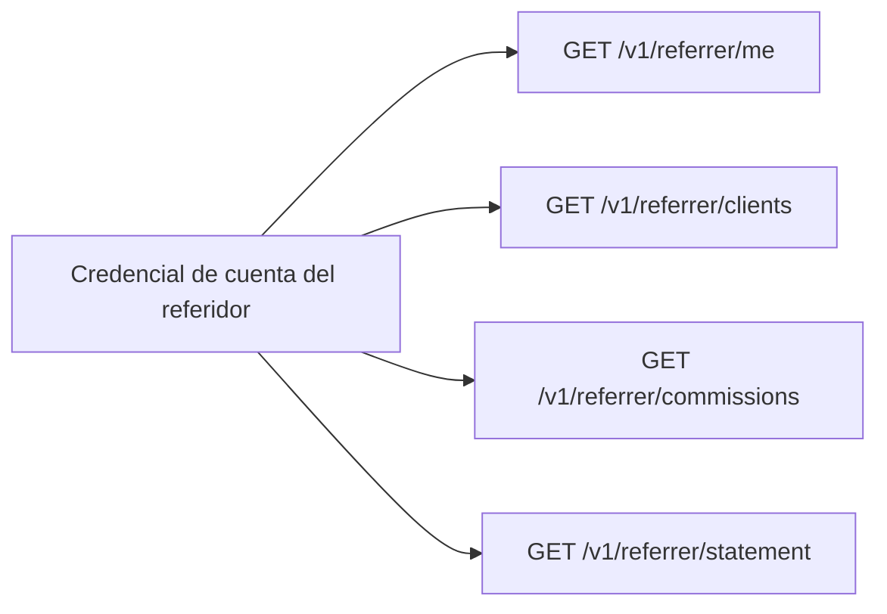

> **Ambientes:** Test `https://cryptobank.qbank.cl/platform` (`pk_test_...`) - Live `https://api.qbank.cl/platform` (`pk_...`).

El portal del referidor es una superficie de solo lectura para la credencial de
la cuenta de pago de un referidor activo. No acepta un `referrer_id` enviado
por el usuario: resuelve el referidor desde la cuenta autenticada, por lo que
solo muestra sus clientes, comisiones e informes.



## Autenticación y límites

Usa la sesión o credencial API de la cuenta de pago del referidor. Cualquier
otra cuenta recibe `404 not_found`. Las respuestas son neutrales respecto de
proveedores y nunca exponen identidades internas.

Los listados usan `page` y `page_size`. Comisiones e informes requieren
`from` y `to`. Puedes solicitar `format=json` (predeterminado), `pdf` o
`xlsx`; `lang=en|es|zh` localiza las etiquetas humanas de las descargas.

## 1. Ver el perfil

```bash
curl "$CBPAY_URL/v1/referrer/me" \
  -H "Authorization: Bearer $REFERRER_TOKEN"
```

```json
{
  "id": "aaaaaaaa-aaaa-4aaa-8aaa-aaaaaaaaaaaa",
  "org_id": "99999999-9999-4999-8999-999999999999",
  "name": "Hernan Lopez",
  "code": "hernan",
  "email": "hernan@example.com",
  "payout_account_id": "11111111-1111-4111-8111-111111111111",
  "status": "active",
  "created_at": "2026-11-04T12:00:00Z",
  "updated_at": "2026-11-04T12:00:00Z"
}
```

Es solo lectura. El admin de la organización controla nombre, estado, cuenta
de pago y asignaciones.

## 2. Ver clientes asignados

```bash
curl "$CBPAY_URL/v1/referrer/clients?status=active&page=1&page_size=50" \
  -H "Authorization: Bearer $REFERRER_TOKEN"
```

```json
{
  "page": 1,
  "page_size": 50,
  "assignments": [{
    "id": "bbbbbbbb-bbbb-4bbb-8bbb-bbbbbbbbbbbb",
    "org_id": "99999999-9999-4999-8999-999999999999",
    "referrer_id": "aaaaaaaa-aaaa-4aaa-8aaa-aaaaaaaaaaaa",
    "account_id": "33333333-3333-4333-8333-333333333333",
    "percent_bps": 2000,
    "percent": "20",
    "status": "active",
    "effective_from": "2026-11-04T12:01:00Z",
    "created_at": "2026-11-04T12:01:00Z"
  }]
}
```

Usa `status=active` o `status=revoked`. Nunca se devuelven asignaciones de
otro referidor.

## 3. Ver comisiones devengadas

```bash
curl "$CBPAY_URL/v1/referrer/commissions?from=2026-11-01&to=2026-12-01&status=pending&page=1&page_size=50" \
  -H "Authorization: Bearer $REFERRER_TOKEN"
```

```json
{
  "page": 1,
  "page_size": 50,
  "commissions": [{
    "id": "cccccccc-cccc-4ccc-8ccc-cccccccccccc",
    "org_id": "99999999-9999-4999-8999-999999999999",
    "referrer_id": "aaaaaaaa-aaaa-4aaa-8aaa-aaaaaaaaaaaa",
    "account_id": "33333333-3333-4333-8333-333333333333",
    "ref_type": "payout",
    "ref_id": "dddddddd-dddd-4ddd-8ddd-dddddddddddd",
    "asset": "USDT",
    "base_gross": "100.000000",
    "cost_amount": "25.000000",
    "base_net": "75.000000",
    "percent_bps": 2000,
    "percent": "20",
    "commission_amount": "15.000000",
    "cost_missing": false,
    "status": "pending",
    "period": "2026-11",
    "created_at": "2026-11-04T12:02:00Z"
  }]
}
```

La comisión es `floor(max(bruto - costo, 0) × percent_bps / 10000)`. Los
montos son strings. Si falta el costo, la fila lleva `cost_missing: true` y
mantiene el cálculo auditable. Filtros opcionales: `account_id`, `status` y
`period`; `from` y `to` limitan el rango.

## 4. Descargar tu informe

El informe contiene totales por asset, resumen por cliente, líneas de
transacción, cierres y `balanced`. Se genera únicamente para el referidor
autenticado:

```bash
curl "$CBPAY_URL/v1/referrer/statement?from=2026-11-01&to=2026-12-01&format=json&lang=es" \
  -H "Authorization: Bearer $REFERRER_TOKEN"
curl -OJ "$CBPAY_URL/v1/referrer/statement?from=2026-11-01&to=2026-12-01&format=pdf&lang=es" \
  -H "Authorization: Bearer $REFERRER_TOKEN"
curl -OJ "$CBPAY_URL/v1/referrer/statement?from=2026-11-01&to=2026-12-01&format=xlsx&lang=es" \
  -H "Authorization: Bearer $REFERRER_TOKEN"
```

La respuesta JSON contiene `org_id`, `org_name`, `referrer_id`,
`referrer_name`, `referrer_code`, `referrer_email`, `from`, `to`, `generated_at`, `totals`,
`clients`, `lines`, `closings`, `truncated`, `clients_truncated`,
`closings_truncated` y `balanced`.

PDF y XLSX usan logo, colores, nombre y footer del branding white-label de la
organización. CBPay es solo el branding predeterminado.

## Estados y errores

| Estado | Significado |
|---|---|
| `active` | Puede devengar |
| `inactive` | No hay nuevos devengos; lo anterior sigue visible |
| `pending` | Devengada y esperando cierre |
| `reversed` | Devengo anterior revertido; queda en el historial |
| `approved` | Incluida en un cierre aprobado |
| `paid` | Incluida en un cierre pagado |
| `revoked` | Asignación terminada; historial intacto |

| HTTP | Código | Solución |
|---:|---|---|
| 400 | `invalid_range` | Envía fechas `from` y `to` válidas. |
| 400 | `invalid_format` | Usa `json`, `pdf` o `xlsx`. |
| 404 | `not_found` | Autentica con la cuenta de pago activa del referidor. |

Revisa el [catálogo de errores](https://docs.cbpayapp.com/es/errors) para el formato común.

## Preguntas frecuentes

#### ¿Puedo elegir un referrer ID?No. Se deriva de tu cuenta de pago autenticada y no permite acceso cruzado.#### ¿Puedo cambiar mi porcentaje o clientes aquí?No. El portal es de solo lectura; solicítalo a un admin de la organización.#### ¿Por qué una comisión está pendiente?Fue devengada, pero todavía no se vinculó a un cierre mensual aprobado o pagado.#### ¿Qué hago después de un timeout al descargar?Repite la consulta de lectura con el mismo rango y formato; no activa ningún pago.#### ¿Qué formatos existen?JSON para una aplicación, PDF para un informe formal y XLSX para análisis.
