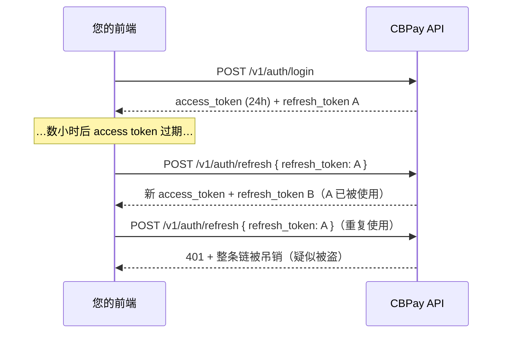

除注册和登录外，每次调用都必须在 `Authorization` 请求头中携带
凭证：

```
Authorization: Bearer <token>
```

也可使用 `X-API-Key: <token>` 作为替代请求头。

## 注册与邮箱验证

注册采用先验证模式：绝不直接创建会话。公共端点对新邮箱和重复邮箱均返回 `201 pending_verification`，因此调用方无法利用它枚举账户。邮箱所有者会收到验证码；请使用 `POST /v1/auth/register/confirm` 完成流程。

邮箱身份匹配可防止同一邮箱创建多个账户。对于 `gmail.com` 和
`googlemail.com`，系统会忽略点号和 `+` 后的内容，并将
`googlemail.com` 视为 `gmail.com`。对于支持的 Outlook、Hotmail、Live、
MSN、iCloud、Me、Mac、Yahoo、Ymail、Rocketmail 和 Proton 域名，也会
折叠 `+` 后缀；其他域名只进行精确匹配。

注册等价变体会返回相同的 `201 pending_verification` 结构，不会创建新账户。
OAuth、管理员创建账户、邀请和邮箱变更遇到同一邮箱时返回
`409 duplicate` 或 `409 email_in_use`。此行为按组织隔离。如果组织策略
阻止了该邮箱，请处理阻止原因，不要尝试同一邮箱的其他变体。

```bash
curl -X POST https://api.qbank.cl/platform/v1/auth/register \
  -H "Content-Type: application/json" \
  -d '{"org":"cbpay","type":"person","email":"ana@example.com","password":"a-secure-password","display_name":"Ana","country":"CL"}'
```

```json
{"status":"pending_verification","note":"check your email for the verification code; complete registration with POST /v1/auth/register/confirm"}
```

确认验证码以验证邮箱。该端点返回 `201 pending_2fa_enrollment`，包含有效
30 分钟的 `pending_token`、`factors: ["totp", "sms"]`、
`passkeys_available: false`、`next` 和 `account`，不会创建会话。只有完成
[注册后的强制 2FA 注册](#注册后的强制-2fa-注册)中的 TOTP 或短信注册后才
会签发会话：

```bash
curl -X POST https://api.qbank.cl/platform/v1/auth/register/confirm \
  -H "Content-Type: application/json" \
  -d '{"org":"cbpay","email":"ana@example.com","code":"123456"}'
```

格式错误的验证码返回 `400 invalid_code`；无效或过期的验证码统一返回 `401 invalid_code`。如果无法查询验证服务，API 返回 `502 otp_check_failed`。确认成功后返回上面的待注册结构；请将 token 交给注册向导。

## 注册的自适应工作量证明

CBPay 使用可选的 Hashcash 风格工作量证明来减缓自动化注册洪峰，
而不会给正常流量增加额外摩擦。只有公共注册速度进入攻击模式时才会
强制要求。注册和邮箱确认分别使用此 gate；请使用相匹配的 `purpose`
请求挑战，并提交完全相同的小写邮箱。

挑战有效期为 600 秒，难度为 `20`，并绑定邮箱和 purpose。请在客户端中
计算，最好在用户填写个人或企业表单时使用后台 worker：

```bash
curl -X POST https://api.qbank.cl/platform/v1/auth/pow-challenge \
  -H "Content-Type: application/json" \
  -d '{"purpose":"register","email":"ana@example.com"}'
```

```json
{
  "challenge": "<challenge>",
  "difficulty": 20,
  "algorithm": "sha256-leading-zero-bits-v1",
  "expires_in": 600,
  "input": "sha256(nonce_bytes || lowercase(email) || be64(suffix)); find suffix with difficulty leading zero bits",
  "nonce_bytes": "first 16 bytes of the base64url payload (part before the dot)"
}
```

找到一个非负 `suffix`，使 SHA-256 摘要至少有 `difficulty` 个前导零位。
输入由挑战 payload 的前 16 个字节、小写邮箱以及作为无符号大端 64 位
整数编码的 suffix 组成。将结果放入注册请求：

```json
{
  "org": "cbpay",
  "type": "person",
  "email": "ana@example.com",
  "password": "a-secure-password",
  "display_name": "Ana",
  "country": "CL",
  "pow": {"challenge": "<challenge>", "suffix": 1847293}
}
```

企业账户使用同样的流程，将 `"type"` 设为 `"company"` 并提交企业注册字段。
收到验证码后，用 `"purpose":"confirm"` 请求新的挑战，并在确认时提交：

```bash
curl -X POST https://api.qbank.cl/platform/v1/auth/pow-challenge \
  -H "Content-Type: application/json" \
  -d '{"purpose":"confirm","email":"ana@example.com"}'

curl -X POST https://api.qbank.cl/platform/v1/auth/register/confirm \
  -H "Content-Type: application/json" \
  -d '{"org":"cbpay","email":"ana@example.com","code":"123456","pow":{"challenge":"<challenge>","suffix":1847293}}'
```

正常情况下，省略 `pow` 的客户端仍可注册和确认。攻击模式启用后，两个
端点都会返回 `400 pow_required`，直到解决匹配的挑战。请参阅
[认证错误](https://docs.cbpayapp.com/zh/errors#认证与注册错误)页面了解处理方式。挑战是无状态的，
10 分钟后过期；过期时请请求新挑战，不要重复提交旧解。挑战端点使用
独立配额：每个 IP 每小时 200 次，且不会消耗注册配额。

#### 现有客户端需要发布新版本吗？
正常流量下不需要：省略 `pow` 仍然有效。攻击模式启用后，客户端必须实现
挑战流程，并在同一操作中携带 `pow` 重试；服务器不会接受其他邮箱或
其他 purpose 的挑战。
#### 计算需要多长时间？
难度 20 设计为客户端的短时计算，通常需要数秒，具体取决于设备。请在
界面线程之外计算；如果超过 10 分钟，请请求新的挑战。
## 身份验证滥用限制

登录失败按归一化账户（组织/邮箱）计数：15 分钟内失败 8 次后，窗口期内的后续尝试返回相同的 `401 invalid_credentials`，且不再执行 bcrypt。待验证的注册成员也会收到该统一响应，无法使用注册密码登录。

密码找回特意防止枚举。`POST /v1/auth/password/forgot` 即使账户发送配额用尽也返回相同的 `200` 响应体；每个账户每小时最多发送 5 次真实验证码。`POST /v1/auth/password/reset` 允许每个账户每 15 分钟尝试 8 次验证码。通过邮箱成功重置会验证邮箱并清除 `register_pending`。

企业成员也可能收到管理员发起的恢复链接。将其中的 `token` 与 `org`、
`new_password` 提交到 `POST /v1/auth/password/reset-link`；链接只能使用
一次，60 分钟后过期。此成员流程与平台管理员密码重置流程相互独立。

## 凭证类型

#### JWT 会话（有登录的用户）

通过 `POST /v1/auth/login` 获取（注册需先确认邮箱，见下文），有效期
**24 小时**。适用于用户需要登录的应用。除 `access_token` 外，您还会收到
一个**刷新令牌（refresh token）**，无需再次输入密码即可续期会话 ——
见[会话续期](#session-renewal-refresh-tokens)。

```bash
curl -X POST https://api.qbank.cl/platform/v1/auth/login \
  -H "Content-Type: application/json" \
  -d '{ "org": "cbpay", "email": "ana@example.com", "password": "…" }'
```

```json
{
  "access_token": "eyJ…",
  "expires_at": "2026-07-14T15:20:49Z",
  "refresh_token": "rt_6a1e6c22-….XXXXXXXX…",
  "refresh_expires_at": "2026-08-12T15:20:49Z",
  "account_id": "…",
  "role": "owner"
}
```

企业账户可以拥有多个具有不同角色的**成员** —— 见下文
[企业成员](#company-members)。

> **注**
如果账户策略要求**登录时进行 OTP 验证**，响应会返回
`otp_required: true` 及一个 `pending_token`（而非会话）：第二步在
`POST /v1/auth/login/otp` 使用通过 SMS/WhatsApp 收到的验证码完成。
完整流程见[安全与双因素认证](https://docs.cbpayapp.com/zh/security-2fa)。
> **注**
您还可以提供**使用 Google、Apple、Microsoft 或 Facebook 注册和登录**
（免密码）—— 见[社交登录](https://docs.cbpayapp.com/zh/guides/social-login)。
#### API 密钥（服务器到服务器）

格式为 `pk_<key_id>.<secret>`。永不过期，且不绑定任何会话。
签发方式：

```bash
curl -X POST https://api.qbank.cl/platform/v1/api-keys \
  -H "Authorization: Bearer <session-token>" \
  -H "Content-Type: application/json" \
  -d '{ "label": "production-backend" }'
```

```json
{
  "api_key_id": "…",
  "key_id": "a1b2c3d4e5f60718",
  "token": "pk_a1b2c3d4e5f60718.XXXXXXXX…",
  "note": "store this token now; it cannot be retrieved again"
}
```

> **重要**
明文令牌**仅显示一次**。服务器端只存储其哈希 —— 如果丢失，请签发
新的密钥。
## 会话续期（刷新令牌） {#session-renewal-refresh-tokens}

`access_token` 有效期为 24 小时；`refresh_token`（`rt_…`）可让您在
**无需重新登录**的情况下换取新的令牌对，有效期 30 天，每次使用自动
续期，自最初登录起最长 90 天。它是**一次性的**：每次兑换都会返回新的
`refresh_token`，旧的立即失效（轮换）。



```bash
curl -X POST https://api.qbank.cl/platform/v1/auth/refresh \
  -H "Content-Type: application/json" \
  -d '{ "refresh_token": "rt_6a1e6c22-….XXXXXXXX…" }'
```

```json
{
  "access_token": "eyJ…",
  "expires_at": "2026-07-14T15:20:50Z",
  "refresh_token": "rt_9f2b1c30-….YYYYYYYY…",
  "refresh_expires_at": "2026-08-12T15:20:50Z",
  "account_id": "…",
  "role": "owner"
}
```

前端必须了解的安全规则：

- **严格轮换**：兑换时，该设备之前的 access token 立即被吊销（每条链
  只有一个存活的 access token）。请始终用响应中的令牌替换两个令牌。
- **重复使用 = 被盗**：如果已兑换过的刷新令牌再次被提交，该设备的整条
  链（令牌和会话）将被吊销，并在 `GET /v1/me/security/events` 中记录
  `refresh_token_reuse` 事件。用户必须重新登录。
- **随会话失效**：退出登录（`DELETE /v1/me/sessions/{id}`）、
  `POST /v1/me/sessions/revoke-all` 或修改/重置密码也会使关联的刷新
  令牌失效。
- 任何拒绝都返回 `401 invalid_refresh_token` —— 收到该错误时请引导用户
  重新登录。
- 请将刷新令牌保存在安全存储中（移动端使用 Keychain/Keystore；Web 端
  建议内存 + 重新登录，或由您的后端使用 httpOnly Cookie）。`pk_` API
  密钥不使用刷新机制：它们永不过期。

#### 应该多久刷新一次？
在 access token 即将过期时（参考 `expires_at`），或在正常调用收到
`401` 时刷新。避免多处并行刷新：同一令牌的两次兑换同时到达时，一次
成功、另一次收到 `401` 且不受惩罚 —— 但兑换一个**已被轮换**的令牌会
吊销整条链。
#### 90 天后会发生什么？
链的绝对上限是自最初登录起 90 天：即使每天刷新，到达上限后刷新会返回
`401`，用户必须重新认证（密码、通行密钥或社交登录）。
#### 刷新对 API 密钥适用吗？
不适用：`pk_` API 密钥永不过期且没有会话。刷新仅用于人类用户的 JWT
会话。
## 访问级别

您的凭证（会话 JWT 或 API 密钥）操作的是**您自己的账户**：余额、
付款、收款、转账、加密资产、KYC/KYB 以及您自己的 webhook。如果某个
端点返回 `403 account_required` 或 `403 org_admin_required`，说明该
操作属于其他凭证级别 —— 请联系 CBPay 团队。

## 您的账户资料

```bash
# Read the profile (includes kyc_status and type)
curl https://api.qbank.cl/platform/v1/me \
  -H "Authorization: Bearer <token>"

# Update profile fields (all optional)
curl -X PATCH https://api.qbank.cl/platform/v1/me \
  -H "Authorization: Bearer <token>" \
  -H "Content-Type: application/json" \
  -d '{
    "display_name": "Comercial Andina SpA",
    "tax_id": "76.543.210-8",
    "phone": "+56 9 1234 5678",
    "country": "CL",
    "locale": "en"
  }'
```

```json
{
  "id": "9b1deb4d-3b7d-4bad-9bdd-2b0d7b3dcb6d",
  "type": "company",
  "display_name": "Comercial Andina SpA",
  "email": "legal@andina.cl",
  "tax_id": "76.543.210-8",
  "phone": "+56 9 1234 5678",
  "country": "CL",
  "status": "active",
  "kyc_status": "approved",
  "created_at": "2026-06-01T12:00:00Z"
}
```

`PATCH /v1/me` 接受 `display_name`、`tax_id`、`phone`、`country` 和 `locale`
（只需发送有变更的字段）。空 `locale` 会存为 `en`；无效值返回 `400 invalid_locale`。
`email`、`status` 和 `kyc_status` 不可自行管理：由管理员处理。
见[语言与 locale](https://docs.cbpayapp.com/zh/guides/locale)。

## 企业成员

**企业**账户可以拥有多个各自登录、权限级别不同的用户：

| 角色 | 权限 |
|---|---|
| `owner` | 全部权限：可操作、管理成员和凭证 |
| `operator` | 日常操作（创建成员时的默认角色） |
| `viewer` | 只读 |

```bash
# Add a member (company accounts only)
curl -X POST https://api.qbank.cl/platform/v1/members \
  -H "Authorization: Bearer <token>" \
  -H "Content-Type: application/json" \
  -d '{
    "email": "finance@andina.cl",
    "password": "a-strong-password",
    "role": "viewer"
  }'

# List members
curl "https://api.qbank.cl/platform/v1/members?page_size=50" \
  -H "Authorization: Bearer <token>"
```

```json
{
  "page": 1,
  "page_size": 50,
  "members": [
    { "id": "…", "email": "legal@andina.cl", "role": "owner", "status": "active" },
    { "id": "…", "email": "finance@andina.cl", "role": "viewer", "status": "active" }
  ]
}
```

在个人账户上调用 `POST /v1/members` 会返回 `403 company_only`。

## 最佳实践

- 将 API 密钥保存在密钥管理器中；切勿写入代码或暴露在浏览器中。
- 每个环境/服务使用一个密钥（配上有意义的 `label`），以便在不中断
  服务的情况下轮换。

### 零停机轮换

通过 `POST /v1/api-keys` 签发新密钥（使用新的 label）。
### 部署

更新您的服务以使用新密钥。
### 停用旧密钥

流量迁移完成后，请联系 CBPay 团队吊销旧密钥。
- JWT 会话面向前端；自动化流程应始终使用 API 密钥。

## 注册后的强制 2FA 注册

邮箱确认只证明邮箱所有权，不再创建会话。`POST
/v1/auth/register/confirm` 返回 `201`、`status: "pending_2fa_enrollment"`、
有效 30 分钟的 `pending_token`、`factors: ["totp", "sms"]`、
`passkeys_available: false`、`next`、`note` 和 `account`。只可将 token 用于
`/v1/auth/register/2fa/*`。

TOTP 先调用 `totp/begin`，扫描 `otpauth_uri`，再确认六位代码；成功响应
包含会话和 10 个一次性 `recovery_codes`。SMS 或 WhatsApp 流程如下：

```bash
curl -X POST https://api.qbank.cl/platform/v1/auth/register/2fa/sms/begin \
  -H "Content-Type: application/json" \
  -d '{"pending_token":"<pending-token>","phone":"+56912345678","channel":"whatsapp"}'
```

`200` 响应包含 `phone_masked`、生效的 `channel`、`steps` 和 `note`。
`channel` 默认为 `sms`；指定 `whatsapp` 会通过 WhatsApp 发送验证码。
请在 10 分钟内确认：

```json
{
  "phone_masked": "********5678",
  "channel": "whatsapp",
  "steps": [
    "1. We sent a code by WhatsApp to ********5678.",
    "2. Enter the code within 10 minutes to verify your number."
  ],
  "note": "enter the code with POST /v1/auth/register/2fa/sms/confirm"
}
```

```bash
curl -X POST https://api.qbank.cl/platform/v1/auth/register/2fa/sms/confirm \
  -H "Content-Type: application/json" \
  -d '{"pending_token":"<pending-token>","code":"482913"}'
```

`201` 响应签发首个会话，`steps` 说明今后登录需要短信验证码，包含
`note`，不包含恢复代码。无论发送渠道是什么，确认端点都相同。受邀
成员和 org-admin 创建账户的成员首次登录也使用同一向导。

`channel` 只接受 `sms` 或 `whatsapp`；其他值返回 `400 invalid_channel`。
注册通行密钥端点返回 `410 passkey_not_offered`；通行密钥登录和
`/v1/me/passkeys` 仍然可用。通行密钥登录也遵循注册门控：
`must_enroll_2fa` 为 `true` 时返回 `pending_2fa_enrollment`，成员必须先
用 TOTP、SMS 或 WhatsApp 完成注册。仍处于 `RegisterPending` 的成员必须先确认邮箱。

`totp/begin` 和 `sms/begin` 在之前的尝试已保存因子、但清理标志被中断时，
也可能返回带正常会话的 `201`。TOTP begin 返回 `totp_secret`、
`otpauth_uri`、可选的 `qr_png_base64`、`steps` 和 `note`；SMS begin 返回
`phone_masked`、`channel`、`steps` 和 `note`。
