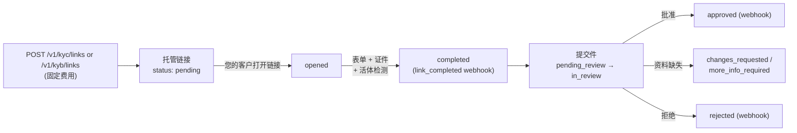

> **环境：** 测试 `https://cryptobank.qbank.cl/platform` (`pk_test_...`) - 正式 `https://api.qbank.cl/platform` (`pk_...`).

## 创建 payin 前的账户身份审核

认证收款要求个人账户为 `kyc_status: approved`、企业账户拥有已批准的 KYB；获批前，`POST /v1/payins`（QR/card/checkout/bank_transfer/fintoc）、OTP/collect、专属入金账户、已保存卡扣款或订阅都会返回 `403 verification_required`。
公开链接、被动入账、org-admin 分配和系统入金工具仍可用；通过 `POST /v1/me/verification/link` 申请审核，获批后重试原始创建请求。

**身份验证**通过真实证据证明个人（KYC）或企业（KYB）确为其所声称的身份：完整的表单、经 OCR 校验的证件上传，以及**视频活体检测**。它包含两个方面：

1. **您自己的验证（入驻）**——强制要求：在获批之前，您的账户只能**入金**（收款、加密货币充值、转入的内部转账）和读取数据。个人 ⇒ KYC；企业 ⇒ KYB。
2. **验证您的客户（仅限企业账户）**——生成托管链接或通过 API 提交数据来验证您自己的终端客户，每次验证收取固定费用。



## 您自己的验证（入驻）

注册后，您的账户初始为未验证状态（`kyc_status: none`），**只能入金和读取数据**。任何资金流出操作（付款、内部转账、提现、银行服务、卡片）在您获批之前都会返回 `403 verification_required`。

> **注**
新的自助申请需要已确认的 TOTP 或已注册的通行密钥；请参阅[个人资料与安全](https://docs.cbpayapp.com/zh/guides/profile)完成注册后重试。开放链接会在 gate 前重新返回，API key 自动化仍然豁免。
### 申请您的验证链接

```bash
curl -X POST https://api.qbank.cl/platform/v1/me/verification/link \
  -H "Authorization: Bearer <token>"
```

`201` 响应（如果您已有一个未关闭的链接，则返回同一个链接并响应 `200`）：

```json
{
  "link_id": "a1b2c3d4-e5f6-4a7b-8c9d-0e1f2a3b4c5d",
  "kind": "kyc",
  "url": "https://…/on/usd/individual/new?invite=abc123…",
  "status": "pending",
  "label": "Ana Pérez",
  "created_at": "2026-07-10T12:00:00Z",
  "updated_at": "2026-07-10T12:00:00Z"
}
```

`kind` 由您的账户类型决定：个人 ⇒ `kyc`，企业 ⇒ `kyb`。入驻验证对您**免费**。
### 完成向导

打开 `url`：托管向导会引导您完成表单、证件上传（身份证明、居住证明；企业需提供公司文件），KYC 还包括摄像头活体检测。
### 等待审核

随时查询您的状态：

```bash
curl https://api.qbank.cl/platform/v1/me/verification \
  -H "Authorization: Bearer <token>"
```

```json
{
  "kyc_status": "pending_review",
  "required_kind": "kyc",
  "verified": false,
  "link": { "link_id": "a1b2c3d4-…", "kind": "kyc", "url": "https://…", "status": "completed" },
  "submission": {
    "submission_id": "f0e1d2c3-…",
    "kind": "kyc",
    "status": "changes_requested",
    "liveness_pending": false,
    "pending_documents": ["proofOfResidence"],
    "changes_requested_comments": "请上传清晰的居住证明。",
    "documents_received": ["identity"],
    "documents_gate": {
      "ok": false,
      "matched": 2,
      "total": 10,
      "unresolved": [
        { "category": "bankStatement", "effective_outcome": "REVIEW" }
      ]
    },
    "created_at": "2026-07-10T12:05:00Z",
    "updated_at": "2026-07-11T16:00:00Z"
  }
}
```

`submission` 内的四个字段是可选的，核心服务有数据时才会返回：
`pending_documents`、`changes_requested_comments`、`documents_received` 和
`documents_gate`。面向账户的该接口有意不暴露 `rejection_reason`；如果核心
服务的只读刷新暂时不可用，这些可选字段可能被省略。

合规团队批准后，您的 `kyc_status` 会**自动**变为 `approved`，所有服务随即解锁（您会收到带 `self_onboarding: true` 的 `kyc_verification_status_changed` webhook）。

> **注**
**自动决策引擎：**资料完全干净（文件可读、活体通过、没有制裁或 PEP 命中且没有风险信号）会在**几秒内自动批准，无需人工介入**。灰色情况会进入 运营人员的人工队列。严重 AML/CFT 制裁（包括 KYB 关联方）、禁止司法辖区、明确的 文件欺诈/过期以及提供方明确拒绝也会进入人工队列，并保留原因；引擎不再自动拒绝。状态 webhook 的 `decision_source`（`"auto"` / `"admin"`）表示决定来源。
批准后还会**用已验证的身份回填您的账户档案**：`display_name`（个人 =
名 + 姓；企业 = 法定名称）、`tax_id` 和 `country` 均取自验证结果，此后
通过 `PATCH /v1/me` 修改将返回 `409 identity_locked` —— 已验证的身份即为
数据的最终来源。
> **注**
等待期间您可以正常入金：所有方式的收款、加密货币充值和转入的内部转账从第一天起即可使用。如果您的验证被拒绝（`kyc_status: rejected`），请联系您的运营方——他们可能会要求您通过新链接重试。
## 验证您的客户（仅限企业账户）

已通过验证的**企业**账户可以验证其自己的终端客户。每创建一次验证都会计收所配置的固定费用（`kyc_verification` / `kyb_verification`；0 = 免费），若创建失败则**自动退款**。个人账户会收到 `403 company_account_required`。

### 方式 A——托管链接（推荐）

您的客户在白标向导中完成全部流程：表单、证件和活体检测。您只需生成链接并等待 webhook。

```bash KYC link (person)
curl -X POST https://api.qbank.cl/platform/v1/kyc/links \
  -H "Authorization: Bearer <token>" \
  -H "Content-Type: application/json" \
  -d '{
    "external_customer_id": "cust_123",
    "label": "Ana Pérez",
    "expires_in_days": 90,
    "idempotency_key": "kyc-link-cust-123-1"
  }'
```

```bash KYB link (company, with country)
curl -X POST https://api.qbank.cl/platform/v1/kyb/links \
  -H "Authorization: Bearer <token>" \
  -H "Content-Type: application/json" \
  -d '{
    "external_customer_id": "cust_456",
    "country": "cl",
    "label": "Comercial Andina SpA",
    "expires_in_days": 90,
    "idempotency_key": "kyb-link-cust-456-1"
  }'
```

- `external_customer_id`（必填）：您对被验证客户的自有引用——会在每个 webhook 和查询中原样返回。等于 `self` 或以 `:self` 结尾的值保留给账户入驻使用，会被拒绝并返回 `400 invalid_payload`。
- `idempotency_key`（必填）：使用相同 key 的重试会返回原始链接，**绝不会重复扣费**。
- `country`（仅 KYB）：`us`、`cl`、`ve`、`br`、`mx`、`co`、`pe`、`bo`、`py`、`ar`、`uk`、`es`、`vg` 或 `generic`（配合 ISO alpha-2 的 `generic_country`，例如 `"ES"`）。个人 KYC 不需要国家。
- `expires_in_days`（可选，1–90）：省略时，原生链接默认 90 天后过期。模拟器不同：省略表示永不过期，且没有显式上限。

`201` 响应：

```json
{
  "link_id": "b2c3d4e5-f6a7-4b8c-9d0e-1f2a3b4c5d6e",
  "kind": "kyb",
  "external_customer_id": "cust_456",
  "url": "https://…/on/cl/business/new?invite=abc123…",
  "status": "pending",
  "country": "cl",
  "label": "Comercial Andina SpA",
  "expires_at": 1721209600,
  "verification_fee": "2.000000",
  "created_at": "2026-07-10T12:00:00Z",
  "updated_at": "2026-07-10T12:00:00Z"
}
```

查询与历史（每个 POST 都有对应的 GET）：

```bash
# Filtered listing
curl "https://api.qbank.cl/platform/v1/kyb/links?from=2026-07-01&to=2026-07-10&status=completed&page=1&page_size=50" \
  -H "Authorization: Bearer <token>"

# Detail (live link state)
curl https://api.qbank.cl/platform/v1/kyb/links/{link_id} \
  -H "Authorization: Bearer <token>"
```

| 链接状态 | 含义 |
|---|---|
| `pending` | 已创建，您的客户尚未打开 |
| `opened` | 您的客户已打开向导 |
| `completed` | 表单已提交——生成提交件（`kyb_link_completed` / `kyc_link_completed` webhook） |
| `expired` | 未完成即已过期 |

### 为您的验证链接设置品牌

企业账户可以在门户的**设置 → Branding** 中配置托管 KYC/KYB 链接的外观。
预览使用新链接实际采用的有效品牌。您可以上传 PNG 徽标、查看预览，并调整
企业名称、网站、页脚地址、支持邮箱和颜色。

企业账户也可以通过 API 使用相同的设置。`brand_name` 最多 120 个字符，
`website` 和 `footer_address` 最多 200 个字符，`support_email` 最多 254
个字符。颜色接受六位十六进制值，可带或不带 `#`。徽标必须是最多 512 KB、
尺寸不超过 2000×2000 像素的 base64 PNG；省略徽标字段表示保留当前图片，
发送空字符串表示删除图片。

```bash
curl -X PUT https://api.qbank.cl/platform/v1/account/branding \
  -H "Authorization: Bearer <token>" \
  -H "Content-Type: application/json" \
  -d '{
    "brand_name": "ACME Corp",
    "website": "www.acme.example",
    "support_email": "support@acme.example",
    "color_primary": "1A2B3C",
    "color_header": "",
    "color_accent": ""
  }'
```

`200 OK` 会返回更新后的有效品牌。`PUT` 和 `GET` 使用相同的响应结构：

```json
{
  "brand_name": "ACME Corp",
  "website": "www.acme.example",
  "footer_address": "",
  "support_email": "support@acme.example",
  "colors": {
    "primary": "#1A2B3C",
    "header": "#2E2E2E",
    "accent": "#A16207"
  },
  "logo_url": "https://cdn.cbpayapp.com/public/branding/org123/accounts/acc456/logo.png",
  "symbol_url": "",
  "custom": true
}
```

在自己的设置页面展示品牌前，先读取当前有效值：

```bash
curl https://api.qbank.cl/platform/v1/account/branding \
  -H "Authorization: Bearer <token>"
```

有效回退顺序是**账户 → 组织 → CBPay**。空文本值会从下一级继承。创建链接
时会保存经过清理的品牌快照，因此之后更改账户品牌不会意外改变已经提供的
链接。托管向导会显示选定的徽标、名称和颜色，但 **“Powered by CBPay”**
标签始终固定，页脚也始终保留。

### 受邀 UBO 和董事

在托管 KYB 流程中，每位受邀的 UBO 或董事都要完成自己的
`/on/ubo`（董事使用同一流程） 向导。在提交前，受邀人员必须查看并签署向导
显示的资金宣誓声明。这是表单步骤，不是新的 API 路由，也不是 OTP 挑战。

如果受邀人员在没有有效签名的情况下提交，提交件会返回
`409 declaration_required`。不要创建新的邀请，也不要改用新路由重试：
让该人员重新打开同一个向导，完成声明后再次提交。签署后，声明会自动以
`swornDeclaration` 项目附加到档案。只有所有必需的 UBO/董事子流程都完成
后，KYB 父案件才能继续。

### 列出并重新发送受邀关联人

完整的租户隔离合同、请求/响应示例、状态和解决方案请参阅[受邀 UBO 与董事](./kyc-ubo-children)。列表不会返回 bearer URL；重新发送会复用同一个邀请和提交件。

### 方式 B——通过 API 提交数据

如果您已持有客户的数据，可直接创建验证（无需向导）。提交件会进入同一个审核队列：

```bash
curl -X POST https://api.qbank.cl/platform/v1/kyc/submissions \
  -H "Authorization: Bearer <token>" \
  -H "Content-Type: application/json" \
  -d '{
    "external_customer_id": "cust_789",
    "idempotency_key": "kyc-sub-cust-789-1",
    "person": {
      "first_name": "Ana",
      "last_name": "Pérez",
      "email": "ana@example.com",
      "phone": "+56912345678",
      "nationality": "CHL",
      "date_of_birth": "1990-04-12",
      "tax_id": "12.345.678-5",
      "id_type": "id_card",
      "id_number": "12345678",
      "address": {
        "line1": "Av. Siempre Viva 123",
        "city": "Santiago",
        "state": "RM",
        "postal_code": "8320000",
        "country": "CHL"
      },
      "primary_purpose": "personal_or_living_expenses",
      "most_recent_occupation": "Engineer",
      "source_of_funds": "salary"
    }
  }'
```

数据模式注意事项：

- 国家使用 **ISO alpha-3**（`CHL`、`USA`、`VEN`…）；日期格式 `YYYY-MM-DD`；`id_type`：`passport | id_card | drivers_license`。
- 电话使用带国家代码的 **E.164** 格式（例如 `+56912345678`）。API 仍接受旧式数字字符串（数字、`+`、`-`、空格、括号，最多 32 个字符），但 E.164 才是正式约定。
- KYB：在 `POST /v1/kyb/submissions` 上使用请求体 `{ external_customer_id, country?, business: {…}, ubos?, directors?, signers?, bank_info?, metadata? }`。
- 数据模式 KYB 必须完整提供法定名称和注册号；KYC 必须提供姓名、出生日期、ISO alpha-3 国籍、证件和 ISO alpha-3 国家。未知 KYB 国家使用带该 ISO 国家值的通用 profile；`country: generic` 必须提供 `generic_country`。
- **创建时不要求活体检测**：KYC 提交件带有 `liveness_pending: true`；通过[活体检测链接](#liveness-check-liveness-link)来完成它。
- 在提交件处于开放状态（`pending_review`、`changes_requested`、`more_info_required`）时使用相同的 `external_customer_id` 重新发送，会**更新**同一个提交件，不会再次扣费。

`201` 响应：

```json
{
  "submission_id": "c3d4e5f6-a7b8-4c9d-0e1f-2a3b4c5d6e7f",
  "kind": "kyc",
  "external_customer_id": "cust_789",
  "status": "pending_review",
  "liveness_pending": true,
  "verification_fee": "1.500000",
  "created_at": "2026-07-10T12:05:00Z",
  "updated_at": "2026-07-10T12:05:00Z"
}
```

查询与历史：

```bash
curl "https://api.qbank.cl/platform/v1/kyc/submissions?from=2026-07-01&to=2026-07-10&status=approved&page=1&page_size=50" \
  -H "Authorization: Bearer <token>"

curl https://api.qbank.cl/platform/v1/kyc/submissions/{submission_id} \
  -H "Authorization: Bearer <token>"
```

详情中会附加合规团队要求的内容：`pending_documents`、`rejection_reason`、`changes_requested_comments`；KYC 还包含 `liveness_pending` 和 `documents_received`；KYB 包含 `aml_decision`。

| 提交件状态 | 含义 |
|---|---|
| `pending_review` | 已接收，处于合规队列中 |
| `in_review` | 合规团队已受理该案例 |
| `changes_requested` | 需要修正数据并重新提交 |
| `more_info_required` | 缺少证件（[通过 API 上传](#documents-through-the-api)） |
| `escalated` | 已升级至高级审核 |
| `approved` / `approved_partial` | 已批准（最终态） |
| `rejected` | 已拒绝（最终态） |

### 已迁移验证墓碑

迁移的 legacy 提交件是冻结的**墓碑**。读取墓碑会返回活跃提交件的数据，
其 `status: "migrated"`，并在适用时包含 `migrated_from`（墓碑 ID）、
`migrated_to`（活跃提交件 ID）以及用于审计的 `migrated_from_core`（legacy
提供方 ID）。所有操作都应针对活跃提交件。

墓碑上的任何写入都会返回 `409 superseded`，消息为
`this case was migrated; decide on <id-vivo>`。这包括 approve、reject、
request-changes、override、reinvite、文档预签名/上传/确认、创建活体链接以及
`PATCH` banking intent。发送到墓碑的备注和分配会有意落到活跃提交件。

> **注**
账户持有人可在批准前补充自己的 self-onboarding 提交件，适用状态为
`pending_review`、`in_review`、`changes_requested`、`more_info_required`
或 `escalated`；详情、文档和活体接口仍可用。第三方、产品和资金接口不变，
终态 `rejected` 仍返回 `403`。
### 通过 API 上传证件

创建时证件为可选项（如缺失，合规团队会通过 `more_info_required` 要求补充）。三步流程：

### 预签名

```bash
curl -X POST https://api.qbank.cl/platform/v1/kyc/submissions/{submission_id}/documents \
  -H "Authorization: Bearer <token>" \
  -H "Content-Type: application/json" \
  -d '{
    "category": "identity",
    "filename": "cedula.jpg",
    "content_type": "image/jpeg",
    "file_size": 482133
  }'
```

```json
{ "upload_url": "https://storage…", "key": "public-api/…", "expires_in": 900 }
```

类别——KYC：`identity`、`identity_front`（正面）、`identity_back`（背面）、`proofOfResidence`；KYB：`legalPresence`、`ownershipStructure`、`controlStructure`、`companyDetails`。文件类型：`application/pdf`、`image/png`、`image/jpeg`；最大 15 MB；上传 URL 15 分钟后过期。受邀 UBO 使用 `uboIdentity`（正面）或 `uboIdentityBack`（背面）。
### 上传

使用相同的 `Content-Type` 将二进制文件直接 `PUT` 到 `upload_url`。
### 确认

```bash
curl -X POST https://api.qbank.cl/platform/v1/kyc/submissions/{submission_id}/documents/confirm \
  -H "Authorization: Bearer <token>" \
  -H "Content-Type: application/json" \
  -d '{ "key": "public-api/…", "category": "identity", "filename": "cedula.jpg", "content_type": "image/jpeg" }'
```

```json
{ "status": "received", "ocr": "queued" }
```

确认后 OCR 校验进入队列；结果通过 `kyc_document_validated` / `kyb_document_validated` webhook 送达，并可用 GET 查询：

```bash
curl https://api.qbank.cl/platform/v1/kyc/submissions/{submission_id}/documents \
  -H "Authorization: Bearer <token>"
```

```json
{
  "items": [
    {
      "id": "9c9b0f1e-4b3c-4f6a-9f6d-2f0a1b2c3d4e",
      "category": "identity",
      "status": "completed",
      "outcome": "MATCH",
      "effective_outcome": "MATCH",
      "score": 0.97,
      "summary": "Document matches the submitted identity",
      "filename": "cedula.jpg"
    }
  ],
  "meta": { "retrieved": 1 }
}
```

`status` 在原生 OCR 任务排队时为 `pending`，处理时为 `running`，保存结果
后为 `completed`，有限重试耗尽后为 `failed`。处于 `pending` 或 `running`
时应视为尚未解决，并等待 `kyc_document_validated` /
`kyb_document_validated` webhook。`failed` 会 fail-closed：保持 `REVIEW`，
不会自动变成匹配。

`outcome`：`MATCH`、`REVIEW`（人工审核）、`NO_MATCH`。每个完成的项目还包含
`score`（字段平均置信度）和可读的 `summary`，以及：

- `id`：校验标识符（合规团队使用它进行审核）。
- `effective_outcome`：当前生效的结果 — 如果管理员已在管理面板中人工处理了该校验，则为人工结果；否则为 OCR 引擎结果。在提交详情（`GET /v1/kyc/submissions/{id}`）中，`documents_gate` 块汇总了所有文档是否已解决（`ok: true`），包含 `matched`/`total` 以及未解决项的 `unresolved` 列表。
- `manual_review`：仅当管理员在管理面板中人工处理了该校验时出现。账户视图中仅包含 `outcome` 和 `reviewed_at`（不含内部备注和审核人）。

账户可见响应还可能包含 `ocr`：逐字段值与置信度、检测到的文档类型、
MRZ 校验、检测日期、质量和欺诈信号。这些是合规证据，不是自动批准。
原生 sidecar 不可用时，文档保持 `REVIEW`；没有外部 fallback，也不会
自动发出 `MATCH`。

> **注**
人工处理文档校验是管理面板（CBPay Admin）的专属操作，不通过公共 API 提供。合规团队应用后，你的账户会在 `effective_outcome` 和 `manual_review` 中看到更新后的结果，并收到相应的 `kyc_document_validated` / `kyb_document_validated` webhook。
### 活体检测（活体检测链接）

通过 API 创建的 KYC 提交件初始带有 `liveness_pending: true`（活体检测是一个浏览器摄像头流程）。为您的客户生成一个精简的托管链接来完成它：

```bash
curl -X POST https://api.qbank.cl/platform/v1/kyc/submissions/{submission_id}/liveness_link \
  -H "Authorization: Bearer <token>" \
  -H "Content-Type: application/json" \
  -d '{ "expires_in_days": 90 }'
```

```json
{ "url": "https://…/on/liveness/<token>", "status": "pending", "expires_at": 1751234567 }
```

- 免费（该服务在创建提交件时已计费）。如已存在未关闭的链接，POST 会返回同一个；如检测已通过，则返回 `400 liveness_already_completed`。
- `GET .../liveness_link` 返回最新的链接和当前检测状态（`{ "liveness": { "status", "outcome", "passed" } }`）。
- 通过时（outcome 为 `PASS` 或 `REVIEW`）：提交件清除 `liveness_pending`，并触发 `kyc_liveness_completed` webhook。

## 常见问题

Consulta la [referencia de 错误](https://docs.cbpayapp.com/zh/errors) para códigos HTTP y soluciones.

#### 我应该使用哪种验证？
个人账户使用 KYC，企业账户使用 KYB。
