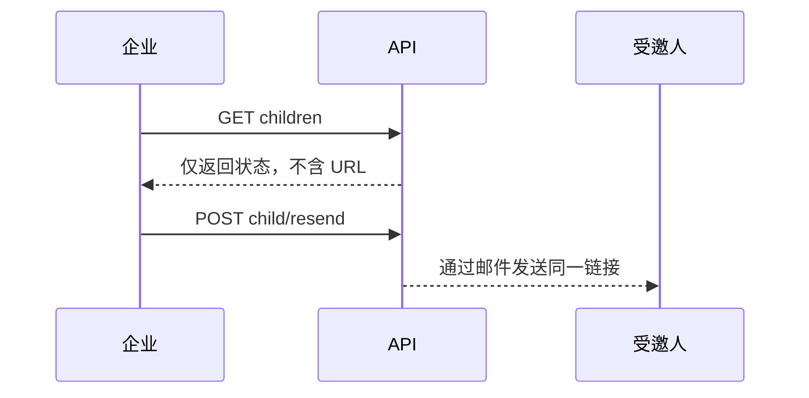

> **环境：** 测试 `https://cryptobank.qbank.cl/platform` (`pk_test_...`) - 正式 `https://api.qbank.cl/platform` (`pk_...`).

## 租户隔离的子流程

父级 KYB 审核期间，企业账户可以列出受邀 UBO 和董事。接口只允许已
认证的企业查看，并且绝不会返回邀请 URL。



```bash
curl https://api.qbank.cl/platform/v1/me/verification/children \
  -H "Authorization: Bearer <token>"
```

```json
{
  "children": [
    {
      "child_link_id": "b7c2d3e4-f5a6-4b7c-8d9e-0f1a2b3c4d5e",
      "flow": "ubo",
      "email": "owner@example.com",
      "name": "Jane Owner",
      "link_status": "opened",
      "submission_id": "f0e1d2c3-e4f5-4a6b-8c9d-0e1f2a3b4c5d",
      "submission_status": "changes_requested",
      "reused": false,
      "expires_at": "2027-01-15T12:00:00Z",
      "created_at": "2026-11-01T12:00:00Z",
      "declaration_signed": false,
      "needs_signature": true,
      "decision_note": "Please sign the beneficial owner declaration."
    }
  ]
}
```

## 重新发送同一个邀请

重新发送会通过电子邮件发送现有子链接，不会创建新的链接、bearer 或提交件。
可补充材料的过期邀请可以恢复；每天每位受邀人最多一次。

```bash
curl -X POST \
  https://api.qbank.cl/platform/v1/me/verification/children/{childID}/resend \
  -H "Authorization: Bearer <token>"
```

```json
{
  "sent": true,
  "reminded_to": "owner@example.com",
  "expires_at": "2027-01-15T12:00:00Z"
}
```

邮件结果会如实返回。`200` 且 `sent: false` 时，会包含
`email_error: "email_unavailable"` 或 `email_error: "email_failed"`；请先
检查结果再采取操作。

| 状态或错误 | 含义 | 解决方案 |
|---|---|---|
| `pending` / `opened` | 子流程尚未完成向导 | 需要时重新发送同一邀请。 |
| `changes_requested` / `more_info_required` | 证据需要修正 | 使用现有向导并再次提交。 |
| `declaration_signed: false` 且 `needs_signature: true` | 资金声明尚未签署 | 打开同一向导、签署并提交；不要创建新的子流程。 |
| `invalid_child`（`400`） | 缺少 `childID` | 使用列表响应中的 `child_link_id`。 |
| `not_found`（`404`） | 子流程不存在或属于其他 KYB 案件 | 检查所有权并使用列表中的 ID。 |
| `already_decided` / `invite_closed`（`409`） | 子流程不能再次发送 | 读取当前状态，不要创建替代邀请。 |
| `email_unavailable` / `email_failed` | 邮件未发送 | 检查邮件配置，稍后重试同一接口。 |

#### 重新发送会再次收费吗？
不会。它复用现有邀请和提交件，不会创建新的验证。
#### 为什么响应中没有 URL？
URL 是 bearer 凭证，只通过邮件发送给受邀人，绝不会暴露在企业 API 中。
共享错误处理请参阅[中央错误目录](https://docs.cbpayapp.com/zh/errors)。
