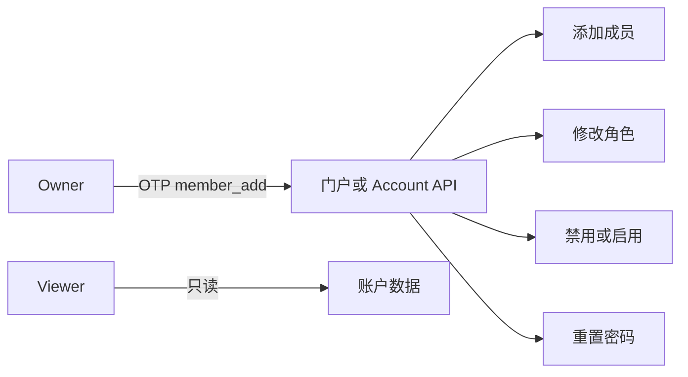

> **环境：** 测试 `https://cryptobank.qbank.cl/platform` (`pk_test_...`) - 正式 `https://api.qbank.cl/platform` (`pk_...`).

公司账户可以为每个登录用户分配所需的最小权限。日常管理可以使用
门户；如果成员管理属于受控的后台流程，也可以使用 Account API。

> **注**
这些 endpoint 需要人类成员会话。API key 可以访问账户资源，但没有成员
档案，也不能管理成员。
## 角色与权限

| 角色 | 读取账户数据 | 操作产品 | 管理成员和凭证 |
|---|---:|---:|---:|
| `owner` | 是 | 是 | 是 |
| `operator` | 是 | 是 | 否 |
| `viewer` | 是 | 否 | 否 |

`viewer` 只有只读权限，不能创建或修改交易、凭证、成员或账户设置。每个
公司账户必须至少保留一个 `owner`。



## 在门户中管理成员

### 打开公司账户设置

以 `owner` 身份登录，打开公司账户设置，然后进入成员区域。
### 添加或选择成员

添加成员时填写 email、至少八个字符且非常见的密码以及三个角色之一。编辑成员
时，先选择成员，再修改角色或状态。
### 确认操作

添加成员、修改角色、禁用或启用登录以及重置密码时，门户要求 OTP 后，
完成 `member_add` OTP 验证。验证成功后操作立即生效。
Owner 不能禁用自己的登录。请让另一位 owner 执行该操作。最后一位
owner 也不能被降级。

## 使用 API 管理成员

以下示例都使用人类会话 token：

```bash
export CBPAY_API="https://api.qbank.cl/platform"
export SESSION_TOKEN="<human-session-token>"
export MEMBER_ID="5a4b3c2d-1e0f-9a8b-7c6d-5e4f3a2b1c0d"
```

### 1. 读取自己的成员档案

此 endpoint 用来区分当前登录成员和公司账户：

```bash
curl "$CBPAY_API/v1/me/member" \
  -H "Authorization: Bearer $SESSION_TOKEN"
```

```json
{
  "id": "5a4b3c2d-1e0f-9a8b-7c6d-5e4f3a2b1c0d",
  "email": "ops@example.com",
  "role": "operator",
  "status": "active",
  "created_at": "2026-07-07T12:00:00Z"
}
```

API key 会返回 `404 member_not_found`，因为 API key 不是人类成员。

### 2. 添加和列出成员

添加成员仅适用于公司账户。如果省略 `role`，默认值是 `operator`：

```bash
curl -X POST "$CBPAY_API/v1/members" \
  -H "Authorization: Bearer $SESSION_TOKEN" \
  -H "Content-Type: application/json" \
  -d '{
    "email": "ops@example.com",
    "password": "another-secure-pass",
    "role": "operator"
  }'
```

响应会返回创建的成员：

```json
{
  "id": "5a4b3c2d-1e0f-9a8b-7c6d-5e4f3a2b1c0d",
  "email": "ops@example.com",
  "role": "operator",
  "status": "active",
  "created_at": "2026-07-07T12:00:00Z"
}
```

显示编辑表单前，先列出当前公司的成员：

```bash
curl "$CBPAY_API/v1/members" \
  -H "Authorization: Bearer $SESSION_TOKEN"
```

```json
{
  "members": [
    {
      "id": "5a4b3c2d-1e0f-9a8b-7c6d-5e4f3a2b1c0d",
      "email": "ops@example.com",
      "role": "operator",
      "status": "active",
      "created_at": "2026-07-07T12:00:00Z"
    }
  ]
}
```

### 3. 修改成员角色

只有公司账户的 owner 可以修改角色。允许的值是 `owner`、`operator` 和
`viewer`。

```bash
curl -X PUT "$CBPAY_API/v1/members/$MEMBER_ID/role" \
  -H "Authorization: Bearer $SESSION_TOKEN" \
  -H "Content-Type: application/json" \
  -H "X-OTP-Token: <member-add-otp>" \
  -d '{"role":"operator"}'
```

```json
{
  "member_id": "5a4b3c2d-1e0f-9a8b-7c6d-5e4f3a2b1c0d",
  "role": "operator",
  "changed": true
}
```

### 4. 禁用或启用成员

禁用成员会立即撤销该成员的全部会话。使用 `active` 可以重新启用登录。

```bash
curl -X PUT "$CBPAY_API/v1/members/$MEMBER_ID/status" \
  -H "Authorization: Bearer $SESSION_TOKEN" \
  -H "Content-Type: application/json" \
  -H "X-OTP-Token: <member-add-otp>" \
  -d '{"status":"disabled"}'
```

```json
{
  "member_id": "5a4b3c2d-1e0f-9a8b-7c6d-5e4f3a2b1c0d",
  "status": "disabled",
  "changed": true,
  "sessions_revoked": 2
}
```

### 5. 重置成员密码

重置密码也会撤销该成员的全部会话。修改自己的密码时，请使用
`POST /v1/me/password`。

```bash
curl -X POST "$CBPAY_API/v1/members/$MEMBER_ID/reset-password" \
  -H "Authorization: Bearer $SESSION_TOKEN" \
  -H "Content-Type: application/json" \
  -H "X-OTP-Token: <member-add-otp>" \
  -d '{"password":"another-secure-pass"}'
```

```json
{
  "member_id": "5a4b3c2d-1e0f-9a8b-7c6d-5e4f3a2b1c0d",
  "status": "password_reset",
  "sessions_revoked": 1
}
```

## 错误与处理方式

| HTTP | 错误 | 处理方式 |
|---:|---|---|
| 400 | `invalid_role` | 只发送 `owner`、`operator` 或 `viewer`。 |
| 403 | `owner_required` | 使用 owner 会话登录。 |
| 403 | `company_only` | 使用公司账户；个人账户不能使用成员功能。 |
| 403 | `otp_required` | 请求并验证 `member_add` OTP，然后发送其 token。 |
| 404 | `member_not_found` | 使用人类成员会话，而不是 API key。 |
| 409 | `last_owner_required` | 降级前必须保留至少一个 owner。 |
| 409 | `self_action_forbidden` | 请另一位 owner 修改你的状态或密码。 |

完整错误目录请参阅[错误参考](https://docs.cbpayapp.com/zh/errors)。

#### Operator 可以添加或编辑成员吗？
不可以。Operator 可以操作账户产品，但不能管理成员或凭证。该操作必须
由 owner 执行。
#### 可以使用 API key 管理成员吗？
不可以。成员管理需要人类会话。API key 没有成员档案，
`GET /v1/me/member` 会返回 `member_not_found`。
#### 禁用成员后会发生什么？
该成员的所有会话会立即被撤销。重新登录前，必须由 owner 重新启用成员。
#### 如何修改自己的密码？
使用 `POST /v1/me/password`。管理员重置 endpoint 只能用于其他成员，对
自己使用会返回 `self_action_forbidden`。
