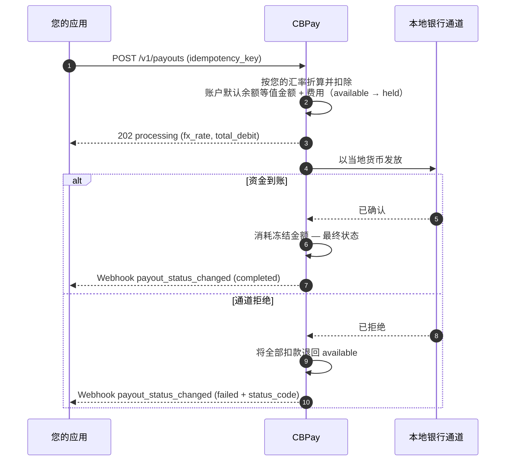

> **环境：** 测试 `https://cryptobank.qbank.cl/platform` (`pk_test_...`) - 正式 `https://api.qbank.cl/platform` (`pk_...`).

> **重要**
**破坏性变更 — 2026-11-13。** BOB、MXN、ARS 和 CLP 余额以及 `BANK_*` 镜像仅属于 Banking。平台 payout、swap、内部转账、银行卡、checkout、POS 和手续费拒绝法币结算并返回 HTTP `400`。已有账户保留明确设置的 `USDT` 默认值；新账户使用 `USD` 作为主余额。法币操作请使用 Banking。
出金（payout）会以当地货币向目的国的银行账户汇出资金。金额按**您账户的
汇率**（即 `GET /v1/rates` 返回的汇率）从当地货币折算为账户默认余额，并从该
余额中扣除等值金额和固定费用（如已配置）。明确设置 USDT 默认值的 legacy 账户
仍从 USDT 余额扣款。

以下是完整的生命周期，包括每一步中您的余额发生的变化：



## 1. 查询可用通道

国家、货币和方式由 CBPay 定义。请始终查询目录：

```bash
curl https://api.qbank.cl/platform/v1/payouts/methods \
  -H "Authorization: Bearer <token>"
```

```json
{
  "items": [
    { "country": "CL", "currency": "CLP", "method": "bank_transfer" },
    { "country": "PE", "currency": "PEN", "method": "bank_transfer" },
    { "country": "PE", "currency": "PEN", "method": "yape" },
    { "country": "BO", "currency": "BOB", "method": "qr" }
  ],
  "meta": { "retrieved": 4 }
}
```

可用的通道和方式：

| 国家 | 货币 | 方式 |
|---|---|---|
| 智利 | CLP | `bank_transfer` |
| 秘鲁 | PEN | `bank_transfer`、`yape` |
| 墨西哥 | MXN | `bank_transfer`（SPEI：CLABE 或借记卡） |
| 委内瑞拉 | VES | `bank_transfer`、`pago_movil` |
| 玻利维亚 | BOB / USD | `bank_transfer`、`qr`（参见 [QR 出金](https://docs.cbpayapp.com/zh/guides/payout-special-cases#qr-出金)） |
| 巴西 | BRL | `pix`（按密钥或到账户）、`qr`（PIX 二维码 —— 参见 [QR 出金](https://docs.cbpayapp.com/zh/guides/payout-special-cases#qr-出金)） |
| 厄瓜多尔 | USD | `bank_transfer`、`deuna`、`cash_pickup`、`cnb` |
| 巴拉圭 | PYG | `bank_transfer` |
| 阿根廷 | ARS / USD | `bank_transfer`（CBU 或 CVU） |
| 哥伦比亚 | COP | `bank_transfer`（整数金额，无小数）、`breb` |
| 美国 | USD | `ach`、`wire`、`swift` |

可用性可能变化；目录（`GET /v1/payouts/methods`）始终是唯一可信来源。
如果某个国家只有一种方式，`method` 为可选。每种方式的计费方式相同：
您的汇率 + 固定费用。

对于银行转账，您还需要银行目录（收款人的 `bank_code` 即来自这里）：

```bash
curl "https://api.qbank.cl/platform/v1/payouts/banks?country=CL" \
  -H "Authorization: Bearer <token>"
```

```json
{
  "items": [
    { "code": "001", "name": "Banco de Chile" },
    { "code": "012", "name": "Banco del Estado de Chile" },
    { "code": "016", "name": "Banco de Crédito e Inversiones" }
  ],
  "meta": { "retrieved": 3 }
}
```

## 2. 创建出金

```bash
curl -X POST https://api.qbank.cl/platform/v1/payouts \
  -H "Authorization: Bearer <token>" \
  -H "Content-Type: application/json" \
  -d '{
    "country": "MX",
    "currency": "MXN",
    "method": "bank_transfer",
    "amount": "1500.00",
    "beneficiary": {
      "name": "Maria Lopez",
      "account_type": "clabe",
      "account_number": "012180001234567895"
    },
    "description": "Invoice 8841",
    "idempotency_key": "invoice-8841"
  }'
```

> **重要**
`beneficiary` 是一个键/值对象，其必填字段取决于具体通道（智利需要 RUT
和银行，墨西哥需要 CLABE，秘鲁需要 CCI，巴西需要 PIX 密钥等）。方式目录
对每个通道都有说明。
> **注**
每笔出金都会自动将收款人保存为[联系人](https://docs.cbpayapp.com/zh/guides/contacts)
（发送 `"save_contact": false` 可跳过）。若要再次向其付款而无需重新输入
资料，请发送 `"beneficiary_contact_id"` 代替 `beneficiary` —— 系统将使用
其在该国家和方式下最近保存的收款人信息（若不存在则返回
`422 no_saved_destination`）。
响应 `202 Accepted`：

```json
{
  "payout_id": "0d4f…",
  "account_id": "…",
  "idempotency_key": "invoice-8841",
  "country": "MX",
  "currency": "MXN",
  "method": "bank_transfer",
  "local_amount": "1500.00",
  "fx_rate": "17.50",
  "usdt_amount": "85.714286",
  "fee": "0.300000",
  "total_debit": "86.014286",
  "settlement_asset": "USDT",
  "settlement_amount": "86.014286",
  "settlement_rate": "1",
  "status": "processing",
  "status_code": "",
  "status_message": "",
  "funds_debited": true,
  "compliance_pending": false,
  "bank_reference": "",
  "created_at": "2026-07-06T20:00:00Z"
}
```

此时您的余额已反映该笔扣款：`total_debit` 已从 `available` 转入
`held`（在 `settlement_asset` 对应的余额上）。

> **注**
**`bank_reference` —— 银行为该笔转账分配的交易编号。** US ACH/wire/SWIFT 在创建时**立即**返回 CBF（payout 保持 `processing` 直至银行确认）；其他通道在完成前为空（`""`）；
当出金状态变为 `completed` 时，它会带上目的地银行/通道分配的交易编号。收款人可使用该编号
与自己的银行核对付款。该字段同时出现在 `payout_status_changed` Webhook、PDF 回执、
出金 CSV 导出以及对账单中。
### 银行 tracking 标识与实时跟进

Payout 响应和 `payout_status_changed` 会包含两个新增且不绑定具体提供
商的字段：

```json
{
  "bank_reference": "CBF1234567890123",
  "uetr": "7d2e4b8a-9d11-4d3e-8f40-5c3b1a2e7f90",
  "imad": ""
}
```

- `uetr` 是 UETR/SWIFT gpi 标识，仅在银行为 SWIFT 转账报告该值时出现。
- `imad` 是国内 wire/ACH 标识，仅在银行报告该值时出现。
- 两个字段在可用前均为 `""`。CBPay 不会推导或编造这些值。

相同字段也会出现在 payout CSV 和 payout PDF 回执中。公共
[交易 tracker](https://docs.cbpayapp.com/zh/guides/tracking) 显示当前公共状态并链接到同一份回执；
它不会公开内部的 `manual_dispatch` 术语或合规细节。

### 从其他余额支付（`settlement_asset`）

扣款默认来自 USD；使用 `PUT /v1/settlement` 更改。若要让单笔操作从其他余额支付，请在请求中加入
`settlement_asset`。示例：一笔 100,000 CLP 的出金从 BTC 余额支付，会经过
四次转换，全部记录在响应中：

1. **CLP → USDT**，按您的汇率：`100000 / 950.25 = 105.235465 USDT`。
2. **+ 固定费用**：`105.235465 + 0.30 = 105.535465 USDT`（`total_debit`）。
3. **USDT → BTC**，按实际结算价格（`settlement_rate`
   `109029.34070000`）：`105.535465 / 109029.3407 = 0.00096795 BTC`
   （向上取整到聪）。
4. **以 BTC 扣款并冻结**：`settlement_amount` `0.00096795` 从您的 BTC
   余额中扣除；收款人照常收到其 100,000 CLP，分毫不差。

```json
{
  "country": "CL",
  "currency": "CLP",
  "local_amount": "100000",
  "fx_rate": "950.25",
  "usdt_amount": "105.235465",
  "fee": "0.300000",
  "total_debit": "105.535465",
  "settlement_asset": "BTC",
  "settlement_amount": "0.00096795",
  "settlement_rate": "109029.34070000",
  "status": "processing",
  "status_code": "",
  "status_message": "",
  "funds_debited": true,
  "compliance_pending": false,
  "bank_reference": ""
}
```

如果出金失败，将向您的 BTC 余额退回精确的 `settlement_amount` ——
绝不重新报价。如果当时 BTC/GOLD/SILVER/PLATINUM 的执行价格不可用，您会收到
`503 pricing_unavailable`；波动性资产还有单笔操作限额
（`422 settlement_limit_exceeded`；可在 `GET /v1/settlement` 中查询）。
有关 BOB、MXN 和 ARS 同币种法币 settlement 的 request/response 示例、
校验错误以及 rates 中的 `same_currency_only` 字段，请参阅
[法币 payout 结算](./fiat-settlement)。
### 技术筛查可能处于 pending

CBPay 会在扣款或调用 core 之前筛查收款人。如果筛查服务暂时不可用，**但
技术筛查队列可用**，payout 会先持久化，创建请求返回 `202 Accepted`，
资源状态为 `pending`：

```json
{
  "payout_id": "0d4f…",
  "idempotency_key": "invoice-8841",
  "status": "pending",
  "status_code": "compliance_pending",
  "status_message": "",
  "funds_debited": false,
  "compliance_pending": true,
  "predebit_failure": false,
  "created_at": "2026-07-06T20:00:00Z",
  "updated_at": "2026-07-06T20:00:00Z"
}
```

等待期间**不会扣款、创建 hold 或账本分录，也不会调用 core，更不会生成
`receipt_url`**。使用相同幂等键 replay 会返回同一个 payout，并带有
`idempotency_hit: true`；绝不会创建第二笔。worker 收到 `process` 后，
原 payout 才进入正常扣款和派发流程。有效的 `hold` 会进入交易防火墙；
之后如果结果是 `rejected`，该 payout 会在不扣款的情况下变为 `failed`。

收到 `process` 后，同一个 payout 仍可能保持 `status: "pending"`，同时
持久化协调扣款和派发。API 与 `payout_status_changed` webhook 会暴露以下
持久化转换码：

- `compliance_dispatch_pending`：筛查通过，扣款/hold 已存在，因此
  `funds_debited: true`；core 派发尚未完成。
- `compliance_dispatching`：派发声明已取得，正在执行。
- `core_unreachable`：派发或本地结算结果不明确，等待协调；不要创建第二笔
  payout。

这些转换不是新操作。保留相同的 `idempotency_key`，重新读取 payout 并
等待下一个状态事件。payout 进入终态后，`completed` 消耗 hold，
`failed` 退回精确扣款；终态事件使用持久化路径并携带正常的回执字段。

当 payout 无法写入 pending 队列，或流程本身没有该队列时，仍使用
`compliance_check_unavailable` 等现有技术错误。现有的校验、安全和
`compliance_hold` 合约不变。

### 扣款前失败不是退款

如果筛查或硬性合规控制在扣款路径开始前失败，同一 payout 可以以
`failed` 结束，并带有 `predebit_failure: true` 和
`funds_debited: false`。响应及其 `payout_status_changed` 事件不包含
`receipt_url`，因为没有可撤销的扣款、hold 或回执。这不同于扣款后的
`failed` payout，后者会在终态事件前退回准确的扣款金额。
有关汇率来源和 FIFO 指示性报价，请参阅 [Payout 汇率来源与 FIFO 指示性报价](https://docs.cbpayapp.com/zh/guides/payout-rate-sources)。

## 阿根廷：付款前解析银行别名

对于 ARS 银行转账，请先解析别名、确认已验证的持有人，再使用返回的
账户资料创建正常 payout。该查询按账户隔离，每分钟最多 10 次。

```bash
curl "https://api.qbank.cl/platform/v1/payouts/ar-alias/resolve?alias=julieta.fernandez" -H "Authorization: Bearer <token>"
```

```json
{"alias":"julieta.fernandez","account_number":"2850590940090418135201","account_type":"CBU","tax_id":"27234567891","holder_name":"Julieta Fernandez"}
```

请在 `POST /v1/payouts` 中将原始别名作为 `account_number`，并使用返回的
`tax_id`/`name`；dispatch 会在最新状态下重新解析别名，并在证据中记录
`destination_alias`。`alias_unresolvable` 是确定性的，
`beneficiary_lookup_unavailable` 是暂时性的；
`invalid_alias`、`query_required`、`verification_required` 和
`too_many_attempts` 都是可处理的查询错误。请参阅[错误码](https://docs.cbpayapp.com/zh/errors)。

### 出金状态

| 状态 | 含义 | 您的余额 |
|---|---|---|
| `processing` | 已接受并在本地通道执行 | 扣款冻结在 `held` |
| `pending` + `waiting_funds` | 临时处理状态；平台会自动恢复 payout | 现有扣款/冻结仍关联；不要创建替代操作 |
| `pending` + `compliance_pending: true` | 技术筛查在扣款或派发前等待 | **不扣款**；`funds_debited: false` |
| `pending` + `compliance_dispatch_pending` / `compliance_dispatching` / `core_unreachable` | 筛查通过；扣款已存在，等待派发或协调 | `funds_debited: true`；扣款仍在 `held` |
| `completed` | 资金已到达收款人 | 冻结金额被消耗 —— 最终状态 |
| `failed`（扣款后） | 通道拒绝或在扣款后执行失败 | **全额自动退款**（金额 + 手续费） |
| `failed` + `predebit_failure: true` | 筛查或硬性合规控制在扣款前失败 | **未扣款**；`funds_debited: false`，无回执 |

## 查询与历史记录

每笔出金都可以单独读取，列表接口支持筛选：

```bash
# One payout
curl https://api.qbank.cl/platform/v1/payouts/0d4f… \
  -H "Authorization: Bearer <token>"

# History with filters: dates, status, country, method, search and pagination
curl "https://api.qbank.cl/platform/v1/payouts?from=2026-07-01&to=2026-07-08&status=failed&country=MX&method=bank_transfer&search=0d4f&page=1&page_size=50" \
  -H "Authorization: Bearer <token>"
```

```json
{
  "page": 1,
  "page_size": 50,
  "payouts": [
    {
      "payout_id": "0d4f…",
      "country": "MX",
      "currency": "MXN",
      "method": "bank_transfer",
      "local_amount": "1500.00",
      "fx_rate": "17.50",
      "usdt_amount": "85.714286",
      "fee": "0.300000",
      "total_debit": "86.014286",
      "status": "failed",
      "status_code": "core_rejected",
      "status_message": "beneficiary account does not exist",
      "bank_reference": "",
      "created_at": "2026-07-06T20:00:00Z"
    }
  ]
}
```

`from`/`to` 使用 `YYYY-MM-DD`（组织时区，两端均含）；日期无效时返回
`400 invalid_range`。`method` 按实时 payout 目录过滤，`search` 会对 payout ID、
银行参考号或幂等键进行不区分大小写的部分匹配。
