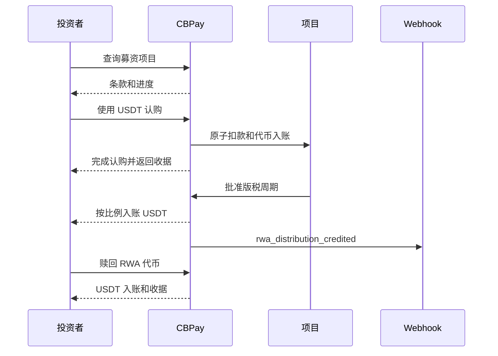

RWA 代币代表公开版税项目中的比例权益。API 使用精确的小数字符串；不要发送浮点数。项目会在购买前公布价格、供应量、版税条款、认购窗口和赎回开关。

> **环境：** 测试 `https://cryptobank.qbank.cl/platform` (`pk_test_...`) - 正式 `https://api.qbank.cl/platform` (`pk_...`).

## 投资者流程



## 1. 查找项目

```bash
curl "https://api.qbank.cl/platform/v1/rwa/projects?status=funding&limit=50&page=1" \
  -H "Authorization: Bearer $CBPAY_TOKEN"
```

响应中的 `code`、`status`、`royalty_pct`、`supply_total`、`subscription_price_usdt` 和 `redeem_enabled` 是做决定前应检查的字段。使用 `GET /platform/v1/rwa/projects/{code}` 获取完整条款。状态包括 `draft`、`funding`、`active`、`distributing`、`defaulted`、`redeemed` 和 `paused`。

## 2. 购买代币

请求金额是 USDT 毛额。配置的 `rwa_subscription` 手续费另收，代币数量按净额计算。

```bash
curl -X POST https://api.qbank.cl/platform/v1/rwa/subscriptions \
  -H "Authorization: Bearer $CBPAY_TOKEN" \
  -H "Content-Type: application/json" \
  -H "Idempotency-Key: sub-min01-0001" \
  -d '{"project_code":"RWA-MIN01","usdt_amount":"1000.000000","idempotency_key":"sub-min01-0001"}'
```

```json
{
  "subscription_id": "22222222-2222-4222-8222-222222222222",
  "project_code": "RWA-MIN01",
  "usdt_gross": "1000.000000",
  "fee_usdt": "10.000000",
  "usdt_net": "990.000000",
  "tokens_credited": "990.000000",
  "price_usdt": "1.000000",
  "status": "completed",
  "created_at": "2026-11-15T13:00:00Z",
  "receipt_url": "/platform/v1/rwa/subscriptions/22222222-2222-4222-8222-222222222222/receipt"
}
```

认购需要完成身份验证、必要的人类会话 OTP、足够的 USDT 和幂等键。重复使用同一幂等键会返回原始认购，不会重复扣款。

## 3. 查看持仓和分配

```bash
curl "https://api.qbank.cl/platform/v1/rwa/holdings" -H "Authorization: Bearer $CBPAY_TOKEN"
curl "https://api.qbank.cl/platform/v1/rwa/distributions?from=2026-01-01T00:00:00Z&to=2026-12-31T23:59:59Z&page=1" \
  -H "Authorization: Bearer $CBPAY_TOKEN"
```

分配使用 ex-date 快照时的余额。示例信用记录：

```json
{
  "leg_id": "55555555-5555-4555-8555-555555555555",
  "distribution_id": "66666666-6666-4666-8666-666666666666",
  "project_code": "RWA-MIN01",
  "period": "2026-Q4",
  "tokens": "890.000000",
  "share_usdt": "12.500000",
  "fee_usdt": "0.125000",
  "created_at": "2026-11-15T15:00:00Z"
}
```

认购、赎回和分配列表支持 `from`、`to` 和 `page`；每个资源都有详情和 PDF 收据接口。

## 4. 赎回

```bash
curl -X POST https://api.qbank.cl/platform/v1/rwa/redemptions \
  -H "Authorization: Bearer $CBPAY_TOKEN" \
  -H "Content-Type: application/json" \
  -d '{"project_code":"RWA-MIN01","tokens":"100.000000","idempotency_key":"red-min01-0001"}'
```

```json
{
  "redemption_id": "44444444-4444-4444-8444-444444444444",
  "project_code": "RWA-MIN01",
  "tokens": "100.000000",
  "usdt_credited": "100.000000",
  "price_usdt": "1.000000",
  "status": "completed",
  "created_at": "2026-11-15T14:00:00Z",
  "receipt_url": "/platform/v1/rwa/redemptions/44444444-4444-4444-8444-444444444444/receipt"
}
```

赎回按项目认购价返还 USDT，并原子扣减 RWA 代币。

## 状态、错误和 Webhook

`funding` 在窗口和额度允许时接受认购；`active` 可产生分配；`distributing` 正在处理分配；`paused` 应等待项目恢复；`defaulted` 和 `redeemed` 不接受新认购。

请查看[错误](https://docs.cbpayapp.com/zh/errors)中的 `rwa_window_closed`、`rwa_cap_exceeded`、`rwa_fee_exceeds_amount`、`rwa_redeem_disabled` 和 `rwa_escrow_insufficient`。遇到 timeout 或 5xx 时，先用同一幂等键查询原始资源。

验证 `rwa_subscription_completed`、`rwa_distribution_credited` 和 `rwa_redeem_completed` 的签名。详见 [Webhook](https://docs.cbpayapp.com/zh/webhooks)。

## 常见问题

#### 代币价格会浮动吗？不会。F1 按项目认购价赎回。#### 失败后可以重新发送吗？遇到 timeout 或 5xx 时，先用同一幂等键查询原操作。#### 为什么分配不按当前余额计算？权益按 ex-date 快照余额计算。#### Bridge 可用吗？不可用。Bridge 属于 F2，不是 RWA F1 功能。
