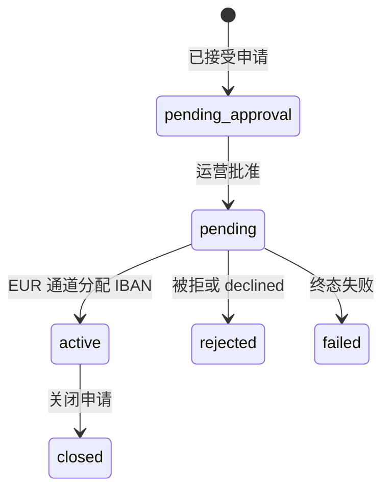

> **环境：** 测试 `https://cryptobank.qbank.cl/platform` (`pk_test_...`) - 正式 `https://api.qbank.cl/platform` (`pk_...`).

> **注**
本页说明 EUR vIBAN 的生命周期和失败处理。API 合同与申请示例仍在
[Banking](https://docs.cbpayapp.com/zh/guides/banking)。
## 生命周期



| 状态 | 含义 | 应该怎么做 |
|---|---|---|
| `pending_approval` | 等待组织运营批准。 | 读取同一申请；不要重复提交。 |
| `pending` | 本地已批准，等待 EUR 通道处理。 | 持续查询同一资源，直到终态。 |
| `active` | IBAN 已分配，可按用途使用。 | 读取 IBAN，使用对应的入金或 Banking 流程。 |
| `rejected` | 被拒或 declined；可用时提供清理后的 `last_error`。 | 修正原因并使用新 key 创建新申请。 |
| `failed` | 验证或分配的终态失败。 | 修正 `last_error` 后创建新申请；不要重试终态记录。 |
| `disabled` / `closed` | 地址已不可用。 | 不要汇款；仍需使用时申请新地址。 |

`declined` 会规范化为终态 `rejected`，不会一直停留在 pending。拒绝或失败
不会创建 IBAN。如果曾收取费用，平台会自动退款，并与终态结果一起记录。

## 费用和真实时间预期

当前 EUR vIBAN 分配费用为 **0**。首次 `funding_usdt` 申请免费。之后的
申请是新申请，不是终态申请的重试。不要用新 key 猜测不明确请求的结果：
先核对已有申请。

激活没有保证的固定期限。运营批准、合规审核、银行截止时间、周末和节假日
都可能延长 `pending_approval` 或 `pending`。使用 GET 或带日期的列表核对；
不要把 pending 申请当成已经分配的 IBAN。

## EUR 通道前的验证

CBPay 会在发送前验证已核验的 registrant。无效数据返回
`422 registrant_incomplete` 及缺失或无效字段路径，不会发送银行通道请求。
常见原因：

- 日期必须有效、为 `YYYY-MM-DD`、处于 `19xx`/`20xx` 范围，并且到期日在
  一个月以后；
- 对于 US 税务国家，`taxNumber` 必须存在并通过验证；没有受支持校验器
  的国家会省略该字段，而不是转发未验证数据；
- 每个申报的 UBO 都需要身份、证件和明确的 PEP 值（`true` 或 `false`）；
- 地址需要有效的国家、城市、街道和 ZIP（没有邮政系统的国家使用已记录的
  零值占位符）。

请修正 422 指出的字段并提交**新的** vIBAN 申请，不要把终态失败变成重试循环。

## 核对和排错

```bash
curl https://api.qbank.cl/platform/v1/banking/virtual-ibans/<id> \
  -H "Authorization: Bearer <token>"

curl "https://api.qbank.cl/platform/v1/banking/virtual-ibans?page=1&page_size=50&from=2026-11-01&to=2026-11-30" \
  -H "Authorization: Bearer <token>"
```

读取响应中的 `status` 和 `last_error`。`last_error` 已为集成方清理，是通道
或调用前验证拒绝申请时的可操作原因。通用错误请参阅[错误](https://docs.cbpayapp.com/zh/errors)。

## 常见问题

#### 为什么 declined 变成 rejected？
`declined` 是银行通道的终态结果。CBPay 将它映射为 `rejected`，避免申请
无限停留在 pending。
#### 可以重试 failed 申请吗？
不可以。修正 `last_error` 后使用新的幂等键创建申请；如果响应不明确，
先核对原申请。
#### 被拒申请会收费吗？
当前分配费用为 0。如果配置曾收取费用，在明确拒绝或失败后会自动退款。
#### 激活需要多长时间？
没有保证的期限。等待终态并用 GET 核对，不要假设固定 SLA。
