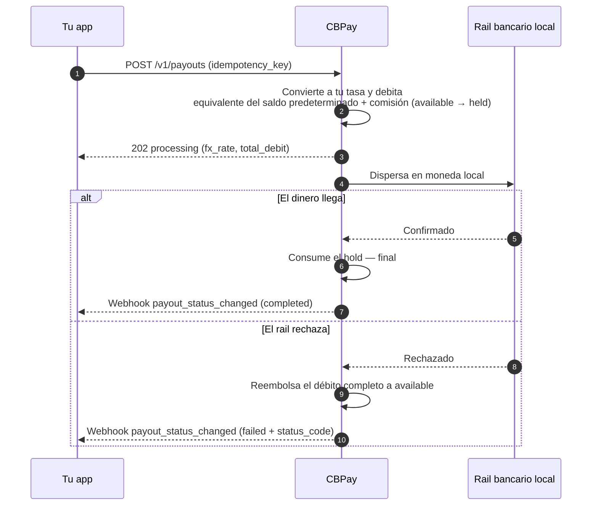

> **Ambientes:** Test `https://cryptobank.qbank.cl/platform` (`pk_test_...`) - Live `https://api.qbank.cl/platform` (`pk_...`).

> **Importante**
**Cambio incompatible — 2026-11-13.** Los saldos BOB, MXN, ARS y CLP, junto con los espejos `BANK_*`, viven solo en Banking. Los payouts, swaps, transferencias internas, tarjetas, checkout, POS y comisiones de la plataforma rechazan la liquidación fiat con HTTP `400`. Las cuentas legacy conservan su default explícito `USDT`; las cuentas nuevas usan `USD` como saldo principal. Usa Banking para las operaciones fiat.
Un payout envía dinero en moneda local a una cuenta bancaria del país
destino. El monto se convierte al saldo predeterminado de tu cuenta con **la tasa de tu
cuenta** (la de `GET /v1/rates`) y se descuenta de ese saldo el equivalente reportado
más la comisión fija, si está configurada. Las cuentas legacy con default USDT
explícito siguen descontando USDT.

Así se ve el ciclo completo, incluido qué pasa con tu saldo en cada paso:



## 1. Descubre los corredores disponibles

Los países, monedas y métodos disponibles los define CBPay.
Consúltalos siempre por catálogo:

```bash
curl https://api.qbank.cl/platform/v1/payouts/methods \
  -H "Authorization: Bearer <token>"
```

```json
{
  "items": [
    { "country": "CL", "currency": "CLP", "method": "bank_transfer" },
    { "country": "PE", "currency": "PEN", "method": "bank_transfer" },
    { "country": "PE", "currency": "PEN", "method": "yape" },
    { "country": "BO", "currency": "BOB", "method": "qr" }
  ],
  "meta": { "retrieved": 4 }
}
```

Corredores y métodos disponibles:

| País | Moneda | Métodos |
|---|---|---|
| Chile | CLP | `bank_transfer` |
| Perú | PEN | `bank_transfer`, `yape` |
| México | MXN | `bank_transfer` (SPEI: CLABE o tarjeta de débito) |
| Venezuela | VES | `bank_transfer`, `pago_movil` |
| Bolivia | BOB / USD | `bank_transfer`, `qr` (ver [Payout QR](https://docs.cbpayapp.com/es/guides/payout-special-cases#payout-qr)) |
| Brasil | BRL | `pix` (por llave o a cuenta), `qr` (QR PIX — ver [Payout QR](https://docs.cbpayapp.com/es/guides/payout-special-cases#payout-qr)) |
| Ecuador | USD | `bank_transfer`, `deuna`, `cash_pickup`, `cnb` |
| Paraguay | PYG | `bank_transfer` |
| Argentina | ARS / USD | `bank_transfer` (CBU o CVU) |
| Colombia | COP | `bank_transfer` (montos enteros, sin decimales), `breb` |
| Estados Unidos | USD | `ach`, `wire`, `swift` |

La disponibilidad puede variar; el catálogo (`GET /v1/payouts/methods`) es
siempre la fuente de verdad. Si un país tiene un solo método, `method` es
opcional. Todos los métodos se cobran igual: tu tasa + fijo.

Para transferencias bancarias necesitas además el catálogo de bancos (de
ahí sale el `bank_code` del beneficiario):

```bash
curl "https://api.qbank.cl/platform/v1/payouts/banks?country=CL" \
  -H "Authorization: Bearer <token>"
```

```json
{
  "items": [
    { "code": "001", "name": "Banco de Chile" },
    { "code": "012", "name": "Banco del Estado de Chile" },
    { "code": "016", "name": "Banco de Crédito e Inversiones" }
  ],
  "meta": { "retrieved": 3 }
}
```

## 2. Crea el payout

```bash
curl -X POST https://api.qbank.cl/platform/v1/payouts \
  -H "Authorization: Bearer <token>" \
  -H "Content-Type: application/json" \
  -d '{
    "country": "MX",
    "currency": "MXN",
    "method": "bank_transfer",
    "amount": "1500.00",
    "beneficiary": {
      "name": "María López",
      "account_type": "clabe",
      "account_number": "012180001234567895"
    },
    "description": "Pago factura 8841",
    "idempotency_key": "factura-8841"
  }'
```

> **Importante**
`beneficiary` es un objeto de pares clave/valor cuyos campos requeridos
dependen del corredor (RUT y banco en Chile, CLABE en México, CCI en Perú,
llave PIX en Brasil, etc.). El catálogo de métodos documenta los campos de
cada uno.
> **Nota**
Cada payout guarda al beneficiario como [contacto](https://docs.cbpayapp.com/es/guides/contacts)
automáticamente (`"save_contact": false` para no guardarlo). Para repetirle
un pago sin re-tipear sus datos, envía `"beneficiary_contact_id"` en vez de
`beneficiary` — se usa su beneficiario guardado más reciente para ese país
y método (`422 no_saved_destination` si no tiene).
Respuesta `202 Accepted`:

```json
{
  "payout_id": "0d4f…",
  "account_id": "…",
  "idempotency_key": "factura-8841",
  "country": "MX",
  "currency": "MXN",
  "method": "bank_transfer",
  "local_amount": "1500.00",
  "fx_rate": "17.50",
  "usdt_amount": "85.714286",
  "fee": "0.300000",
  "total_debit": "86.014286",
  "settlement_asset": "USDT",
  "settlement_amount": "86.014286",
  "settlement_rate": "1",
  "status": "processing",
  "status_code": "",
  "status_message": "",
  "funds_debited": true,
  "compliance_pending": false,
  "bank_reference": "",
  "created_at": "2026-07-06T20:00:00Z"
}
```

En ese momento tu saldo ya refleja el débito: `total_debit` pasó de
`available` a `held` (en el saldo del `settlement_asset`).

> **Nota**
**`bank_reference` — el id propio del banco para la transferencia.** En US ACH,
wire y SWIFT es la referencia CBF que vuelve **de inmediato** al crear (el
payout sigue `processing` hasta que el banco confirma). En el resto de
corredores queda vacio (`""`) hasta `completed`. Mientras
el payout está en curso viene vacío (`""`); cuando el payout queda
`completed`, lleva el id de transacción asignado por el banco/rail de
destino. Es el valor que el beneficiario puede usar para cruzar el pago con
su banco, y también aparece en el webhook `payout_status_changed`, el
comprobante PDF, el export CSV de payouts y la cartola. Las respuestas, CSV, webhooks y comprobantes también incluyen `uetr` (UETR/SWIFT gpi) e `imad` (wire/ACH doméstico), vacíos hasta que el banco los reporte; usa el [tracker público](https://docs.cbpayapp.com/es/guides/tracking) para el estado vivo y el mismo comprobante.
### Pagar desde otro saldo (`settlement_asset`)

Por defecto el débito sale de USD; usa `PUT /v1/settlement` para cambiarlo. Para pagar una operación
puntual desde otro saldo, agrega `settlement_asset` al request. Ejemplo:
un payout de 100,000 CLP pagado desde el saldo BTC pasa por cuatro
transformaciones, todas registradas en la respuesta:

1. **CLP → USDT** a tu tasa: `100000 / 950.25 = 105.235465 USDT`.
2. **+ comisión fija**: `105.235465 + 0.30 = 105.535465 USDT` (`total_debit`).
3. **USDT → BTC** al precio efectivo de settlement (`settlement_rate`
   `109029.34070000`): `105.535465 / 109029.3407 = 0.00096795 BTC`
   (redondeo hacia arriba al satoshi).
4. **Débito y hold en BTC**: `settlement_amount` `0.00096795` sale de tu
   saldo BTC; el beneficiario recibe sus 100,000 CLP igual que siempre.

```json
{
  "country": "CL",
  "currency": "CLP",
  "local_amount": "100000",
  "fx_rate": "950.25",
  "usdt_amount": "105.235465",
  "fee": "0.300000",
  "total_debit": "105.535465",
  "settlement_asset": "BTC",
  "settlement_amount": "0.00096795",
  "settlement_rate": "109029.34070000",
  "status": "processing",
  "status_code": "",
  "status_message": "",
  "funds_debited": true,
  "compliance_pending": false,
  "bank_reference": ""
}
```

Si el payout falla, se reembolsa el `settlement_amount` exacto a tu saldo
BTC — nunca se re-cotiza. Si el precio de ejecución de BTC/GOLD/SILVER/PLATINUM no está
disponible en ese momento recibirás `503 pricing_unavailable`, y los
assets volátiles tienen un límite por operación
(`422 settlement_limit_exceeded`; consúltalo en `GET /v1/settlement`).
Para settlement BOB, MXN o ARS en la misma moneda, consulta [Settlement de payouts fiat](./fiat-settlement).
### El screening técnico puede quedar pendiente
CBPay screenea al beneficiario antes de debitar tu saldo o llamar al core. Si
el servicio de screening está temporalmente no disponible **y la cola técnica
de screening está disponible**, el payout se persiste y el create responde
`202 Accepted` con el recurso en `status: "pending"`:

```json
{
  "payout_id": "0d4f…",
  "idempotency_key": "invoice-8841",
  "status": "pending",
  "status_code": "compliance_pending",
  "status_message": "",
  "funds_debited": false,
  "compliance_pending": true,
  "predebit_failure": false,
  "created_at": "2026-07-06T20:00:00Z",
  "updated_at": "2026-07-06T20:00:00Z"
}
```

Mientras está pendiente **no hay débito, hold, asiento en el ledger, despacho
al core ni `receipt_url`**. El replay con la misma clave de idempotencia devuelve
el mismo payout con `idempotency_hit: true`; nunca crea una segunda operación.
Cuando el worker recibe `process`, el payout existente sigue el flujo normal de
débito y despacho. Un `hold` válido entra al firewall transaccional. Un
`rejected` posterior termina el payout en `failed` sin débito.

Después de aceptar `process`, el mismo payout puede permanecer en
`status: "pending"` mientras se reconcilian el débito y el despacho. La API y el
webhook `payout_status_changed` exponen estos códigos de transición durables:

- `compliance_dispatch_pending`: el screening pasó, existe el débito/hold y
  `funds_debited: true`, pero el despacho al core aún no terminó.
- `compliance_dispatching`: el claim de despacho está en curso.
- `core_unreachable`: el despacho o la liquidación local es ambiguo y espera
  conciliación; no crees un segundo payout.

Estas transiciones no son una operación nueva. Conserva la misma
`idempotency_key`, lee el payout y espera el siguiente evento de estado. Cuando
el payout termina, `completed` consume el hold y `failed` devuelve el débito
exacto. Los eventos finales usan el camino durable e incluyen los campos
normales del comprobante.

La respuesta técnica `compliance_check_unavailable` sigue aplicando cuando el
payout no se puede dejar en la cola pendiente y en los flujos que no tienen
esta cola. No reemplaza los contratos actuales de validación, seguridad ni
`compliance_hold`.

### Un fallo antes del débito no es un reembolso
Si el screening o un control duro de compliance falla antes de iniciar el
camino de débito, el mismo payout puede terminar `failed` con
`predebit_failure: true` y `funds_debited: false`. La respuesta y su evento
`payout_status_changed` omiten `receipt_url`, porque no hubo débito, hold ni
comprobante que revertir. Es distinto de un `failed` posterior al débito,
donde el débito exacto se reembolsa antes del evento terminal.
Para conocer el origen de la tasa y las cotizaciones FIFO indicativas, revisa [Orígenes de tasa de payouts y cotizaciones FIFO](https://docs.cbpayapp.com/es/guides/payout-rate-sources).

## Argentina: resuelve un alias bancario antes de pagar
Resuelve y confirma el titular antes de crear el payout (10 consultas/minuto/cuenta). Request: `GET /v1/payouts/ar-alias/resolve?alias=julieta.fernandez`. Respuesta: `{"alias":"julieta.fernandez","account_number":"2850590940090418135201","account_type":"CBU","tax_id":"27234567891","holder_name":"Julieta Fernandez"}`. Crea `POST /v1/payouts` con `account_number` igual al alias original y el `tax_id`/`name` devueltos; el dispatch lo vuelve a resolver y registra `destination_alias` en la evidencia. `alias_unresolvable` es determinista y `beneficiary_lookup_unavailable` temporal. Consulta [Errores](https://docs.cbpayapp.com/es/errors).
## 3. Recibe el estado final

Suscríbete al evento `payout_status_changed` ([webhooks](https://docs.cbpayapp.com/es/webhooks)):

```json
{
  "payout_id": "0d4f…",
  "account_id": "…",
  "country": "MX",
  "currency": "MXN",
  "local_amount": "1500.00",
  "usdt_amount": "85.714286",
  "total_debit": "86.014286",
  "status": "completed",
  "status_code": "",
  "status_message": "",
  "bank_reference": "00761123456"
}
```

- **`completed`**: el dinero llegó; el hold se consume.
- **`failed`**: se reembolsa el débito completo automáticamente
  (`payout_refund` en tu ledger).

`status_message` es el detalle opcional y normalizado que acompaña a
`status_code`; puede venir vacío cuando el core no tiene un mensaje adicional.

También puedes consultar en cualquier momento:

```bash
curl https://api.qbank.cl/platform/v1/payouts/0d4f… \
  -H "Authorization: Bearer <token>"
```

### Estados del payout

| Estado | Significado | ¿Tu saldo? |
|---|---|---|
| `processing` | Aceptado y ejecutándose en el riel local | Débito retenido en `held` |
| `pending` + `waiting_funds` | Estado transitorio; la plataforma reanuda el payout automáticamente | El débito/hold existente sigue asociado; no crees un reemplazo |
| `pending` + `compliance_pending: true` | El screening técnico del beneficiario espera antes de cualquier débito o despacho | **Sin débito**; `funds_debited: false` |
| `pending` + `compliance_dispatch_pending` / `compliance_dispatching` / `core_unreachable` | Screening aprobado; débito existente mientras espera despacho o conciliación | `funds_debited: true`; débito retenido |
| `completed` | El dinero llegó al beneficiario | Hold consumido — final |
| `failed` después del débito | El corredor lo rechazó o la ejecución falló después del débito | **Reembolso automático completo** (monto + comisión) |
| `failed` + `predebit_failure: true` | El screening o un control duro de compliance falló antes del débito | **Sin débito**; `funds_debited: false`, sin comprobante |

## Consulta e historial

Cada payout se puede leer individualmente y el listado acepta filtros:

```bash
# Un payout
curl https://api.qbank.cl/platform/v1/payouts/0d4f… \
  -H "Authorization: Bearer <token>"

# Historial con filtros: fechas, estado, país, método, búsqueda y paginación
curl "https://api.qbank.cl/platform/v1/payouts?from=2026-07-01&to=2026-07-08&status=failed&country=MX&method=bank_transfer&search=0d4f&page=1&page_size=50" \
  -H "Authorization: Bearer <token>"
```

```json
{
  "page": 1,
  "page_size": 50,
  "payouts": [
    {
      "payout_id": "0d4f…",
      "country": "MX",
      "currency": "MXN",
      "method": "bank_transfer",
      "local_amount": "1500.00",
      "fx_rate": "17.50",
      "usdt_amount": "85.714286",
      "fee": "0.300000",
      "total_debit": "86.014286",
      "status": "failed",
      "status_code": "core_rejected",
      "status_message": "beneficiary account does not exist",
      "bank_reference": "",
      "created_at": "2026-07-06T20:00:00Z"
    }
  ]
}
```

`from`/`to` van en `YYYY-MM-DD` (zona horaria de tu organización, ambos inclusive); una fecha inválida
responde `400 invalid_range`. `method` filtra por el catálogo activo de payouts y
`search` hace una coincidencia parcial sin distinguir mayúsculas/minúsculas sobre
el ID del payout, la referencia bancaria o la clave de idempotencia.
