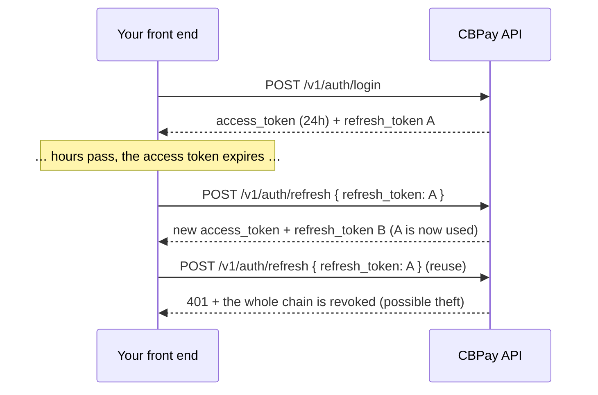

Every call (except register and login) requires a credential in the
`Authorization` header:

```
Authorization: Bearer <token>
```

`X-API-Key: <token>` is accepted as an alternative header.

## Registration and email verification

Registration is verify-first: it never creates a session. The public endpoint returns
`201 pending_verification` for both a new email and a duplicate email, so callers
cannot use it to enumerate accounts. The email owner receives a verification code;
complete the flow with `POST /v1/auth/register/confirm`.

Email identity matching prevents multiple accounts for the same mailbox. For
`gmail.com` and `googlemail.com`, dots and everything after `+` are ignored and
`googlemail.com` is treated as `gmail.com`. Plus addressing is also collapsed
for the supported Outlook, Hotmail, Live, MSN, iCloud, Me, Mac, Yahoo, Ymail,
Rocketmail and Proton domains; other domains are matched exactly.

Registering an equivalent variant returns the same `201 pending_verification`
shape without creating another account. The same mailbox is rejected with
`409 duplicate` or `409 email_in_use` for OAuth, administrator-created
accounts, invitations and email changes. This behavior is organization-scoped.
If an email is blocked by an organization policy, resolve the block rather than
trying another variant of the same mailbox.

```bash
curl -X POST https://api.qbank.cl/platform/v1/auth/register \
  -H "Content-Type: application/json" \
  -d '{"org":"cbpay","type":"person","email":"ana@example.com","password":"a-secure-password","display_name":"Ana Perez","country":"CL"}'
```

```json
{"status":"pending_verification","note":"check your email for the verification code; complete registration with POST /v1/auth/register/confirm"}
```

Confirm the code to verify the mailbox. The endpoint returns `201 pending_2fa_enrollment` with a 30-minute `pending_token`, `factors: ["totp", "sms"]`, `passkeys_available: false`, `next` and `account`; it does not create a session. The session is issued only after TOTP or SMS enrollment in [Mandatory 2FA enrollment after registration](#mandatory-2fa-enrollment-after-registration):

```bash
curl -X POST https://api.qbank.cl/platform/v1/auth/register/confirm \
  -H "Content-Type: application/json" \
  -d '{"org":"cbpay","email":"ana@example.com","code":"123456"}'
```

A code with the wrong shape returns `400 invalid_code`; an invalid or expired code
returns `401 invalid_code` uniformly. If the verification service cannot be checked,
the API returns `502 otp_check_failed`. A successful confirmation returns the pending-enrollment shape described above; use its token with the enrollment wizard.

## Adaptive proof of work for registration

CBPay uses an optional Hashcash-style proof of work to slow automated registration
bursts without adding friction to normal traffic. It is required only while the
public registration velocity is in attack mode. The same gate applies independently
to registration and email confirmation, so request a challenge with the matching
`purpose` and the exact lowercase email that you will submit.

The challenge is short-lived (600 seconds), has difficulty `20`, and is bound to
the email and purpose. Solve it in your client, preferably in a background worker
while the person or company form is open:

```bash
curl -X POST https://api.qbank.cl/platform/v1/auth/pow-challenge \
  -H "Content-Type: application/json" \
  -d '{"purpose":"register","email":"ana@example.com"}'
```

```json
{
  "challenge": "<challenge>",
  "difficulty": 20,
  "algorithm": "sha256-leading-zero-bits-v1",
  "expires_in": 600,
  "input": "sha256(nonce_bytes || lowercase(email) || be64(suffix)); find suffix with difficulty leading zero bits",
  "nonce_bytes": "first 16 bytes of the base64url payload (part before the dot)"
}
```

Find a non-negative `suffix` whose SHA-256 digest has at least `difficulty`
leading zero bits, using the first 16 bytes of the challenge payload, the
lowercase email and the suffix encoded as an unsigned big-endian 64-bit integer.
Submit the result in the registration request:

```json
{
  "org": "cbpay",
  "type": "person",
  "email": "ana@example.com",
  "password": "a-secure-password",
  "display_name": "Ana Perez",
  "country": "CL",
  "pow": {"challenge": "<challenge>", "suffix": 1847293}
}
```

For a company account, use the same flow with `"type": "company"` and the
company's registration fields. After receiving the verification code, request a
new challenge with `"purpose":"confirm"` and submit it with confirmation:

```bash
curl -X POST https://api.qbank.cl/platform/v1/auth/pow-challenge \
  -H "Content-Type: application/json" \
  -d '{"purpose":"confirm","email":"ana@example.com"}'

curl -X POST https://api.qbank.cl/platform/v1/auth/register/confirm \
  -H "Content-Type: application/json" \
  -d '{"org":"cbpay","email":"ana@example.com","code":"123456","pow":{"challenge":"<challenge>","suffix":1847293}}'
```

In normal conditions, registration and confirmation remain compatible with clients
that omit `pow`. During attack mode, either endpoint returns `400 pow_required`
until the matching challenge is solved. See the central
[authentication errors](/en/errors#authentication-and-registration-errors) page
for the required action. The challenge is stateless and expires after 10 minutes;
request a fresh one when it expires rather than retrying a stale solution. The
challenge endpoint has its own limit of 200 requests per hour per IP and does
not consume the registration budget.

<AccordionGroup>
<Accordion title="Do existing clients need a release?">
Not during normal traffic: omitting `pow` remains accepted. If attack mode is
active, clients must implement the challenge flow and retry the same operation
with `pow`; the server does not accept a challenge for another email or purpose.
</Accordion>
<Accordion title="How long does solving take?">
Difficulty 20 is calibrated for a short client-side computation, commonly a few
seconds depending on the device. Run it off the UI thread and request a new
challenge if the 10-minute expiry is reached.
</Accordion>
</AccordionGroup>


## Mandatory 2FA enrollment after registration

Email confirmation now proves mailbox ownership but does not create a session. `POST /v1/auth/register/confirm` returns `201` with a 30-minute `pending_token` and the exact next steps:

```json
The response fields are: `status: pending_2fa_enrollment`, a
`pending_token` valid for 30 minutes, `factors: ["totp", "sms"]`,
`passkeys_available: false`, `next`, `note`, and `account`. It does not
contain a session.

Choose the authenticator app or phone delivery by SMS or WhatsApp. TOTP uses `totp/begin` and
`totp/confirm`, and returns the first session plus 10 recovery codes once.
SMS or WhatsApp uses:

```bash
curl -X POST https://api.qbank.cl/platform/v1/auth/register/2fa/sms/begin \
  -H "Content-Type: application/json" \
  -d '{"pending_token":"<pending-token>","phone":"+56912345678","channel":"whatsapp"}'
```

The `200` response contains `phone_masked`, the effective `channel`, `steps`
and `note`. `channel` defaults to `sms`; set it to `whatsapp` to deliver the
registration code through WhatsApp. Confirm the code within 10 minutes:

```json
{
  "phone_masked": "********5678",
  "channel": "whatsapp",
  "steps": [
    "1. We sent a code by WhatsApp to ********5678.",
    "2. Enter the code within 10 minutes to verify your number."
  ],
  "note": "enter the code with POST /v1/auth/register/2fa/sms/confirm"
}
```

```bash
curl -X POST https://api.qbank.cl/platform/v1/auth/register/2fa/sms/confirm \
  -H "Content-Type: application/json" \
  -d '{"pending_token":"<pending-token>","code":"482913"}'
```

The `201` response issues the first session and includes `steps` saying that
future sign-ins require an SMS code, plus `note`; it does not include recovery
codes. The confirmation endpoint is channel-agnostic. Registration passkey endpoints return
`410 passkey_not_offered`. Passkey login and `/v1/me/passkeys` remain live.

Use the pending token only with the enrollment endpoints. `channel` accepts
only `sms` or `whatsapp`; another value returns `400 invalid_channel`. TOTP uses
`totp/begin` with the pending token, then `totp/confirm` with the six-digit
code; confirmation returns the normal session plus 10 recovery codes shown
once. SMS or WhatsApp uses `sms/begin` and `sms/confirm` as shown below. Passkey
registration is no longer accepted in this wizard (`410
passkey_not_offered`); use passkey login or manage passkeys after sign-in.

Company members invited through `POST /v1/members` and members of accounts created by an organization administrator follow the same wizard on their first login. Existing members are not retroactively locked. Password reset clears a pending email-registration flag when the email code is proven, but the member still must enroll a factor before receiving a session.


## Authentication abuse limits

Login failures are counted per normalized organization/email account: after 8 failures
within 15 minutes, further attempts return the same `401 invalid_credentials` without
running bcrypt until the window expires. Pending-registration members also receive
that uniform response and cannot log in with the signup password.

Password recovery is deliberately anti-enumeration. `POST /v1/auth/password/forgot`
returns the same `200` body even when its account send budget is exhausted; at most 5
real code sends per account are allowed per hour. `POST /v1/auth/password/reset`
allows at most 8 code attempts per account in 15 minutes. A successful email reset
verifies the email and clears `register_pending`.
Company members may also receive an administrator-initiated recovery link.
Redeem its `token` with `org` and `new_password` at
`POST /v1/auth/password/reset-link`; the link is single-use and expires after
60 minutes. This member flow is separate from the platform-admin reset.

## Credential types

<Tabs>
<Tab title="JWT session (users with login)">

Obtained from `POST /v1/auth/login` (registration requires email confirmation first, see below), valid for
**24 hours**. Meant for apps where users sign in. Along with the
`access_token` you receive a **refresh token** to renew the session without
asking for the password again — see
[session renewal](#session-renewal-refresh-tokens).

```bash
curl -X POST https://api.qbank.cl/platform/v1/auth/login \
  -H "Content-Type: application/json" \
  -d '{ "org": "cbpay", "email": "ana@example.com", "password": "…" }'
```

```json
{
  "access_token": "eyJ…",
  "expires_at": "2026-07-14T15:20:49Z",
  "refresh_token": "rt_6a1e6c22-….XXXXXXXX…",
  "refresh_expires_at": "2026-08-12T15:20:49Z",
  "account_id": "…",
  "role": "owner"
}
```

Company accounts can have multiple **members** with roles — see
[company members](#company-members) below.

<Note>
If the account's policy requires **OTP on login**, the response carries
`otp_required: true` with a `pending_token` instead of the session: the
second step completes at `POST /v1/auth/login/otp` with the code received
over SMS/WhatsApp. Full flow in [security and 2FA](/en/security-2fa).
</Note>

<Note>
You can also offer **sign up and sign in with Google, Apple, Microsoft or
Facebook** (passwordless) — see [social login](/en/guides/social-login).
</Note>

</Tab>
<Tab title="API key (server to server)">

Format `pk_<key_id>.<secret>`. Never expires and is not tied to a session.
Issue one with:

```bash
curl -X POST https://api.qbank.cl/platform/v1/api-keys \
  -H "Authorization: Bearer <session-token>" \
  -H "Content-Type: application/json" \
  -d '{ "label": "production-backend" }'
```

```json
{
  "api_key_id": "…",
  "key_id": "a1b2c3d4e5f60718",
  "token": "pk_a1b2c3d4e5f60718.XXXXXXXX…",
  "note": "store this token now; it cannot be retrieved again"
}
```

<Warning>
The plaintext token is shown **exactly once**. Only a hash is stored server
side — if you lose it, issue a new key.
</Warning>

</Tab>
</Tabs>

## Session renewal (refresh tokens)

The `access_token` lasts 24 hours; the `refresh_token` (`rt_…`) lets you get
a fresh pair **without re-login** for 30 days, renewed on every use up to a
maximum of 90 days from the original login. It is **single-use**: every
exchange returns a new `refresh_token` and invalidates the previous one
(rotation).



```bash
curl -X POST https://api.qbank.cl/platform/v1/auth/refresh \
  -H "Content-Type: application/json" \
  -d '{ "refresh_token": "rt_6a1e6c22-….XXXXXXXX…" }'
```

```json
{
  "access_token": "eyJ…",
  "expires_at": "2026-07-14T15:20:50Z",
  "refresh_token": "rt_9f2b1c30-….YYYYYYYY…",
  "refresh_expires_at": "2026-08-12T15:20:50Z",
  "account_id": "…",
  "role": "owner"
}
```

Security rules your front end must know:

- **Strict rotation**: on exchange, the previous access token of that device
  is revoked immediately (only one live access token per chain). Always
  replace BOTH tokens with the ones in the response.
- **Reuse = theft**: if an already-exchanged refresh token is presented
  again, the device's entire chain is revoked (tokens and sessions) and a
  `refresh_token_reuse` event is recorded in
  `GET /v1/me/security/events`. The user must sign in again.
- **Dies with the session**: signing out (`DELETE /v1/me/sessions/{id}`),
  `POST /v1/me/sessions/revoke-all` or a password change/reset also
  invalidate the associated refresh tokens.
- Every rejection returns `401 invalid_refresh_token` — on that error, send
  the user to the login screen.
- Store the refresh token in secure storage (Keychain/Keystore on mobile; on
  web, prefer memory + re-login or an httpOnly cookie from your backend).
  `pk_` API keys do not use refresh: they never expire.

<AccordionGroup>
<Accordion title="How often should I refresh?">
When the access token is about to expire (use `expires_at`) or upon a `401`
on a normal call. Avoid refreshing in parallel from several places: if two
exchanges of the same token race, one wins and the other gets a `401`
without penalty — but exchanging a token that was ALREADY rotated revokes
the chain.
</Accordion>
<Accordion title="What happens after 90 days?">
The chain's absolute cap is 90 days from the original login: even refreshing
daily, once the limit is reached the refresh returns `401` and the user must
authenticate again (password, passkey or social login).
</Accordion>
<Accordion title="Does refresh work with API keys?">
Not applicable: `pk_` API keys never expire and have no session. Refresh is
only for JWT sessions of human users.
</Accordion>
</AccordionGroup>

## Access level

Your credential (session JWT or API key) operates **your own account**:
balances, payouts, payins, transfers, crypto, KYC/KYB and your own webhooks. If
an endpoint responds `403 account_required` or `403 org_admin_required`,
that operation belongs to a different credential level — contact the CBPay
team.

## Your account profile

```bash
# Read the profile (includes kyc_status and type)
curl https://api.qbank.cl/platform/v1/me \
  -H "Authorization: Bearer <token>"

# Update profile fields (all optional)
curl -X PATCH https://api.qbank.cl/platform/v1/me \
  -H "Authorization: Bearer <token>" \
  -H "Content-Type: application/json" \
  -d '{
    "display_name": "Comercial Andina SpA",
    "tax_id": "76.543.210-8",
    "phone": "+56 9 1234 5678",
    "country": "CL",
    "locale": "en"
  }'
```

```json
{
  "id": "9b1deb4d-3b7d-4bad-9bdd-2b0d7b3dcb6d",
  "type": "company",
  "display_name": "Comercial Andina SpA",
  "email": "legal@andina.cl",
  "tax_id": "76.543.210-8",
  "phone": "+56 9 1234 5678",
  "country": "CL",
  "locale": "en",
  "status": "active",
  "kyc_status": "approved",
  "created_at": "2026-06-01T12:00:00Z"
}
```

`PATCH /v1/me` accepts `display_name`, `tax_id`, `phone`, `country` and `locale`
(send only the ones that change). Empty `locale` stores `en`; invalid values return `400 invalid_locale`.
`email`, `status` and `kyc_status` are not self-managed: the administrator resolves them.
See [Locale and language](/en/guides/locale).

## Company members

**Company** accounts can have multiple users with their own login and
different permission levels:

| Role | Permissions |
|---|---|
| `owner` | Everything: operates, manages members and credentials |
| `operator` | Day-to-day operation (default when creating a member) |
| `viewer` | Read-only |

```bash
# Add a member (company accounts only)
curl -X POST https://api.qbank.cl/platform/v1/members \
  -H "Authorization: Bearer <token>" \
  -H "Content-Type: application/json" \
  -d '{
    "email": "finance@andina.cl",
    "password": "a-strong-password",
    "role": "viewer"
  }'

# List members
curl "https://api.qbank.cl/platform/v1/members?page_size=50" \
  -H "Authorization: Bearer <token>"
```

```json
{
  "page": 1,
  "page_size": 50,
  "members": [
    { "id": "…", "email": "legal@andina.cl", "role": "owner", "status": "active" },
    { "id": "…", "email": "finance@andina.cl", "role": "viewer", "status": "active" }
  ]
}
```

On a person account, `POST /v1/members` responds `403 company_only`.

## Best practices

- Store API keys in a secrets manager; never in code or in the browser.
- Use one key per environment/service (descriptive `label`) so you can
  rotate without downtime.

<Steps>
  <Step title="Zero-downtime rotation">
    Issue the new key with `POST /v1/api-keys` (new label).
  </Step>
  <Step title="Deploy">
    Update your service to use the new key.
  </Step>
  <Step title="Retire the old one">
    Ask the CBPay team to revoke the previous key once traffic migrated.
  </Step>
</Steps>

- JWT sessions are for front-ends; automated processes should always use
  API keys.

Passkey login still respects the enrollment gate: when `must_enroll_2fa` is
true, it returns `pending_2fa_enrollment`; complete registration with TOTP or
SMS before receiving a session. A member still marked `RegisterPending` must
confirm the mailbox first.

Both `totp/begin` and `sms/begin` can return `201` with the normal session
when a factor was already persisted and only final flag cleanup was
interrupted; this crash-safe recovery completes enrollment. A normal TOTP
begin response contains `totp_secret`, `otpauth_uri`, optional
`qr_png_base64`, `steps` and `note`; SMS begin returns `phone_masked`,
`steps` and `note`.
