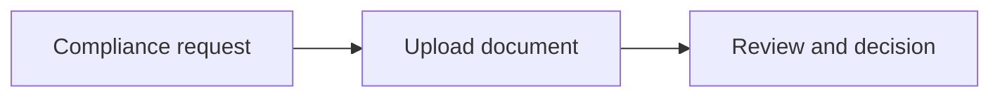

import { EnvUrls } from "/snippets/env-urls.jsx";

<EnvUrls lang="en" />


## Delivery A+B: contract signing and document remediation

This section is the implementation contract for the hosted portal and API. The
API examples below use the public platform routes and the response fields are
the normalized fields returned by the handlers.

### Inline remediation: verify the email, add a number, unlock the number

When a newly linked phone has not been verified, phone-based OTP actions stay
in a **four-hour cooldown**. The portal must show the compliance call to action
and let the member choose an independent factor: a verified email challenge or
a TOTP challenge. A code sent to the new number never unlocks this protection.

```bash
# Create the phone-change challenge; choose email or totp in the request.
curl -X POST https://api.qbank.cl/platform/v1/otp/challenges \
  -H "Authorization: Bearer <CBPAY_TOKEN>" \
  -H "Content-Type: application/json" \
  -d '{"action":"phone_change","channel":"email"}'

# Verify the challenge in the portal, then unlock early with its X-OTP-Token.
curl -X POST https://api.qbank.cl/platform/v1/me/phone/unlock-cooldown \
  -H "Authorization: Bearer <CBPAY_TOKEN>" \
  -H "X-OTP-Token: <VERIFIED_PHONE_CHANGE_TOKEN>"
```

A successful response is `{"status":"unlocked","channel":"email"}`;
when no cooldown exists it is `{"status":"not_locked"}`. Missing or spent
codes return `401 invalid_otp`; a phone/SMS/WhatsApp factor returns
`403 independent_factor_required`. If no independent factor is available,
the member must wait until the four-hour window expires. After the member adds
and verifies the number, the profile reflects the result in `GET /v1/me`.

An organization administrator can clear the marker without changing the phone
or its `phone_verified` state:

```bash
curl -X POST https://api.qbank.cl/platform/v1/accounts/<ACCOUNT_ID>/phone/clear-cooldown \
  -H "Authorization: Bearer <ADMIN_TOKEN>"
```

The response is `{"status":"cleared","account_id":"<ACCOUNT_ID>"}`. The
admin action is audited and requires the account-write permission.

### Typed signatures in the portal and wizard

The contract wizard offers **Draw signature** and **Type full name**. Both
produce the same `signature_png` field. For a typed signature, send the
rendered PNG plus the explicit mode and exact name:

```bash
curl -X POST https://api.qbank.cl/platform/v1/me/contracts/envelopes/<ENVELOPE_ID>/sign \
  -H "Authorization: Bearer <CBPAY_TOKEN>" \
  -H "Content-Type: application/json" \
  -H "X-OTP-Token: <FRESH_OTP>" \
  -d '{"signer_name":"Jordan Lee","signer_title":"Director","consent":true,
       "signature_png":"<PNG_BASE64>","signature_mode":"typed","typed_name":"Jordan Lee"}'
```

`signature_mode` is `drawn` by default or `typed`. In typed mode,
`typed_name` is required and must exactly match `signer_name`; otherwise the
API returns `422 typed_name_mismatch`. An unknown mode returns
`422 invalid_signature_mode`. The OTP remains a header, never a JSON field.

### KYB wizard: United Kingdom and generic countries

For a hosted company link, send `country: "uk"` for the United Kingdom. The
wizard then asks for the UK company number, registered details, directors,
beneficial owners and control/signing roles using the UK profile. For a
country outside the corridor catalog, send `country: "generic"` and an ISO
alpha-2 `generic_country`:

```bash
curl -X POST https://api.qbank.cl/platform/v1/kyb/links \
  -H "Authorization: Bearer <CBPAY_TOKEN>" \
  -H "Content-Type: application/json" \
  -H "Idempotency-Key: kyb-cust-456-uk-1" \
  -d '{"external_customer_id":"cust_456","country":"uk","label":"Northwind Ltd"}'

curl -X POST https://api.qbank.cl/platform/v1/kyb/links \
  -H "Authorization: Bearer <CBPAY_TOKEN>" \
  -H "Content-Type: application/json" \
  -d '{"external_customer_id":"cust_789","country":"generic","generic_country":"ES",
       "idempotency_key":"kyb-cust-789-es-1","label":"Example SL"}'
```

The wizard carries the selected country into the legal-presence and party
steps. The same fields are available in the native portal wizard; do not
substitute a country-specific catalog value when the country is generic.

### Verification emails and language

Verification and remediation emails include a **Continue compliance** CTA
when a hosted link or an actionable submission exists. The CTA points to the
same wizard token; email delivery is best-effort, so the link or submission
resource remains authoritative. The message language follows the profile
locale (`en`, `es` or `zh`), falling back to English. Integrators must not
infer a decision from delivery of the email.

### Native document upload: `multipart` and `raw`

The presign response tells the portal which transport to use:

```json
{"upload_url":"https://api.qbank.cl/platform/v1/kyc/submissions/sub_123/documents/upload",
 "key":"native/sub_123/identity/abc","expires_in":900,"method":"POST","shape":"multipart"}
```

For `shape: "multipart"`, POST the file to `upload_url` as the `file` part
and include `category` and the reserved `key`:

```bash
curl -X POST "$UPLOAD_URL" -H "Authorization: Bearer <CBPAY_TOKEN>" \
  -F "file=@passport.jpg;type=image/jpeg" -F "category=identity" -F "key=$KEY"
```

For `shape: "raw"`, PUT the bytes to `upload_url` with the same
`Content-Type`; the filename remains in the presign/confirm JSON. Never expose
an upstream storage or provider URL in the integration UI. Both paths finish
with `POST .../{submissionID}/documents/confirm`, then `GET .../documents`.
The native route accepts up to 24 MiB at the platform proxy; the core limit is
15 MiB per file.

After compliance asks for evidence, the response marks the item with
`uploaded_after_request: true`. Render that as an **Uploaded after request**
badge, alongside the document's `outcome` and `effective_outcome`. The latter
is the manual resolution when one exists; otherwise it is the OCR outcome.

## States and errors

| State or error | Meaning | Action |
|---|---|---|
| `phone_binding_cooldown` | The new phone is inside the four-hour window. | Use verified email/TOTP, ask an admin to clear it, or wait. |
| `uploaded_after_request: true` | The file answers a compliance request. | Show the badge and wait for validation. |
| `typed_name_mismatch` | The typed name differs from `signer_name`. | Send the exact signer name. |

See the [error catalog](/en/errors) for the complete response contract.

## FAQ

<AccordionGroup>
  <Accordion title="Can the new phone unlock its own cooldown?">No. Use the verified email or authenticator app, or wait four hours.</Accordion>
  <Accordion title="Which upload shape should the portal use?">Use the `shape` returned by presign; never infer it from a storage URL.</Accordion>
</AccordionGroup>
