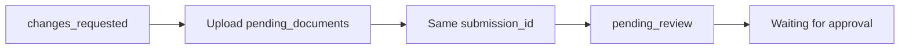

import { EnvUrls } from "/snippets/env-urls.jsx";

<EnvUrls lang="en" />

## Continue the current case

Your account has one **current verification case**. A later `rejected` record
does not invalidate an earlier case that is still actionable for remediation.
When a request is already in progress, `POST /v1/me/verification/link`
returns `409 self_verification_in_progress` without a new URL:

```json
{
  "error": {
    "code": "self_verification_in_progress",
    "message": "a verification is already in progress"
  }
}
```

Call `GET /v1/me/verification` and reopen the existing `link.url`. Do not
create a second case or change the idempotency key.

If a remediation-capable link expires while its submission is still
`changes_requested` or `more_info_required`, opening it automatically
reopens the link for another 90 days. Its state is `opened`, and the response
reports `changes_requested` with `next_step: resubmit`. Terminal and revoked
links remain closed.

## Resubmit in place

While remediation is possible, the current submission exposes:

```json
{
  "submission_id": "sub_123",
  "status": "changes_requested",
  "pending_documents": ["proofOfResidence"],
  "documents_received": ["identity"],
  "changes_requested_comments": "Upload a legible proof of residence.",
  "documents_gate": { "ok": false, "total": 2, "matched": 1 }
}
```

Upload every item in `pending_documents` in the existing wizard. The wizard
resubmits **in place**: the `submission_id` is unchanged and no new
submission is created. When the last required document is accepted, the case
automatically returns to `pending_review` and the portal shows **Waiting for
approval**.

For an invited UBO or director at `/on/ubo/`, if the declaration is still
missing, the review card shows **Your sworn declaration still needs your
signature**. The UBO can sign the declaration inline; signing is sufficient
to continue, and the case remains in review.

An expired-link screen is intentionally distinct and explains that your
progress was saved, then asks you to request a new link.



<AccordionGroup>
  <Accordion title="Why did I receive a 409?">
    A current self-verification case already exists. Read the current
    verification and reuse its open link.
  </Accordion>
  <Accordion title="Does resubmission create a new review?">
    No. The existing submission is updated and returns to review after the
    requested evidence is complete.
  </Accordion>
</AccordionGroup>

See the [error catalog](/en/errors) for actionable error codes.

## Company's own third-party cases

A company can read its own third-party KYC/KYB cases before the account is
approved. These routes exist to break the remediation loop: they are
read-only, scoped to the authenticated company account, and do not adopt,
create, or change a verification.

### List cases

```bash
curl "https://api.qbank.cl/platform/v1/me/verifications/kyb/third-party?page=1&page_size=50&from=2026-11-01&to=2026-11-07&status=changes_requested" \
  -H "Authorization: Bearer <account-token>"
```

```json
{
  "page": 1,
  "page_size": 50,
  "submissions": [{
    "submission_id": "c3d4e5f6-a7b8-4c9d-0e1f-2a3b4c5d6e7f",
    "kind": "kyb",
    "status": "changes_requested",
    "external_customer_id": "link:7f8e9d0c-1b2a-4c3d-8e4f-0a1b2c3d4e5f",
    "created_at": "2026-11-03T16:18:20Z",
    "updated_at": "2026-11-06T16:37:23Z"
  }]
}
```

The list accepts `page`, `page_size` (maximum 200), `status`, and optional
`from`/`to` filters. When omitted, the API applies its default date range;
passing the range explicitly is recommended for reproducible pagination. It
is a platform mirror and does not make a core request for every row.

### Read remediation detail

```bash
curl "https://api.qbank.cl/platform/v1/me/verifications/kyb/third-party/c3d4e5f6-a7b8-4c9d-0e1f-2a3b4c5d6e7f" \
  -H "Authorization: Bearer <account-token>"
```

```json
{
  "submission_id": "c3d4e5f6-a7b8-4c9d-0e1f-2a3b4c5d6e7f",
  "kind": "kyb",
  "status": "changes_requested",
  "external_customer_id": "link:7f8e9d0c-1b2a-4c3d-8e4f-0a1b2c3d4e5f",
  "pending_documents": ["proofOfAddress", "financialStatements"],
  "changes_requested_comments": "Please upload the listed documents.",
  "created_at": "2026-11-03T16:18:20Z",
  "updated_at": "2026-11-06T16:37:23Z"
}
```

The detail reads the current core state when available. If that enrichment is
temporarily unavailable, the safe mirror is returned. A migrated case is
reported as `status: "migrated"` with `migrated_from` and `migrated_to`.

| HTTP | Code | Solution |
|---:|---|---|
| 400 | `invalid_range` | Correct malformed `from`/`to` values and use the documented date format. |
| 401 | `unauthorized` | Refresh the account token and send it as a Bearer token. |
| 403 | `company_account_required` | Use a company account; person accounts cannot own third-party cases. |
| 404 | `not_found` | Verify the case belongs to the authenticated account. |

<AccordionGroup>
  <Accordion title="Does the account need to be approved first?">
    No. The company may read its own third-party cases in any state so it can
    complete remediation. Write operations retain their existing approval and
    permission gates.
  </Accordion>
  <Accordion title="Does reading create or adopt a case?">
    No. Both routes are pure reads. They never create a submission, send a
    decision, adopt an approval, or change account state.
  </Accordion>
  <Accordion title="How do I submit the requested documents?">
    Use the existing hosted flow for the same submission. Keep its
    `submission_id`; do not create a replacement case.
  </Accordion>
</AccordionGroup>
