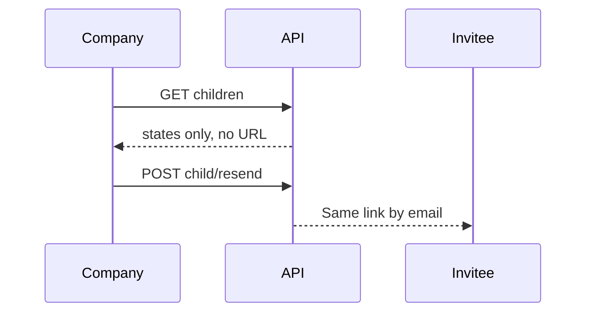

import { EnvUrls } from "/snippets/env-urls.jsx";

<EnvUrls lang="en" />

## Tenant-scoped child workflow

Company accounts can list invited beneficial owners and directors while the
parent KYB is under review. The routes are scoped to the authenticated
company and never return the invite URL.



```bash
curl https://api.qbank.cl/platform/v1/me/verification/children \
  -H "Authorization: Bearer <token>"
```

```json
{
  "children": [
    {
      "child_link_id": "b7c2d3e4-f5a6-4b7c-8d9e-0f1a2b3c4d5e",
      "flow": "ubo",
      "email": "owner@example.com",
      "name": "Jane Owner",
      "link_status": "opened",
      "submission_id": "f0e1d2c3-e4f5-4a6b-8c9d-0e1f2a3b4c5d",
      "submission_status": "changes_requested",
      "reused": false,
      "expires_at": "2027-01-15T12:00:00Z",
      "created_at": "2026-11-01T12:00:00Z",
      "declaration_signed": false,
      "needs_signature": true,
      "decision_note": "Please sign the beneficial owner declaration."
    }
  ]
}
```

## Resend the same invite

Resend sends the existing child link by email. It never creates a new link,
bearer or submission. Remediable expired invites can be revived; throttling
allows one resend per child per day.

```bash
curl -X POST \
  https://api.qbank.cl/platform/v1/me/verification/children/{childID}/resend \
  -H "Authorization: Bearer <token>"
```

```json
{
  "sent": true,
  "reminded_to": "owner@example.com",
  "expires_at": "2027-01-15T12:00:00Z"
}
```

Email delivery is reported honestly. A `200` response with
`sent: false` includes `email_error: "email_unavailable"` or
`email_error: "email_failed"`; inspect it before any further action.

| State or error | Meaning | Solution |
|---|---|---|
| `pending` / `opened` | The child has not completed the wizard | Resend the same invite when needed. |
| `changes_requested` / `more_info_required` | Evidence needs correction | Use the existing wizard and submit again. |
| `declaration_signed: false` and `needs_signature: true` | The sworn declaration is pending | Open the same wizard, sign and submit; do not create another child. |
| `invalid_child` (`400`) | `childID` is missing | Pass the `child_link_id` from the list response. |
| `not_found` (`404`) | The child is unknown or belongs to another KYB case | Check ownership and use the listed child ID. |
| `already_decided` / `invite_closed` (`409`) | The child cannot be resent | Read the current state; do not create a replacement. |
| `email_unavailable` / `email_failed` | The email was not sent | Check mail configuration and retry this resend route later. |

<AccordionGroup>
<Accordion title="Does resend charge again?">
No. It reuses the existing child invite and submission and does not create a
new verification.
</Accordion>
<Accordion title="Why is the invite URL not in the response?">
The URL is a bearer credential. It is delivered only to the invitee by email
and is never exposed through the company API.
</Accordion>
</AccordionGroup>

See the [central error catalog](/en/errors) for shared error handling.
