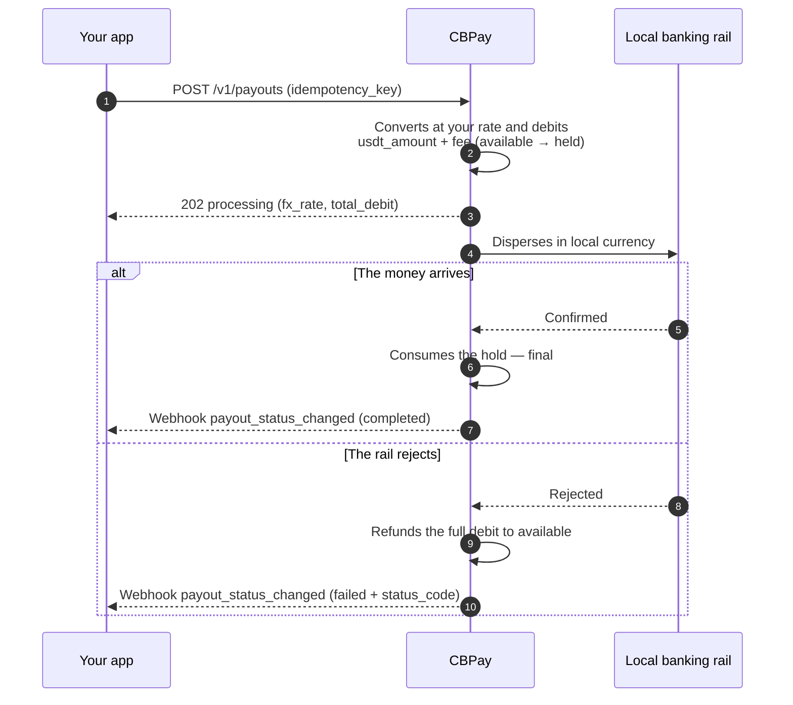

import { EnvUrls } from "/snippets/env-urls.jsx";

<EnvUrls lang="en" />


<Warning>
**Breaking change — 2026-11-13.** BOB, MXN, ARS and CLP ledger balances, plus `BANK_*` mirrors, are Banking-only. Platform payouts, swaps, internal transfers, cards, checkout, POS and fees reject fiat settlement with HTTP `400`. Existing fiat defaults migrate automatically to `USDT`; use Banking for fiat operations.
</Warning>
A payout sends money in local currency to a bank account in the destination
country. The amount converts from local currency to USDT at **your
account's rate** (the one from `GET /v1/rates`) and `usdt_amount + fee`
(the fixed fee, when configured) is debited from your balance.

This is the full lifecycle, including what happens to your balance at each
step:



## 1. Discover the available corridors

Countries, currencies and methods are defined by CBPay. Always check
the catalog:

```bash
curl https://api.qbank.cl/platform/v1/payouts/methods \
  -H "Authorization: Bearer <token>"
```

```json
{
  "items": [
    { "country": "CL", "currency": "CLP", "method": "bank_transfer" },
    { "country": "PE", "currency": "PEN", "method": "bank_transfer" },
    { "country": "PE", "currency": "PEN", "method": "yape" },
    { "country": "BO", "currency": "BOB", "method": "qr" }
  ],
  "meta": { "retrieved": 4 }
}
```

Available corridors and methods:

| Country | Currency | Methods |
|---|---|---|
| Chile | CLP | `bank_transfer` |
| Peru | PEN | `bank_transfer`, `yape` |
| Mexico | MXN | `bank_transfer` (SPEI: CLABE or debit card) |
| Venezuela | VES | `bank_transfer`, `pago_movil` |
| Bolivia | BOB / USD | `bank_transfer`, `qr` (see [QR payout](/en/guides/payout-special-cases#qr-payout)) |
| Brazil | BRL | `pix` (by key or to account), `qr` (PIX QR — see [QR payout](/en/guides/payout-special-cases#qr-payout)) |
| Ecuador | USD | `bank_transfer`, `deuna`, `cash_pickup`, `cnb` |
| Paraguay | PYG | `bank_transfer` |
| Argentina | ARS / USD | `bank_transfer` (CBU or CVU) |
| Colombia | COP | `bank_transfer` (integer amounts, no decimals), `breb` |
| United States | USD | `ach`, `wire`, `swift` |

Availability may vary; the catalog (`GET /v1/payouts/methods`) is always
the source of truth. If a country has a single method, `method` is
optional. Every method is charged the same way: your rate + fixed fee.

For bank transfers you also need the banks catalog (that is where the
beneficiary's `bank_code` comes from):

```bash
curl "https://api.qbank.cl/platform/v1/payouts/banks?country=CL" \
  -H "Authorization: Bearer <token>"
```

```json
{
  "items": [
    { "code": "001", "name": "Banco de Chile" },
    { "code": "012", "name": "Banco del Estado de Chile" },
    { "code": "016", "name": "Banco de Crédito e Inversiones" }
  ],
  "meta": { "retrieved": 3 }
}
```

## 2. Create the payout

```bash
curl -X POST https://api.qbank.cl/platform/v1/payouts \
  -H "Authorization: Bearer <token>" \
  -H "Content-Type: application/json" \
  -d '{
    "country": "MX",
    "currency": "MXN",
    "method": "bank_transfer",
    "amount": "1500.00",
    "beneficiary": {
      "name": "Maria Lopez",
      "account_type": "clabe",
      "account_number": "012180001234567895"
    },
    "description": "Invoice 8841",
    "idempotency_key": "invoice-8841"
  }'
```

<Warning>
`beneficiary` is a key/value object whose required fields depend on the
corridor (RUT and bank in Chile, CLABE in Mexico, CCI in Peru, PIX key in
Brazil, etc.). The methods catalog documents each one.
</Warning>

<Note>
Every payout saves the beneficiary as a [contact](/en/guides/contacts)
automatically (`"save_contact": false` to skip it). To pay them again
without re-typing their data, send `"beneficiary_contact_id"` instead of
`beneficiary` — their most recent saved beneficiary for that country and
method is used (`422 no_saved_destination` if there is none).
</Note>

Response `202 Accepted`:

```json
{
  "payout_id": "0d4f…",
  "account_id": "…",
  "idempotency_key": "invoice-8841",
  "country": "MX",
  "currency": "MXN",
  "method": "bank_transfer",
  "local_amount": "1500.00",
  "fx_rate": "17.50",
  "usdt_amount": "85.714286",
  "fee": "0.300000",
  "total_debit": "86.014286",
  "settlement_asset": "USDT",
  "settlement_amount": "86.014286",
  "settlement_rate": "1",
  "status": "processing",
  "status_code": "",
  "status_message": "",
  "funds_debited": true,
  "compliance_pending": false,
  "bank_reference": "",
  "created_at": "2026-07-06T20:00:00Z"
}
```

At that moment your balance already reflects the debit: `total_debit` moved
from `available` into `held` (on the `settlement_asset` balance).

<Note>
**`bank_reference` — the bank's own id for the transfer.** On US ACH, wire
and SWIFT it is the CBF reference returned **immediately** at create (the
payout stays `processing` until the bank confirms). On other corridors it
stays empty (`""`) until the payout is `completed`. It is the value the
beneficiary can use to cross-check the payment with their bank, and it also
appears in the `payout_status_changed` webhook, the PDF receipt, the payouts
CSV export and the statement. Payout responses, webhooks, CSV and receipts also expose `uetr` (UETR/SWIFT gpi) and `imad` (domestic wire/ACH), both empty until reported by the bank; use the [public transaction tracker](/en/guides/tracking) for live status and the same receipt.
</Note>
### Paying from another balance (`settlement_asset`)

The default debit comes from USD; use `PUT /v1/settlement` to change it. To pay a single operation from
another balance, add `settlement_asset` to the request. Example: a 100,000
CLP payout paid from the BTC balance goes through four transformations,
all recorded on the response:

1. **CLP → USDT** at your rate: `100000 / 950.25 = 105.235465 USDT`.
2. **+ fixed fee**: `105.235465 + 0.30 = 105.535465 USDT` (`total_debit`).
3. **USDT → BTC** at the effective settlement price (`settlement_rate`
   `109029.34070000`): `105.535465 / 109029.3407 = 0.00096795 BTC`
   (rounded up to the satoshi).
4. **Debit and hold in BTC**: `settlement_amount` `0.00096795` leaves your
   BTC balance; the beneficiary receives their 100,000 CLP exactly as
   always.

```json
{
  "country": "CL",
  "currency": "CLP",
  "local_amount": "100000",
  "fx_rate": "950.25",
  "usdt_amount": "105.235465",
  "fee": "0.300000",
  "total_debit": "105.535465",
  "settlement_asset": "BTC",
  "settlement_amount": "0.00096795",
  "settlement_rate": "109029.34070000",
  "status": "processing",
  "status_code": "",
  "status_message": "",
  "funds_debited": true,
  "compliance_pending": false,
  "bank_reference": ""
}
```

If the payout fails, the exact `settlement_amount` is refunded to your BTC
balance — never re-quoted. If the BTC/GOLD/SILVER/PLATINUM execution price is unavailable
at that moment you get `503 pricing_unavailable`, and volatile assets have
a per-operation limit (`422 settlement_limit_exceeded`; check it in
`GET /v1/settlement`).
For same-currency BOB, MXN or ARS settlement, see [Fiat payout settlement](./fiat-settlement).
### Technical screening can be pending
CBPay screens the beneficiary before it debits your balance or calls the core.
If the screening service is temporarily unavailable **and the technical
screening queue is available**, the payout is persisted and the create call
returns `202 Accepted` with the payout resource in `status: "pending"`:

```json
{
  "payout_id": "0d4f…",
  "idempotency_key": "invoice-8841",
  "status": "pending",
  "status_code": "compliance_pending",
  "status_message": "",
  "funds_debited": false,
  "compliance_pending": true,
  "predebit_failure": false,
  "created_at": "2026-07-06T20:00:00Z",
  "updated_at": "2026-07-06T20:00:00Z"
}
```

While it is pending there is **no debit, hold, ledger entry, core dispatch or
`receipt_url`**. Replaying with the same idempotency key returns the same payout
with `idempotency_hit: true`; it never creates a second operation. When the
screening worker receives `process`, the existing payout enters the normal debit
and dispatch flow. A valid `hold` goes to the transactional firewall. A later
`rejected` result ends the queued payout as `failed` with no debit.

After `process` is accepted, the same payout can remain `status: "pending"`
while the debit and dispatch are reconciled. The API and
`payout_status_changed` webhook expose these durable transition codes:

- `compliance_dispatch_pending`: screening passed, the debit/hold exists and
  `funds_debited: true`, but the core dispatch has not completed.
- `compliance_dispatching`: the dispatch claim is in progress.
- `core_unreachable`: the dispatch or local settlement is ambiguous and is
  waiting for reconciliation; do not create a second payout.

These transitions are not a new payout operation. Keep the same
`idempotency_key`, read the payout, and wait for the next status event. Once the
payout is final, `completed` consumes the hold and `failed` refunds the exact
debit. Final status events use the durable event path and include the normal
receipt fields.

The technical `compliance_check_unavailable` response remains applicable when
the payout cannot be placed in the pending queue, and to flows that do not have
this queue. It does not replace the existing validation, security or
`compliance_hold` contracts.

### Pre-debit failure is not a refund
If screening or a hard compliance gate fails before the debit path starts, the
same payout can finish as `failed` with `predebit_failure: true` and
`funds_debited: false`. The response and its `payout_status_changed` event omit
`receipt_url`, because there was no debit, hold or receipt to reverse. This is
different from a post-debit `failed` payout, where the exact debit is refunded
before the terminal event.
For rate provenance and indicative FIFO quotes, see [Payout rate sources and indicative FIFO quotes](/en/guides/payout-rate-sources).

## Argentina: resolve a bank alias before paying
Resolve and confirm the holder before creating the payout (10 lookups/minute/account). Request: `GET /v1/payouts/ar-alias/resolve?alias=julieta.fernandez`. Response: `{"alias":"julieta.fernandez","account_number":"2850590940090418135201","account_type":"CBU","tax_id":"27234567891","holder_name":"Julieta Fernandez"}`. Create `POST /v1/payouts` with `account_number` set to the original alias and the returned `tax_id`/`name`; dispatch re-resolves it and records `destination_alias` in evidence. `alias_unresolvable` is deterministic; `beneficiary_lookup_unavailable` is temporary. See [Errors](/en/errors).
## 3. Receive the final state

Subscribe to the `payout_status_changed` event ([webhooks](/en/webhooks)):

```json
{
  "payout_id": "0d4f…",
  "account_id": "…",
  "country": "MX",
  "currency": "MXN",
  "local_amount": "1500.00",
  "usdt_amount": "85.714286",
  "total_debit": "86.014286",
  "status": "completed",
  "status_code": "",
  "status_message": "",
  "bank_reference": "00761123456"
}
```

- **`completed`**: the money arrived; the hold is consumed.
- **`failed`**: the full debit is refunded automatically (`payout_refund`
  in your ledger).

`status_message` is the optional, normalized detail accompanying
`status_code`; it can be empty when the core has no additional message.

You can also query at any time:

```bash
curl https://api.qbank.cl/platform/v1/payouts/0d4f… \
  -H "Authorization: Bearer <token>"
```

### Payout statuses

| Status | Meaning | Your balance |
|---|---|---|
| `processing` | Accepted and executing on the local rail | Debit held in `held` |
| `pending` + `waiting_funds` | Temporary processing state; the platform resumes the payout automatically | Existing debit/hold remains associated; do not create a replacement |
| `pending` + `compliance_pending: true` | Technical beneficiary screening is pending before any debit or dispatch | **No debit**; `funds_debited: false` |
| `pending` + `compliance_dispatch_pending` / `compliance_dispatching` / `core_unreachable` | Screening passed; debit exists while dispatch or reconciliation is pending | `funds_debited: true`; debit remains held |
| `completed` | The money reached the beneficiary | Hold consumed — final |
| `failed` after debit | The corridor rejected it or execution failed after the debit | **Full automatic refund** (amount + fee) |
| `failed` + `predebit_failure: true` | Screening or a hard compliance gate failed before the debit | **No debit**; `funds_debited: false`, no receipt |

## Reads and history

Every payout can be read individually and the listing accepts filters:

```bash
# One payout
curl https://api.qbank.cl/platform/v1/payouts/0d4f… \
  -H "Authorization: Bearer <token>"

# History with filters: dates, status, country, method, search and pagination
curl "https://api.qbank.cl/platform/v1/payouts?from=2026-07-01&to=2026-07-08&status=failed&country=MX&method=bank_transfer&search=0d4f&page=1&page_size=50" \
  -H "Authorization: Bearer <token>"
```

```json
{
  "page": 1,
  "page_size": 50,
  "payouts": [
    {
      "payout_id": "0d4f…",
      "country": "MX",
      "currency": "MXN",
      "method": "bank_transfer",
      "local_amount": "1500.00",
      "fx_rate": "17.50",
      "usdt_amount": "85.714286",
      "fee": "0.300000",
      "total_debit": "86.014286",
      "status": "failed",
      "status_code": "core_rejected",
      "status_message": "beneficiary account does not exist",
      "bank_reference": "",
      "created_at": "2026-07-06T20:00:00Z"
    }
  ]
}
```

`from`/`to` use `YYYY-MM-DD` (organization timezone, both inclusive); an invalid date
responds `400 invalid_range`. `method` filters by the live payout catalog, while
`search` performs a case-insensitive partial match on the payout ID, bank reference
or idempotency key.

