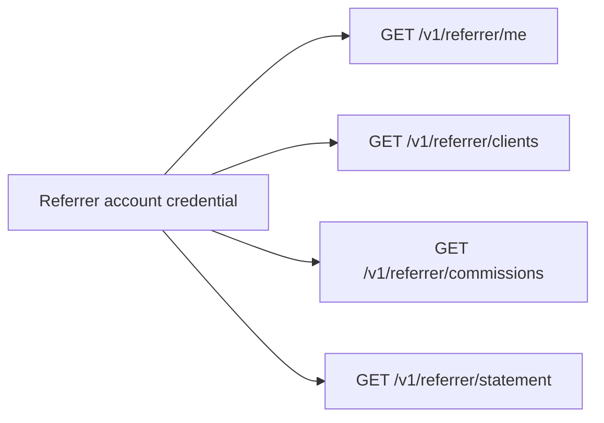

import { EnvUrls } from "/snippets/env-urls.jsx";

<EnvUrls lang="en" />

The referrer portal is a read-only surface for the credential of an active
referrer's payout account. It never accepts an organization referrer ID from
the caller: the API resolves the referrer from the authenticated account, so
the caller can see only its own clients, commissions and reports.



## Authentication and limits

Use the session or API credential of the referrer's payout account. A
credential for any other account receives `404 not_found`. Portal responses
are provider-agnostic and never expose internal provider identities.

All list endpoints use `page` and `page_size`. Commission and statement
requests require `from` and `to` date parameters. Use `format=json` (default),
`format=pdf` or `format=xlsx`; `lang=en|es|zh` localizes human-readable
download labels.

## 1. View the referrer profile

```bash
curl "$CBPAY_URL/v1/referrer/me" \
  -H "Authorization: Bearer $REFERRER_TOKEN"
```

```json
{
  "id": "aaaaaaaa-aaaa-4aaa-8aaa-aaaaaaaaaaaa",
  "org_id": "99999999-9999-4999-8999-999999999999",
  "name": "Hernan Lopez",
  "code": "hernan",
  "email": "hernan@example.com",
  "payout_account_id": "11111111-1111-4111-8111-111111111111",
  "status": "active",
  "created_at": "2026-11-04T12:00:00Z",
  "updated_at": "2026-11-04T12:00:00Z"
}
```

This endpoint is read-only. The organization admin controls the name, status,
payout account and client assignments.

## 2. View assigned clients

```bash
curl "$CBPAY_URL/v1/referrer/clients?status=active&page=1&page_size=50" \
  -H "Authorization: Bearer $REFERRER_TOKEN"
```

```json
{
  "page": 1,
  "page_size": 50,
  "assignments": [{
    "id": "bbbbbbbb-bbbb-4bbb-8bbb-bbbbbbbbbbbb",
    "org_id": "99999999-9999-4999-8999-999999999999",
    "referrer_id": "aaaaaaaa-aaaa-4aaa-8aaa-aaaaaaaaaaaa",
    "account_id": "33333333-3333-4333-8333-333333333333",
    "percent_bps": 2000,
    "percent": "20",
    "status": "active",
    "effective_from": "2026-11-04T12:01:00Z",
    "created_at": "2026-11-04T12:01:00Z"
  }]
}
```

Use `status=active` or `status=revoked`. The portal never returns another
referrer's assignments.

## 3. View accrued commissions

```bash
curl "$CBPAY_URL/v1/referrer/commissions?from=2026-11-01&to=2026-12-01&status=pending&page=1&page_size=50" \
  -H "Authorization: Bearer $REFERRER_TOKEN"
```

```json
{
  "page": 1,
  "page_size": 50,
  "commissions": [{
    "id": "cccccccc-cccc-4ccc-8ccc-cccccccccccc",
    "org_id": "99999999-9999-4999-8999-999999999999",
    "referrer_id": "aaaaaaaa-aaaa-4aaa-8aaa-aaaaaaaaaaaa",
    "account_id": "33333333-3333-4333-8333-333333333333",
    "ref_type": "payout",
    "ref_id": "dddddddd-dddd-4ddd-8ddd-dddddddddddd",
    "asset": "USDT",
    "base_gross": "100.000000",
    "cost_amount": "25.000000",
    "base_net": "75.000000",
    "percent_bps": 2000,
    "percent": "20",
    "commission_amount": "15.000000",
    "cost_missing": false,
    "status": "pending",
    "period": "2026-11",
    "created_at": "2026-11-04T12:02:00Z"
  }]
}
```

The commission is calculated on net revenue:
`floor(max(gross - cost, 0) × percent_bps / 10000)`. Amounts are strings,
not floating point. When operating cost is unavailable, the row says
`cost_missing: true` and keeps the gross-based calculation auditable.

Optional filters are `account_id`, `status` and `period`; `from` and `to`
bound the inclusive/exclusive date range used by the API.

## 4. Download your statement

The statement contains totals by asset, a client summary, transaction lines,
closings and the `balanced` flag. It is generated only for the authenticated
referrer:

```bash
curl "$CBPAY_URL/v1/referrer/statement?from=2026-11-01&to=2026-12-01&format=json&lang=en" \
  -H "Authorization: Bearer $REFERRER_TOKEN"
curl -OJ "$CBPAY_URL/v1/referrer/statement?from=2026-11-01&to=2026-12-01&format=pdf&lang=en" \
  -H "Authorization: Bearer $REFERRER_TOKEN"
curl -OJ "$CBPAY_URL/v1/referrer/statement?from=2026-11-01&to=2026-12-01&format=xlsx&lang=en" \
  -H "Authorization: Bearer $REFERRER_TOKEN"
```

The JSON response contains:

```json
{
  "org_id": "99999999-9999-4999-8999-999999999999",
  "org_name": "Example Organization",
  "referrer_id": "aaaaaaaa-aaaa-4aaa-8aaa-aaaaaaaaaaaa",
  "referrer_name": "Hernan Lopez",
  "referrer_code": "hernan",
  "referrer_email": "hernan@example.com",
  "from": "2026-11-01T00:00:00Z",
  "to": "2026-12-01T00:00:00Z",
  "generated_at": "2026-12-01T10:05:00Z",
  "totals": [],
  "clients": [],
  "lines": [],
  "closings": [],
  "truncated": false,
  "clients_truncated": false,
  "closings_truncated": false,
  "balanced": true
}
```

PDF and XLSX use the organization's configured white-label logo, colors,
name and footer. CBPay is only the default branding when the organization has
not configured its own identity.

## States and errors

| State | Meaning |
|---|---|
| `active` | Assignment or referrer can accrue commissions |
| `inactive` | No new accruals; previous commissions remain visible |
| `pending` | Accrued and waiting for a closing |
| `reversed` | A previous accrual was reversed; keep it in the history |
| `approved` | Included in an approved closing |
| `paid` | Included in a paid closing |
| `revoked` | Assignment ended; historical rows remain |

| HTTP | Code | Solution |
|---:|---|---|
| 400 | `invalid_range` | Send valid `from` and `to` dates. |
| 400 | `invalid_format` | Use `json`, `pdf` or `xlsx`. |
| 404 | `not_found` | Authenticate with the active referrer's payout account. |

See the [error catalog](/en/errors) for the shared response format.

## FAQ

<AccordionGroup>
  <Accordion title="Can I choose a referrer ID?">No. The portal derives it from your authenticated payout account and ignores cross-referrer access.</Accordion>
  <Accordion title="Can I change my percentage or clients here?">No. Ask an organization administrator; this portal is read-only.</Accordion>
  <Accordion title="Why is a commission pending?">It has been accrued but has not yet been linked to an approved or paid monthly closing.</Accordion>
  <Accordion title="What should I do after a timeout downloading a report?">Repeat the read-only request with the same date range and format. No payment is triggered by a statement request.</Accordion>
  <Accordion title="Which report formats are available?">JSON for an application, PDF for a formal report and XLSX for analysis.</Accordion>
</AccordionGroup>
