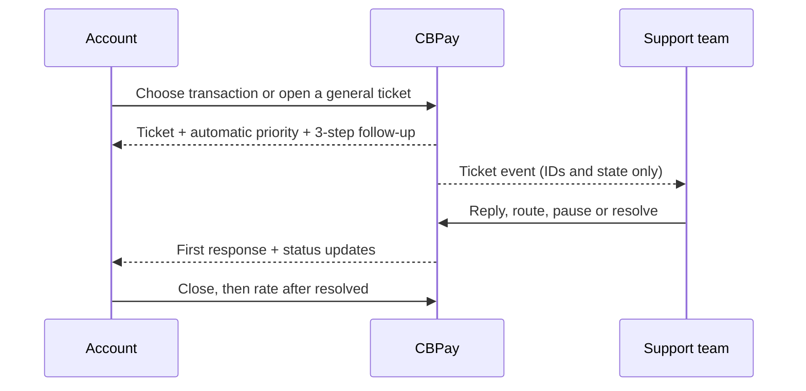

import { EnvUrls } from "/snippets/env-urls.jsx";

<EnvUrls lang="en" />

Use Support when you need an auditable conversation with your organization. A ticket can start with a transaction, or without one for an account issue. You can link, replace, or unlink the transaction later; the linked receipt is read-only evidence and never changes the ledger.



## 1. Choose the right flow

There are two ways to open a ticket:

1. **From a transaction:** open the transaction detail and select Support, or search it with `GET /v1/support/transactions`. This is the preferred path for a payout, payin, refund, transfer, crypto movement, swap, card purchase, banking operation, or wallet movement.
2. **From Support:** create a ticket without a transaction for an account question. Use `kind: general`; the category is `other` (the legacy `general` category is accepted temporarily and normalized to `other`).

The 11 categories are closed:

| Transaction (6) | Account or other (5) |
|---|---|
| `error`, `question`, `delay`, `amount_mismatch`, `unrecognized_operation`, `refund_request` | `account_verification`, `access_security`, `fraud`, `fees_limits`, `other` |

`unrecognized_operation` and `fraud` are the Fraud queue categories. `money_stuck` is a separate required signal: send `yes`, `no`, or `unknown`.

## 2. Open the ticket

```bash
curl -X POST https://api.qbank.cl/platform/v1/support/tickets \
  -H "Authorization: Bearer $ACCOUNT_TOKEN" -H "Content-Type: application/json" \
  -H "Idempotency-Key: support-payout-2026-0001" \
  -d '{"kind":"payout","resource_id":"payout-123","subject":"Payout is delayed","category":"delay","money_stuck":"yes","message":"Please check this payout.","idempotency_key":"support-payout-2026-0001"}'
```

The response is `201 Created` and includes `ticket_id`, `number` (`SUP-YYYY-NNNNNN`), the read-only `snapshot`, `priority`, `priority_source: "auto"`, `priority_rule`, `money_stuck`, `team`, `first_response_due_at`, `resolution_due_at`, and status.

The client **does not choose priority**. The organization evaluates enabled rules in position order and applies the first match:

1. Fraud or unrecognized operation → `urgent`.
2. `money_stuck: yes` → `urgent`.
3. `error`, `delay`, or `amount_mismatch` at or above the configured USD floor (default `1000`) → `high`.
4. `access_security` → `high`.
5. Catch-all → `normal`.

If the organization has no custom rules, these five defaults apply. A legacy `priority` field is ignored for compatibility; it is not validated or trusted.

The key is required in the body or `Idempotency-Key` header and is scoped to organization + account. Replaying it returns the original ticket with `idempotency_hit: true`. A second open ticket for the same transaction returns `409 ticket_already_open` and identifies the existing ticket. On a timeout, do not submit a new key: read with the same key or check the transaction first.

### Example response

```json
{
  "ticket_id": "7c7c8f4e-3d6a-4f62-bf6d-8d9ce1e2a111",
  "number": "SUP-2026-000127",
  "kind": "payout",
  "resource_id": "payout-123",
  "category": "delay",
  "money_stuck": "yes",
  "priority": "urgent",
  "priority_source": "auto",
  "priority_rule": "money_stuck",
  "status": "open",
  "first_response_due_at": "2026-10-30T12:00:00Z",
  "resolution_due_at": "2026-10-30T16:00:00Z",
  "snapshot": {"status": "processing", "amount": "125.00", "currency": "USD"},
  "messages": []
}
```

## 3. Follow the ticket in three steps

The customer-facing follow-up is intentionally simple:

1. **Open:** the team is investigating. The response SLA is measured from creation.
2. **First response:** a public reply changes the ticket to `pending_customer`. The customer can reply with more context, but does not see internal notes or the organization’s internal Activity feed.
3. **Resolved and closed:** a resolved ticket is ready for CSAT. Close it when the answer is complete, then rate it. A customer reply reopens `pending_customer`, `on_hold`, or `resolved` as `open`; `closed` is terminal.

```bash
curl "https://api.qbank.cl/platform/v1/support/tickets/7c7c8f4e-3d6a-4f62-bf6d-8d9ce1e2a111" \
  -H "Authorization: Bearer $ACCOUNT_TOKEN"

curl -X POST https://api.qbank.cl/platform/v1/support/tickets/TICKET_ID/messages \
  -H "Authorization: Bearer $ACCOUNT_TOKEN" -H "Content-Type: application/json" \
  -d '{"body":"Here is additional context."}'
```

Use `GET /v1/support/tickets?from=2026-10-01&to=2026-10-31&page=1&page_size=50` for history. Filter by `status`, `category`, `priority`, or `kind`; `page_size` is capped at 200. Every list response is paginated.

## 4. Link, change, or unlink a transaction

Support can link a transaction to a general ticket, replace the link, or unlink it. The account can then read the new snapshot and tracker link. The link is checked against account ownership and the open-ticket invariant; it never mutates the transaction.

To find a transaction before linking:

```bash
curl "https://api.qbank.cl/platform/v1/support/transactions?q=125&from=2026-10-01&to=2026-10-31&page=1&page_size=50" \
  -H "Authorization: Bearer $ACCOUNT_TOKEN"
```

Results include `kind`, `resource_id`, `status`, `created_at`, `counterparty`, amount fields, `reference`, and `has_open_ticket`. If `has_open_ticket` is true, continue that ticket instead of creating another.

## 5. Add evidence safely

Upload one PDF, PNG, or JPG at a time, up to 10 MiB. The server checks the file signature and deduplicates by SHA-256 per ticket: uploading the same bytes twice does not create a second attachment.

Upload one `PDF`, `PNG` or `JPG` as multipart field `file`, up to 10 MiB. The server checks the file signature, not only the declared MIME type. Downloads are authenticated binary responses; do not expose `download_url` publicly.

```bash
curl -X POST https://api.qbank.cl/platform/v1/support/tickets/TICKET_ID/attachments \
  -H "Authorization: Bearer $ACCOUNT_TOKEN" \
  -F "file=@receipt.png;type=image/png" -o attachment.json
```

Attachment downloads are authenticated binary responses. Do not expose the private object key or construct a public URL.

## 6. Close and rate

`POST /v1/support/tickets/{id}/close` is convergent. CSAT is available only after the ticket is `resolved` or `closed`; submit `rating` from 1 to 5 and an optional comment up to 1,000 characters. A second rating returns `409 already_rated`.

```bash
curl -X POST https://api.qbank.cl/platform/v1/support/tickets/TICKET_ID/close \
  -H "Authorization: Bearer $ACCOUNT_TOKEN"

curl -X POST https://api.qbank.cl/platform/v1/support/tickets/TICKET_ID/rate \
  -H "Authorization: Bearer $ACCOUNT_TOKEN" -H "Content-Type: application/json" \
  -d '{"rating":5,"comment":"The explanation was clear."}'
```

## Status, SLA and errors

| Status | Meaning | Account action |
|---|---|---|
| `open` | Waiting for support work | Add context if needed |
| `pending_customer` | Support replied and awaits the account | Reply or close |
| `on_hold` | Support paused the work | Wait or add context |
| `resolved` | Support resolved the request | Rate or reopen with a message |
| `closed` | Terminal state | Open a new ticket |

Default first-response SLA is low 4h, normal 2h, high 1h, and urgent 30m. Resolution SLA is 48h, 24h, 8h, and 4h respectively. The organization may configure these values, business-hours calendars, and whether `pending_customer` pauses the clock. The API computes `sla_breached`; the customer sees the first-response commitment, not internal queue activity.

| HTTP | Code | Solution |
|---:|---|---|
| 400 | `idempotency_key_required`, `invalid_kind`, `invalid_category`, `invalid_subject`, `invalid_message`, `invalid_money_stuck`, `invalid_rating`, `invalid_comment` | Send the required key and use the closed vocabulary and limits. Priority is automatic; do not send it as a customer choice. |
| 403 | `forbidden` | Use an account token that owns the ticket and linked transaction. |
| 404 | `not_found` | Confirm the transaction or ticket belongs to the authenticated account. |
| 409 | `ticket_already_open` | Continue the returned open ticket; do not create a duplicate. |
| 409 | `ticket_closed`, `already_rated`, `attachment_duplicate` | Open a new ticket, keep the existing rating, or reuse the existing attachment. |
| 422 | `invalid_attachment` | Use a supported file type and size; the signature must match. |
| 503 | `storage_unavailable` | Read the ticket with the same key later; never invent a new key after an ambiguous timeout. |

See the [error catalog](/en/errors) and [webhook events](/en/webhooks#support-ticket-events).

## FAQ

<AccordionGroup>
<Accordion title="Can I open a ticket without a transaction?">
Yes. Omit `resource_id`, use `kind: general`, and use `category: other`. The legacy category `general` is normalized to `other` during the compatibility window.
</Accordion>
<Accordion title="Can I choose urgent priority?">
No. Priority is calculated server-side by first-match rules. Send the facts (`category` and `money_stuck`); the organization’s rule engine decides the priority. An old `priority` field is ignored.
</Accordion>
<Accordion title="How do I avoid duplicate tickets?">
Use the transaction search or open-ticket endpoint first, then reuse the same account-scoped idempotency key on retries. The server also enforces one open ticket per transaction.
</Accordion>
<Accordion title="Can I change the transaction later?">
Yes. Support can link, replace, or unlink a transaction after creation. The snapshot is refreshed and the ticket remains an auditable conversation; the transaction itself is never changed.
</Accordion>
<Accordion title="Can the account see internal notes or Activity?">
No. Internal notes and the organization Activity feed are admin-only. Customer responses and webhook events contain no internal note bodies.
</Accordion>
<Accordion title="When can I send CSAT?">
After the ticket is resolved or closed. Each ticket accepts one rating from 1 to 5 and one optional comment.
</Accordion>
</AccordionGroup>
