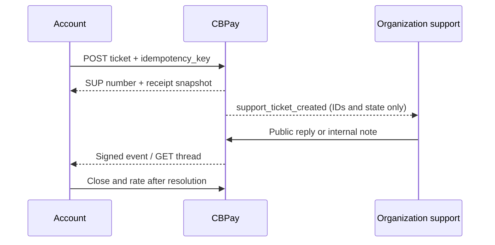

import { EnvUrls } from "/snippets/env-urls.jsx";

<EnvUrls lang="en" />

A support ticket keeps the account's question and the relevant transaction together. Open one from a transaction when the issue is an error, question, delay or amount mismatch; use `kind: general` only when there is no originating transaction. The API stores a read-only receipt snapshot for transaction tickets.



## Open a ticket

The transaction `kind` must be one of `payout`, `payin`, `payin_refund`, `transfer`, `crypto_withdrawal`, `crypto_deposit`, `swap`, `card_purchase`, `banking_operation`, `wallet_send` or `wallet_deposit`. Send its `resource_id`; `general` tickets must use category `general` and omit it.

```bash
curl -X POST https://api.qbank.cl/platform/v1/support/tickets \
  -H "Authorization: Bearer $ACCOUNT_TOKEN" -H "Content-Type: application/json" \
  -H "Idempotency-Key: support-payout-2026-0001" \
  -d '{"kind":"payout","resource_id":"payout-123","subject":"Payout is delayed","category":"delay","priority":"high","message":"Please check this payout.","idempotency_key":"support-payout-2026-0001"}'
```

The first request returns `201`. `idempotency_key` may contain at most 128 characters; a longer value returns `400 invalid_payload`. The idempotency key is account-scoped: deduplication uses `(organization, account, idempotency_key)`, so the same key may be used independently by different accounts. Replaying the same key returns the original ticket with `idempotency_hit: true`; it never creates another ticket. A second open ticket for the same transaction returns `409 ticket_already_open` and includes the existing ticket.

## Read and continue the thread

Use `GET /v1/support/tickets?from=2026-10-01&to=2026-10-31&page=1&page_size=50` to list tickets. Filters also include `status`, `category`, `priority` and `kind`; `page_size` is capped at 200. The detail contains `snapshot`, public messages and attachment metadata. Internal notes are never returned to the account.

```bash
curl -X POST https://api.qbank.cl/platform/v1/support/tickets/TICKET_ID/messages \
  -H "Authorization: Bearer $ACCOUNT_TOKEN" -H "Content-Type: application/json" \
  -d '{"body":"Here is additional context."}'
```

A message from the account reopens `pending_customer`, `on_hold` or `resolved` tickets as `open`. `closed` is terminal; open a new ticket instead.

## Attachments

Upload one `PDF`, `PNG` or `JPG` as multipart field `file`, up to 10 MiB. The server checks the file signature, not only the declared MIME type. Downloads are authenticated binary responses; do not expose `download_url` publicly.

```bash
curl -X POST https://api.qbank.cl/platform/v1/support/tickets/TICKET_ID/attachments \
  -H "Authorization: Bearer $ACCOUNT_TOKEN" \
  -F "file=@receipt.png;type=image/png" -o attachment.json
```

## Close and rate

`POST /v1/support/tickets/{id}/close` is convergent: closing an already closed ticket returns its current detail. After resolution, rate once with `rating` from 1 to 5 and an optional comment of at most 1,000 characters. A second rating returns `409 already_rated`.

## Status, SLA and errors

| Status | Meaning | Account action |
|---|---|---|
| `open` | Waiting for support work | Add context if needed |
| `pending_customer` | Support replied and awaits the account | Reply or close |
| `on_hold` | Support paused the work | Wait or add context |
| `resolved` | Support resolved the request | Rate or reopen with a message |
| `closed` | Terminal state | Open a new ticket |

Default first-response SLA is low 4h, normal 2h, high 1h and urgent 30m. Resolution SLA is 48h, 24h, 8h and 4h respectively. The organization may configure these values; `sla_breached` is computed server-side.

| HTTP | Code | Solution |
|---:|---|---|
| 400 | `idempotency_key_required` | Send the key in the body or `Idempotency-Key` header. |
| 400 | `invalid_kind`, `invalid_category`, `invalid_priority`, `invalid_subject`, `invalid_message`, `invalid_rating`, `invalid_comment` | Use the closed vocabulary and documented limits. |
| 404 | `not_found` | Confirm the transaction or ticket belongs to the authenticated account. |
| 409 | `ticket_already_open` | Continue the returned open ticket. |
| 409 | `ticket_closed`, `already_rated` | Open a new ticket or keep the existing rating. |
| 503 | `storage_unavailable` | Wait and upload once more; do not create a duplicate ticket. |

See the [error catalog](/en/errors) and [webhook events](/en/webhooks#support-ticket-events).

## FAQ

<AccordionGroup>
<Accordion title="Can a ticket be opened without a transaction?">
Yes. Use `kind: general`, omit `resource_id` and set `category: general`.
</Accordion>
<Accordion title="Can the account see internal notes?">
No. Internal notes are restricted to organization administrators and are excluded from account responses and events.
</Accordion>
<Accordion title="Do support events contain message bodies?">
No. Events contain identifiers and state only. Fetch the thread with authentication.
</Accordion>
</AccordionGroup>
