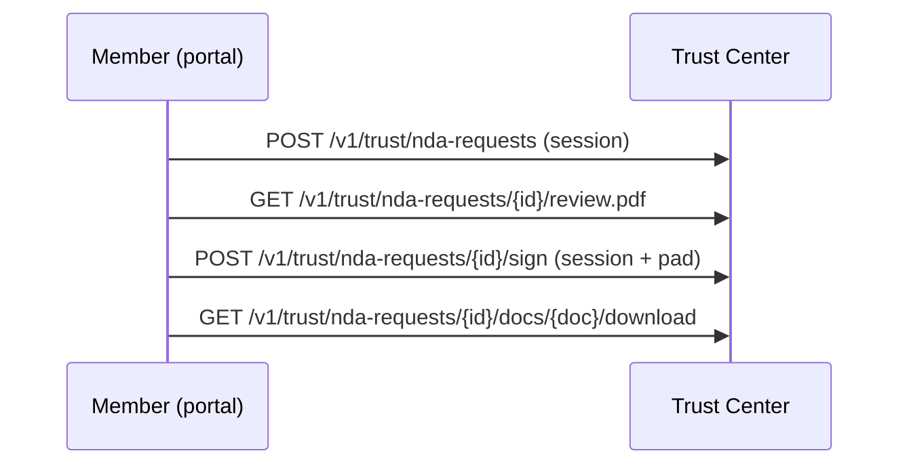

import { EnvUrls } from "/snippets/env-urls.jsx";

<EnvUrls lang="en" />

The public Trust Center at [cbpayapp.com/trust](https://www.cbpayapp.com/trust) lists public compliance records and explains how to request the gated N2 room. The gated room requires a CBPay account with approved KYC/KYB: every request, signature, and download is bound to a verified identity and fully audited. The legacy anonymous token flow is closed for new envelopes (existing signed entitlements were revoked; pending token links expire naturally).

The room holds 31 documents: 7 first-party programs (US AML program, Peru SPLAFT manual, Chile AML audit + training plan, Bolivia UIF + SEPREC, Colombia existence), 14 vendor reports and certificates received by GRUPO CB LLC (Sophos C5, SOC 2, PCI AOC, healthcare risk analysis, ISO 27001, TX-RAMP Cloud/MDR, NIST/CIS/PCI cards; Cloudflare C5, SOC 2, PCI AOC, ISO 27001), and 10 PCI DSS/SAQ-A and ASV scan reports (Aperia, September 2026). The Canada FINTRAC/PSP registrations are fully public and download directly from the site.

Request only what you need: pass `document_ids` with the chosen catalog IDs (see `GET /v1/trust/nda-docs`). Omitted means all documents; an explicitly empty list is rejected. Downloads, the status panel, and the completion email all honor the selection — documents outside it return 404 as if unknown.

Signing captures a drawn (or typed) signature in the portal: it is printed on the signed NDA block and attached to the completion email. The pre-signature branded PDF can be viewed and downloaded before signing.



## Flow

<Steps>
  <Step title="Request access">
    Authenticate with a member session of a verified account. Company, email, and country come from the verified account (echoed values must match exactly). Replays while pending are idempotent.

```bash
curl -X POST https://api.qbank.cl/platform/v1/trust/nda-requests \
  -H 'Authorization: Bearer <MEMBER_JWT>' \
  -H 'Content-Type: application/json' \
  -d '{"contact_name":"Jordan Lee","purpose":"Evaluate compliance controls","locale":"en","document_ids":["us-aml-program","pci-saqa"]}'
```

Response (`202`, or `200` with `idempotency_hit: true` on replay):

```json
{"request_id":"4e7b1f3e-8b20-4ef8-9cc5-1bcb6d9b2a01","status":"pending_signature","expires_at":"2026-11-18T20:00:00Z","email_sent":true}
```
  </Step>
  <Step title="List available document metadata">
    Metadata is public; document bytes are not.

```bash
curl https://api.qbank.cl/platform/v1/trust/nda-docs
```

Response (`200`):

```json
{"documents":[{"id":"us-aml-program","title_en":"US AML Program (Grupo CB LLC, Jan 2026)","pages":39,"sha256":"7d1df3be9f4a8b4bf88dce93a3b939f8a737f123cb60b8074442ca035cd6e940"}]}
```
  </Step>
  <Step title="Review and sign in the portal">
    Open the branded pre-signature PDF, then submit the signer identity, registered address, acceptance, and the pad-exported signature PNG. Company registration comes from the verified account.

```bash
curl https://api.qbank.cl/platform/v1/trust/nda-requests/<REQUEST_ID>/review.pdf \
  -H 'Authorization: Bearer <MEMBER_JWT>' -o nda-review.pdf
curl -X POST https://api.qbank.cl/platform/v1/trust/nda-requests/<REQUEST_ID>/sign \
  -H 'Authorization: Bearer <MEMBER_JWT>' \
  -H 'Content-Type: application/json' \
  -d '{"signer_name":"Jordan Lee","signer_title":"Chief Compliance Officer","company_address":"1 Main Street, Boston MA","accept":true,"signature_png":"data:image/png;base64,<signature-png>","signature_mode":"drawn"}'
```

Response (`200`):

```json
{"request_id":"4e7b1f3e-8b20-4ef8-9cc5-1bcb6d9b2a01","status":"signed","download_token":"<32-hex-token>","download_url":"https://business.cbpayapp.com/trust?request=4e7b1f3e-8b20-4ef8-9cc5-1bcb6d9b2a01","expires_at":"2031-10-18T20:00:00Z"}
```
  </Step>
  <Step title="Check status and download">
    Authenticate with the member session. Each PDF response includes `X-Checksum-Sha256` and `Cache-Control: no-store`; every delivery is audit-recorded.

```bash
curl https://api.qbank.cl/platform/v1/trust/nda-requests/<REQUEST_ID> \
  -H 'Authorization: Bearer <MEMBER_JWT>'
curl -L -o trust-document.pdf https://api.qbank.cl/platform/v1/trust/nda-requests/<REQUEST_ID>/docs/us-aml-program/download \
  -H 'Authorization: Bearer <MEMBER_JWT>'
```

Status response (`200`):

```json
{"request_id":"4e7b1f3e-8b20-4ef8-9cc5-1bcb6d9b2a01","status":"signed","signed_at":"2026-10-19T20:00:00Z","expires_at":"2031-10-18T20:00:00Z","documents":["us-aml-program"]}
```
  </Step>
</Steps>

## States and errors

| State | Meaning | Action |
|---|---|---|
| `pending_signature` | Envelope is valid for 30 days. | Review and sign, or request again after expiry. |
| `signed` | Downloads are enabled for five years. | Download from the portal with your session. |
| `expired` | Signing or download entitlement expired. | Submit a new request. |
| `revoked` | Compliance removed access immediately. | Contact compliance or submit a new request. |

See the [error catalog](/en/errors) for `counsel_pending`, `invalid_token`, `unknown_document`, `already_decided`, `accept_required`, `email_unavailable`, `entitlement_revoked`, `entitlement_expired`, `kyc_not_approved`, `member_required` and `account_identity_mismatch`.

## FAQ

<AccordionGroup>
  <Accordion title="Is a CBPay account required?">Yes. The account must have approved KYC/KYB; requests, signatures, and downloads are bound to the verified identity.</Accordion>
  <Accordion title="Can API keys request or sign?">No. Requesting and signing require a logged-in member session; API keys can only consume reads and downloads of the owning account.</Accordion>
  <Accordion title="Can I retry the request safely?">Yes. Replaying while pending returns the existing request and does not send a duplicate envelope.</Accordion>
  <Accordion title="What does email_sent mean?">`true` means delivery was handed to the configured email service; `false` means the request exists but delivery failed. Do not log or expose raw tokens.</Accordion>
  <Accordion title="How long are downloads available?">Five years after signing, unless compliance revokes the entitlement sooner.</Accordion>
</AccordionGroup>
