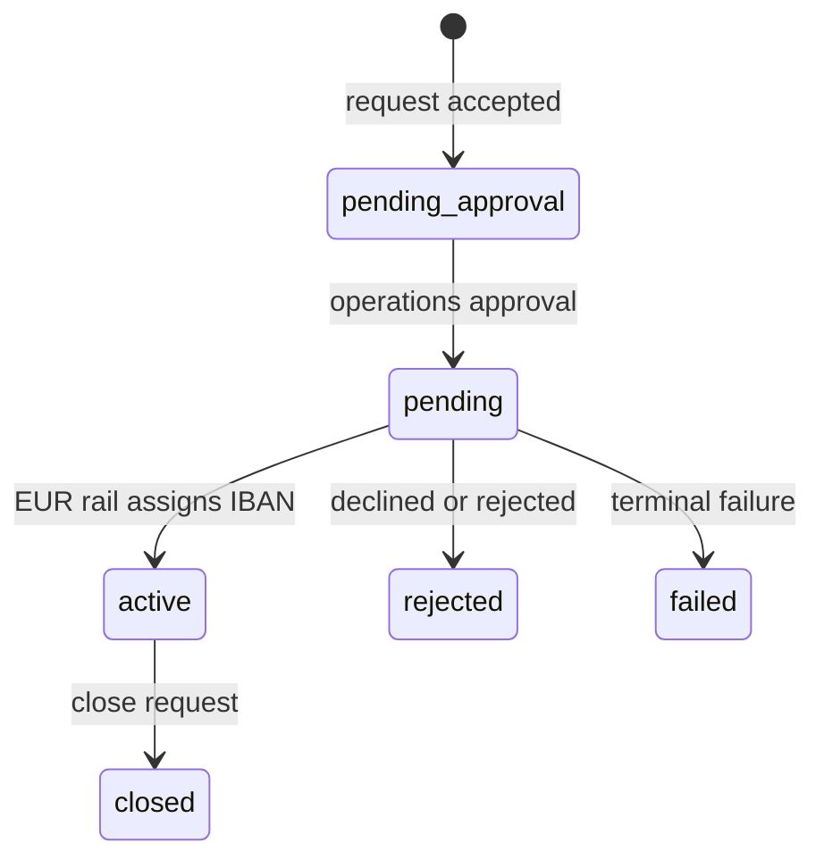

import { EnvUrls } from "/snippets/env-urls.jsx";

<EnvUrls lang="en" />

<Info>
This page explains the EUR vIBAN lifecycle and failure handling. The API
contract and request examples remain in [Banking](/en/guides/banking).
</Info>

## Lifecycle



| Status | Meaning | What to do |
|---|---|---|
| `pending_approval` | Waiting for organization operations approval. | Read the same request; do not duplicate it. |
| `pending` | Approved locally and waiting for the EUR rail. | Poll the same resource until terminal. |
| `active` | IBAN assigned and usable for its purpose. | Read the IBAN and use the matching funding or Banking flow. |
| `rejected` | Declined or rejected, with sanitized `last_error` when available. | Fix the stated cause and create a new request with a new key. |
| `failed` | Terminal validation or allocation failure. | Fix `last_error` and create a new request; never retry the terminal row. |
| `disabled` / `closed` | Address is no longer usable. | Do not send funds to it; request a new address if needed. |

`declined` is normalized to terminal `rejected`; it does not remain pending.
Rejected or failed requests do not create an IBAN. If a fee was charged, it is
refunded automatically and recorded with the terminal outcome.

## Fees and honest timing

The current EUR vIBAN allocation fee is **0**. The first `funding_usdt`
request is free. A later request is a new application, not a retry of a
terminal request. Do not use a new key to guess the outcome of an ambiguous
request: reconcile the existing request first.

There is no guaranteed activation deadline. Operations approval, compliance
review, bank cutoffs, weekends and holidays can extend `pending_approval` or
`pending`. Use the resource GET or the dated list to reconcile state. Do not
present a pending request as an assigned IBAN.

## Validation before the EUR rail

CBPay validates the verified registrant before dispatch. Invalid data returns
`422 registrant_incomplete` with the missing or invalid field path, and no bank
rail request is sent. Common causes:

- document dates must be valid `YYYY-MM-DD` dates in the accepted `19xx`/`20xx`
  range, with expiry more than one month in the future;
- `taxNumber` is required and validated for US tax country; for countries
  without a supported validator it is omitted instead of forwarding unverified
  data;
- every declared UBO needs the required identity/document fields and an
  explicit PEP value (`true` or `false`);
- the registrant address needs valid country, city, street and ZIP values
  (countries without a postal system use the documented zero placeholder).

Correct the field named by the 422 response and submit a **new** vIBAN request.
Do not turn a terminal failure into a retry loop.

## Reconcile and troubleshoot

```bash
curl https://api.qbank.cl/platform/v1/banking/virtual-ibans/<id> \
  -H "Authorization: Bearer <token>"

curl "https://api.qbank.cl/platform/v1/banking/virtual-ibans?page=1&page_size=50&from=2026-11-01&to=2026-11-30" \
  -H "Authorization: Bearer <token>"
```

Read `status` and `last_error` from the response. `last_error` is sanitized for
integrators and is the actionable explanation when the rail or pre-provider
validation rejected the request. For general error semantics, see
[Errors](/en/errors).

## FAQ

<AccordionGroup>
<Accordion title="Why did declined become rejected?">
`declined` is a terminal banking-rail result. CBPay maps it to `rejected` so a
request cannot remain pending forever. The cause is exposed when available.
</Accordion>
<Accordion title="Can I retry a failed request?">
No. Fix the cause in `last_error` and create a new request with a new
idempotency key. For an ambiguous response, reconcile the original request
first and do not create a second one to guess its result.
</Accordion>
<Accordion title="Will a rejected request charge me?">
The current allocation fee is 0. If a fee was charged by configuration, it is
refunded automatically when the request reaches a definitive rejection or
failure.
</Accordion>
<Accordion title="How long will activation take?">
There is no guaranteed deadline. Wait for `pending_approval` and `pending` to
reach a terminal state and reconcile with GET; do not assume a fixed SLA.
</Accordion>
</AccordionGroup>
