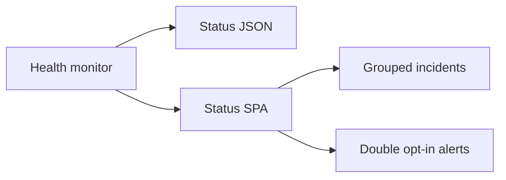

import { EnvUrls } from "/snippets/env-urls.jsx";

<EnvUrls lang="en" />

The public status surface gives your team and your customers one place to
understand payment availability. It combines the current state of enabled
corridors, a 90-day heatmap, grouped incident history and optional email
alerts. It is provider-agnostic: public responses identify only flow, country,
currency and method.



## Public status page

- `GET /status/{orgToken}` serves the top-tier SPA by default. The page shows
  an overall state, uptime and MTTR metrics, incident count, 90-day daily
  heatmap, corridor groups for payouts and payins, filters, search and a
  subscription modal.
- The SPA supports English, Spanish and Chinese, uses your organization’s
  white-label name, colors and logo, and can deep-link to an incident with
  `?incident=<id>`. A corridor selection can also be narrowed with `flow`,
  `country`, `currency` and `method` query parameters.
- `?ui=legacy` keeps the server-rendered legacy page available as a
  compatibility path. It is not the default experience.
- The SPA uses same-origin, self-hosted `/_next/*` assets. It does not load
  JavaScript, fonts or other resources from an external CDN; all browser
  resources are self-hosted. Each HTML
  response receives a per-request CSP nonce; assets are immutable and carry
  long-lived caching headers.

Only corridors enabled for the organization appear. An enabled corridor that
is down remains visible and affects the overall state; an operator-disabled
corridor is omitted from rows and incident history.

## Status JSON

```bash
curl "https://api.qbank.cl/platform/v1/status/{orgToken}"
```

The existing flat `incidents` field remains for compatibility and is
**deprecated** in favor of the grouped endpoint below. The additive fields
used by the SPA are:

```json
{
  "brand": {
    "name": "CBPay",
    "website": "https://cbpayapp.com",
    "primary_hex": "FBC140",
    "header_hex": "2E2E2E",
    "accent_hex": "",
    "grey_hex": "",
    "logo_url": "",
    "symbol_url": ""
  },
  "status": "degraded",
  "generated_at": "2026-11-17T15:00:00Z",
  "corridors": [],
  "incidents": [],
  "incidents_total_90d": 2,
  "mttr_mins_90d": 45,
  "incidents_daily": [
    {"date": "2026-11-16", "degraded": 1, "down": 0},
    {"date": "2026-11-17", "degraded": 0, "down": 1}
  ]
}
```

The server includes `logo_data_uri` and `symbol_data_uri` only when
`?brand_assets=1` is requested and the organization has those assets. Keep
these data URIs out of logs and analytics; request them only when the UI needs
to render a self-contained brand.

## Grouped incident history

```bash
curl "https://api.qbank.cl/platform/v1/status/{orgToken}/incidents?page=1&page_size=50&from=2026-11-01T00:00:00Z&to=2026-11-17T23:59:59Z&flow=payout&country=US&currency=USD&method=bank_transfer&severity=down&status=resolved"
```

The endpoint groups each corridor’s non-operational window from its first
`degraded`/`down` transition until recovery. Windows that start within five
minutes of one another are coalesced into one incident. For example, the
implementation test covers three US/USD corridors starting at
`2026-11-14T11:10:00Z` and recovering five minutes later; the result is one
resolved incident with three `affected` entries and `duration_mins: 5`.

```json
{
  "page": 1,
  "page_size": 50,
  "total": 1,
  "incidents": [
    {
      "id": "<stable-incident-id>",
      "title": "<localized by the UI>",
      "severity": "down",
      "status": "resolved",
      "started_at": "2026-11-14T11:10:00Z",
      "resolved_at": "2026-11-14T11:15:00Z",
      "duration_mins": 5,
      "affected": [
        {"flow": "payout", "country": "US", "currency": "USD", "method": "bank_transfer", "worst": "down"},
        {"flow": "payout", "country": "US", "currency": "USD", "method": "wire", "worst": "down"},
        {"flow": "payin", "country": "US", "currency": "USD", "method": "bank_transfer", "worst": "down"}
      ],
      "updates": [
        {"at": "2026-11-14T11:15:00Z", "status": "operational", "message": "<human-readable resolved message>"},
        {"at": "2026-11-14T11:10:00Z", "status": "down", "message": "<human-readable investigating message>"}
      ]
    }
  ]
}
```

Supported optional filters are `flow` (`payout` or `payin`), `country`,
`currency`, `method`, `severity` (`degraded` or `down`), `status` (`open` or
`resolved`) and `from`/`to`. `page` defaults to 1; `page_size` defaults to 50
and is capped at 200. Invalid filters return `invalid_filter`; an invalid or
reversed date range returns `invalid_range`. Unknown or malformed organization
tokens return `404` without revealing whether an organization exists.

## Subscribe to status alerts

The subscription flow is double opt-in. The initial request is intentionally
neutral so it does not reveal whether an email is already subscribed.

```bash
curl -X POST "https://api.qbank.cl/platform/v1/status/{orgToken}/subscriptions" \
  -H "Content-Type: application/json" \
  -d '{"email":"ops@example.com","flows":"all","lang":"en"}'
```

```json
{"ok": true}
```

`flows` is `all`, `payout` or `payin`; it defaults to `all`. `lang` accepts
`en`, `es` or `zh`. An invalid email returns `invalid_email`; an invalid flow
returns `invalid_filter`. The service accepts a honeypot field named
`company_website` and silently drops bot submissions when it is non-empty.

The confirmation link is valid for 24 hours and single-use:

```bash
curl -H "Accept: application/json" \
  "https://api.qbank.cl/platform/v1/status/{orgToken}/subscriptions/confirm?token=<64-lowercase-hex-token>"
```

```json
{"ok": true, "confirmed": true}
```

Confirmation, management and unsubscribe links also support branded HTML when
`Accept: text/html` is sent. Those pages contain no JavaScript and use a strict
CSP. The management endpoint shows a masked email and current flow filter;
update it with JSON or the no-JS form:

```bash
curl -X POST "https://api.qbank.cl/platform/v1/status/{orgToken}/subscriptions/preferences" \
  -H "Content-Type: application/json" \
  -d '{"token":"<unsubscribe-token>","flows":"payin"}'
```

```json
{"ok": true, "flows": "payin"}
```

`GET` or `POST` unsubscribe is idempotent and accepts the token in the query,
JSON body or form body:

```bash
curl -X POST "https://api.qbank.cl/platform/v1/status/{orgToken}/subscriptions/unsubscribe" \
  -H "Content-Type: application/json" \
  -d '{"token":"<unsubscribe-token>"}'
```

```json
{"ok": true, "unsubscribed": true}
```

The service throttles subscription requests to 10 per IP per hour and 3 per
email per hour. Token operations are limited to 60 per IP per hour. A limit
returns `rate_limited`. Tokens are random 256-bit capabilities; only hashes
are stored. Email addresses are encrypted at rest and never written to logs.
Alerts are sent individually, never with unrelated recipients in a shared
`To` header. Opened and resolved notices are deduplicated per subscription
and incident window.

## Corridor states

| State | Meaning | Recommended action |
|---|---|---|
| `operational` | Processing normally. | Continue normally. |
| `degraded` | Elevated infrastructure errors were observed. | Show a warning and monitor the incident feed. |
| `down` | Consecutive failures or failed health checks. | Consider hiding the corridor until it recovers. |

A status page is observability, not a dispatch gate. Never resend a financial
operation because a corridor is degraded or down; resolve the operation using
its normal status and retry only with the same idempotency key when the API
contract allows it.

## FAQ

<AccordionGroup>
  <Accordion title="Does a down corridor reject every request?">
    No. The monitor does not block dispatches. New operations are more likely
to fail through the normal API path; use the availability signal and incident
feed to decide what to show.
  </Accordion>
  <Accordion title="Can I use an incident ID as a stable deep link?">
    Yes. The grouped incident ID is deterministic for its start time and
    affected corridors, so the SPA can open it with `?incident=<id>`.
  </Accordion>
  <Accordion title="Can I identify the underlying provider?">
    No. Public status data is provider-agnostic and exposes only corridor
    dimensions plus normalized human-readable messages.
  </Accordion>
  <Accordion title="Why did I receive no confirmation email?">
    The POST response is neutral by design. Check the address and request a
    new subscription; do not use the response to infer whether an existing
    subscription exists.
  </Accordion>
</AccordionGroup>
