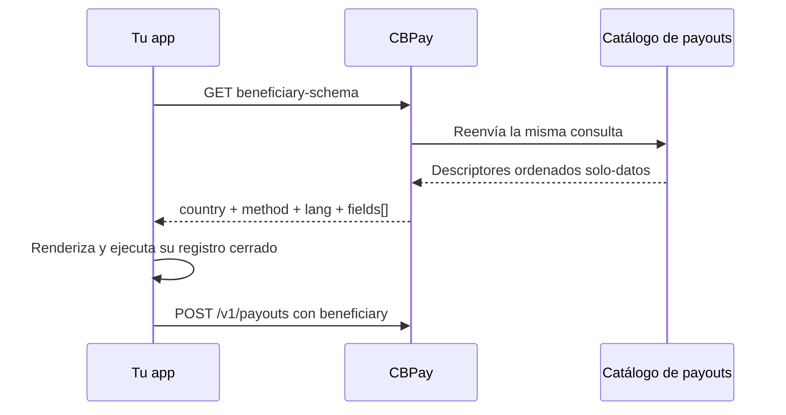

import { EnvUrls } from "/snippets/env-urls.jsx";

<EnvUrls lang="es" />

## Qué hace este endpoint

`GET /v1/payouts/beneficiary-schema` devuelve los descriptores de datos para
renderizar el objeto `beneficiary` de un corredor de payout. Úsalo antes de
`POST /v1/payouts` en vez de mantener tablas hardcodeadas por país.
La respuesta viene en orden de render e incluye labels, placeholders, hints,
errores, reglas condicionales y nombres de validadores client-side cerrados.

Es un catálogo de solo lectura: no valida ni crea un payout, no ejecuta
validadores y no expone la identidad de ningún proveedor de procesamiento.

## Request

```bash
curl "https://api.qbank.cl/platform/v1/payouts/beneficiary-schema?country=CL&method=fintoc&lang=es" \
  -H "Authorization: Bearer <token>"
```

`country` es el país destino ISO alpha-2 y `method` es el método del rail.
`lang` acepta `en`, `es` o `zh` y por defecto es `en`. Para `swift` y `sepa`,
cualquier país solicitado resuelve mediante `*:swift` o `*:sepa`; la respuesta
repite el país solicitado.



## Response real

```json
{
  "country": "CL",
  "method": "fintoc",
  "lang": "es",
  "fields": [
    { "key": "name", "label": "Nombre del beneficiario", "kind": "text" },
    {
      "key": "tax_id",
      "label": "RUT",
      "placeholder": "12.345.678-5",
      "hint": "Se valida el dígito verificador",
      "kind": "text",
      "validator": "chilean_rut",
      "error": "RUT inválido: revisa el dígito verificador"
    },
    { "key": "bank_code", "label": "Banco", "kind": "bank" },
    {
      "key": "account_type",
      "label": "Tipo de cuenta",
      "kind": "select",
      "options": [
        { "value": "checking", "label": "Cuenta corriente" },
        { "value": "vista", "label": "Cuenta vista" }
      ]
    },
    {
      "key": "account_number",
      "label": "Número de cuenta",
      "kind": "text",
      "hint": "Solo dígitos",
      "validator": "cl_account_number",
      "error": "Número de cuenta inválido: solo dígitos (máx. 20)"
    }
  ]
}
```

### Contrato de cada campo

Todos los campos traen `key`, `label` y `kind`. `kind` puede ser `text`,
`phone`, `bank`, `select`, `geoCountry`, `geoState` o `geoCity`.
El orden de `fields` es significativo.

| Propiedad | Significado |
|---|---|
| `placeholder`, `hint`, `error` | Textos visibles traducidos. |
| `options` | Valores cerrados de un `select`; envía `value` y muestra `label`. |
| `show_if`, `required_if` | Muestra o exige según `{key, equals}` en el formulario actual. |
| `required_when_country_has_subdivisions` | Exige estado cuando el país tiene subdivisiones catalogadas. |
| `default_value`, `fixed_value` | Valor inicial o inmutable del schema. |
| `validator` | Nombre de validador simple cerrado. |
| `validator_with_values` | Nombre de validador cerrado que recibe el formulario completo. |
| `validate_fn_when` | Condición para ejecutar la validación de formato. |
| `optional` | No es obligatorio; si se envía, igual se valida. |
| `wide`, `collapsible`, `collapsible_group` | Sugerencias de render, no reglas de negocio. |
| `default_from_corridor_country` | Prellena el país del corredor, pero permite editarlo. |
| `country_key`, `state_key` | Campos fuente de las cascadas geográficas. |

El backend solo envía nombres de validadores. Implementa el registro cerrado
en tu frontend y trata un nombre desconocido como error seguro. Nunca evalúes
código recibido desde la API.

## Corredores soportados

El catálogo contiene 20 corredores exactos más los comodines globales
`*:swift` y `*:sepa`. La disponibilidad se controla por el catálogo de
métodos: consulta `GET /v1/payouts/methods` para poblar el selector.
Si no existe schema para el par solicitado, recibirás
`404 payout_corridor_unsupported`.

La [guía de corredores de payout](/es/guides/payout-corridors) contiene los
campos de negocio y ejemplos completos de creación.

## Errores y reintentos seguros

| HTTP | Código | Qué hacer |
|---:|---|---|
| 400 | `invalid_payload` | Envía `country` y `method`; no adivines el método. |
| 400 | `invalid_language` | Usa `en`, `es` o `zh`, o elimina `lang` para inglés. |
| 404 | `payout_corridor_unsupported` | Actualiza el catálogo y deja de renderizar ese corredor. |
| 401/403 | Error de autenticación o scope | Usa el token acotado a la cuenta. |

Es una lectura sin idempotency key. Si falla la red, puedes repetir esta
consulta. Nunca repitas una operación de dinero incierta con una key nueva:
consulta el payout original usando la misma key.

## FAQ

<AccordionGroup>
<Accordion title="¿La respuesta trae código ejecutable?">
No. `validator` y `validator_with_values` son nombres de un set cerrado; el
frontend implementa cada validador y no ejecuta strings como código.
</Accordion>
<Accordion title="¿Reemplaza al catálogo de métodos?">
No. El catálogo de métodos indica qué corredores están habilitados; este
endpoint indica qué campos mostrar después de elegir uno.
</Accordion>
<Accordion title="¿Un campo sin optional es obligatorio?">
Sí, salvo que una condición del mismo descriptor cambie su obligatoriedad.
El endpoint de payout sigue siendo la autoridad final.
</Accordion>
<Accordion title="¿Puedo cachear la respuesta?">
Sí, brevemente por `country`, `method` y `lang`. Refresca al cambiar el
catálogo de métodos y maneja `404` sin crear un payout.
</Accordion>
<Accordion title="¿Por qué la respuesta de plataforma es idéntica a la del core?">
La plataforma proxea este catálogo estático sin modificarlo. Usa siempre la
URL de plataforma y no dependas de servicios internos.
</Accordion>
</AccordionGroup>
