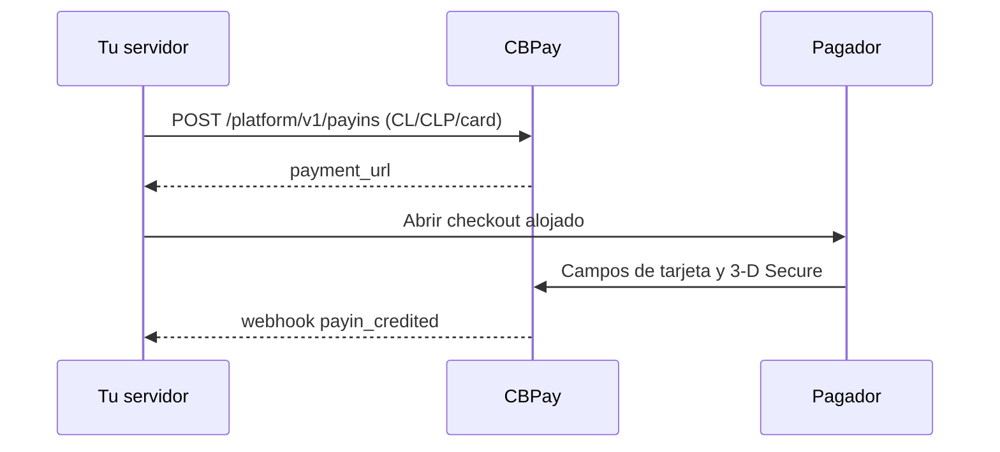

import { EnvUrls } from "/snippets/env-urls.jsx";

<EnvUrls lang="es" />

Usa este corredor para que un pagador en Chile pague con tarjeta en CLP.
Tu servidor crea el payin y CBPay devuelve un `payment_url`. Ábrelo en un
popup o redirección. Los datos de tarjeta permanecen en los campos alojados y
3-D Secure corre dentro del modal cuando el emisor lo solicita.



## Crear el payin

```bash
curl -X POST https://api.qbank.cl/platform/v1/payins \
  -H "Authorization: Bearer <token>" \
  -H "Idempotency-Key: cl-card-order-8841" \
  -H "Content-Type: application/json" \
  -d '{"country":"CL","currency":"CLP","method":"card","amount":"150000","description":"Pedido 8841","idempotency_key":"cl-card-order-8841"}'
```

```json
{"payin_id":"7a2b…","status":"pending","country":"CL","currency":"CLP","method":"card","amount":"150000","payment_url":"https://api.qbank.cl/pay/cards/9f3XkT…"}
```

`idempotency_key` es obligatorio en el body o en el header
`Idempotency-Key`. CLP es una moneda entera: `"150000.50"` devuelve
422 `core_rejected`. Repetir la misma clave devuelve el payin original con
`idempotency_hit: true`; no crees otra clave ante un resultado ambiguo.

## Checkout y tarjetas guardadas

Abre `payment_url` en un popup. El checkout muestra el modal de espera solo
para `CL/CLP/card`, valida CLP entero antes de enviar y muestra disponibilidad
con un semáforo. Guardar una tarjeta exige la oferta del integrador y el
consentimiento del pagador. Los cobros one-click y MIT posteriores usan el
endpoint server-side de tarjetas guardadas; el PAN nunca llega a tu servidor.

El checkout universal cotiza `CL/CLP/card` cuando el catálogo lo informa
disponible. Lee siempre `GET /platform/v1/payins/methods` antes de mostrarlo.

### Documento del pagador (opcional)

En los payins con tarjeta, `customer` se envía al core como `bill_to`. Puedes
incluir `document_type` y `document_number` para scoring antifraude. El
documento es opcional: omitir ambos campos es válido. Para `CL`,
`document_type` queda en `RUT` cuando envías un número y `document_number`
debe ser un RUT chileno válido (módulo 11, con o sin puntuación). Un RUT
inválido se rechaza antes del claim del cobro con `400 invalid_payload`. En
otros países se acepta texto plano de hasta 50 caracteres; se rechazan markup
y valores más largos.

```json
{
  "customer": {
    "first_name": "Ana",
    "last_name": "Rojas",
    "email": "payer@example.com",
    "country": "CL",
    "document_type": "RUT",
    "document_number": "11.111.111-1"
  },
  "save_card": true
}
```

### Cómo saber si la tarjeta quedó guardada

Cuando ofreciste `save_card: true` y el pagador consintió, una respuesta
`complete` aprobada incluye `card_saved`. `true` significa que la credencial
quedó guardada y puede usarse en el flujo de tarjetas guardadas. `false`
significa que la venta se aprobó, pero la tarjeta no quedó guardada; muestra
un mensaje claro y no cobres nuevamente. El campo se omite si no ofreciste o
solicitaste guardar la tarjeta.

## Cuotas Emisor

En los payins con tarjeta CLP de Chile, el checkout alojado puede ofrecer
cuotas financiadas por el emisor. Primero el pagador tokeniza una tarjeta
nueva; solo si el token informa opciones diferidas la página muestra los
plazos curados `3`, `6`, `12`, `24`, `36` y `48`, acotados al máximo informado
por el emisor. Luego el pagador confirma el plazo y el checkout lo envía en la
solicitud pública de `complete`:

```json
{
  "payment_token": "tok_…",
  "months": 6
}
```

`months` es un entero. Omítelo, o envía `0` o `1`, para un pago único. Los
valores de `2` a `48` solicitan cuotas Emisor. El valor se valida antes del
claim del cobro: `-2` o `99` devuelve `400 invalid_payload` sin consumir un
intento.

Las cuotas solo funcionan con una tarjeta nueva tokenizada con front-token en
el flujo de cuotas del emisor en Chile. No están disponibles para cobros MIT
con tarjeta guardada y las Cuotas Comercio Beta quedan fuera de este contrato.
Los rails de verificación reales rechazan una solicitud con cuotas; los caminos
soportados son el rail Kushki con front-token y el simulador. Nunca envíes un
segundo cobro después de un resultado ambiguo.

Una respuesta aprobada incluye el plazo aprobado como recibo, y el mismo valor
queda guardado en el payload de auditoría del cobro:

```json
{
  "status": "paid",
  "transaction_id": "710000000000123",
  "months": 6
}
```

| HTTP | Código | Solución |
|---:|---|---|
| 400 | `invalid_payload` | Envía un entero entre `0` y `48`; usa `0`, `1` u omítelo para pago único. |
| 200 | `failed_attempt` | Si seleccionaste una tarjeta guardada con cuotas, usa una tarjeta nueva; el fallo permite reintentar. |
| 200 | `review` | Si un rail real tiene dinero en curso, lee la sesión y reconcilia; nunca reintentes a ciegas. |

## Cobros con tarjeta en UF

El corredor de tarjetas de Chile también acepta `currency: "UF"`. Envía el
monto como string decimal con hasta dos decimales:

```bash
curl -X POST https://api.qbank.cl/platform/v1/payins \
  -H "Authorization: Bearer <token>" \
  -H "Idempotency-Key: cl-uf-card-order-8842" \
  -H "Content-Type: application/json" \
  -d '{"country":"CL","currency":"UF","method":"card","amount":"1.50","description":"Pedido 8842","idempotency_key":"cl-uf-card-order-8842"}'
```

La respuesta conserva `currency: "UF"` y `amount: "1.50"` en el payin y el
recibo. El rail cobra el monto UF de forma nativa y lo convierte internamente
a CLP; `1 UF` equivale aproximadamente a `41.274 CLP` y el valor exacto
depende de la tasa UF aplicable. Puedes combinar UF con cuotas Emisor:
incluye el mismo campo `months` descrito arriba en la solicitud `complete`
con front-token. El plazo aprobado vuelve en el recibo.

UF acepta como máximo dos decimales. `"1.50"` es válido, mientras
`"1.501"` devuelve 422 `core_rejected` ("amount has too many decimals for this currency")
antes del claim del cobro. CLP sigue
siendo una moneda entera, por lo que `"150000.50"` devuelve el mismo
rechazo honesto pre-claim. Ante un resultado ambiguo, lee
el recurso y no envíes un segundo cobro.

Para consultar el contexto de conversión vigente, lee:

```bash
curl https://api.qbank.cl/v1/rates/usd/local \
  -H "Authorization: Bearer <token>"
```

La respuesta incluye la llave `uf`, proveniente de la fuente OXR con ISO
`CLF`. La liquidación convierte UF a USDT a la tasa spot aplicable; la tasa UF
mostrada no garantiza un precio fijo de liquidación.

Un webhook UF aprobado conserva la moneda y el monto UF:

```json
{
  "event": "payin_credited",
  "payin_id": "7a2b…",
  "country": "CL",
  "currency": "UF",
  "amount": "1.50",
  "status": "credited"
}
```

## Payins pre-autorizados (holds)

Con `capture_method: "manual"` el checkout retiene (autoriza) en vez de
cobrar. Después capturas (cobro total) o anulas (libera, sin mover plata)
desde tu integración o el panel admin:

```bash
curl -X POST https://api.qbank.cl/platform/v1/payins \
  -H "Authorization: Bearer <token>" \
  -H "Content-Type: application/json" \
  -d '{"country":"CL","currency":"CLP","method":"card","amount":"10000","capture_method":"manual","description":"Order 8843","idempotency_key":"cl-manual-order-8843"}'
```

El payin queda `pending` con `capture_method: "manual"` mientras el hold
sigue abierto. El emisor libera los holds no capturados automáticamente (7
días débito, 28 crédito); el payin entonces se cierra expirado y te avisamos.

```bash
# Capturar el monto autorizado completo.
curl -X POST https://api.qbank.cl/platform/v1/payins/7a2b…/captures \
  -H "Authorization: Bearer <token>" \
  -H "Content-Type: application/json" \
  -d '{"idempotency_key":"cap-order-8843"}'
# O liberar el hold sin mover dinero.
curl -X POST https://api.qbank.cl/platform/v1/payins/7a2b…/voids \
  -H "Authorization: Bearer <token>" \
  -H "Content-Type: application/json" \
  -d '{"idempotency_key":"void-order-8843"}'
# Historial (paginado).
curl "https://api.qbank.cl/platform/v1/payins/7a2b…/captures?page_size=50" \
  -H "Authorization: Bearer <token>"
```

Reglas: v1 captura solo el total (`partial_capture_unsupported` en otro
caso); manual exige un pago interactivo (las guardadas cobran de inmediato)
y no se combina con cuotas. Un `201` significa listo (`verdict: completed`,
la captura acredita por el flujo normal); un `202` significa ambiguo —
reintenta con la MISMA llave, nunca una nueva. No requiere OTP (una captura
acredita tu cuenta, un void no mueve nada). Captura+void concurrentes van
single-flight: una gana, la otra recibe `409`.

## Consultar, anular y reembolsar

```bash
curl https://api.qbank.cl/platform/v1/payins/7a2b… -H "Authorization: Bearer <token>"
curl "https://api.qbank.cl/platform/v1/payins?from=2026-11-01&to=2026-11-30&country=CL&currency=CLP&method=card&page=1&page_size=50" -H "Authorization: Bearer <token>"
```

Un pago autorizado puede anularse antes de liquidar. Un reembolso es
semiautomático: puede quedar `pending` y cerrarse con una notificación firmada.
Ambas operaciones requieren idempotencia y nunca reintentan automáticamente
un despacho ambiguo.

| Estado | Significado |
|---|---|
| `pending` | Checkout esperando al pagador |
| `credited` | Pago confirmado y acreditado |
| `failed` | Pago rechazado claramente |
| `refunded` | Reembolso confirmado |
| `review` | Reconciliación pendiente; no cobres nuevamente |

## Errores

| HTTP | Código | Solución |
|---:|---|---|
| 400 | `invalid_amount` | Envía un monto decimal positivo (los valores no numéricos o negativos se rechazan antes del despacho) |
| 400 | `idempotency_key_required` | Envía el campo o header |
| 409 | `idempotency_conflict` | Usa el payload original con la clave original |
| 409 | `already_captured` / `hold_released` / `hold_expired` | El hold ya se cerró: lee sus captures/voids en vez de reintentar con otra llave |
| 422 | `core_rejected` | Muestra el fallo alojado; no reintentes a ciegas — esto incluye violaciones de decimales (CLP debe ser entero, UF máximo dos decimales) |
| 422 | `payin_not_capturable` / `preauth_not_supported` | Solo payins manuales con tarjeta pendientes se pueden capturar o anular |
| 422 | `partial_capture_unsupported` | v1 captura solo el monto autorizado completo |
| 202 | `action_pending` | La captura/anulación se está conciliando; repite con la misma llave |
| 503 | `core_unavailable` | Lee el payin y repite solo con la misma clave |

## Webhooks

Verifica la firma antes de procesar. Los eventos relevantes son
`payin_credited`, `payin_refunded`, `dispute` y `card_stored`.

```json
{"event":"payin_credited","payin_id":"7a2b…","country":"CL","currency":"CLP","amount":"150000","status":"credited"}
```

## Preguntas frecuentes

<AccordionGroup>
<Accordion title="¿Puedo enviar CLP o UF con decimales?">
CLP debe ser entero. UF acepta hasta dos decimales, por ejemplo `"1.50"`;
desde tres decimales devuelve 422 `core_rejected`.
</Accordion>
<Accordion title="¿Qué hago si crear el payin agota el tiempo?">
Lee el recurso o repite con la misma clave de idempotencia. No envíes otro cobro.
</Accordion>
<Accordion title="¿Cuándo termina un reembolso?">
Puede quedar `pending` hasta que llegue la notificación firmada.
</Accordion>
<Accordion title="¿Cuánto dura un hold?">
7 días en débito, 28 en crédito (política del emisor). Captura o anula
antes; los vencidos se cierran solos con notificación.
</Accordion>
<Accordion title="¿Puedo capturar la mitad ahora y la mitad después?">
No en v1: la captura toma el monto autorizado completo. La captura parcial
es una fase futura documentada.
</Accordion>
<Accordion title="¿Puedo combinar hold con cuotas o tarjeta guardada?">
No: la pre-autorización exige tarjeta nueva pagada completa en la página.
Las guardadas cobran de inmediato y las cuotas liquidan al tiro.
</Accordion>
</AccordionGroup>
