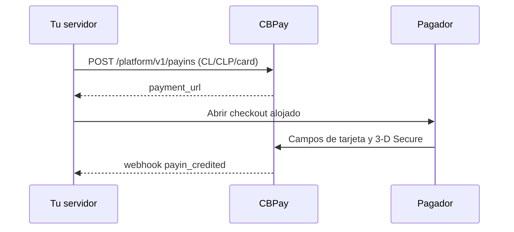

import { EnvUrls } from "/snippets/env-urls.jsx";

<EnvUrls lang="es" />

Usa este corredor para que un pagador en Chile pague con tarjeta en CLP.
Tu servidor crea el payin y CBPay devuelve un `payment_url`. Ábrelo en un
popup o redirección. Los datos de tarjeta permanecen en los campos alojados y
3-D Secure corre dentro del modal cuando el emisor lo solicita.



## Crear el payin

```bash
curl -X POST https://api.qbank.cl/platform/v1/payins \
  -H "Authorization: Bearer <token>" \
  -H "Idempotency-Key: cl-card-order-8841" \
  -H "Content-Type: application/json" \
  -d '{"country":"CL","currency":"CLP","method":"card","amount":"150000","description":"Pedido 8841","idempotency_key":"cl-card-order-8841"}'
```

```json
{"payin_id":"7a2b…","status":"pending","country":"CL","currency":"CLP","method":"card","amount":"150000","payment_url":"https://api.qbank.cl/pay/cards/9f3XkT…"}
```

`idempotency_key` es obligatorio en el body o en el header
`Idempotency-Key`. CLP es una moneda entera: `"150000.50"` devuelve
`400 invalid_amount`. Repetir la misma clave devuelve el payin original con
`idempotency_hit: true`; no crees otra clave ante un resultado ambiguo.

## Checkout y tarjetas guardadas

Abre `payment_url` en un popup. El checkout muestra el modal de espera solo
para `CL/CLP/card`, valida CLP entero antes de enviar y muestra disponibilidad
con un semáforo. Guardar una tarjeta exige la oferta del integrador y el
consentimiento del pagador. Los cobros one-click y MIT posteriores usan el
endpoint server-side de tarjetas guardadas; el PAN nunca llega a tu servidor.

El checkout universal cotiza `CL/CLP/card` cuando el catálogo lo informa
disponible. Lee siempre `GET /platform/v1/payins/methods` antes de mostrarlo.

## Consultar, anular y reembolsar

```bash
curl https://api.qbank.cl/platform/v1/payins/7a2b… -H "Authorization: Bearer <token>"
curl "https://api.qbank.cl/platform/v1/payins?from=2026-11-01&to=2026-11-30&country=CL&currency=CLP&method=card&page=1&page_size=50" -H "Authorization: Bearer <token>"
```

Un pago autorizado puede anularse antes de liquidar. Un reembolso es
semiautomático: puede quedar `pending` y cerrarse con una notificación firmada.
Ambas operaciones requieren idempotencia y nunca reintentan automáticamente
un despacho ambiguo.

| Estado | Significado |
|---|---|
| `pending` | Checkout esperando al pagador |
| `credited` | Pago confirmado y acreditado |
| `failed` | Pago rechazado claramente |
| `refunded` | Reembolso confirmado |
| `review` | Reconciliación pendiente; no cobres nuevamente |

## Errores

| HTTP | Código | Solución |
|---:|---|---|
| 400 | `invalid_amount` | Envía un monto CLP entero |
| 400 | `idempotency_key_required` | Envía el campo o header |
| 409 | `idempotency_conflict` | Usa el payload original con la clave original |
| 422 | `core_rejected` | Muestra el fallo alojado; no reintentes a ciegas |
| 503 | `core_unavailable` | Lee el payin y repite solo con la misma clave |

## Webhooks

Verifica la firma antes de procesar. Los eventos relevantes son
`payin_credited`, `payin_refunded`, `dispute` y `card_stored`.

```json
{"event":"payin_credited","payin_id":"7a2b…","country":"CL","currency":"CLP","amount":"150000","status":"credited"}
```

## Preguntas frecuentes

<AccordionGroup>
<Accordion title="¿Puedo enviar CLP con decimales?">
No. El peso chileno no tiene decimales; envía un string entero.
</Accordion>
<Accordion title="¿Qué hago si crear el payin agota el tiempo?">
Lee el recurso o repite con la misma clave de idempotencia. No envíes otro cobro.
</Accordion>
<Accordion title="¿Cuándo termina un reembolso?">
Puede quedar `pending` hasta que llegue la notificación firmada.
</Accordion>
</AccordionGroup>
