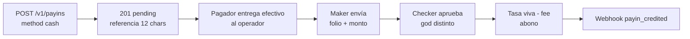

import { EnvUrls } from "/snippets/env-urls.jsx";
<EnvUrls lang="es" />

## Payins cash (anuncio y entrega presencial)

`method: "cash"` crea un payin anunciado `push`. CBPay no entrega una cuenta de depósito ni `deposit_instructions`: el pagador entrega el monto exacto en moneda local al operador y cita la `reference` de 12 caracteres. El payin queda `pending` hasta completar maker-checker.



| País | Moneda | Método | Entrega |
|---|---|---|---|
| CL | CLP | `cash` | announced-only (presencial) |
| PE | PEN | `cash` | announced-only (presencial) |
| MX | MXN | `cash` | announced-only (presencial) |
| VE | VES | `cash` | announced-only (presencial) |
| BO | BOB, USD | `cash` | announced-only (presencial) |
| US | USD | `cash` | announced-only (presencial) |
| PY | PYG | `cash` | announced-only (presencial) |
| CO | COP | `cash` | announced-only (presencial) |
| EC | USD | `cash` | announced-only (presencial) |
| BR | BRL, BOB | `cash` | announced-only (presencial) |
| AR | ARS | `cash` | announced-only (presencial) |

### Anunciar el efectivo

```bash
curl -X POST https://api.qbank.cl/platform/v1/payins -H "Authorization: Bearer <token>" -H "Content-Type: application/json" -d '{"country":"CL","currency":"CLP","method":"cash","amount":"50000","payer_name":"Ana Perez","idempotency_key":"cash-cl-001"}'
```

```json
{"payin_id":"11111111-2222-4333-8444-555555555555","status":"pending","reference":"A1B2C3D4E5F6","note":"hand the cash to the operator quoting the reference; the deposit is credited once the operator confirms receipt","payer_name":"Ana Perez","payer_source":"declared"}
```

Repetir la misma key devuelve `200` con `idempotency_hit: true`; no abras otro anuncio después de un timeout.

### Confirmación y webhooks

El maker org-admin envía `POST /v1/payins/{payinID}/confirm-received` con `bank_reference` (folio/recibo) y `received_amount`. Solo registra evidencia. Un checker god nombrado y distinto envía `POST .../confirm-approve` sin body. `GET /v1/payins/{payinID}` y `GET /v1/admin/approvals` muestran `confirm_request` y `kind: "payin_manual_confirm"`. El maker o un god puede cancelar con `POST .../confirm-cancel`; cancelar nunca abona. Al aprobar se aplica tasa viva menos fee y se emite `payin_credited`.

### Errores

Consulta la [referencia completa de errores](/es/errors).

| HTTP/código | Significado | Acción |
|---|---|---|
| 400 `invalid_request` | Falta país o moneda | Envía ambos campos. |
| 422 `invalid_request` | `method cash is not available for country X / currency Y` | Consulta `GET /v1/payins/methods` y usa un corredor habilitado. |
| 422 `amount_below_minimum` | El fee fijo impide acreditar | Aumenta el monto local. |
| 409 `idempotency_conflict` | La key se usó con otro método o payload | Lee el payin original; no abras otro anuncio. |
| 409 `corridor_disabled` | Kill-switch del corredor apagado | Espera la habilitación operativa. |
| 409 `bank_ref_conflict` | El folio/recibo ya está reclamado | Detente y usa la operación original. |
| 409 `confirm_request_conflict` | Ya hay evidencia distinta pendiente | Lee `confirm_request` y resuelve o cancela esa solicitud. |
| 409 `invalid_state` | El payin ya no está `pending` al aprobar o cancelar | Relee el payin y su solicitud pendiente. |
| 403 `named_admin_required` | El checker no es un god nombrado | Usa un god nombrado con sesión humana. |
| 409 `confirm_account_mismatch` | La cuenta cambió desde la solicitud maker | Relee y solicita nuevamente solo si sigue elegible. |

### Vencimiento y vida de la solicitud

El anuncio cash es un payin `push` normal: si queda `pending` 24 horas, el sweep lo cambia a `expired` y emite `payin_expired`. Un recibo físico tardío no se abona a ese anuncio; operaciones debe abrir un anuncio **nuevo** para él (el cash nunca produce filas `unassigned` automáticas — no hay evento de proveedor que parquear). La solicitud maker **no tiene TTL de sistema**: su timeout es operativo. Muere junto con el payin; tras vencer el anuncio, el checker recibe `409 invalid_state` y la bandeja oculta el payin vencido porque solo lista pendientes.

### Consulta e historial

```bash
curl https://api.qbank.cl/platform/v1/payins/{payinID} -H "Authorization: Bearer <token>"
curl "https://api.qbank.cl/platform/v1/payins?from=2026-10-01&to=2026-10-24&status=pending&country=CL&method=cash" -H "Authorization: Bearer <token>"
```

Usa el detalle para `confirm_request` (solo roles org-admin y plataforma — a nivel cuenta el bloque jamás se ve) y el listado con `from`, `to`, `status`, `country` y `method` para historial.

### Estados

| Estado | Significado | Acción |
|---|---|---|
| `pending` | Anuncio o confirmación esperando acción | Entrega efectivo o completa maker-checker. |
| `credited` | Aprobación aplicó tasa viva, fee y ledger | Reconcilia saldo y webhook. |
| `unassigned` | No ocurre en cash (sin eventos de proveedor que parquear) | Si se recibió efectivo, abre un anuncio nuevo. |
| `expired` | Anuncio push vencido a las 24 horas | No lo apruebes; reconcilia el recibo aparte. |
| `failed` | La operación no pudo completarse | Lee `failure` y evita duplicar. |

### Webhook `payin_credited`

```json
{"payin_id":"11111111-2222-4333-8444-555555555555","account_id":"66666666-7777-4888-8999-000000000000","country":"CL","currency":"CLP","local_amount":"47500","fx_rate":"950.00","rate_source":"lot","usdt_credited":"49.500000","fee":"0.500000"}
```


<AccordionGroup>
<Accordion title="¿Cash entrega instrucciones de depósito?">No. Es entrega física y no hay `deposit_instructions`.
</Accordion>
<Accordion title="¿confirm-received abona?">No. Solo la aprobación separada del checker abona.
</Accordion>
<Accordion title="¿Cuándo vence un anuncio cash?">Después de 24 horas en pending. La solicitud maker no tiene TTL de sistema y no puede aprobarse cuando vence su payin.
</Accordion>
</AccordionGroup>
