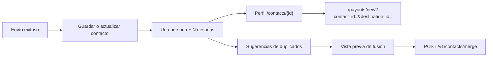

import { EnvUrls } from "/snippets/env-urls.jsx";

<EnvUrls lang="es" />

Un contacto representa a una persona, no a un destino. Cada persona puede tener varios destinos reutilizables: una cuenta CBPay vinculada, beneficiarios de payout por corredor y direcciones cripto por red. Los contactos se crean solos con los envíos exitosos y también se pueden crear o importar explícitamente.



## Agenda unificada

La plataforma agrupa los guardados automáticos por nombre visible normalizado cuando un envío no tiene teléfono, email ni cuenta vinculada para identificar a la persona. La normalización ignora mayúsculas, tildes y espacios repetidos. Si quedan varios candidatos, la plataforma no adivina: el envío conserva su comportamiento de destino y la persona puede elegir desde la agenda.

Un contacto puede tener:

- un destino CBPay vinculado;
- uno o más destinos de payout, cada uno con país, moneda y método;
- una o más direcciones cripto, cada una con red y dirección.

La agenda es privada de la cuenta. Los destinos quedan aislados por propietario y nunca se leen desde otra cuenta.

## Agenda en el portal

La pantalla `/contacts` tiene una barra de herramientas con búsqueda, origen, solo CBPay, favoritos, tipo de destino, país y orden. Muestra el total entregado por el servidor y permite paginar. La búsqueda también encuentra datos de destinos cuando la lista se expande: etiquetas, campos del corredor de payout y texto de red o dirección cripto.

Cada fila abre `/contacts/{id}`. El perfil tiene barra de herramientas con volver, editar y eliminar, estado favorito, cantidad de destinos y tarjetas agrupadas. Desde cada tarjeta se puede cambiar la etiqueta, eliminarla o usar **Enviar**. Ese botón abre `/payouts/new?contact_id=<contact_id>&destination_id=<destination_id>` para usar exactamente el destino guardado.

La acción de fusionar abre una vista previa con contactos, destinos y sobreviviente antes de enviar la operación; una sugerencia nunca fusiona por sí sola.

## Listar y filtrar contactos

Usa `expand=destinations` cuando necesites los destinos en la misma respuesta. Es una expansión en bloque, no una solicitud por contacto. `dest_type` y `dest_country` requieren esa expansión. Los filtros disponibles son `q`, `source`, `has_destinations`, `sort`, `has_cbpay`, `favorite`, `page` y `page_size`; la respuesta incluye `total`.

```bash
curl "https://api.qbank.cl/platform/v1/contacts?q=carlos&source=import&has_destinations=true&sort=recent&expand=destinations&dest_type=payout&dest_country=CL&page=1&page_size=50" \\
  -H "Authorization: Bearer <token>"
```

```json
{
  "page": 1,
  "page_size": 50,
  "total": 1,
  "contacts": [{
    "contact_id": "3f8a1b2c-4d5e-6f70-8a9b-0c1d2e3f4a5b",
    "display_name": "Carlos Soto",
    "has_cbpay": true,
    "destinations": [{
      "destination_id": "bb22c3d4-5e6f-7a80-9b0c-1d2e3f4a5b6c",
      "type": "payout",
      "country": "CL",
      "currency": "CLP",
      "method": "bank_transfer",
      "label": "Cuenta principal"
    }]
  }]
}
```

Un booleano, orden, origen o filtro de destino inválido falla cerrado con `400 invalid_filter`. Una expansión desconocida devuelve `400 invalid_expand`.

## Crear, consultar y editar

Puedes crear un contacto directamente:

```bash
curl -X POST https://api.qbank.cl/platform/v1/contacts \\
  -H "Authorization: Bearer <token>" -H "Content-Type: application/json" \\
  -d '{"display_name":"Carlos Soto","phone":"+56987654321","favorite":true}'
```

```json
{
  "contact_id": "3f8a1b2c-4d5e-6f70-8a9b-0c1d2e3f4a5b",
  "display_name": "Carlos Soto",
  "phone": "+56987654321",
  "has_cbpay": true,
  "source": "manual",
  "favorite": true,
  "destinations": [],
  "created_at": "2026-11-13T12:00:00Z",
  "updated_at": "2026-11-13T12:00:00Z"
}
```

`GET /v1/contacts/{contact_id}` devuelve el perfil completo con destinos. `PATCH /v1/contacts/{contact_id}` acepta cambios parciales de nombre, alias, teléfono, email o favorito; cambiar el teléfono vuelve a ejecutar la coincidencia CBPay.

```bash
curl -X PATCH https://api.qbank.cl/platform/v1/contacts/3f8a1b2c-4d5e-6f70-8a9b-0c1d2e3f4a5b \\
  -H "Authorization: Bearer <token>" -H "Content-Type: application/json" \\
  -d '{"display_name":"Carlos Soto","alias":"Carlitos","favorite":true}'
```

`DELETE /v1/contacts/{contact_id}` elimina el contacto y sus destinos guardados.

## Agregar y etiquetar destinos

Agrega un destino payout, cripto o CBPay con `POST /v1/contacts/{contact_id}/destinations`. Los destinos se deduplican por su huella.

```bash
curl -X PATCH https://api.qbank.cl/platform/v1/contacts/3f8a1b2c-4d5e-6f70-8a9b-0c1d2e3f4a5b/destinations/bb22c3d4-5e6f-7a80-9b0c-1d2e3f4a5b6c \\
  -H "Authorization: Bearer <token>" -H "Content-Type: application/json" \\
  -d '{"label":"Cuenta principal"}'
```

La respuesta devuelve el destino actualizado. `DELETE /v1/contacts/{contact_id}/destinations/{destination_id}` elimina solo ese destino.

## Duplicados y fusión con vista previa

Las sugerencias son de solo lectura y agrupan por nombre plegado. Son candidatas, no una fusión automática:

```bash
curl https://api.qbank.cl/platform/v1/contacts/duplicates \\
  -H "Authorization: Bearer <token>"
```

```json
{
  "groups": [{
    "name": "juan perez",
    "contact_ids": ["3f8a1b2c-4d5e-6f70-8a9b-0c1d2e3f4a5b", "9c1d2e3f-4a5b-6c7d-8e9f-0a1b2c3d4e5f"],
    "display_names": ["Juan Pérez", "JUAN PEREZ"],
    "contacts_count": 2,
    "destinations_count": 3
  }]
}
```

Después de revisar la vista previa, fusiona de 2 a 20 IDs distintos:

```bash
curl -X POST https://api.qbank.cl/platform/v1/contacts/merge \\
  -H "Authorization: Bearer <token>" -H "Content-Type: application/json" \\
  -d '{"contact_ids":["3f8a1b2c-4d5e-6f70-8a9b-0c1d2e3f4a5b","9c1d2e3f-4a5b-6c7d-8e9f-0a1b2c3d4e5f"],"surviving_contact_id":"3f8a1b2c-4d5e-6f70-8a9b-0c1d2e3f4a5b"}'
```

La respuesta `200` es el contacto sobreviviente completo e incluye `merged_contact_ids`. Los destinos pasan al sobreviviente en una transacción; un ID inexistente o ajeno devuelve `404` y no deja una fusión parcial.

<Warning>
`POST /v1/contacts/merge` no es idempotente. Después de una fusión exitosa, los contactos fuente se eliminan y repetir ciegamente la solicitud devuelve `404`. No la reenvíes después de un timeout ambiguo: consulta el contacto y las sugerencias, y deja que el cliente decida.
</Warning>

## Errores y estados

| HTTP | Error | Significado | Solución |
|---|---|---|---|
| 400 | `invalid_filter` / `invalid_expand` | Filtro o expansión no soportado | Usa valores documentados y exige `expand=destinations` para filtros de destino |
| 400 | `batch_too_large` | Se enviaron más de 20 contactos | Divide la operación revisada por la persona |
| 404 | `not_found` | Contacto o destino ausente o de otra cuenta | Vuelve a consultar; nunca adivines otro ID |
| 409 | `duplicate` | Teléfono o email chocaría con otro contacto | Edita el existente o revisa duplicados |

Las mutaciones son sincrónicas: `200` o `201` es final; `4xx` rechaza sin cambios parciales. No hay webhooks de contactos; el dinero iniciado desde un contacto conserva los estados e idempotencia normales de payout, transferencia o retiro.

## Preguntas frecuentes

<AccordionGroup>
<Accordion title="¿Una persona debe tener un contacto aunque tenga varias cuentas bancarias?">Sí. Mantén un contacto y agrega un destino payout por país, moneda y método cuando corresponda.</Accordion>
<Accordion title="¿Por qué dos personas con el mismo nombre no se fusionaron solas?">Las sugerencias son conservadoras. Si hay más de un candidato, la plataforma no infiere identidad; usa la vista previa y elige el sobreviviente.</Accordion>
<Accordion title="¿Puedo reintentar una fusión después de un timeout?">No a ciegas. La fusión no es idempotente. Lee primero el contacto y las sugerencias; tras el éxito los IDs fuente ya no existen.</Accordion>
<Accordion title="¿Cómo envío desde el perfil?">Selecciona Enviar en la tarjeta del destino. El portal abre `/payouts/new?contact_id=...&destination_id=...` con ese contexto.</Accordion>
<Accordion title="¿Otra cuenta puede leer mis destinos?">No. Las lecturas y escrituras están limitadas a la cuenta autenticada.</Accordion>
<Accordion title="¿Qué pasa si elimino un destino?">Se elimina solo ese destino; el contacto y los demás permanecen.</Accordion>
</AccordionGroup>
