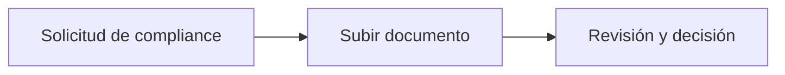

import { EnvUrls } from "/snippets/env-urls.jsx";

<EnvUrls lang="es" />


## Entrega A+B: firma de contratos y remediación documental

Esta sección define el contrato de implementación para el portal y la API.
Los ejemplos usan las rutas públicas de plataforma y los campos de respuesta
normalizados por los handlers.

### Remediación inline: verificar el correo, agregar un número y desbloquearlo

Cuando se enlaza un teléfono nuevo sin verificarlo, las acciones OTP por
teléfono quedan en **cooldown de cuatro horas**. El portal debe mostrar el
CTA de compliance y permitir un factor independiente: desafío por correo
verificado o TOTP. Un código enviado al número nuevo nunca desbloquea esta
protección.

```bash
curl -X POST https://api.qbank.cl/platform/v1/otp/challenges \
  -H "Authorization: Bearer <CBPAY_TOKEN>" -H "Content-Type: application/json" \
  -d '{"action":"phone_change","channel":"email"}'

curl -X POST https://api.qbank.cl/platform/v1/me/phone/unlock-cooldown \
  -H "Authorization: Bearer <CBPAY_TOKEN>" \
  -H "X-OTP-Token: <VERIFIED_PHONE_CHANGE_TOKEN>"
```

La respuesta exitosa es `{"status":"unlocked","channel":"email"}`; sin
cooldown es `{"status":"not_locked"}`. Un código ausente o usado responde
`401 invalid_otp`; un factor telefónico responde `403
independent_factor_required`. Sin factor independiente, el titular espera
las cuatro horas. El resultado queda visible en `GET /v1/me`.

Un administrador puede limpiar el marcador sin cambiar el teléfono ni
`phone_verified`:

```bash
curl -X POST https://api.qbank.cl/platform/v1/accounts/<ACCOUNT_ID>/phone/clear-cooldown \
  -H "Authorization: Bearer <ADMIN_TOKEN>"
```

La respuesta es `{"status":"cleared","account_id":"<ACCOUNT_ID>"}` y la
acción queda auditada.

### Firma tipeada en el portal y el wizard

El wizard ofrece **Dibujar firma** y **Escribir nombre completo**. Ambos
producen `signature_png`. Para firma tipeada, envía el PNG renderizado, el
modo y el nombre exacto:

```bash
curl -X POST https://api.qbank.cl/platform/v1/me/contracts/envelopes/<ENVELOPE_ID>/sign \
  -H "Authorization: Bearer <CBPAY_TOKEN>" -H "Content-Type: application/json" \
  -H "X-OTP-Token: <FRESH_OTP>" \
  -d '{"signer_name":"Jordan Lee","signer_title":"Director","consent":true,
       "signature_png":"<PNG_BASE64>","signature_mode":"typed","typed_name":"Jordan Lee"}'
```

`signature_mode` puede ser `drawn` (por defecto) o `typed`. En modo tipeado,
`typed_name` es obligatorio y debe coincidir exactamente con `signer_name`;
si no, responde `422 typed_name_mismatch`. Un modo desconocido responde
`422 invalid_signature_mode`. El OTP sigue siendo un header.

### Wizard KYB: Reino Unido y país genérico

Para una empresa británica usa `country: "uk"`; el wizard solicita número de
empresa, datos registrados, directores, beneficiarios finales y roles de
control/firma según el perfil UK. Para otro país usa `country: "generic"` y
`generic_country` ISO alpha-2:

```bash
curl -X POST https://api.qbank.cl/platform/v1/kyb/links \
  -H "Authorization: Bearer <CBPAY_TOKEN>" -H "Content-Type: application/json" \
  -H "Idempotency-Key: kyb-cust-456-uk-1" \
  -d '{"external_customer_id":"cust_456","country":"uk","label":"Northwind Ltd"}'

curl -X POST https://api.qbank.cl/platform/v1/kyb/links \
  -H "Authorization: Bearer <CBPAY_TOKEN>" -H "Content-Type: application/json" \
  -d '{"external_customer_id":"cust_789","country":"generic","generic_country":"ES",
       "idempotency_key":"kyb-cust-789-es-1","label":"Example SL"}'
```

El país se conserva en los pasos de presencia legal y partes relacionadas; no
reemplaces un país genérico por un valor del catálogo regional.

### Correos de verificación e idioma

Los correos incluyen un CTA **Continuar compliance** cuando existe un link o
una submission accionable. El CTA usa el mismo token del wizard. El idioma
sigue el locale del perfil (`en`, `es` o `zh`) y cae a inglés. El correo no es
la fuente de verdad del estado.

### Subida nativa de documentos: `multipart` y `raw`

La respuesta de presign indica el transporte:

```json
{"upload_url":"https://api.qbank.cl/platform/v1/kyc/submissions/sub_123/documents/upload",
 "key":"native/sub_123/identity/abc","expires_in":900,"method":"POST","shape":"multipart"}
```

Con `shape: "multipart"`, haz POST con la parte `file`, `category` y `key`:

```bash
curl -X POST "$UPLOAD_URL" -H "Authorization: Bearer <CBPAY_TOKEN>" \
  -F "file=@passport.jpg;type=image/jpeg" -F "category=identity" -F "key=$KEY"
```

Con `shape: "raw"`, haz PUT de los bytes con el mismo `Content-Type`. Ambos
flujos terminan con `POST .../{submissionID}/documents/confirm` y luego
`GET .../documents`. El proxy acepta hasta 24 MiB; el límite del core es 15
MiB por archivo.

Si compliance pidió el archivo, aparece `uploaded_after_request: true`.
Muéstralo como badge **Subido después de la solicitud**, junto a `outcome` y
`effective_outcome`. Este último usa la resolución manual cuando existe y, si
no, el resultado OCR.

## Estados y errores

| Estado o error | Significado | Acción |
|---|---|---|
| `phone_binding_cooldown` | El teléfono nuevo está en la ventana de cuatro horas. | Usa correo/TOTP verificado, pide limpieza admin o espera. |
| `uploaded_after_request: true` | El archivo responde una solicitud de compliance. | Muestra el badge y espera la validación. |
| `typed_name_mismatch` | El nombre tipeado difiere de `signer_name`. | Envía el nombre exacto del firmante. |

Consulta el [catálogo de errores](/es/errors) para el contrato completo.

## Preguntas frecuentes

<AccordionGroup>
  <Accordion title="¿El número nuevo puede desbloquear su cooldown?">No. Usa el correo verificado o la app autenticadora, o espera cuatro horas.</Accordion>
  <Accordion title="¿Qué shape debe usar el portal?">Usa el `shape` devuelto por presign; nunca lo infieras desde una URL de storage.</Accordion>
</AccordionGroup>
