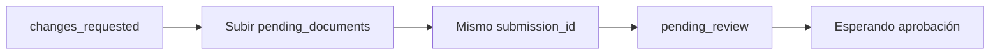

import { EnvUrls } from "/snippets/env-urls.jsx";

<EnvUrls lang="es" />

## Continúa el expediente vigente

Tu cuenta tiene un único **expediente de verificación vigente**. Un registro
`rejected` posterior no anula un expediente que todavía permite subsanar. Si
ya existe una solicitud en curso, `POST /v1/me/verification/link` responde
`409 self_verification_in_progress` sin entregar un link nuevo:

```json
{
  "error": {
    "code": "self_verification_in_progress",
    "message": "a verification is already in progress"
  }
}
```

Consulta `GET /v1/me/verification` y vuelve a abrir el `link.url` existente.
No crees un segundo expediente ni cambies la clave de idempotencia.

## Resubmisión en el mismo expediente

Mientras se pueda subsanar, la submission vigente expone:

```json
{
  "submission_id": "sub_123",
  "status": "changes_requested",
  "pending_documents": ["proofOfResidence"],
  "documents_received": ["identity"],
  "changes_requested_comments": "Sube un comprobante de domicilio legible.",
  "documents_gate": { "ok": false, "total": 2, "matched": 1 }
}
```

Sube cada elemento de `pending_documents` en el wizard existente. La
resubmisión ocurre **en el mismo expediente**: se conserva el
`submission_id` y no se crea otra submission. Al aceptar el último documento
exigido, el caso vuelve automáticamente a `pending_review` y el portal muestra
**Esperando aprobación**.



<AccordionGroup>
  <Accordion title="¿Por qué recibí un 409?">
    Ya existe un expediente vigente. Consulta la verificación y reutiliza su
    link abierto.
  </Accordion>
  <Accordion title="¿La resubmisión crea otra revisión?">
    No. Se actualiza la submission existente y vuelve a revisión cuando la
    evidencia exigida está completa.
  </Accordion>
</AccordionGroup>

Consulta el [catálogo de errores](/es/errors) para los códigos accionables.
