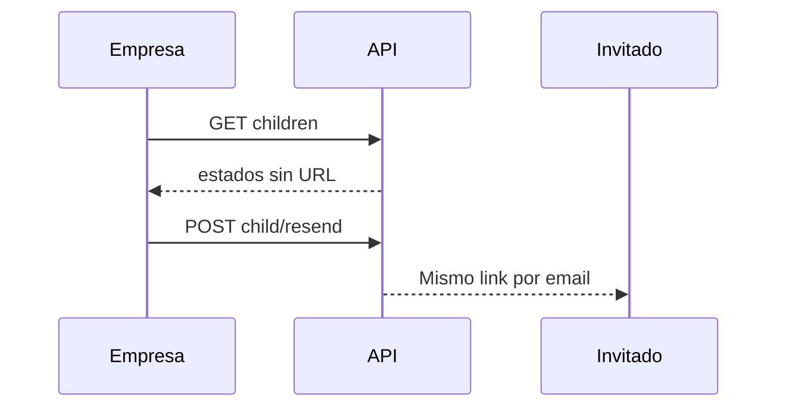

import { EnvUrls } from "/snippets/env-urls.jsx";

<EnvUrls lang="es" />

## Flujo de hijos aislado por tenant

Las cuentas empresa pueden listar UBOs y directores invitados mientras el KYB
padre sigue en revisión. Las rutas quedan aisladas a la empresa autenticada y
nunca devuelven la URL del link.



```bash
curl https://api.qbank.cl/platform/v1/me/verification/children \
  -H "Authorization: Bearer <token>"
```

```json
{
  "children": [
    {
      "child_link_id": "b7c2d3e4-f5a6-4b7c-8d9e-0f1a2b3c4d5e",
      "flow": "ubo",
      "email": "owner@example.com",
      "name": "Jane Owner",
      "link_status": "opened",
      "submission_id": "f0e1d2c3-e4f5-4a6b-8c9d-0e1f2a3b4c5d",
      "submission_status": "changes_requested",
      "reused": false,
      "expires_at": "2027-01-15T12:00:00Z",
      "created_at": "2026-11-01T12:00:00Z",
      "declaration_signed": false,
      "needs_signature": true,
      "decision_note": "Please sign the beneficial owner declaration."
    }
  ]
}
```

## Reenvía la misma invitación

El reenvío manda por email el link hijo existente. Nunca crea otro link,
bearer ni submission. Los links vencidos pero subsanables pueden reactivarse;
el límite es un reenvío por hijo al día.

```bash
curl -X POST \
  https://api.qbank.cl/platform/v1/me/verification/children/{childID}/resend \
  -H "Authorization: Bearer <token>"
```

```json
{
  "sent": true,
  "reminded_to": "owner@example.com",
  "expires_at": "2027-01-15T12:00:00Z"
}
```

La entrega de email se informa honestamente. Una respuesta `200` con
`sent: false` incluye `email_error: "email_unavailable"` o
`email_error: "email_failed"`; revísala antes de actuar de nuevo.

| Estado o error | Significado | Solución |
|---|---|---|
| `pending` / `opened` | El hijo no terminó el wizard | Reenvía la misma invitación cuando corresponda. |
| `changes_requested` / `more_info_required` | Hay que corregir evidencia | Usa el wizard existente y envía de nuevo. |
| `declaration_signed: false` y `needs_signature: true` | Falta firmar la declaración jurada | Abre el mismo wizard, firma y envía; no crees otro hijo. |
| `invalid_child` (`400`) | Falta `childID` | Usa el `child_link_id` del listado. |
| `not_found` (`404`) | El hijo no existe o pertenece a otro caso KYB | Verifica ownership y usa el ID listado. |
| `already_decided` / `invite_closed` (`409`) | El hijo no admite reenvío | Lee el estado actual; no crees un reemplazo. |
| `email_unavailable` / `email_failed` | El email no fue enviado | Revisa el mailer y reintenta esta ruta después. |

<AccordionGroup>
<Accordion title="¿El reenvío cobra de nuevo?">
No. Reutiliza la invitación y submission existentes, sin crear otra
verificación.
</Accordion>
<Accordion title="¿Por qué la URL no aparece en la respuesta?">
La URL es una credencial bearer. Solo se envía al invitado por email y nunca
se expone en la API de la empresa.
</Accordion>
</AccordionGroup>

Revisa el [catálogo central de errores](/es/errors) para el manejo compartido.
