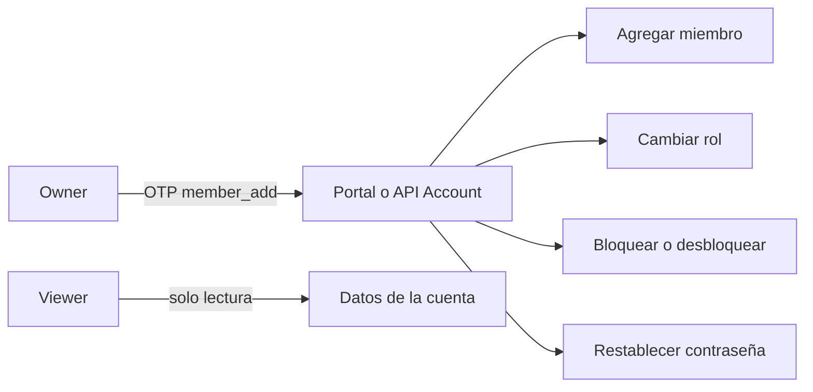
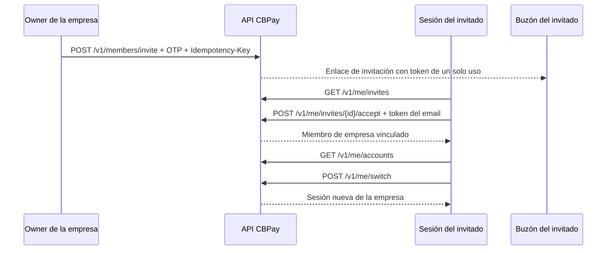

import { EnvUrls } from "/snippets/env-urls.jsx";

<EnvUrls lang="es" />

Las cuentas de empresa pueden invitar una cuenta que ya existe en la misma
organización. El invitado conserva un solo acceso y acepta desde una sesión
humana; CBPay agrega un miembro con rol `operator` o `viewer` limitado a esa
empresa.

<Note>
Las invitaciones y el switcher requieren una sesión humana. Las API keys no
pueden aceptar o rechazar invitaciones, listar las cuentas del acceso ni
cambiar el contexto de cuenta.
</Note>

## Roles y permisos

| Rol | Lee datos de la cuenta | Opera productos | Administra miembros y credenciales |
|---|---:|---:|---:|
| `owner` | Sí | Sí | Sí |
| `operator` | Sí | Sí | No |
| `viewer` | Sí | No | No |

`viewer` es de solo lectura: no puede crear ni cambiar operaciones,
credenciales, miembros o ajustes de la cuenta. Mantén al menos un `owner` en
cada cuenta de empresa.



## Cómo funciona el acceso multicuenta



La invitación dura siete días. Aceptarla prueba la sesión autenticada y la
posesión del token del email. El email de la sesión debe coincidir exactamente
con el email invitado; el token por sí solo no basta.

## Invitar una cuenta existente

La invitación requiere una cuenta activa y verificada de la misma
organización. No crea un login nuevo. El rol ofrecido debe ser `operator` o
`viewer`; un owner existente puede promover después al miembro.

```bash
export CBPAY_API="https://api.qbank.cl/platform"
export OWNER_SESSION="<token-de-sesion-del-owner>"
export INVITEE_SESSION="<token-de-sesion-humana-del-invitado>"
export INVITE_ID="7f3a9c1e-4b5d-4e6f-8a9b-0c1d2e3f4a5b"

curl -X POST "$CBPAY_API/v1/members/invite" \
  -H "Authorization: Bearer $OWNER_SESSION" \
  -H "Content-Type: application/json" \
  -H "Idempotency-Key: company-invite-ops-001" \
  -H "X-OTP-Token: <otp-member-add>" \
  -d '{"email":"ops@example.com","role":"operator"}'
```

```json
{
  "invite_id": "7f3a9c1e-4b5d-4e6f-8a9b-0c1d2e3f4a5b",
  "company_account_id": "1a2b3c4d-5e6f-4a7b-8c9d-0e1f2a3b4c5d",
  "company_name": "Acme SpA",
  "email": "ops@example.com",
  "role": "operator",
  "status": "pending",
  "invited_by": "owner@example.com",
  "delivery": "link",
  "expires_at": "2026-12-02T12:00:00Z",
  "created_at": "2026-11-25T12:00:00Z"
}
```

Envía `Idempotency-Key` en cada invitación. Repetir el mismo payload con la
misma clave devuelve la invitación existente sin enviar otro email. Usar la
misma clave con datos distintos devuelve `idempotency_conflict`.

## Revisar, aceptar o rechazar

El invitado consulta sus invitaciones desde una sesión humana. Puedes filtrar
por `status=pending|accepted|declined|revoked|expired`, `page` y `page_size`;
el tamaño predeterminado es 50 y el máximo es 200.

```bash
curl "$CBPAY_API/v1/me/invites?status=pending&page=1&page_size=50" \
  -H "Authorization: Bearer $INVITEE_SESSION"
```

El enlace del email entrega el token opaco. No lo registres ni lo expongas:

```bash
curl -X POST "$CBPAY_API/v1/me/invites/$INVITE_ID/accept" \
  -H "Authorization: Bearer $INVITEE_SESSION" \
  -H "Content-Type: application/json" \
  -d '{"token":"<token-del-email-de-invitacion>"}'
```

```json
{
  "member_id": "9a8b7c6d-5e4f-4a3b-8c9d-0e1f2a3b4c5d",
  "account_id": "1a2b3c4d-5e6f-4a7b-8c9d-0e1f2a3b4c5d",
  "role": "operator",
  "linked": true
}
```

Rechazar está restringido al buzón invitado, pero no requiere el token:

```bash
curl -X POST "$CBPAY_API/v1/me/invites/$INVITE_ID/decline" \
  -H "Authorization: Bearer $INVITEE_SESSION"
```

Aceptar y rechazar son seguros de repetir: si hubo una decisión concurrente,
la API devuelve el estado real. Una invitación expirada debe reenviarse o
reemplazarse por el owner.

## Listar, reenviar o revocar

Lista las invitaciones de la empresa con `status`, `page` y `page_size`:

```bash
curl "$CBPAY_API/v1/members/invites?status=pending&page=1&page_size=50" \
  -H "Authorization: Bearer $OWNER_SESSION"
```

Solo una invitación `pending` se puede reenviar o revocar. Ambas acciones
requieren el OTP `member_add` del owner. Reenviar rota el token y renueva los
siete días; no crea una segunda invitación.

```bash
curl -X POST "$CBPAY_API/v1/members/invites/$INVITE_ID/resend" \
  -H "Authorization: Bearer $OWNER_SESSION" \
  -H "X-OTP-Token: <otp-member-add>"

curl -X POST "$CBPAY_API/v1/members/invites/$INVITE_ID/revoke" \
  -H "Authorization: Bearer $OWNER_SESSION" \
  -H "X-OTP-Token: <otp-member-add>"
```

No existe un webhook público de invitaciones. Consulta el estado en los GET;
al aceptar, el miembro vinculado aparece en `GET /v1/members`.

## Accesos vinculados y switcher

`linked: true` significa que el miembro de empresa pertenece a la misma
familia de acceso que la cuenta primaria del invitado. Tiene rol y estado
propios en la empresa, pero la credencial se administra solo desde la
primaria: clave, email, 2FA, passkeys y vínculos sociales.

```bash
curl "$CBPAY_API/v1/me/accounts" \
  -H "Authorization: Bearer $INVITEE_SESSION"
```

La respuesta lista `account_id`, tipo, nombre, `member_id`, rol y si es
`primary`. Cambia a la cuenta empresa emitiendo una sesión fresca:

```bash
curl -X POST "$CBPAY_API/v1/me/switch" \
  -H "Authorization: Bearer $INVITEE_SESSION" \
  -H "Content-Type: application/json" \
  -d '{"account_id":"1a2b3c4d-5e6f-4a7b-8c9d-0e1f2a3b4c5d"}'
```

La respuesta contiene `access_token`, `refresh_token`, sus vencimientos,
`account_id`, `member_id` y `role`. La sesión actual sigue válida. Guarda los
tokens como tokens de login y nunca en URLs o logs. Para gestionar la
credencial vinculada, cambia a la cuenta `primary: true`; de lo contrario se
devuelve `primary_account_required` o `linked_login_managed_by_primary`.

## Estados de invitación

| Estado | Significado | Siguiente acción |
|---|---|---|
| `pending` | Se puede aceptar o rechazar. | Aceptar, reenviar o revocar. |
| `accepted` | Se creó el miembro vinculado. | Gestionar el miembro o cambiar de cuenta. |
| `declined` | El invitado la rechazó. | Crear otra si aún hace falta. |
| `revoked` | El owner la canceló. | Crear otra si aún hace falta. |
| `expired` | Venció el plazo de siete días. | Reenviar o crear otra. |

## Administrar miembros en el portal

<Steps>
<Step title="Abre los ajustes de la cuenta de empresa">
Inicia sesión como `owner`, abre los ajustes de la cuenta de empresa y entra
en la sección de miembros.
</Step>
<Step title="Agrega o selecciona un miembro">
Al agregar un miembro, indica email, una contraseña de al menos ocho
caracteres que no sea de uso común y uno de los tres roles. Al editarlo, selecciónalo antes de
cambiar su rol o estado.
</Step>
<Step title="Confirma la acción">
Para agregar un miembro, cambiar un rol, bloquear o desbloquear un login, o
restablecer una contraseña, completa el desafío OTP `member_add` cuando el
portal lo solicite. La acción se aplica inmediatamente después de confirmar.
</Step>
</Steps>

Un owner no puede bloquear su propio login. Pide a otro owner que lo haga. El
último owner tampoco puede ser degradado.

## Administrar miembros con la API

Todos los ejemplos usan un token de sesión humana:

```bash
export CBPAY_API="https://api.qbank.cl/platform"
export SESSION_TOKEN="<human-session-token>"
export MEMBER_ID="5a4b3c2d-1e0f-9a8b-7c6d-5e4f3a2b1c0d"
```

### 1. Consultar tu perfil de miembro

Este endpoint distingue al miembro que inició sesión de la cuenta de empresa:

```bash
curl "$CBPAY_API/v1/me/member" \
  -H "Authorization: Bearer $SESSION_TOKEN"
```

```json
{
  "id": "5a4b3c2d-1e0f-9a8b-7c6d-5e4f3a2b1c0d",
  "email": "ops@example.com",
  "role": "operator",
  "status": "active",
  "created_at": "2026-07-07T12:00:00Z"
}
```

Las API keys reciben `404 member_not_found` porque no son miembros humanos.

### 2. Agregar y listar miembros

Agregar miembros es exclusivo de cuentas de empresa. Si omites `role`, el
valor predeterminado es `operator`:

```bash
curl -X POST "$CBPAY_API/v1/members" \
  -H "Authorization: Bearer $SESSION_TOKEN" \
  -H "Content-Type: application/json" \
  -d '{
    "email": "ops@example.com",
    "password": "another-secure-pass",
    "role": "operator"
  }'
```

La respuesta es el miembro creado:

```json
{
  "id": "5a4b3c2d-1e0f-9a8b-7c6d-5e4f3a2b1c0d",
  "email": "ops@example.com",
  "role": "operator",
  "status": "active",
  "created_at": "2026-07-07T12:00:00Z"
}
```

Lista los miembros antes de mostrar un formulario de edición:

```bash
curl "$CBPAY_API/v1/members" \
  -H "Authorization: Bearer $SESSION_TOKEN"
```

```json
{
  "members": [
    {
      "id": "5a4b3c2d-1e0f-9a8b-7c6d-5e4f3a2b1c0d",
      "email": "ops@example.com",
      "role": "operator",
      "status": "active",
      "created_at": "2026-07-07T12:00:00Z"
    }
  ]
}
```

### 3. Cambiar el rol

Solo un owner de una cuenta de empresa puede cambiar roles. Los valores
permitidos son `owner`, `operator` y `viewer`.

```bash
curl -X PUT "$CBPAY_API/v1/members/$MEMBER_ID/role" \
  -H "Authorization: Bearer $SESSION_TOKEN" \
  -H "Content-Type: application/json" \
  -H "X-OTP-Token: <member-add-otp>" \
  -d '{"role":"operator"}'
```

```json
{
  "member_id": "5a4b3c2d-1e0f-9a8b-7c6d-5e4f3a2b1c0d",
  "role": "operator",
  "changed": true
}
```

### 4. Bloquear o desbloquear un miembro

Deshabilitar un miembro revoca inmediatamente todas sus sesiones. Usa
`active` para desbloquear el login.

```bash
curl -X PUT "$CBPAY_API/v1/members/$MEMBER_ID/status" \
  -H "Authorization: Bearer $SESSION_TOKEN" \
  -H "Content-Type: application/json" \
  -H "X-OTP-Token: <member-add-otp>" \
  -d '{"status":"disabled"}'
```

```json
{
  "member_id": "5a4b3c2d-1e0f-9a8b-7c6d-5e4f3a2b1c0d",
  "status": "disabled",
  "changed": true,
  "sessions_revoked": 2
}
```

### 5. Restablecer una contraseña

Restablecer la contraseña también revoca todas las sesiones del miembro. Para
cambiar tu propia contraseña usa `POST /v1/me/password`.

```bash
curl -X POST "$CBPAY_API/v1/members/$MEMBER_ID/reset-password" \
  -H "Authorization: Bearer $SESSION_TOKEN" \
  -H "Content-Type: application/json" \
  -H "X-OTP-Token: <member-add-otp>" \
  -d '{"password":"another-secure-pass"}'
```

```json
{
  "member_id": "5a4b3c2d-1e0f-9a8b-7c6d-5e4f3a2b1c0d",
  "status": "password_reset",
  "sessions_revoked": 1
}
```

## Errores y recuperación

| HTTP | Error | Qué hacer |
|---:|---|---|
| 400 | `invalid_role` | Envía exactamente `owner`, `operator` o `viewer`. |
| 403 | `owner_required` | Inicia sesión con un owner. |
| 403 | `company_only` | Usa una cuenta de empresa; las cuentas persona no tienen miembros. |
| 403 | `otp_required` | Solicita y verifica el OTP `member_add`, y envía su token. |
| 404 | `member_not_found` | Usa una sesión humana, no una API key. |
| 409 | `last_owner_required` | Conserva al menos un owner antes de degradar este miembro. |
| 409 | `self_action_forbidden` | Pide a otro owner cambiar tu estado o contraseña. |
| 404 | `invitee_not_found` | Ninguna cuenta de la organización usa ese email; debe crear su cuenta primero. |
| 409 | `invitee_not_ready` | La cuenta invitada aún no verifica su email. |
| 409 | `already_member` | Ese email ya tiene acceso a esta empresa. |
| 410 | `invite_expired` | La invitación expiró; invita de nuevo. |
| 409 | `company_not_active` | La empresa ya no está activa; las invitaciones están cerradas. |
| 403 | `primary_account_required` | Cambia a la cuenta primaria para gestionar credenciales. |
| 403 | `linked_login_managed_by_primary` | Resetea la clave o cambia el email desde la cuenta primaria. |
| 403 | `switch_unavailable` | Esa cuenta no está disponible para cambiar ahora. |
| 400 | `invalid_email` | Envía un email válido y simple de una cuenta existente. |
| 400 | `idempotency_key_required` | Agrega `Idempotency-Key` a la invitación. |
| 400 | `invalid_token` | Usa el token del email de invitación más reciente. |
| 400 | `invalid_status` | Usa `pending`, `accepted`, `declined`, `revoked` o `expired`. |
| 401 | `not_found` | La invitación no está disponible para este buzón o contexto. |
| 409 | `idempotency_conflict` | Repite el payload original o elige una clave nueva. |
| 409 | `invalid_state` | La invitación ya no está pendiente; consulta su estado. |
| 429 | `too_many_attempts` | Espera y reintenta después; no reenvíes repetidamente. |

Consulta la [referencia de errores](/es/errors) para el catálogo completo.

> Los destinatarios por email siempre resuelven a la cuenta propia del buzón: pagar al email de un usuario multicuenta abona su cuenta persona, nunca una empresa que opere.

<AccordionGroup>
<Accordion title="¿La invitación crea una cuenta nueva?">
No. El email debe pertenecer a una cuenta elegible de la organización. La
invitación agrega acceso empresarial a ese login existente.
</Accordion>
<Accordion title="¿Puedo aceptar solo con el token del email?">
No. Se necesita una sesión humana cuyo email coincida exactamente con el
buzón invitado y el token del email más reciente.
</Accordion>
<Accordion title="¿Qué significa linked?">
El miembro comparte la familia de credenciales de la cuenta primaria. Su rol y
estado empresarial son propios, pero la clave, email, 2FA, passkeys y vínculos
sociales se administran desde la primaria.
</Accordion>
<Accordion title="¿Dónde administro la credencial vinculada?">
Cambia a la cuenta marcada `primary: true` en `GET /v1/me/accounts`.
</Accordion>
<Accordion title="¿Dónde llega un pago a un payee por email?">
Siempre se abona a la cuenta persona del dueño del buzón, nunca a una empresa
que esa persona opere.
</Accordion>
</AccordionGroup>
