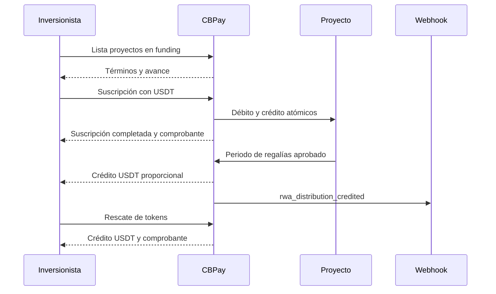

import { EnvUrls } from "/snippets/env-urls.jsx";

Los tokens RWA representan un derecho proporcional sobre un proyecto de regalías publicado. La API usa cadenas decimales exactas: nunca envíes números de punto flotante. Antes de comprar, el proyecto publica precio, oferta, términos de regalías, ventana de suscripción y si permite rescates.

<EnvUrls lang="es" />

## Recorrido del inversionista



## 1. Buscar un proyecto

```bash
curl "https://api.qbank.cl/platform/v1/rwa/projects?status=funding&limit=50&page=1" \
  -H "Authorization: Bearer $CBPAY_TOKEN"
```

```json
{
  "page": 1,
  "page_size": 50,
  "projects": [{
    "project_id": "11111111-1111-4111-8111-111111111111",
    "code": "RWA-MIN01",
    "name": "Minera Norte Royalty I",
    "mineral": "copper",
    "status": "funding",
    "royalty_pct": "5",
    "royalty_base": "nsr",
    "cap_multiple": "2",
    "term_years": 7,
    "supply_total": "10000000.000000",
    "subscription_price_usdt": "1.000000",
    "min_per_account": "100.000000",
    "distribution_frequency": "quarterly",
    "chain": "polygon",
    "bridge_enabled": false,
    "transfers_enabled": true,
    "redeem_enabled": true,
    "sold_tokens": "1200000.000000",
    "raised_gross_usdt": "1200000.000000",
    "subscribers": 84,
    "redeemed_tokens": "0.000000"
  }]
}
```

Usa `GET /platform/v1/rwa/projects/{code}` para consultar los términos completos. Los estados posibles son `draft`, `funding`, `active`, `distributing`, `defaulted`, `redeemed` y `paused`.

## 2. Comprar tokens

El monto solicitado es el monto bruto en USDT. La comisión configurada `rwa_subscription` se cobra aparte y la cantidad de tokens se calcula sobre el monto neto.

```bash
curl -X POST https://api.qbank.cl/platform/v1/rwa/subscriptions \
  -H "Authorization: Bearer $CBPAY_TOKEN" \
  -H "Content-Type: application/json" \
  -H "Idempotency-Key: sub-min01-0001" \
  -d '{"project_code":"RWA-MIN01","usdt_amount":"1000.000000","idempotency_key":"sub-min01-0001"}'
```

```json
{
  "subscription_id": "22222222-2222-4222-8222-222222222222",
  "account_id": "33333333-3333-4333-8333-333333333333",
  "project_id": "11111111-1111-4111-8111-111111111111",
  "project_code": "RWA-MIN01",
  "usdt_gross": "1000.000000",
  "fee_usdt": "10.000000",
  "usdt_net": "990.000000",
  "tokens_credited": "990.000000",
  "price_usdt": "1.000000",
  "status": "completed",
  "created_at": "2026-11-15T13:00:00Z",
  "receipt_url": "/platform/v1/rwa/subscriptions/22222222-2222-4222-8222-222222222222/receipt"
}
```

Comprar exige identidad verificada, OTP si la sesión humana lo requiere, USDT disponible y una clave de idempotencia. Reutilizar la misma clave devuelve la operación original.

## 3. Revisar saldos y distribuciones

```bash
curl "https://api.qbank.cl/platform/v1/rwa/holdings" -H "Authorization: Bearer $CBPAY_TOKEN"
curl "https://api.qbank.cl/platform/v1/rwa/distributions?from=2026-01-01T00:00:00Z&to=2026-12-31T23:59:59Z&page=1" \
  -H "Authorization: Bearer $CBPAY_TOKEN"
```

Las distribuciones usan el saldo del snapshot de ex-date:

```json
{
  "leg_id": "55555555-5555-4555-8555-555555555555",
  "distribution_id": "66666666-6666-4666-8666-666666666666",
  "project_code": "RWA-MIN01",
  "period": "2026-Q4",
  "tokens": "890.000000",
  "share_usdt": "12.500000",
  "fee_usdt": "0.125000",
  "created_at": "2026-11-15T15:00:00Z"
}
```

Los listados de suscripciones, rescates y distribuciones aceptan `from`, `to` y `page`; cada recurso tiene consulta individual y comprobante PDF.

## 4. Rescatar

```bash
curl -X POST https://api.qbank.cl/platform/v1/rwa/redemptions \
  -H "Authorization: Bearer $CBPAY_TOKEN" \
  -H "Content-Type: application/json" \
  -d '{"project_code":"RWA-MIN01","tokens":"100.000000","idempotency_key":"red-min01-0001"}'
```

```json
{
  "redemption_id": "44444444-4444-4444-8444-444444444444",
  "project_code": "RWA-MIN01",
  "tokens": "100.000000",
  "usdt_credited": "100.000000",
  "price_usdt": "1.000000",
  "status": "completed",
  "created_at": "2026-11-15T14:00:00Z",
  "receipt_url": "/platform/v1/rwa/redemptions/44444444-4444-4444-8444-444444444444/receipt"
}
```

El rescate devuelve USDT al precio de suscripción del proyecto y descuenta los tokens de forma atómica.

## Estados, errores y webhooks

`funding` permite suscripciones si la ventana y los topes lo permiten; `active` opera y puede distribuir; `distributing` procesa una distribución; `paused` requiere esperar; `defaulted` y `redeemed` no aceptan nuevas suscripciones.

Consulta [Errores](/es/errors) para `rwa_window_closed`, `rwa_cap_exceeded`, `rwa_fee_exceeds_amount`, `rwa_redeem_disabled` y `rwa_escrow_insufficient`. Ante timeout o 5xx, consulta el recurso con la misma clave antes de actuar.

Verifica la firma de `rwa_subscription_completed`, `rwa_distribution_credited` y `rwa_redeem_completed`. Revisa [Webhooks](/es/webhooks).

## Preguntas frecuentes

<AccordionGroup>
<Accordion title="¿El precio del token fluctúa?">No. F1 rescata al precio de suscripción del proyecto.</Accordion>
<Accordion title="¿Puedo reenviar una solicitud fallida?">Ante un timeout o 5xx, primero consulta la operación original con la misma clave de idempotencia.</Accordion>
<Accordion title="¿Por qué mi distribución no usa mi saldo actual?">La participación se calcula con el saldo del snapshot de ex-date.</Accordion>
<Accordion title="¿Está disponible el bridge?">No. El bridge es F2 y no forma parte de RWA F1.</Accordion>
</AccordionGroup>
