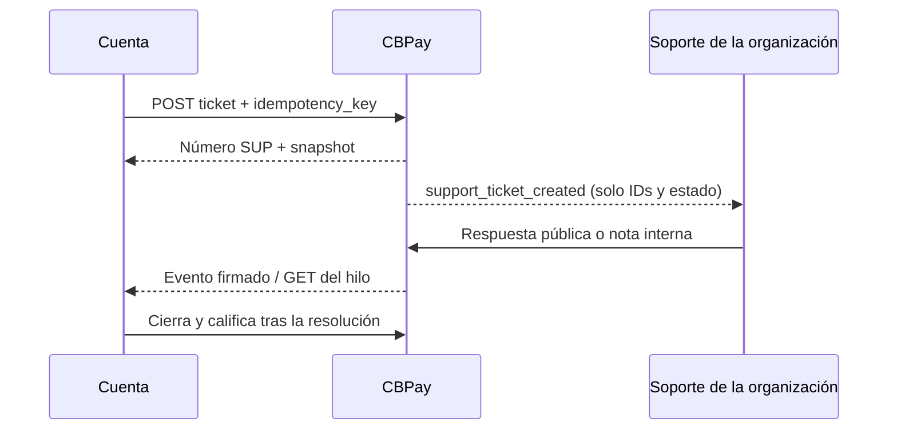

Para pruebas usa `https://cryptobank.qbank.cl/platform`.

Un ticket mantiene la consulta de la cuenta junto con la transacción relevante. Ábrelo desde una transacción para errores, consultas, demoras o diferencias de monto; usa `kind: general` solo si no existe una transacción de origen. Los tickets de transacción guardan un snapshot de comprobante de solo lectura.



## Abrir un ticket

`kind` debe ser `payout`, `payin`, `payin_refund`, `transfer`, `crypto_withdrawal`, `crypto_deposit`, `swap`, `card_purchase`, `banking_operation`, `wallet_send` o `wallet_deposit`. Envía `resource_id`; los tickets `general` deben usar categoría `general` y omitirlo.

```bash
curl -X POST https://api.qbank.cl/platform/v1/support/tickets \
  -H "Authorization: Bearer $ACCOUNT_TOKEN" -H "Content-Type: application/json" \
  -H "Idempotency-Key: support-payout-2026-0001" \
  -d '{"kind":"payout","resource_id":"payout-123","subject":"El payout está demorado","category":"delay","priority":"high","message":"Revisen este payout.","idempotency_key":"support-payout-2026-0001"}'
```

La primera solicitud responde `201`. `idempotency_key` puede tener como máximo 128 caracteres; un valor más largo devuelve `400 invalid_payload`. La clave de idempotencia está ligada a la cuenta: la deduplicación usa `(organización, cuenta, idempotency_key)`, por lo que distintas cuentas pueden usar la misma clave de forma independiente. Repetir la misma clave devuelve el ticket original con `idempotency_hit: true`; nunca crea otro. Un segundo ticket abierto para la misma transacción devuelve `409 ticket_already_open` con el ticket existente.

## Leer y continuar el hilo

Usa `GET /v1/support/tickets?from=2026-10-01&to=2026-10-31&page=1&page_size=50` para listar. También puedes filtrar por `status`, `category`, `priority` y `kind`; `page_size` llega hasta 200. El detalle contiene `snapshot`, mensajes públicos y metadata de adjuntos. Las notas internas nunca llegan a la cuenta.

```bash
curl -X POST https://api.qbank.cl/platform/v1/support/tickets/TICKET_ID/messages \
  -H "Authorization: Bearer $ACCOUNT_TOKEN" -H "Content-Type: application/json" \
  -d '{"body":"Aquí hay contexto adicional."}'
```

Un mensaje de la cuenta reabre tickets `pending_customer`, `on_hold` o `resolved` como `open`. `closed` es terminal; abre uno nuevo.

## Adjuntos

Sube un `PDF`, `PNG` o `JPG` como campo multipart `file`, hasta 10 MiB. El servidor verifica la firma real del archivo. Las descargas son binarias y autenticadas; no expongas `download_url`.

## Cerrar y calificar

`POST /v1/support/tickets/{id}/close` es convergente: un ticket ya cerrado devuelve su detalle actual. Tras la resolución, califica una sola vez con `rating` de 1 a 5 y comentario opcional de hasta 1.000 caracteres. La segunda calificación devuelve `409 already_rated`.

## Estados, SLA y errores

| Estado | Significado | Acción |
|---|---|---|
| `open` | Espera trabajo de soporte | Agrega contexto si hace falta |
| `pending_customer` | Soporte respondió y espera a la cuenta | Responde o cierra |
| `on_hold` | Soporte pausó el trabajo | Espera o agrega contexto |
| `resolved` | Soporte resolvió la solicitud | Califica o reabre con un mensaje |
| `closed` | Estado terminal | Abre otro ticket |

El SLA predeterminado de primera respuesta es 4 h, 2 h, 1 h y 30 min para prioridad low, normal, high y urgent. El de resolución es 48 h, 24 h, 8 h y 4 h. La organización puede configurarlos y `sla_breached` lo calcula el servidor.

| HTTP | Código | Solución |
|---:|---|---|
| 400 | `idempotency_key_required` | Envía la clave en el body o header `Idempotency-Key`. |
| 400 | `invalid_kind`, `invalid_category`, `invalid_priority`, `invalid_subject`, `invalid_message`, `invalid_rating`, `invalid_comment` | Usa el vocabulario cerrado y sus límites. |
| 404 | `not_found` | Confirma ownership de la transacción o ticket. |
| 409 | `ticket_already_open` | Continúa el ticket abierto retornado. |
| 409 | `ticket_closed`, `already_rated` | Abre uno nuevo o conserva la calificación. |
| 503 | `storage_unavailable` | Espera y vuelve a subirlo una vez; no dupliques el ticket. |

Revisa el [catálogo de errores](/es/errors) y los [eventos webhook](/es/webhooks#eventos-de-tickets-de-soporte).

## Preguntas frecuentes

<AccordionGroup>
<Accordion title="¿Puedo abrir un ticket sin transacción?">Sí. Usa `kind: general`, omite `resource_id` y define `category: general`.</Accordion>
<Accordion title="¿La cuenta ve notas internas?">No. Solo las ven administradores de la organización; tampoco salen en respuestas ni eventos de cuenta.</Accordion>
<Accordion title="¿Los eventos contienen cuerpos de mensajes?">No. Solo contienen identificadores y estado; lee el hilo autenticado.</Accordion>
</AccordionGroup>
