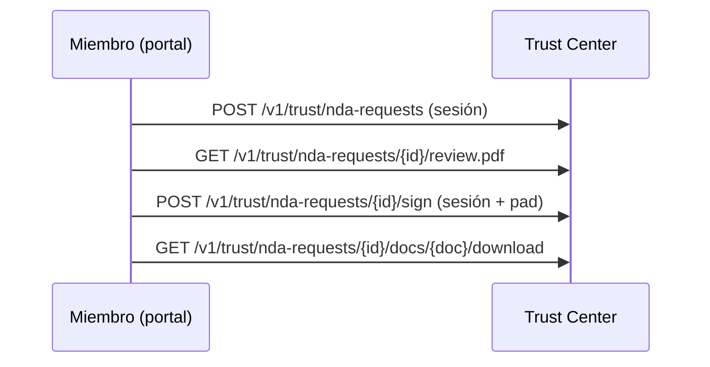

import { EnvUrls } from "/snippets/env-urls.jsx";

<EnvUrls lang="es" />

El Trust Center público en [cbpayapp.com/trust](https://www.cbpayapp.com/trust) lista registros públicos y explica cómo pedir acceso a la sala N2 restringida. La sala exige cuenta CBPay con KYC/KYB aprobado: cada solicitud, firma y descarga queda ligada a una identidad verificada y totalmente auditada. El flujo anónimo con token quedó cerrado para sobres nuevos (los accesos firmados existentes se revocaron; los links pendientes vencen solos).

La sala tiene 31 documentos: 7 programas propios (programa AML US, manual SPLAFT Perú, auditoría AML + plan Chile, UIF + SEPREC Bolivia, existencia Colombia), 14 reportes y certificados de proveedores recibidos por GRUPO CB LLC (Sophos C5, SOC 2, PCI AOC, análisis healthcare, ISO 27001, TX-RAMP Cloud/MDR, tarjetas NIST/CIS/PCI; Cloudflare C5, SOC 2, PCI AOC, ISO 27001) y 10 reportes PCI DSS/SAQ-A y escaneos ASV (Aperia, septiembre 2026). Los registros FINTRAC/PSP de Canadá son totalmente públicos y se descargan directo del sitio.

Pide solo lo que necesites: envía `document_ids` con los IDs elegidos del catálogo (ver `GET /v1/trust/nda-docs`). Omitido significa todos; una lista explícitamente vacía se rechaza. Descargas, panel de estado y email de completitud respetan la selección — lo fuera de ella responde 404 como si no existiera.

La firma captura tu rúbrica dibujada (o escrita) en el portal: se imprime en el bloque del NDA firmado y se adjunta al email de completitud. El PDF brandeado pre-firma se puede ver y descargar antes de firmar.



## Flujo

<Steps>
  <Step title="Solicita acceso">
    Autentícate con sesión de miembro de una cuenta verificada. Empresa, email y país salen de la cuenta aprobada (los valores repetidos deben coincidir exacto). Reintentar mientras está pendiente es idempotente.

```bash
curl -X POST https://api.qbank.cl/platform/v1/trust/nda-requests \
  -H 'Authorization: Bearer <MEMBER_JWT>' \
  -H 'Content-Type: application/json' \
  -d '{"contact_name":"Jordan Lee","purpose":"Evaluar controles de cumplimiento","locale":"es","document_ids":["us-aml-program","pci-saqa"]}'
```

Respuesta (`202`, o `200` con `idempotency_hit: true` al repetir):

```json
{"request_id":"4e7b1f3e-8b20-4ef8-9cc5-1bcb6d9b2a01","status":"pending_signature","expires_at":"2026-11-18T20:00:00Z","email_sent":true}
```
  </Step>
  <Step title="Lista los metadatos">
    Los metadatos son públicos; los bytes no.

```bash
curl https://api.qbank.cl/platform/v1/trust/nda-docs
```

Respuesta (`200`):

```json
{"documents":[{"id":"us-aml-program","title_es":"Programa AML EE.UU. (Grupo CB LLC, ene 2026)","pages":39,"sha256":"7d1df3be9f4a8b4bf88dce93a3b939f8a737f123cb60b8074442ca035cd6e940"}]}
```
  </Step>
  <Step title="Revisa y firma en el portal">
    Abre el PDF brandeado pre-firma y luego envía identidad del firmante, domicilio, aceptación y la rúbrica del pad. El registro societario sale de la cuenta verificada.

```bash
curl https://api.qbank.cl/platform/v1/trust/nda-requests/<REQUEST_ID>/review.pdf \
  -H 'Authorization: Bearer <MEMBER_JWT>' -o nda-revision.pdf
curl -X POST https://api.qbank.cl/platform/v1/trust/nda-requests/<REQUEST_ID>/sign \
  -H 'Authorization: Bearer <MEMBER_JWT>' \
  -H 'Content-Type: application/json' \
  -d '{"signer_name":"Jordan Lee","signer_title":"Chief Compliance Officer","company_address":"1 Main Street, Boston MA","accept":true,"signature_png":"data:image/png;base64,<firma-png>","signature_mode":"drawn"}'
```

Respuesta (`200`):

```json
{"request_id":"4e7b1f3e-8b20-4ef8-9cc5-1bcb6d9b2a01","status":"signed","download_token":"<32-hex-token>","download_url":"https://business.cbpayapp.com/trust?request=4e7b1f3e-8b20-4ef8-9cc5-1bcb6d9b2a01","expires_at":"2031-10-18T20:00:00Z"}
```
  </Step>
  <Step title="Consulta y descarga">
    Autentícate con tu sesión de miembro. Cada PDF incluye `X-Checksum-Sha256` y `Cache-Control: no-store`; toda entrega queda auditada.

```bash
curl https://api.qbank.cl/platform/v1/trust/nda-requests/<REQUEST_ID> -H 'Authorization: Bearer <MEMBER_JWT>'
curl -L -o documento-trust.pdf https://api.qbank.cl/platform/v1/trust/nda-requests/<REQUEST_ID>/docs/us-aml-program/download -H 'Authorization: Bearer <MEMBER_JWT>'
```

Respuesta de estado (`200`):

```json
{"request_id":"4e7b1f3e-8b20-4ef8-9cc5-1bcb6d9b2a01","status":"signed","signed_at":"2026-10-19T20:00:00Z","expires_at":"2031-10-18T20:00:00Z","documents":["us-aml-program"]}
```
  </Step>
</Steps>

## Estados y errores

| Estado | Significado | Acción |
|---|---|---|
| `pending_signature` | El sobre vence en 30 días. | Revisa y firma, o solicita de nuevo tras vencer. |
| `signed` | Descargas habilitadas por cinco años. | Descarga desde el portal con tu sesión. |
| `expired` | Venció la firma o la descarga. | Envía una nueva solicitud. |
| `revoked` | Compliance quitó el acceso de inmediato. | Contacta compliance o solicita de nuevo. |

Revisa el [catálogo de errores](/es/errors).

## Preguntas frecuentes

<AccordionGroup>
  <Accordion title="¿Necesito una cuenta CBPay?">Sí. La cuenta debe tener KYC/KYB aprobado; solicitudes, firmas y descargas quedan ligadas a la identidad verificada.</Accordion>
  <Accordion title="¿Sirven las API keys?">No para pedir ni firmar (exigen sesión de miembro logueado); sí para lecturas y descargas de la propia cuenta.</Accordion>
  <Accordion title="¿Puedo repetir la solicitud?">Sí. Mientras esté pendiente devuelve la solicitud existente y no crea otro sobre.</Accordion>
  <Accordion title="¿Qué significa email_sent?">`true` indica que el servicio de correo aceptó el envío; `false` indica que la solicitud existe pero la entrega falló. Nunca registres ni expongas tokens crudos.</Accordion>
  <Accordion title="¿Cuánto duran las descargas?">Cinco años desde la firma, salvo revocación anticipada de compliance.</Accordion>
</AccordionGroup>
