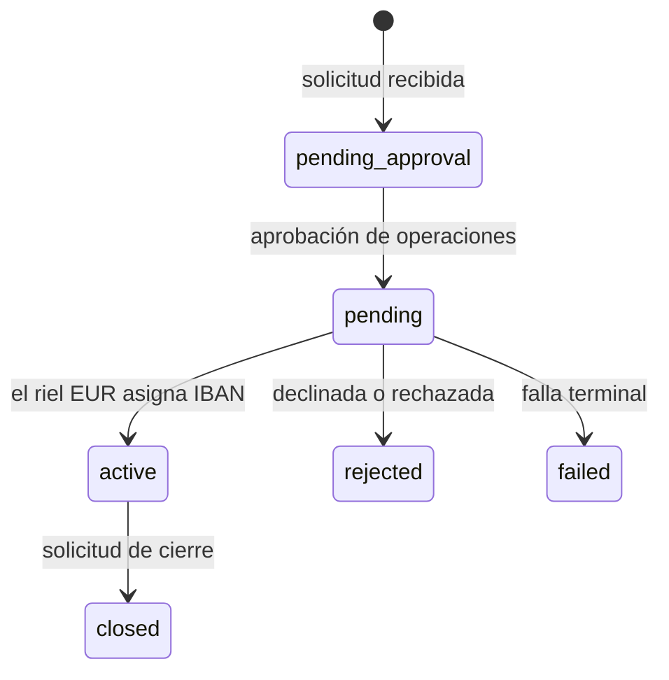

import { EnvUrls } from "/snippets/env-urls.jsx";

<EnvUrls lang="es" />

<Info>
Esta página explica el ciclo de vida y las fallas del vIBAN EUR. El contrato y
los ejemplos de solicitud siguen en [Banking](/es/guides/banking).
</Info>

## Ciclo de vida



| Estado | Significado | Qué hacer |
|---|---|---|
| `pending_approval` | Espera la aprobación de operaciones de la organización. | Lee la misma solicitud; no la dupliques. |
| `pending` | Fue aprobada localmente y espera al riel EUR. | Consulta el mismo recurso hasta un estado terminal. |
| `active` | El IBAN fue asignado y puede usarse para su propósito. | Lee el IBAN y usa el flujo de fondeo o Banking correspondiente. |
| `rejected` | Declinada o rechazada, con `last_error` saneado cuando está disponible. | Corrige la causa y crea una solicitud nueva con una clave nueva. |
| `failed` | Falla terminal de validación o asignación. | Corrige `last_error` y crea una solicitud nueva; nunca reintentes la fila terminal. |
| `disabled` / `closed` | La dirección ya no se puede usar. | No envíes fondos; solicita otra si la necesitas. |

`declined` se normaliza a `rejected`, un estado terminal; no queda pendiente.
Las solicitudes rechazadas o fallidas no crean un IBAN. Si se cobró una
comisión, se reembolsa automáticamente y queda registrada con el resultado.

## Comisiones y tiempos honestos

La comisión vigente de asignación del vIBAN EUR es **0**. La primera solicitud
`funding_usdt` es gratis. Una solicitud posterior es una solicitud nueva, no un
reintento de una solicitud terminal. No uses una clave nueva para adivinar el
resultado de una solicitud ambigua: primero reconcilia la solicitud existente.

No existe un plazo garantizado de activación. La aprobación de operaciones, la
revisión de compliance, los horarios de corte, fines de semana y feriados pueden
alargar `pending_approval` o `pending`. Usa GET o el listado con fechas para
reconciliar. No presentes una solicitud pendiente como un IBAN asignado.

## Validación antes del riel EUR

CBPay valida el registrant verificado antes del despacho. Los datos inválidos
devuelven `422 registrant_incomplete` con la ruta del campo faltante o inválido,
y no se envía ninguna solicitud al riel bancario. Las causas habituales son:

- las fechas deben ser válidas, usar `YYYY-MM-DD`, estar en el rango `19xx`/`20xx`
  y vencer en más de un mes;
- `taxNumber` es obligatorio y se valida para el país fiscal US; en países sin
  validador soportado se omite en vez de reenviar datos no verificados;
- cada UBO declarado necesita identidad, documento y un valor PEP explícito
  (`true` o `false`);
- la dirección necesita país, ciudad, calle y ZIP válidos (los países sin sistema
  postal usan el placeholder de ceros documentado).

Corrige el campo indicado por el 422 y envía una **solicitud nueva** de vIBAN.
No conviertas una falla terminal en un loop de reintentos.

## Reconciliar y resolver problemas

```bash
curl https://api.qbank.cl/platform/v1/banking/virtual-ibans/<id> \
  -H "Authorization: Bearer <token>"

curl "https://api.qbank.cl/platform/v1/banking/virtual-ibans?page=1&page_size=50&from=2026-11-01&to=2026-11-30" \
  -H "Authorization: Bearer <token>"
```

Lee `status` y `last_error`. `last_error` está saneado para integradores y es
la explicación accionable cuando el riel o la validación previa rechazan la
solicitud. Para los errores generales, revisa [Errores](/es/errors).

## Preguntas frecuentes

<AccordionGroup>
<Accordion title="¿Por qué declined pasó a rejected?">
`declined` es un resultado terminal del riel bancario. CBPay lo convierte en
`rejected` para que una solicitud no quede pendiente para siempre.
</Accordion>
<Accordion title="¿Puedo reintentar una solicitud failed?">
No. Corrige la causa de `last_error` y crea una solicitud nueva con una clave
de idempotencia nueva. Ante una respuesta ambigua, reconcilia la original.
</Accordion>
<Accordion title="¿Una solicitud rechazada me cobra?">
La comisión vigente es 0. Si una configuración cobró una comisión, se
reembolsa automáticamente al llegar a un rechazo o falla definitiva.
</Accordion>
<Accordion title="¿Cuánto demora la activación?">
No hay un plazo garantizado. Espera el estado terminal y reconcilia con GET;
no asumas un SLA fijo.
</Accordion>
</AccordionGroup>
