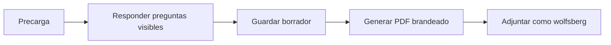

import { EnvUrls } from "/snippets/env-urls.jsx";

<EnvUrls lang="es" />

## Completar el cuestionario

El onboarding de empresas incluye el cuestionario Wolfsberg CBDDQ v1.4:
15 secciones, preguntas condicionales y una declaración final. Solo muestra
las preguntas activadas por tus respuestas y el progreso cuenta las visibles.

El formulario precarga datos coincidentes del perfil de la empresa y guarda
un borrador local mientras avanzas. Revisa cada valor precargado: es una
sugerencia, no una decisión de compliance.

Selecciona **Generar PDF** para crear el archivo brandeado
`wolfsberg-cbddq-v1.4-*.pdf`. El PDF terminado se adjunta a la submission KYB
nativa con categoría `wolfsberg`. Si falla la carga, reintenta desde el
borrador sin responder de nuevo.

<AccordionGroup>
  <Accordion title="¿Puedo enviar el cuestionario incompleto?">
    No. Completa todas las preguntas visibles obligatorias y la declaración
    final.
  </Accordion>
  <Accordion title="¿Puedo editarlo después de generar el PDF?">
    Sí. Genera y sube la última versión; el expediente sigue siendo el mismo.
  </Accordion>
  <Accordion title="¿Reemplaza los demás antecedentes KYB?">
    No. Es una categoría de evidencia solicitada.
  </Accordion>
</AccordionGroup>

Consulta el [catálogo de errores](/es/errors) si falla la carga del PDF.
