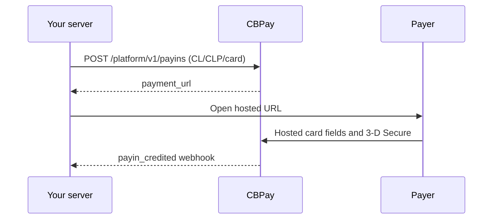

> **Environments:** Test `https://cryptobank.qbank.cl/platform` (`pk_test_...`) - Live `https://api.qbank.cl/platform` (`pk_...`).

Use this corridor when a payer in Chile needs to pay by card in CLP. Your
server creates the payin; CBPay returns a hosted `payment_url`. Open it in a
popup or redirect. Card data stays in the hosted fields and 3-D Secure runs
inside the checkout modal when the issuer requests it.



## Create the payin

```bash
curl -X POST https://api.qbank.cl/platform/v1/payins \
  -H "Authorization: Bearer <token>" \
  -H "Idempotency-Key: cl-card-order-8841" \
  -H "Content-Type: application/json" \
  -d '{"country":"CL","currency":"CLP","method":"card","amount":"150000","description":"Order 8841","idempotency_key":"cl-card-order-8841"}'
```

```json
{
  "payin_id": "7a2b…",
  "status": "pending",
  "country": "CL",
  "currency": "CLP",
  "method": "card",
  "amount": "150000",
  "payment_url": "https://api.qbank.cl/pay/cards/9f3XkT…"
}
```

`idempotency_key` is mandatory in the body or `Idempotency-Key` header.
CLP is an integer currency: `"150000.50"` returns `400 invalid_amount`.
Replaying the same key returns the original payin with
`idempotency_hit: true`; never create a second key after an ambiguous result.

## Hosted checkout and stored cards

Open `payment_url` in a popup. The checkout shows the waiting modal only for
`CL/CLP/card`, validates the integer CLP amount before submit, and reports
availability with a status indicator. Saving a card requires both the
integrator's offer and the payer's consent. Later one-click and merchant-
initiated charges use the server-side stored-card endpoint; the PAN is never
sent to your server.

The universal checkout quotes `CL/CLP/card` when the catalog reports it as
available. Always read `GET /platform/v1/payins/methods` before showing the
option.

### Payer document (optional)

For card payins, `customer` is sent to the core as `bill_to`. You may provide
`document_type` and `document_number` for fraud scoring. The document is
optional: omitting both fields is valid. For `CL`, `document_type` defaults to
`RUT` when a number is present and `document_number` must be a valid Chilean
RUT (modulo 11, with or without punctuation). An invalid RUT is rejected
before the charge claim with `400 invalid_payload`. Other countries accept
plain text up to 50 characters; markup and longer values are rejected.

```json
{
  "customer": {
    "first_name": "Ana",
    "last_name": "Rojas",
    "email": "payer@example.com",
    "country": "CL",
    "document_type": "RUT",
    "document_number": "11.111.111-1"
  },
  "save_card": true
}
```

### Knowing whether the card was saved

When `save_card: true` was offered and the payer consented, an approved
`complete` response includes `card_saved`. `true` means the credential was
stored and can be used through the stored-card flow. `false` means the sale
was approved but the card was not stored; show a clear message and do not
charge the payer again. The field is omitted when saving was not offered or
requested.

## Read, void, and refund

```bash
curl https://api.qbank.cl/platform/v1/payins/7a2b… \
  -H "Authorization: Bearer <token>"
curl "https://api.qbank.cl/platform/v1/payins?from=2026-11-01&to=2026-11-30&country=CL&currency=CLP&method=card&page=1&page_size=50" \
  -H "Authorization: Bearer <token>"
```

An authorized card payment can be voided before settlement. A refund is
semi-automatic: creation may return `pending`, and a signed notification
closes it. Both operations require idempotency and never retry an ambiguous
dispatch automatically.

| Status | Meaning |
|---|---|
| `pending` | Hosted payment is waiting for the payer |
| `credited` | Payment was confirmed and credited |
| `failed` | The payment was clearly rejected |
| `refunded` | The refund was confirmed |
| `review` | Reconciliation is required; do not submit another charge |

## Errors

| HTTP | Code | Solution |
|---:|---|---|
| 400 | `invalid_amount` | Send an integer CLP amount |
| 400 | `idempotency_key_required` | Send the body field or header |
| 409 | `idempotency_conflict` | Use the original payload with the original key |
| 422 | `core_rejected` | Show the hosted failure and do not blind-retry |
| 503 | `core_unavailable` | Read the payin and retry only with the same key |

## Webhooks

Verify the signature before processing. Relevant events are
`payin_credited`, `payin_refunded`, `dispute`, and `card_stored`.

```json
{
  "event": "payin_credited",
  "payin_id": "7a2b…",
  "country": "CL",
  "currency": "CLP",
  "amount": "150000",
  "status": "credited"
}
```

## FAQ

#### Can I send decimal CLP?
No. Chilean pesos have no decimal minor unit; send an integer string.
#### What if the create request times out?
Read the resource or repeat the request with the same idempotency key. Do
not submit a new charge.
#### When is a refund final?
A refund can remain `pending` until the signed notification confirms it.
