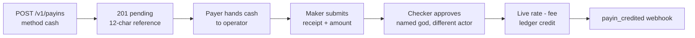

> **Environments:** Test `https://cryptobank.qbank.cl/platform` (`pk_test_...`) - Live `https://api.qbank.cl/platform` (`pk_...`).

## Cash payins (announced, in-person delivery)

`method: "cash"` creates an announced `push` payin. CBPay does not expose a deposit account or `deposit_instructions`: the payer hands the exact local-currency amount to the operator and quotes the 12-character `reference`. The payin remains `pending` until the maker-checker confirmation completes.



| Country | Currency | Method | Delivery |
|---|---|---|---|
| CL | CLP | `cash` | announced-only (in-person) |
| PE | PEN | `cash` | announced-only (in-person) |
| MX | MXN | `cash` | announced-only (in-person) |
| VE | VES | `cash` | announced-only (in-person) |
| BO | BOB, USD | `cash` | announced-only (in-person) |
| US | USD | `cash` | announced-only (in-person) |
| PY | PYG | `cash` | announced-only (in-person) |
| CO | COP | `cash` | announced-only (in-person) |
| EC | USD | `cash` | announced-only (in-person) |
| BR | BRL, BOB | `cash` | announced-only (in-person) |
| AR | ARS | `cash` | announced-only (in-person) |

### Announce the cash payment

```bash
curl -X POST https://api.qbank.cl/platform/v1/payins \
  -H "Authorization: Bearer <token>" -H "Content-Type: application/json" \
  -d '{"country":"CL","currency":"CLP","method":"cash","amount":"50000","payer_name":"Ana Perez","idempotency_key":"cash-cl-001"}'
```

```json
{"payin_id":"11111111-2222-4333-8444-555555555555","status":"pending","reference":"A1B2C3D4E5F6","note":"hand the cash to the operator quoting the reference; the deposit is credited once the operator confirms receipt","payer_name":"Ana Perez","payer_source":"declared"}
```

Replay the same key to receive HTTP `200` with `idempotency_hit: true`. Do not send a second announcement after a timeout.

### Confirmation and webhooks

The org-admin maker sends `POST /v1/payins/{payinID}/confirm-received` with `{"bank_reference":"CL-CASH-REC-001","received_amount":"50000"}`. Despite the field name, `bank_reference` is the operator folio or receipt number; this step only records evidence. A different named god checker sends `POST /v1/payins/{payinID}/confirm-approve` with no body. `GET /v1/payins/{payinID}` and `GET /v1/admin/approvals` expose `confirm_request` and `kind: "payin_manual_confirm"`. The maker or a god may cancel with `POST .../confirm-cancel`; cancellation never credits. On approval the live rate and fee are applied, then the normal `payin_credited` webhook is sent.

### Errors

See the complete [error reference](https://docs.cbpayapp.com/en/errors) for all API errors.

| HTTP/code | Meaning | Action |
|---|---|---|
| 400 `invalid_request` | `country` or `currency` is missing | Send both fields. |
| 422 `invalid_request` | `method cash is not available for country X / currency Y` | Read `GET /v1/payins/methods` and use an enabled cash corridor. |
| 422 `amount_below_minimum` | The fixed fee makes the announced amount non-creditable | Increase the local amount. |
| 409 `idempotency_conflict` | The key was used with another method or payload | Read the original payin; do not create a second announcement. |
| 409 `corridor_disabled` | The corridor kill-switch is off | Wait for operations to enable the corridor. |
| 409 `bank_ref_conflict` | The receipt/folio is already claimed by another operation | Stop and use the original operation; never reuse the folio. |
| 409 `confirm_request_conflict` | A different evidence request is already pending | Read `confirm_request`, cancel or resolve that request; do not submit another. |
| 409 `invalid_state` | The payin is no longer `pending` when approving or cancelling | Re-read the payin and pending request, then follow its current state. |
| 403 `named_admin_required` | The checker is not a named god admin | Use a named god in a human admin session. |
| 409 `confirm_account_mismatch` | The account changed since the maker request | Re-read the payin and submit a new evidence request only if still eligible. |

### Expiry and confirmation request lifetime

The cash announcement is a normal `push` payin: if it remains pending for 24 hours, the expiry sweep changes it to `expired` and emits `payin_expired`. A late physical receipt is not credited to that expired announcement; operations must open a **new** announcement for it (cash never produces automatic `unassigned` rows — there is no provider event to park). The maker confirmation request has **no system TTL**: its timeout is operational. It dies with the payin, so after announcement expiry the checker receives `409 invalid_state` and the expired payin is hidden from the pending approvals list.

### Query and history

```bash
curl https://api.qbank.cl/platform/v1/payins/{payinID} -H "Authorization: Bearer <token>"
curl "https://api.qbank.cl/platform/v1/payins?from=2026-10-01&to=2026-10-24&status=pending&country=CL&method=cash" -H "Authorization: Bearer <token>"
```

Use the detail endpoint for `confirm_request` (org-admin and platform roles only — account-level callers never see the block); use the list endpoint with `from`, `to`, `status`, `country` and `method` for history.

### States

| State | Meaning | Action |
|---|---|---|
| `pending` | Announcement or confirmation is awaiting action | Deliver cash, or complete maker-checker. |
| `credited` | Checker approval applied live pricing, fee and ledger credit | Reconcile the balance and webhook. |
| `unassigned` | Does not occur for cash (no provider events to park) | If cash was received, open a new announcement instead. |
| `expired` | The 24-hour push announcement ended without credit | Do not approve it; reconcile any late receipt separately. |
| `failed` | The operation could not complete | Read the failure code and follow operations; do not blindly create a duplicate. |

### `payin_credited` webhook

```json
{"payin_id":"11111111-2222-4333-8444-555555555555","account_id":"66666666-7777-4888-8999-000000000000","country":"CL","currency":"CLP","local_amount":"47500","fx_rate":"950.00","rate_source":"lot","usdt_credited":"49.500000","fee":"0.500000"}
```

#### Does cash return deposit instructions?No. Delivery is physical, so the response has no `deposit_instructions`.
#### Does confirm-received credit the balance?No. Only the separate checker approval credits the account.
#### When does a cash announcement expire?After 24 hours while still pending. The maker request itself has no system TTL; it is hidden and cannot be approved once its payin expires.
