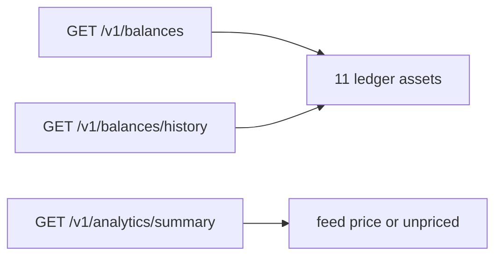

> **Environments:** Test `https://cryptobank.qbank.cl/platform` (`pk_test_...`) - Live `https://api.qbank.cl/platform` (`pk_...`).

CBPay accounts now expose four local-fiat ledger assets: **BOB**, **MXN**,
**ARS** and **CLP**. They are independent balances; BOB/MXN/ARS use two
decimal places and CLP uses zero decimals
(minor units), and appear alongside USD, USDT, USDC, BTC, GOLD, SILVER and
PLATINUM.

**CLP is a fiat-ledger asset.** Banking holds local CLP and exposes a derived
balance per instrument. CLP amounts are whole pesos: any non-zero fractional
digit is rejected with `400 invalid_amount`. Same-asset internal transfers are
allowed, and CLP payout settlement is selectable only when the payout currency
is also CLP: the debit is same-currency identity with zero settlement spreads.



## Where fiat assets appear

The following account endpoints include the four local-fiat assets:

- `GET /v1/balances`: always returns all eleven ledger assets, including zero
  rows. BOB/MXN/ARS use two decimals; CLP uses zero decimals, for example
  `"125.40"` or `"125"`.
- `GET /v1/balances/history`: includes a daily series for each fiat asset.
  The `available` balance is tracked; held amounts are exposed by the
  current snapshot.
- `GET /v1/analytics/summary`: includes fiat balances and volumes when they
  exist. USD valuation uses the organization rate feed (`1 / local-per-USD`);
  if no valid rate exists, the asset is reported as unpriced and excluded
  from USD totals.

```json
{
  "account_id": "9b1deb4d-3b7d-4bad-9bdd-2b0d7b3dcb6d",
  "balances": [
    { "asset": "BOB", "available": "15000.00", "held": "0.00" },
    { "asset": "MXN", "available": "0.00", "held": "0.00" },
    { "asset": "ARS", "available": "0.00", "held": "0.00" },
    { "asset": "CLP", "available": "0", "held": "0" }
  ]
}
```

## Transfers

`POST /v1/transfers` permits a same-asset transfer when the source and
destination accounts use the same asset. A fiat transfer keeps its two-decimal
precision; CLP keeps zero-decimal peso precision. It is not implicitly
converted to USDT or another currency.

## Product gates in v1

The ledger registration does not mean every product can spend fiat:

| Product | BOB/MXN/ARS in v1 |
|---|---|
| Account balances, history and analytics | Supported; CLP is valued through the configured feed when available, otherwise reported as `unpriced` |
| Same-asset internal transfers | Supported |
| Payout settlement asset and organization defaults | Same-currency CLP payout settlement is supported with identity rate and zero spreads; cross-currency fiat returns `503 pricing_unavailable` |
| Swaps and manual/automatic conversion | CLP is rejected with `400 invalid_pair` or `400 invalid_asset`; no FX pricing exists |
| Checkout and POS | CLP denomination is rejected with `400 invalid_asset` |
| Cards | CLP spending is rejected with `400 spending_asset_unavailable` |
| `default_payin_asset` | CLP is rejected with `400 invalid_asset`; no automatic conversion path exists |

This separation is intentional: a balance can exist in the ledger before a
pricing or external settlement path is available.

## Errors and precision

Amounts are decimal strings. `1.50` BOB means 150 minor units; `1.234` BOB,
MXN or ARS is rejected, and `"100.50"` CLP is rejected because CLP has no
minor unit. A fiat settlement request may be syntactically valid
but cross-currency fiat settlement still returns `503 pricing_unavailable`
because no FX pricing path exists.

#### Does adding a fiat asset change my default settlement asset?
No. Your default is unchanged. A fiat asset is only used
when explicitly enabled and accepted by the relevant product gate.
#### Can I use a fiat balance to pay a card purchase?
No. Cards reject fiat spending assets in v1; the balance remains visible and
usable by the products listed as supported above.
